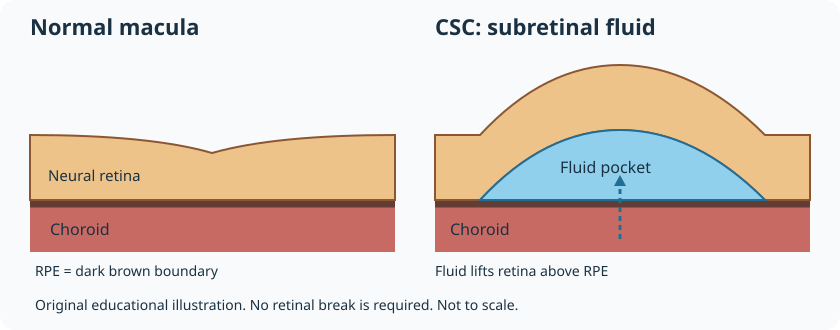

# 📚 Central Serous Chorioretinopathy (CSC) — Nursing Concepts

**Study-ready, not studied.** Original nursing teaching. Specialist imaging and therapy evidence are enrichment, not a claim of mandatory NORCET syllabus.

[Chapter](../README.md) · [30 original MCQs](../MCQs/Central-Serous-Chorioretinopathy-30-MCQs.md) · [Exam evidence](../Previous-Year-Questions/Central-Serous-Chorioretinopathy-Exam-Evidence.md)

## Mechanism

Retina aankh ki light-sensitive layer hai. Iske neeche retinal pigment epithelium (RPE) naam ki thin supporting cell layer hoti hai. RPE photoreceptors ko support karti hai aur subretinal space se fluid ko choroid ki taraf transport karne mein help karti hai. Choroid retina ke bahar vascular layer hai.

CSC mein choroidal circulation aur RPE barrier/pump ke function mein changes contribute karte hain. Exact cause completely established nahi hai. Choroid ki vessels se increased leakage aur pressure ke saath RPE barrier fail ho sakta hai. Fluid neural retina ke neeche collect hota hai. Central retina dome ki tarah lift ho sakti hai. Isko localized serous neurosensory detachment kehte hain. Ismein retinal tear hona zaroori nahi hai.

Ek waterproof floor ke neeche dampness imagine karo. Agar neeche ka pressure aur barrier ki problem ke kaaran paani upar collect ho, toh floor ki upper sheet thodi lift ho sakti hai. Ye analogy fluid accumulation samajhne ke liye hai. Retina mein actual living cells aur fluid transport involved hain.

*Diagram educational hai. Choroid, RPE aur fluid ke upar lifted neural retina ko simplify karke dikhaya gaya hai. Actual OCT nahi hai.*

## Risk and medication history

CSC often young aur middle-aged adults mein detect hoti hai. Men more commonly affected hote hain, lekin women aur older patients mein bhi possible hai. Corticosteroid exposure important modifiable association hai. Oral tablets, injections, inhalers, nasal sprays aur skin creams ki history lo. Patient ko pata nahi bhi ho sakta ki cream mein steroid hai. Product name, route, duration, reason aur prescriber record karo.

Agar patient prescribed steroid le raha hai toh khud se abruptly stop karne ki advice mat do. Long-term systemic steroid suddenly stop karna adrenal insufficiency aur underlying illness flare ka risk create kar sakta hai. Ophthalmologist aur treating prescriber milkar safe change ya taper decide karenge. Stress, hypertension, pregnancy aur endogenous cortisol excess ke associations reported hain. Stress ko sole cause ya patient ki galti mat batao.

Pregnant patient mein new visual disturbance ko CSC assume nahi karna chahiye. BP, headache, other obstetric warning symptoms aur urgent maternal assessment ki need check karo. Preeclampsia aur hypertensive choroidopathy bhi serous fluid cause kar sakte hain.

## Symptoms and assessment

Central blur, grey/dim central patch, distorted lines aur micropsia report ho sakti hai. Micropsia mein object chhota lagta hai. Kabhi near focus ya contrast perception bhi disturb hoti hai. Peripheral retina relatively preserved ho sakti hai. Ek eye symptomatic ho aur doosri eye mein silent changes possible hain.

Har eye ki acuity separately document karo. Symptom onset, progression, recurrence, medication history aur work impact record karo. Acute major vision loss, new flashes/floaters ya curtain ko established CSC ka harmless symptom assume mat karo. Urgent ophthalmology review arrange karo.

## Imaging and differential

OCT mein neural retina aur RPE ke beech dark fluid pocket dikhta hai. Pigment epithelial detachment (PED) mein RPE apni underlying boundary se elevate hoti hai. PED aur subretinal fluid same anatomical location nahi hain, dono coexist kar sakte hain. Enhanced-depth OCT choroid ko better evaluate kar sakta hai. Thick choroid association hai, diagnosis ka universal cutoff nahi.

Fluorescein angiography (FA) mein focal leak ka ink-blot pattern commonly describe hota hai. Smoke-stack pattern classic hai lekin har CSC mein present nahi hota. Indocyanine green angiography (ICGA) choroidal vascular abnormalities evaluate karne mein useful ho sakti hai. Fundus autofluorescence (FAF) RPE-related alterations document karti hai. OCT angiography (OCTA) abnormal neovascular flow network identify karne mein useful hai, lekin dye leakage ko directly show nahi karti.

| Condition | Distinguishing feature |
|---|---|
| CSC | Choroid/RPE dysfunction with localized subretinal fluid |
| Rhegmatogenous detachment | Retinal break se fluid retina ke neeche enter karta hai |
| Diabetic macular edema | Retinal vascular leakage often intraretinal edema cause karti hai |
| Macular neovascularization (MNV) | Abnormal vascular network se exudation ho sakti hai. CSC ke saath coexist bhi kar sakti hai |
| Hypertensive choroidopathy | Severe BP-related choroidal injury se serous detachment ho sakti hai |

Single OCT image se har cause establish nahi hota. Retina specialist history, dilated examination aur multimodal imaging integrate karta hai.

## Course and treatment

Many acute cases spontaneously improve karte hain. 2024 treatment guideline ke according selected acute cases mein treatment 3–4 months tak defer kiya ja sakta hai under specialist follow-up. Ye universal waiting rule nahi hai. Selected patients mein earlier intervention helpful ho sakta hai. Persistent or recurrent fluid RPE aur photoreceptors ko damage kar sakta hai. Dry OCT ke baad bhi contrast ya visual function fully normal na ho sakta hai.

2025 APVRS/AAPPO/ARI expert consensus chronic CSC ke liye half-dose photodynamic therapy (PDT) ko preferred first-line therapy endorse karta hai. PDT mein intravenous photosensitizer verteporfin ko targeted nonthermal light se activate karte hain. Choroidal hyperpermeability ko reduce karna intended effect hai. Exact dose, fluence, selection aur regulatory status specialist decide karta hai. CSC use US label mein listed indication nahi hai. Local availability aur authorization check karo.

Selected extrafoveal focal leaks mein conventional thermal laser consider ho sakta hai, particularly when PDT unavailable. Foveal thermal injury permanent central scotoma cause kar sakti hai. Micropulse treatment selected alternative ho sakta hai, lekin PLACE trial mein half-dose PDT better fluid outcomes se associated thi. VICI trial ne eplerenone ka placebo par superiority establish nahi kiya. Isliye routine CSC therapy ke liye eplerenone recommend mat karo. Anti-VEGF uncomplicated CSC ki routine therapy nahi hai, par coexisting MNV mein appropriate ho sakti hai.

## PDT nursing and follow-up

PDT se pehle medicine reconciliation, allergies, contraindications aur IV line patency check karo. Verteporfin product label mein porphyria aur known hypersensitivity contraindications hain. Infusion ke dauran site swelling/pain aur systemic allergic signs monitor karo. Extravasation suspect ho toh infusion immediately stop karke local protocol follow karo. Site ko direct light se protect karo aur prescriber ko notify karo. Anaphylaxis suspect ho toh infusion stop aur emergency response activate karo.

US product label ke according verteporfin ke baad 5 din direct sunlight aur bright indoor light se skin/eyes protect karni hoti hain. Ordinary ambient indoor light allowed aur useful hai. Complete darkness ki advice nahi deni hai. Sunscreen alone visible light reaction prevent nahi karta. Protective clothing, sunglasses aur treating team ke local product-specific instructions teach-back se verify karo. Urgent medical care delay nahi karni. Emergency clinicians ko recent verteporfin exposure batao.

Follow-up OCT date aur symptoms document karo. Recurrent fluid ke possibility samjhao. Stress management, adequate sleep aur prescribed BP follow-up support kar sakte hain, lekin retinal review ka substitute nahi hain. Steroid taper sirf authorized clinician ke plan ke according ho.

## Clinical examples

**Example 1:** Asthma patient nasal spray aur inhaler use karta hai. CSC detect hone par nurse medicine names note karti hai aur respiratory team se coordinated review arrange karti hai. Breathing treatment abruptly discontinue nahi karvati.

**Example 2:** Chronic CSC mein fluid persist ho raha hai. Patient eplerenone ke old article ko lekar aata hai. Nurse current evidence aur retina specialist discussion ki importance samjhati hai. Drug independently prescribe nahi karti.

**Example 3:** PDT ke baad patient sunscreen lagakar midday sunlight mein jaane ka plan banata hai. Nurse visible light sensitivity explain karti hai aur product-specific protective clothing aur light restrictions check karvati hai.

## ▶️ Teaching and dedicated practice

[Central Serous Chorioretinopathy Explained Simply — Dr. Alexandre Rosa and Dr. Gabriel Botelho](https://www.youtube.com/watch?v=c4Fa8TxoMxA), indexed description confirms teaching on diagnosis/treatment. Direct playback not verified. Q1–30 specific dedicated MCQ practice pending. Teaching link not counted as MCQ coverage.

## Clinical references

- [ASRS patient information](https://www.asrs.org/patients/retinal-diseases/21/central-serous-chorioretinopathy) — direct text retrieved.
- [2024 evidence-based treatment guideline](https://pubmed.ncbi.nlm.nih.gov/38301969/) — indexed abstract, PubMed direct view blocked.
- [2025 Asia-Pacific consensus](https://pubmed.ncbi.nlm.nih.gov/41106484/) — indexed abstract, direct PubMed view blocked.
- [EyeWiki CSC](https://eyewiki.aao.org/Central_Serous_Chorioretinopathy) — indexed text.
- [2025 treatment recommendations](https://www.nature.com/articles/s41433-025-03894-z) — indexed text.
- [DailyMed verteporfin label](https://dailymed.nlm.nih.gov/dailymed/drugInfo.cfm?setid=2f0a34ce-3c57-4ac8-b28e-512be807272f) — indexed safety instructions.
- [StatPearls](https://www.ncbi.nlm.nih.gov/books/NBK558973/) — indexed extracts, direct page CAPTCHA.
