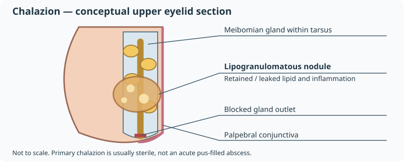

# 📚 Chalazion — detailed Roman Hinglish nursing concepts

**Study-ready, not studied.** [Chapter](../README.md) · [30 original MCQs](../MCQs/Chalazion-30-MCQs.md) · [Exam evidence](../Previous-Year-Questions/Chalazion-Exam-Evidence.md) · [Stye](Stye-Hordeolum-Concepts.md)

## Mechanism and pathology

Meibomian glands tarsal plate ke andar oil banati hain. Is oil ko meibum kehte hain. Jab gland ka outlet block hota hai, secretion retain ho sakti hai aur adjacent tissue mein leak kar sakti hai. Immune cells lipid ko foreign material ki tarah handle karte hain. Macrophages, epithelioid cells aur multinucleated giant cells ke saath chronic lipogranulomatous inflammation develop hoti hai. Isko chalazion kehte hain. Ye true epithelial-lined cyst nahi hai, though common name meibomian cyst hai. Primary process generally sterile hota hai. Secondary infection possible hai.

Deep chalazion meibomian gland se originate hota hai. Superficial or marginal chalazion Zeis gland se associated ho sakta hai. Upper lid mein meibomian glands zyada hain, isliye chalazia commonly upper lid involve kar sakte hain. Lower lid bhi affected ho sakta hai. Multiple gland obstruction se multiple nodules possible hain.

## Assessment and visual effects

Typical history weeks or months mein gradually developing firm lump hai. Initially inflammatory tenderness possible hai, later painless nodule common hai. Stye acute infection comparison pichhle topic mein covered hai. Size, exact lid and location, duration, recurrence at same site, previous procedures, visual symptoms and lid closure record karo. Clinician lid eversion and slit-lamp evaluation se tarsal lesion aur gland orifices assess karta hai. Thick retained gland secretion underlying meibomian dysfunction ka clue ho sakti hai.

Large upper lid chalazion cornea par pressure exert kar sakta hai. Corneal curvature change hone se induced astigmatism aur blurred vision develop ho sakti hai. Large mass mechanical ptosis ya incomplete eyelid closure cause kar sakta hai. Young children mein visual-axis obstruction or induced refractive blur prolonged rahe toh amblyopia risk hai. Children with significant vision effects need timely ophthalmology assessment, routine months-long observation nahi.

## Atypical lesions and biopsy

Typical small chalazion clinical diagnosis hota hai. Har case mein routine imaging or laboratory test necessary nahi. Elderly patient mein recurrent same-site nodule, lash loss (madarosis), atypical vascularity, ulceration, abnormal lid-margin architecture ya persistent unilateral inflammation malignancy ke warning clues ho sakte hain. Sebaceous carcinoma chalazion ya chronic blepharitis mimic kar sakta hai. Red flag se cancer automatically diagnose nahi hota, but prompt specialist evaluation and appropriate biopsy needed ho sakti hai. Suspicious lesion ko repeated steroid injection se mask nahi karna. Histopathology benign lipogranuloma aur neoplasm differentiate karti hai. Tissue specimen surgeon instructions aur laboratory protocol ke according label and transport karo.

## Conservative management

Small asymptomatic lesion spontaneous resolve ho sakti hai over weeks to months. Comfortable warm compress and gentle lid massage gland drainage help kar sakte hain. Compress technique aur thermal safety stye chapter mein detailed hai. Chalazion ko squeeze ya puncture nahi karna. Primary sterile lesion mein antibiotic routinely indicated nahi. Associated blepharitis, rosacea/MGD or secondary infection ka treatment separate indication hai. Selected recurrent MGD/rosacea mein systemic anti-inflammatory treatment clinician consider kar sakta hai. Har nodule ko bacterial abscess assume karna inappropriate hai.

Refer for persistent, large, symptomatic or atypical lesions, significant visual effects, recurrent infection or lid function impairment. Mizoram 2025 STG persistent large lesions ke liye procedure examples describe karti hai. UK EBI 2024 pathway elective intervention ke liye 6-month duration plus 4-week conservative care criterion list karti hai, but visual impact, suspected malignancy, abscess, impaired closure and repeated infection are exceptions. Ye UK resource-allocation criterion universal clinical waiting period nahi. Indian local clinical pathway and ophthalmologist decision follow karo. AB-HWC manual surgical referral discuss karta hai, but not every uncomplicated chalazion requires surgery.

## Procedures and nursing

Persistent typical chalazion mein incision and curettage (I&C) ya selected intralesional corticosteroid injection options hain. Steroid infection exclude aur suspicious lesions assess karne ke baad specialist administer karta hai. Local risks include skin pigment change, fat atrophy, raised IOP and rare serious ocular injury. Patient ko benefit, alternatives, recurrence aur risks explain karo. Procedure-specific consent verify karo. Near punctum lesion mein drainage system injury risk ke wajah se clinician technique carefully select karta hai.

I&C mein clinician local anesthesia, lid clamp and often inner conjunctival approach se retained inflammatory material remove karta hai. Conjunctival approach anterior skin scar avoid kar sakta hai. Surgeon approach lesion location se decide karega. Nurse identity, correct lid and side, allergies, medication history including anticoagulants, procedure order, consent and aseptic equipment check kare. Anticoagulants khud stop karne ko advise mat karo. Clamp tissue stabilize aur bleeding control mein help karta hai, clinician use karta hai. Suspicious or recurrent tissue histopathology ke liye send karo, pathology and microbiology sample handling distinct hai.

After procedure mild bruising, swelling and discomfort possible hain. Residual nodule immediately disappear hona necessary nahi. Prescribed dressing, medication and follow-up instructions follow karo. Significant bleeding, increasing pain, worsening swelling, purulent discharge, fever or sudden vision change urgent review require karte hain. Eye rubbing aur unapproved contact lens use avoid karo. Recurrence possible hai, so persistent symptoms reassess karo.

## Prevention and follow-up

Underlying MGD, rosacea and blepharitis risk factors hain. Lid hygiene and gentle massage patient education individualize karo. Recurrent multiple lesions mein medication history, including bortezomib exposure, and systemic history clinician review kare. Medication association diagnosis prove nahi karti, prescribed cancer treatment independently stop nahi karna. Follow-up mein lesion size and lid closure, visual function, adherence and suspicious features document karo. Young patient mein visual development assessment coordinate karo.

## ▶️ Teaching and MCQ practice

[Smart Optometry with Samir — Chalazion management](https://www.youtube.com/watch?v=f2fkJvIteIM) indexed teaching title. [Eyelid ophthalmology high-yield MCQs](https://www.youtube.com/watch?v=0tTcBtFP0nU) prior indexed eyelid-topic practice lead, not verified chalazion-specific question coverage. [Shubham Sir eye-disorders session](https://www.youtube.com/watch?v=GCMk4wrOvBg) broad nursing practice lead, no specific item mapping. Exact video playback and dedicated nursing coverage pending.

## References

- [EyeWiki Chalazion](https://eyewiki.aao.org/Chalazion) — retrieved clinical text.
- [Mizoram Health and Family Welfare STG 2025](https://hfwmizoramstg.in/guidelines/chalazion) — retrieved.
- [EBI UK chalazia removal, reviewed 2024](https://ebi.aomrc.org.uk/interventions/chalazia-removal/) — retrieved, distinguish commissioning criteria from individual clinical decisions.
- [AAO sebaceous carcinoma](https://www.aao.org/eyenet/article/diagnosis-management-of-sebaceous-carcinoma-of-eye) — indexed.
- [Merck Professional 2026](https://www.merckmanuals.com/professional/eye-disorders/eyelid-and-lacrimal-disorders/chalazion-and-hordeolum-stye) — retrieved in preceding stye package.
- [HP NHM AB-HWC staff nurse manual](https://nhm.hp.gov.in/storage/app/media/uploaded-files/Eye%20Care%20Training%20Manual%20for%20Staff%20Nurse%20at%20AB-HWC.pdf) — text retrieved in preceding package, screenshot failed.
