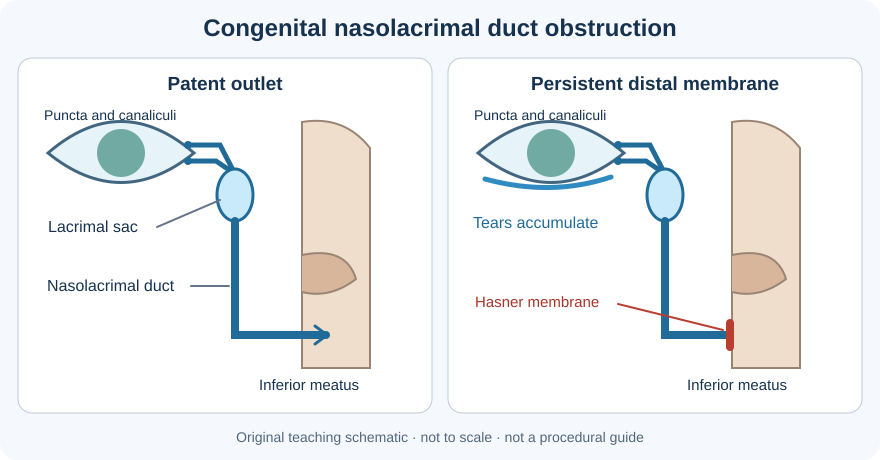

# 📚 Congenital nasolacrimal duct obstruction (CNLDO)

**Study-ready, not studied.** [Chapter](../README.md) · [30 original MCQs](../MCQs/Congenital-Nasolacrimal-Duct-Obstruction-30-MCQs.md) · [Exam evidence and practice gaps](../Previous-Year-Questions/Congenital-Nasolacrimal-Duct-Obstruction-Exam-Evidence.md)

[Mechanism](#mechanism) · [Assessment](#assessment) · [Conservative care](#conservative-care) · [Complications](#complications) · [Intervention](#intervention) · [Follow-up](#follow-up)

## mechanism

**🟠 HIGH YIELD — Baby ki eye watery kyun hoti hai?** Tears eye ki surface ko moist rakhti hain. Normal drainage inner eyelid ke puncta se canaliculi, lacrimal sac aur nasolacrimal duct ke through nose tak hoti hai. Duct ka distal opening inferior turbinate ke neeche inferior meatus mein hota hai. Valve of Hasner ke region mein ek membrane birth ke baad persist kar sakti hai. Agar opening patent nahi hui toh tear fluid drain hone ke bajaye surface par accumulate hota hai. Isko congenital nasolacrimal duct obstruction kehte hain.

Ye simple distal membrane common cause hai, lekin har CNLDO same anatomy ki nahi hoti. Punctum absent ho sakta hai, canaliculi abnormal ho sakte hain ya bony narrowing ho sakti hai. Complex anatomical problems specialist evaluation demand karti hain.

Baby mein visible tear production develop hone ke saath symptoms first few weeks mein noticeable ho sakte hain. Cold ya nasal congestion mein symptoms temporarily increase ho sakte hain. Ek eye ya dono eyes affected ho sakti hain. Practice Q1–4.

## assessment

**🔴 MOST IMPORTANT — Har watery eye blocked duct nahi hai.** History mein age at onset, affected eye, intermittent ya persistent watering, crusting, redness, pain-like behaviour, photophobia, feeding difficulty aur previous care poochho. Uncomplicated blockage mein tears pool ho sakti hain aur lashes par mucus dry ho sakta hai, jabki conjunctiva relatively quiet ho sakti hai. Cleaning ke baad mucus dobara aa sakta hai kyunki original drainage problem remain karti hai.

| Presentation | Clinical concern and action |
|---|---|
| Early watering and intermittent crusting, quiet eye | Possible uncomplicated CNLDO. Clinician assessment and planned follow-up. |
| Tearing with photophobia, blepharospasm or enlarged/hazy cornea | Possible congenital glaucoma or corneal disease. Urgent pediatric ophthalmic assessment. |
| Marked conjunctival inflammation and profuse neonatal discharge | Possible neonatal conjunctivitis. Urgent clinical assessment. |
| Tender red medial swelling with systemic illness | Possible dacryocystitis. Urgent treatment. |
| Bluish medial swelling and breathing/feeding symptoms | Possible dacryocystocele with intranasal extension. Airway assessment priority. |

Preverbal infant pain ya blurred vision verbally describe nahi kar sakta. Nurse fixation, following behaviour, light avoidance aur caregiver observations document kare. Red reflex aur corneal examination appropriately trained clinician ke scope mein hain. Clinical assessment ke bina simple blocked duct assume mat karo. Right aur left eye ka course separately record karo. [Dacryocystitis](Dacryocystitis-Concepts.md) acute sac infection ko detail mein cover karta hai. Practice Q5–10.

## conservative-care

**🟠 HIGH YIELD — Observation aur caregiver teaching.** AAPOS ke September 2025 updated explanation ke according most congenital blocked tear ducts first year mein spontaneously clear ho jati hain. Isliye clinically confirmed uncomplicated infant cases mein planned observation aur clinician-taught lacrimal sac massage appropriate options ho sakti hain. Follow-up zaroori hai, kyunki complex obstruction ya alternative diagnosis persist kar sakta hai.

Crigler massage ka principle hydrostatic pressure hai. Sac par correctly directed compression se pressure distal membrane ki taraf transmit ho sakta hai. Caregiver ko child ki eye team se practical demonstration leni chahiye. Nurse teach-back mein correct site, hand hygiene, safe technique aur prescribed frequency verify kare. Direct globe pressure nahi karna chahiye. Acute painful red swelling mein routine home massage stop karke urgent medical assessment lena chahiye.

Indian Journal of Ophthalmology ki South India retrospective study aur CUP observational study supervised Crigler technique ki importance discuss karti hain. Different protocols use hue hain, isliye one universal number of strokes ko compulsory rule mat samjho. Randomized evidence aur observational evidence same strength ke nahi hote. Individual regimen treating specialist decide kare.

Gentle cleaning se accumulated mucus remove hota hai. Both eyes clean karte time separate clean materials aur hand hygiene use karo. Significant discharge ya secondary infection mein prescribed topical antibiotics useful ho sakti hain, lekin antibiotic distal membrane ko mechanically open nahi karti. Long-term unsupervised antibiotic use avoid karo. Unsterile traditional preparations ya invasive home instruments use mat karo. Practice Q11–17.

## complications

**🔴 MOST IMPORTANT — Dacryocystocele aur neonatal airway.** Dacryocystocele mein sac fluid trapped ho sakta hai due to distal obstruction aur proximal functional obstruction. Medial canthus ke neeche bluish swelling dikh sakti hai. Distal duct nose ke andar cyst bana sakti hai. Especially bilateral nasal cysts newborn ke airflow ko compromise kar sakti hain. Feeding difficulty, noisy breathing, cyanosis ya respiratory distress par airway aur breathing priority hai. Urgent pediatric, ENT aur ophthalmic team involvement chahiye.

Fever absent hone se mechanical airway problem exclude nahi hoti. Red tender swelling acute infection suggest kar sakti hai. Routine home massage continue karne ke bajaye urgent evaluation arrange karo. Systemic antibiotics, drainage ya early endoscopic assessment ka decision specialist team karegi. Uncomplicated obstruction aur complicated neonatal infection/airway disease ko same management pathway mat samjho. Practice Q18–22.

## intervention

**🟠 HIGH YIELD — Probing aur timing.** Persistent uncomplicated obstruction mein pediatric ophthalmologist intervention timing decide karta hai. AAPOS ke patient guidance mein persistence after around 12 months ya severe symptoms par probing discuss ki ja sakti hai. 2018 population cohort mein spontaneous resolution ki rate 9 months ke baad slow hui aur initial probing success 15 months ke baad lower thi. Ye observation 9–15 months ke possible discussion window ko support karti hai, universal deadline nahi. Individual anatomy, symptoms aur associated complications important hain.

Probing ka aim existing drainage pathway open karna hai. Ye DCR se different hai, jo new sac-to-nose bypass create karti hai. Probing ka setting age, cooperation, anatomy aur anesthesia assessment ke according select hota hai. Persistent symptoms after first probing mein specialist repeat probing, balloon dilation ya silicone intubation consider kar sakta hai. Rare complex resistant cases mein DCR discuss ho sakti hai.

Nursing preparation mein correct child and eye, consent, allergies, recent respiratory illness, medication list aur anesthesia team ki individualized fasting instructions verify karo. Home probing ya independent invasive procedure nursing care ka part nahi hai. Practice Q23–28.

## follow-up

**🔴 MOST IMPORTANT — Functional resolution.** Follow-up mein watering, crusting, symptom-free intervals, eye redness, caregiver adherence aur associated ocular findings record karo. Intermittent cold-related watering alone procedure failure prove nahi karti. Persistent or recurrent symptoms reassessment demand karte hain. Caregiver ko planned follow-up aur urgent red flags dono clearly samjhao. Painful redness, fever, corneal haze, light intolerance ya breathing difficulty ke saath prompt medical evaluation important hai. Practice Q29–30.

## practice-resources

Teaching: [AAPOS — Nasolacrimal duct obstruction](https://www.aapos.org/glossary/nasolacrimal-duct-obstruction) contains a linked video and clinical explanation. Video playback not verified. [AAO EyeWiki clinical review](https://eyewiki.aao.org/Nasolacrimal_Duct_Obstruction%2C_Congenital) and [Indian observational research](https://pmc.ncbi.nlm.nih.gov/articles/PMC8169822/) are reading resources, not question-solving videos.

Dedicated nursing MCQ video mapping: pending for Q1–30. No teaching-only source is counted as verified MCQ practice. See [evidence register](../Previous-Year-Questions/Congenital-Nasolacrimal-Duct-Obstruction-Exam-Evidence.md).

### Clinical references, 27 November 2026

- [AAPOS nasolacrimal duct obstruction](https://www.aapos.org/glossary/nasolacrimal-duct-obstruction), directly retrieved, updated September 2025. Symptoms, spontaneous resolution, treatment and complications.
- [StatPearls CNLDO](https://www.ncbi.nlm.nih.gov/books/NBK559267/), indexed clinical extract. Direct reader retrieval failed. Acute infection massage precaution and technique.
- [AAO pediatric nasolacrimal obstruction review](https://www.aao.org/education/disease-review/nasolacrimal-duct-obstruction-4), indexed clinical text, nasal cyst and respiratory complications.
- [2018 JAMA Ophthalmology population cohort](https://pubmed.ncbi.nlm.nih.gov/30178001/), indexed abstract, age-related natural resolution and intervention outcomes.
- [South India treatment outcomes](https://pmc.ncbi.nlm.nih.gov/articles/PMC4728972/), Indian Journal of Ophthalmology retrospective study, indexed extract.
- [CUP study, Crigler compression](https://pmc.ncbi.nlm.nih.gov/articles/PMC8169822/), indexed observational text.
- [2024 clinical guideline](https://doi.org/10.1007/s10384-024-01064-4), indexed recommendation on hydrostatic massage.

Independent full clinical review, exact video playback and rendered UI audit pending.

[Chapter](../README.md) · [MCQs](../MCQs/Congenital-Nasolacrimal-Duct-Obstruction-30-MCQs.md) · [Evidence](../Previous-Year-Questions/Congenital-Nasolacrimal-Duct-Obstruction-Exam-Evidence.md)
