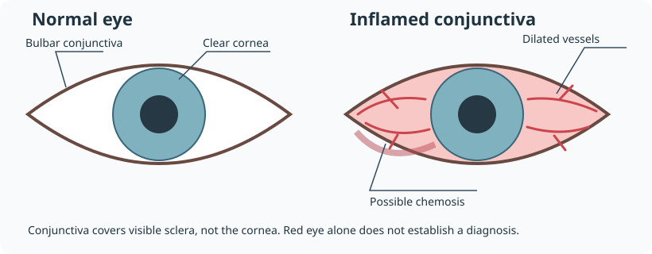

# 📚 Conjunctivitis — detailed Roman Hinglish nursing concepts

**Study-ready, not studied.** Core red-eye nursing assessment, infection prevention and urgent referral. Corneal ulcers, trachoma and chemical injuries have separate planned topics. [Chapter](../README.md) · [30 original MCQs](../MCQs/Conjunctivitis-30-MCQs.md) · [Exam evidence](../Previous-Year-Questions/Conjunctivitis-Exam-Evidence.md)

## Anatomy and mechanism

Conjunctiva ek thin transparent mucous membrane hai jo eyelid ki inner surface (palpebral conjunctiva) aur sclera ki anterior visible surface (bulbar conjunctiva) cover karti hai. Dono fornix par continuous hain. Cornea transparent surface hai aur conjunctiva normally cornea ko cover nahi karti. Goblet cells tear film ke mucin component mein contribute karti hain. Jab conjunctiva inflamed hoti hai toh vessels dilate hoti hain, tearing ya discharge badh sakta hai aur tissue swell ho sakta hai. Swollen conjunctiva ko chemosis kehte hain.

Ek transparent protective lining imagine karo. Jab dust, allergen ya microbes lining ko irritate karte hain, toh inflammatory response redness aur watery ya mucus discharge create kar sakta hai. Redness ka matlab automatically bacterial infection nahi hota. Cause ke according management change hota hai.

## Types and clinical clues

| Type | Typical clues | Important limitation |
|---|---|---|
| Viral | Watery discharge, gritty feeling, recent respiratory illness, sometimes preauricular node | One eye first and second eye later possible. Symptoms overlap. |
| Bacterial | Mucopurulent discharge, stuck eyelids, recurrent discharge after wiping | Discharge alone does not prove organism. Mild cases may resolve spontaneously. |
| Allergic | Prominent itching, often bilateral, watery or stringy mucus, exposure/atopy history | Not contagious. Corneal involvement in severe allergic disease needs review. |
| Hyperacute bacterial | Rapidly accumulating copious purulent discharge, marked swelling | Gonococcal infection can threaten cornea rapidly. Emergency systemic treatment. |
| Chlamydial inclusion | Persistent follicular conjunctivitis, possible genital infection | Requires systemic evaluation and treatment, not drops alone. |
| Irritant/toxic | Temporal association with exposure or topical product | Chemical injury is an emergency. Immediate irrigation takes priority. |

Viral conjunctivitis commonly adenovirus se hoti hai. Pharyngoconjunctival fever mein conjunctivitis, fever aur sore throat ka combination mil sakta hai. Epidemic keratoconjunctivitis (EKC) severe contagious adenoviral illness hai jisme cornea bhi involve ho sakti hai. Corneal infiltrates vision disturb kar sakte hain. Acute hemorrhagic conjunctivitis enterovirus 70 ya coxsackievirus A24 variant se associated ho sakti hai. Subconjunctival hemorrhage alone us diagnosis ka proof nahi hai.

Palpebral conjunctiva mein follicles lymphoid aggregates hain. Papillae elevated vascular inflammatory structures hain. Follicles often viral/chlamydial disease mein aur papillae allergic/bacterial inflammation mein mil sakti hain, but overlap hai. Contact lens-associated giant papillary conjunctivitis (GPC) mein upper tarsal papillae, mucus, lens intolerance aur mechanical/inflammatory reaction ho sakta hai. Severe vernal keratoconjunctivitis (VKC) children/young persons mein warm-season symptoms, giant cobblestone papillae, limbal changes aur corneal complications se associated ho sakti hai. Persistent photophobia ya shield ulcer suspicion urgent specialist review require karta hai. Steroid drops ophthalmologist ke supervision ke bina use nahi karne.

## Red eye assessment and urgent referral

History mein duration, one/both eyes, pain vs itching, discharge nature, contact lens wear, trauma, chemical exposure, recent URI, allergies, immunosuppression, topical medicines aur infectious contacts record karo. Visual acuity separately check karo. Discharge gently clean karne aur blink ke baad bhi acuity reduced ho toh serious cause consider karo. Pupil abnormality, deep pain, marked photophobia, corneal opacity, severe purulence, eye movement pain, proptosis aur significant vision loss urgent assessment require karte hain. Conjunctivitis label lagakar keratitis, uveitis, angle closure, orbital cellulitis ya injury miss mat karo.

Contact lens wearer with painful red eye ko microbial keratitis risk hai. Lens immediately remove if feasible, do not reinsert, urgent ophthalmic assessment. Do not routinely patch suspected infection or use borrowed steroid drops. Chemical splash mein history aur acuity testing ke liye irrigation delay mat karo. Local emergency protocol follow karo.

Uncomplicated conjunctivitis often clinical diagnosis hoti hai. Culture/testing routine mild cases mein necessary nahi. Severe purulence, neonatal disease, recurrence, refractory cases ya gonococcal suspicion mein clinician microbiological testing request kar sakta hai. Specimen collection therapy delay na kare. Swab site, time aur laterality label karo.

## Management and nursing

Most adult viral cases supportive care se resolve hoti hain. Cool clean compresses aur lubricants comfort de sakte hain. Antibiotics viral infection treat nahi karte. Herpes suspicion, especially vesicular rash or corneal involvement, specialist antiviral assessment require karta hai. Topical corticosteroids HSV keratitis worsen kar sakte hain aur indiscriminate use unsafe hai. Bacterial disease mild ho toh self-limited ho sakti hai, but clinician discharge severity, risk, organism aur local antimicrobial protocol ke according treatment decide karega. ICMR antimicrobial guideline viral cases mein routine antibiotics avoid karti hai. No universal best antibiotic for every red eye.

Allergic conjunctivitis mein trigger avoid karna, cool compresses, artificial tears aur prescribed topical antihistamine/mast-cell stabilizer useful ho sakte hain. Eye rubbing avoid karo. Long-term unsupervised vasoconstrictor drops rebound redness cause kar sakte hain. Severe allergic keratoconjunctivitis ordinary seasonal itching se different risk rakhti hai.

Hyperacute gonococcal infection cornea rapidly damage kar sakti hai, so emergency ophthalmology and systemic antibiotics under medical orders. Adult chlamydial inclusion disease mein systemic treatment, STI testing and partner management needed. Confidentiality preserve karo. No dose-based self-prescription. Do not apply home remedies or share drops.

## Infection prevention

Hand-to-eye transmission break karna main nursing role hai. Hand hygiene before/after eye care, gloves for contact with secretions as per standard precautions, separate clean pads for each wipe/eye, no shared towels, makeup or eye-drop bottles. Bottle tip ko lashes, eye or fingers touch nahi karne. Soiled linen handle according to infection-control protocol.

Clinic outbreak mein reusable ophthalmic devices including tonometer tips and high-touch surfaces ko approved effective disinfection method aur manufacturer instructions ke according process karo. Adenovirus many routine disinfectants ke against resistant ho sakta hai. Facility infection prevention team ko suspected cluster report karo, shared equipment prevent karo, isolate/cohort as directed. CDC 2026 healthcare personnel guidance emphasizes infectious staff exclusion, environmental cleaning and coordinated outbreak response. Exact return-to-work duration cause, symptoms, occupational health policy and outbreak context par depend karti hai. Universal 24-hour antibiotic rule viral disease ya every school/work situation par apply nahi hota.

## Ophthalmia neonatorum

First four weeks of life mein conjunctivitis ko ophthalmia neonatorum kaha jaata hai. Gonococcal disease often 2–5 days after birth mein severe discharge ke saath present karti hai. Chlamydial disease usually 5–14 days mein present ho sakti hai. Timing overlaps and cannot replace organism testing. Chemical irritation may be early and transient, but infection must be excluded in symptomatic newborn. HSV and other organisms also possible.

Newborn red eye with discharge requires prompt clinical review. Copious pus, corneal clouding, poor feeding, fever or systemic illness means urgent emergency assessment. Obtain clinician-ordered appropriate specimens, including conjunctival cells for chlamydial testing, and assess for other infection. Gonococcal disease and chlamydial ophthalmia need systemic therapy. Chlamydia can also cause infant pneumonia. Topical treatment alone inadequate. Macrolide-treated young infants need monitoring for hypertrophic pyloric stenosis, especially progressive projectile vomiting. Ceftriaxone needs special caution in hyperbilirubinemic neonates and is contraindicated with required IV calcium-containing solutions in neonates under relevant labeling. Clinician selects alternatives as indicated.

Prenatal STI screening and treatment are crucial. CDC notes routine erythromycin ocular prophylaxis protects against gonococcal disease but does not reliably prevent neonatal chlamydial infection. Indian ICMR portal lists prophylactic agents, but do not equate listed options with guaranteed chlamydia prevention. Follow current local newborn prophylaxis policy. Maternal and partner assessment, privacy and discharge follow-up are important. General neonatal resuscitation and maternal STI management are cross-linked, not repeated.

## Quick clinical scenarios

**Scenario 1:** Contact lens wearer complains of painful red eye and reduced vision. Nurse removes lens if possible, escalates urgently and does not assume uncomplicated conjunctivitis.

**Scenario 2:** Several eye-clinic patients develop red eye after visits. Infection prevention team investigates shared equipment, hand hygiene, staff illness and disinfection process.

**Scenario 3:** Ten-day-old infant has mucopurulent discharge. Nurse arranges prompt neonatal and ophthalmic assessment, helps collect prescribed samples and ensures systemic evaluation rather than simply applying routine drops.

## ▶️ Teaching and MCQ practice

Teaching: [Iram Fatima Nursing — ophthalmology MRP](https://www.youtube.com/watch?v=YlogEu5ijnQ) indexed description specifically lists conjunctivitis types and management. [Level Up RN — Pink Eye](https://www.youtube.com/watch?v=V6Qcq7KZ96k) teaching. Mixed pediatric eye/ear theory and MCQs [video](https://www.youtube.com/watch?v=qVPpZQ8qkvs) explicitly includes conjunctivitis in the overall description, but exact questions and division between theory and practice are unverified. [Shubham Sir eye-disorders MCQ session](https://www.youtube.com/watch?v=GCMk4wrOvBg) broad practice lead, conjunctivitis-specific coverage not established. No exact or verified topic-level MCQ mappings. All 30 question gaps remain recorded.

## References

- [CDC clinical overview](https://www.cdc.gov/conjunctivitis/hcp/clinical-overview/) — retrieved text.
- [CDC healthcare personnel infection control, September 2026](https://www.cdc.gov/infection-control/hcp/healthcare-personnel-epidemiology-control/conjunctivitis.html) — retrieved text.
- [AAO Conjunctivitis PPP, published 2024](https://aao.org/education/preferred-practice-pattern/conjunctivitis-ppp-2023) — indexed guideline.
- [ICMR antimicrobial guideline, ocular infections](https://amrtg.icmr.org.in/section-info/11/1) — retrieved text.
- [CDC treatment](https://www.cdc.gov/conjunctivitis/treatment/) — indexed.
- [CDC neonatal chlamydia](https://www.cdc.gov/std/treatment-guidelines/chlamydia.htm) and [neonatal gonorrhea](https://www.cdc.gov/std/treatment-guidelines/gonorrhea-neonates.htm) — indexed.
- [StatPearls, updated September 2026](https://www.ncbi.nlm.nih.gov/books/NBK541034/) — indexed.
- [AAO neonatal prophylaxis statement 2025](https://www.aao.org/education/clinical-statement/use-of-erythromycin-in-prevention-of-neonatal-opht) — indexed.
- [Neonatal Nursing](../../Neonatal-Nursing/README.md) · [Child Health Nursing](../../Child-Health-Nursing/README.md).
