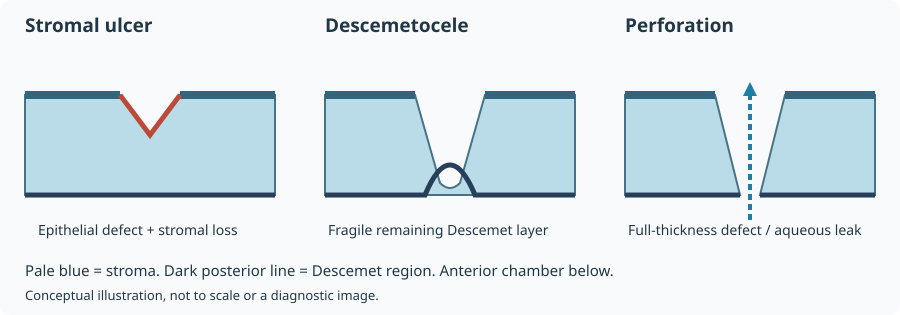

# 📚 Corneal Ulcer — assessment, complications and nursing

**Study-ready, not studied.** [Chapter](../README.md) · [30 original MCQs](../MCQs/Corneal-Ulcer-30-MCQs.md) · [Exam evidence](../Previous-Year-Questions/Corneal-Ulcer-Exam-Evidence.md) · [Organism-specific Keratitis](Keratitis-Concepts.md)

## Ulcer depth and assessment

Corneal ulcer mein surface epithelium ka defect aur underlying stromal inflammation/tissue loss hota hai. Cornea ki transparency aur structural strength dono compromise ho sakti hain. Infectious ulcer mein organism aur host inflammatory response tissue injury produce karte hain. Sterile inflammatory ulcer bhi possible hai. Keratitis ke organism patterns aur drug choices pichhle topic mein covered hain.

Ek transparent layered window imagine karo. Surface coating scratch ho toh superficial defect hai. Agar deeper supporting material bhi dissolve ho raha hai toh structural strength kam hoti hai. Cornea mein actual living tissue repair aur immune injury involved hain.

Slit-lamp assessment mein epithelial defect aur stromal infiltrate ko separately measure karte hain. Horizontal aur vertical diameters mm mein, central/peripheral location, depth, percentage thinning, edema, leading edge, anterior chamber reaction aur visual acuity record karo. Fluorescein epithelial defect outline karta hai. Dye-positive area alone stromal depth nahi batata. Serial comparable measurements improvement ya worsening assess karne mein useful hain. Central lesion optical axis affect karti hai, isliye small central scar bhi meaningful visual loss cause kar sakta hai.

## Hypopyon and progression

Hypopyon anterior chamber ke inferior part mein inflammatory cells ka visible level hai. Blood level ko hyphema kehte hain. Corneal infection ke response mein inflammatory cells anterior chamber mein collect ho sakte hain. Bacterial keratitis-associated hypopyon often sterile hota hai. Isse intraocular infection automatically confirm nahi hoti. Lekin severe infection aur endophthalmitis suspicion mein urgent specialist assessment zaroori hai. Routine anterior chamber tap nurse ka procedure nahi hai aur har hypopyon mein required nahi.

Classical ulcer progression mein infiltration, active ulceration, regression aur repair describe kiye jaate hain. Ye fixed timeline nahi. Increasing infiltrate size, depth, stromal melt ya chamber reaction worsening indicate kar sakte hain. Improving margins, decreasing infiltration, epithelial closure aur reduced inflammation recovery support karte hain. Ek parameter alone cure prove nahi karta.

## Descemetocele and perforation

Stromal melt mein collagen degradation se cornea thin hoti jaati hai. Jab localized stroma almost completely lost ho aur remaining Descemet membrane outward bulge kare, descemetocele develop ho sakta hai. Is fragile membrane mein perforation ka high risk hota hai. Central clear-looking zone ko healing assume nahi karo. Surrounding tissue fluorescein stain kar sakta hai jab exposed Descemet membrane generally stain nahi leti.

Full-thickness perforation mein aqueous humor leak ho sakta hai. Anterior chamber shallow ho sakta hai, iris defect ki taraf prolapse kar sakti hai aur visual acuity suddenly reduce ho sakti hai. Kabhi sudden pain relief bhi leakage ke baad ho sakta hai, ye recovery ka proof nahi. Clinician-performed Seidel test mein fluorescein film aqueous leak se dilute hoti hai. Plugged defect negative test de sakta hai. Obvious open globe ko further manipulate nahi karna.

Suspected perforation ya impending rupture mein pressure-free rigid shield aur immediate ophthalmic emergency referral chahiye. Pressure patch, tonometry, forceful eyelid opening, rubbing aur repeated manipulation avoid karo. Patient ko calm rakhkar vomiting/straining minimize karne ke liye prescribed analgesia aur antiemetic coordinate karo. Surgical assessment ke liye NPO status local emergency/anesthesia instructions ke according manage karo. Emergency transfer investigations ke liye unnecessarily delay mat karo.

## Treatment and monitoring

Large, central, deep, atypical, multiple ya unresponsive lesions mein clinician corneal samples arrange kar sakta hai. Microbiology results ke liye initial urgent therapy unnecessarily delay nahi hoti. AAO 2024 guideline severity ke according intensive prescribed antimicrobial therapy support karti hai. ICMR guidance local organism-based regimen selection mein useful hai. Cycloplegic prescribed ho toh ciliary spasm aur associated anterior chamber inflammation-related pain reduce karne mein help mil sakti hai. Ye antimicrobial substitute nahi.

Medication preparation, storage and expiry pharmacy instructions follow karo, especially fortified drops. Drop tip ko eye touch nahi karna. Different drops prescribed interval se do aur actual time record karo. Severe ulcer, only seeing eye, perforation threat, inability to follow treatment ya urgent procedure mein inpatient care consider hoti hai. Nonresponse par resistance, wrong diagnosis, mixed infection, medication toxicity aur adherence reassess hote hain. Specialist repeat scraping/biopsy consider kar sakta hai. Antibiotics independent switch mat karo.

## Surgical and postoperative nursing

Small selected perforations ya descemetoceles mein surgeon tissue adhesive se temporary seal create kar sakta hai. Medical-grade adhesive specialist procedure hai, household glue kabhi use nahi karna. Selected cases mein amniotic membrane support epithelial healing provide kar sakti hai, but uncontrolled infection ka substitute nahi. Therapeutic keratoplasty mein infected/damaged tissue remove karke globe integrity restore karte hain. Tectonic surgery structural support ke liye hoti hai. Optical keratoplasty ka primary goal later vision improvement hai. Indications overlap kar sakti hain. Graft size aur technique location, extent, infection aur donor tissue availability se decide hoti hain.

Preoperative identity, laterality, consent, allergies, last medication timing aur ordered investigations verify karo. Postoperative shield aur prescribed antimicrobial schedule maintain karo. Excised corneal tissue microbiology/histopathology ke liye clinician-directed labeling aur transport follow karo. New redness, pain, vision drop, discharge, graft opacity ya wound leak urgently report karo. Infection recurrence, graft failure aur rejection all possible hain. Steroid timing organism aur infection control ke hisaab se surgeon decide karega, especially fungal disease. Do not self-adjust.

## Healing and rehabilitation

Epithelium migrate aur proliferate karke defect close karti hai. Stromal repair collagen remodeling aur scar formation involve kar sakti hai. Classical corneal opacity descriptions: nebula (faint), macula (moderate) aur leucoma (dense). Corneal macula retina ke macula se alag term hai. Adherent leucoma mein iris posterior scar se adherent hoti hai after prior perforation. Anterior staphyloma mein weak scarred cornea bulge kar sakti hai with uveal lining. Scar optical axis ko distort kar sakta hai aur irregular astigmatism cause kar sakta hai. New spectacles ya specialist contact lens rehabilitation active infection settle hone ke baad consider hoti hai. Children mein deprivation amblyopia risk ke liye pediatric eye follow-up important hai.

## ▶️ Teaching and practice

[Corneal ulcer lecture — Ophthalmology by Prof.](https://www.youtube.com/watch?v=2Pnnzx5Exow) indexed description covers pathogenesis, complications and treatment. [Dr Kritika Ophthal NEET PG cornea question discussion](https://www.youtube.com/watch?v=a3Im-WHVeFI) indexed description includes ulcer and hypopyon. Supplemental medical entrance MCQ lead for Q6–7 only, exact item/timestamp and nursing-specific practice pending. All 30 nursing-specific gaps documented.

## Clinical sources

- [MoHFW standard treatment guideline, printed pp53–54](https://clinicalestablishments.mohfw.gov.in/sites/default/files/standard-treatment-guidelines/6251.pdf) — retrieved text, screenshot unavailable. Older document, compare with recent evidence.
- [AAO bacterial keratitis PPP 2024](https://www.aaojournal.org/article/S0161-6420%2824%2900007-1/fulltext) — indexed text.
- [EyeWiki descemetocele and perforation](https://eyewiki.aao.org/Management_of_Descemetocele_and_Corneal_Perforation) — direct text retrieved.
- [Indian Journal of Ophthalmology 2025 review on ocular surface disease](https://pmc.ncbi.nlm.nih.gov/articles/PMC12097427/) — indexed extract.
- [ICMR ocular antimicrobial guidance](https://amrtg.icmr.org.in/section-info/11/1) — indexed text.
- [AAO corneal ulcer triage](https://www.aao.org/young-ophthalmologists/yo-info/article/4-tips-to-triage-and-treat-a-corneal-ulcer) — indexed.
