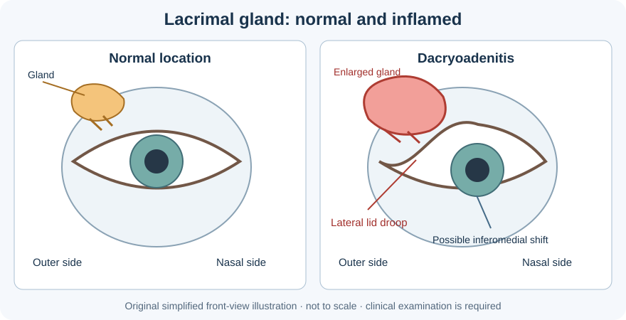

# 📚 Dacryoadenitis — lacrimal gland inflammation and nursing care

**Study-ready, not studied.** [Chapter](../README.md) · [30 original MCQs](../MCQs/Dacryoadenitis-30-MCQs.md) · [Exam and video evidence](../Previous-Year-Questions/Dacryoadenitis-Exam-Evidence.md)

[Anatomy](#anatomy) · [Assessment](#assessment) · [Causes](#causes) · [Investigation](#investigation) · [Management](#management) · [Nursing](#nursing)

## anatomy

**🟠 HIGH YIELD — Gland aur sac mein difference samjho.** Lacrimal gland eye ke upper outer orbit mein hoti hai. Orbit ka matlab bony socket hai jiske andar globe aur surrounding structures hote hain. Gland tear film ka watery ya aqueous component produce karne mein main role rakhti hai. Levator aponeurosis ki lateral expansion main gland ko orbital aur palpebral portions mein divide karti hai. Gland ki ductules upper conjunctival fornix mein secretion release karti hain.

Jab gland inflamed ho jati hai toh isko dacryoadenitis kehte hain. Ye infection se bhi ho sakti hai aur noninfectious inflammation se bhi. Lacrimal sac alag structure hai jo tears collect karke nose ki taraf drain karta hai. Sac infection ko dacryocystitis kehte hain. Gland inflammation ka management automatically DCR surgery nahi hota.

Socho ki orbit ek limited space hai. Agar upper outer gland ka size kaafi badh jaye toh adjacent structures par pressure aa sakta hai. Lateral lid neeche droop kar sakti hai aur substantial mass globe ko inferomedially displace kar sakta hai. Ye possible mechanical effects hain, har patient mein zaroori nahi. Practice Q1–3.

## assessment

**🟠 HIGH YIELD — Swelling ki exact location dekho.** Acute disease mein upper outer lid pain, tenderness, redness aur swelling ho sakti hai. Gland enlargement se outer upper lid zyada droop kar sakti hai. Lid ka S-shaped contour ek classical clue hai, lekin is clue se cause confirm nahi hota. Clinician upper outer fornix mein palpebral lobe aur ductules assess kar sakta hai. Purulent material gland ductules se aa sakta hai, jo medial punctal reflux se different finding hai.

| Finding | Clinical implication |
|---|---|
| Deep upper outer orbital swelling | Lacrimal gland involvement consider karo. |
| Inferomedial swelling near nose | Lacrimal sac pathology consider karo. |
| Localized tarsal lump | Chalazion ya other lid lesion consider karo. |
| Persistent progressive gland mass | Inflammation, atypical infection aur neoplasm evaluate karo. |
| New visual dysfunction, RAPD or restricted eye movement | Urgent orbital specialist assessment chahiye. |

Nurse onset, pain, fever, recent infection, swelling ka course, systemic symptoms aur previous treatment document kare. Baseline vision aur clinician-assessed ocular movements/pupillary findings ka record useful hai. Acute symptoms mein care delay karke elective tests complete mat karo. Practice Q4–7.

## causes

**🟠 HIGH YIELD — Ek jaisi swelling ke alag causes ho sakte hain.** Viral inflammation younger patients mein acute presentation ke saath aa sakti hai. EBV, jo infectious mononucleosis se associated virus hai, important example hai. Sore throat, fatigue aur cervical lymph nodes ka enlargement history mein relevant ho sakta hai. Mumps aur other viruses bhi associated ho sakte hain. Purulent bacterial disease mein Staphylococcus aureus aur Streptococcus species important possibilities hain. Local resistance aur clinical severity antimicrobial selection affect karte hain.

Chronic ya recurrent enlargement mein systemic inflammatory causes investigate karne pad sakte hain. Sjögren syndrome mein immune inflammation exocrine glands ko affect kar sakti hai. Dry mouth aur tear symptoms relevant history hain. IgG4-related disease mein multiple organs ka fibroinflammatory enlargement ho sakta hai, including lacrimal aur salivary glands. Sarcoidosis aur granulomatosis with polyangiitis bhi specialist differential mein aa sakte hain. Bilateral involvement se systemic cause ka concern badh sakta hai, lekin bilateral disease alone kisi ek diagnosis ko confirm nahi karti.

India ke context mein persistent atypical gland mass aur tuberculosis exposure ki history communicate karna important hai. JIPMER se indexed rare tubercular dacryoadenitis case available hai. TB ko har gland swelling ka default cause mat samjho. Diagnosis evidence-based specialist workup se hota hai. Idiopathic ka matlab hai ki appropriate evaluation ke baad specific cause identify nahi hua. Practice Q8–13.

## investigation

**🟠 HIGH YIELD — Test ka role aur limitations.** Typical uncomplicated improving viral illness mein clinician observation choose kar sakta hai. Har acute viral presentation ko biopsy ya extensive investigation ki need nahi hoti. Persistent, recurrent, atypical ya progressive cases mein cause reassess karna zaroori hai.

CT orbit gland size, enhancement, adjacent tissue involvement aur possible abscess ka assessment support karti hai. MRI soft tissues ko detail mein show kar sakti hai without ionizing radiation. Imaging patterns overlap kar sakte hain, isliye image alone se exact organism ya tumour type confirm nahi hota. Patient-specific contrast safety, implants, pregnancy status when relevant aur sedation needs team assess karti hai.

CBC, ESR aur CRP inflammation ke clues de sakte hain. CRP high hone ka matlab specific diagnosis confirmed hona nahi hai. Systemic symptoms ke according chest imaging ya other investigations clinician request kar sakta hai. Suspected atypical infection ya refractory swelling mein specialist tissue biopsy consider kar sakta hai. Tumour differential mein biopsy approach specialist plan kare, kyunki every mass mein same biopsy technique appropriate nahi hoti.

Steroid therapy tissue inflammation aur lymphoid findings change kar sakti hai. Planned diagnostic biopsy se pehle unreviewed corticosteroid order ho toh team se timing clarify karo. Emergency treatment ko independently hold mat karo. Practice Q14–20.

## management

**🔴 MOST IMPORTANT — Cause-specific treatment.** Clinician-confirmed uncomplicated viral disease mein supportive care aur monitoring sufficient ho sakti hai. Antibiotics viruses ko treat nahi karti. Bacterial gland involvement mein systemic antibiotic treatment commonly necessary hota hai. Route oral ya intravenous severity aur specialist assessment par depend karta hai. Deep tissue infection mein topical drops alone adequate assume mat karo. Agar abscess develop ho toh specialist source control ke liye drainage consider karta hai aur microbiological testing ke liye sample bhej sakta hai.

Noninfectious inflammatory disease mein corticosteroid treatment clinician select kar sakta hai. Ye immune inflammation reduce karti hai, lekin infection worsen ya mask bhi kar sakti hai. Cause aur contraindications assess karna zaroori hai. Dose aur taper individually prescribed hote hain. Refractory disease mein steroid-sparing options specialist consider kar sakta hai. Detailed specialist drug selection is nursing bank ka core target nahi hai. Nurse medication reconciliation, adherence, adverse effects aur clinical response monitor kare. Practice Q21–25.

## nursing

**🔴 MOST IMPORTANT — Vision protection.** Gland enlargement surrounding orbital structures ko affect kar sakti hai. New visual acuity reduction, abnormal colour vision, relative afferent pupillary defect (RAPD), proptosis ya painful restricted eye movements ko urgently escalate karo. RAPD ka matlab asymmetric afferent visual pathway response ka abnormal sign hai. Isko harmless cosmetic finding mat samjho. Severe systemic illness ya rapid progression mein urgent medical assessment important hai.

Swelling resolve hone ke baad bhi reduced tear secretion aur ocular surface discomfort persist kar sakte hain. Prescribed lubrication aur follow-up support karo. Immunosuppressive therapy ke during new fever ya purulent discharge possible infection ka concern hai. Prompt clinician reassessment arrange karo. Unsupervised dose increase ya abrupt permanent discontinuation recommend mat karo.

Follow-up mein swelling, pain, acuity, other visual findings, tear symptoms aur systemic features ka trend record karo. Patient ka comfort aur daily functioning bhi important outcomes hain. Practice Q26–30.

## practice-resources

| Topic | Teaching video | Dedicated MCQ practice |
|---|---|---|
| Anatomy, assessment and causes | [sqadia.com — Lacrimal Diseases, 2019](https://www.youtube.com/watch?v=4MjLOI0PKXU), description checked | Pending Q1–13 |
| Investigation and management | [Dr G Bhanu Prakash — Lacrimal Apparatus and Orbital Diseases, 2026](https://www.youtube.com/watch?v=e4BLAGh51WI), description checked | Pending Q14–25 |
| Nursing and escalation | Same orbital disease lecture provides related conceptual coverage, not exact nursing question verification | Pending Q26–30 |

Playback and timestamps were not inspected. Both are medical teaching leads, not authenticated MCQ-solving videos.

### Clinical references — checked 27 November 2026

- [StatPearls Dacryoadenitis](https://www.ncbi.nlm.nih.gov/books/NBK535384/), directly retrieved, anatomy, presentation, workup and complications.
- [AAO EyeWiki Dacryoadenitis](https://eyewiki.aao.org/Dacryoadenitis), directly retrieved, differential, imaging, biopsy and management.
- [Non-infectious Dacryoadenitis — LV Prasad Eye Institute affiliated review](https://pubmed.ncbi.nlm.nih.gov/34081929/), indexed bibliographic evidence, direct page returned CAPTCHA.
- [Isolated tubercular dacryoadenitis — JIPMER case report](https://pubmed.ncbi.nlm.nih.gov/37530351/), indexed case abstract, rare presentation, not prevalence evidence.
- [Masses of the Lacrimal Gland](https://pmc.ncbi.nlm.nih.gov/articles/PMC7987400/), indexed review, differential and management.

**Quick recap:** Gland = production, sac = drainage. Upper outer gland swelling can cause lateral lid droop. Persistent enlargement needs cause evaluation. Treatment depends on viral, bacterial, systemic inflammatory or other pathology. New visual dysfunction needs urgent escalation.

[Chapter](../README.md) · [MCQs](../MCQs/Dacryoadenitis-30-MCQs.md) · [Evidence](../Previous-Year-Questions/Dacryoadenitis-Exam-Evidence.md)
