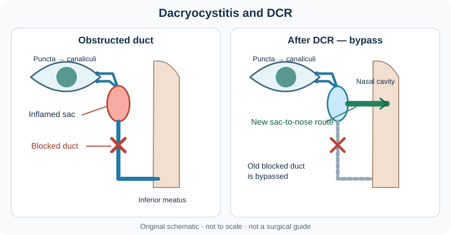

# 📚 Dacryocystitis — lacrimal sac infection and nursing management

**Study-ready, not studied.** [Chapter](../README.md) · [30 original MCQs](../MCQs/Dacryocystitis-30-MCQs.md) · [Exam evidence and practice gaps](../Previous-Year-Questions/Dacryocystitis-Exam-Evidence.md)

[Mechanism](#mechanism) · [Assessment](#assessment) · [Acute care](#acute-care) · [Definitive care](#definitive-care) · [Aftercare](#aftercare) · [Practice resources](#practice-resources)

## mechanism

**🟠 HIGH YIELD — Tear production aur drainage ka difference.** Lacrimal gland eye ke upper outer region mein hoti hai aur tear fluid banane mein help karti hai. Blink karne se tears surface par spread hoti hain. Inner corner ke paas upper aur lower puncta chhoti openings hain. Tears in openings se canaliculi mein enter karti hain aur lacrimal sac tak pahunchti hain. Sac se nasolacrimal duct normally tears ko inferior nasal meatus mein drain karti hai. Isliye ro kar nose watery ho sakti hai.

Dacryocystitis mein lacrimal sac infected ya inflamed ho jata hai, commonly downstream drainage obstruction ke context mein. Socho ki ek drain pipe block ho gayi hai. Fluid bahar nahi ja pa raha, toh debris aur fluid collect hone lagte hain. Sac mein bhi aisi stagnation microbial growth support kar sakti hai. Common acute bacterial pathogens Staphylococcus aur Streptococcus species hain. Har patient ka organism same nahi hota. Local resistance aur culture clinically important ho sakte hain.

Diagram mein normal downstream duct ka obstruction red cross se dikhaya hai. Green line surgically created sac-to-nose route hai. DCR purane blocked duct ko bypass kar sakti hai. Tear production aur intraocular aqueous humour drainage alag systems hain. Practice Q1–4.

## assessment

**🟠 HIGH YIELD — Acute versus chronic presentation.** Acute infection mein inner corner ke neeche, nasal bridge ke paas sac region painful, red aur swollen ho sakta hai. Patient ko watering ya discharge ho sakti hai. Chronic obstruction-related disease mein lambe time se watering, sticky mucus, repeated conjunctival irritation ya relatively painless sac swelling ho sakti hai. Chronic disease par acute infection superimpose bhi ho sakti hai.

| Finding | Kya samajhna hai |
|---|---|
| Tender inferomedial swelling | Lacrimal sac process ka clue hai. |
| Superotemporal gland-area swelling | Dacryoadenitis consider hoti hai, jo gland ki inflammation hai. |
| Pouting punctum, focal canalicular tenderness, concretions | Canaliculitis ki possibility hai. |
| Blood-stained tears, hard mass, superior extension | Atypical lesion including possible tumour ke liye specialist assessment chahiye. |

History mein onset, prior episodes, discharge, trauma, nasal surgery, sinus disease, diabetes, immunosuppression aur previous treatment poochho. Baseline visual acuity, pupils, ocular movements, temperature aur vital signs record karo. Severe symptoms mein routine detailed testing se urgent care delay mat karo. 

ROPLAS ka full form regurgitation on pressure over the lacrimal sac hai. Stable chronic case mein clinician gentle pressure se punctal reflux observe kar sakta hai. Ye retained sac content aur drainage dysfunction support karta hai. Patient ko acute painful sac par repeated forceful pressure karne ko mat bolo. Routine diagnostic syringing aur probing acute inflammation mein generally contraindicated hain. Dye disappearance test mein fluorescein clearance observe hoti hai. Five minutes par persistent dye drainage delay suggest kar sakti hai, lekin exact obstruction site identify nahi karti. Stable chronic case mein specialist additional tests choose kar sakta hai. Atypical mass, blood-stained tears ya suspected spread mein imaging ki zaroorat ho sakti hai.

**Example:** Ek adult ko months se unilateral watery eye hai aur inner lower corner mein relatively painless swelling hai. Ye chronic drainage disorder ka clue hai. Agar new redness, pain aur fever develop ho, toh acute flare ya complication consider karke prompt assessment arrange karo. Practice Q5–11.

## acute-care

**🔴 MOST IMPORTANT — Infection control aur escalation.** Acute dacryocystitis mein clinician systemic antibiotic therapy prescribe kar sakta hai. Mild stable case oral treatment aur warm compresses ke saath manage ho sakta hai, lekin timely ophthalmic follow-up zaroori hai. Severe disease, systemic illness ya orbital extension mein hospital evaluation aur IV therapy ki zaroorat ho sakti hai. Topical drops alone deep sac infection ka reliable definitive treatment nahi hain. Nurse independently antibiotic choose nahi karti.

NHSRC AB-HWC medical officer training manual section 7.6 Indian primary-care context mein acute infection ke systemic treatment aur ophthalmologist referral ko support karta hai. Ye local medical officer guidance hai, independent nursing prescription authority nahi. Local antimicrobial sensitivity, allergy, renal function, severity aur age clinician ke selection mein important hain. Agar response poor hai, purulent material ka clinician-directed culture treatment refine karne mein help kar sakta hai. Serious deterioration mein culture result ka wait karke urgent management delay nahi karna chahiye.

**Complications:** Sac mein pus collection banne ko abscess kehte hain. Fluctuant swelling abscess ka clue ho sakti hai. Specialist drainage, antimicrobial care aur selected surgical approach decide karega. Abscess skin se rupture ho kar acquired lacrimal fistula bana sakta hai. Infection adjacent tissues mein spread kar sakti hai. Proptosis, new painful restricted eye movements, declining vision, systemic illness ya neurological signs urgent warning signs hain. Diabetic ya immunocompromised patient mein deterioration ko seriously assess karo.

Newborn mein painful red sac swelling ke saath lethargy, fever ya poor feeding serious infection ka concern hai. Uncomplicated congenital tear duct obstruction ka routine massage plan acute neonatal infection ka substitute nahi hai. Pediatric and ophthalmic team ko urgent referral chahiye. Congenital obstruction ka detailed conservative care aur timing separate topic mein cover hoga.

**Nursing priorities:** Vitals aur visual function assess karo, urgent red flags identify karo, prescribed treatment aur allergy check karo, safe hand hygiene aur discharge cleaning follow karo, patient ko unsupervised invasive procedures se bachne ko bolo. Worsening symptoms par early review ki clear instruction do. Practice Q12–20.

## definitive-care

**🟠 HIGH YIELD — Antibiotics aur DCR ke aims alag hain.** Acute infection settle hone par pain kam ho sakta hai, lekin original obstruction remain kar sakti hai. Isliye recurrent episodes mein structural drainage evaluation necessary hai. Dacryocystorhinostomy (DCR) sac aur nasal cavity ke beech new channel banati hai, jo downstream blocked nasolacrimal duct ko bypass karti hai. Native duct inferior meatus mein open hoti hai. DCR ka opening commonly middle meatus region mein create kiya jata hai.

| Approach | Basic principle |
|---|---|
| External DCR | Skin incision ke through sac tak access aur nasal bypass create karna. |
| Endoscopic endonasal DCR | Nose ke andar endoscopic access se bypass create karna. External skin scar avoid ho sakta hai. |
| Temporary silicone stent | Selected operations mein healing ke time new passage ko open maintain karne mein help kar sakta hai. |

Traditional external DCR often acute inflammation settle hone ke baad planned hoti hai. Current clinical literature selected cases mein early endoscopic DCR support karti hai. Timing har patient ke systemic stability, infection severity, anatomy aur specialist plan par depend karti hai. Fixed universal waiting period ya immediate surgery rule nahi hai. Unstable severe infection mein emergency stabilization priority hai. Standard DCR har upstream canalicular obstruction ko correct nahi karti. Specialist evaluation essential hai.

Preoperative nursing mein medication reconciliation, allergies, consent, fasting instructions if applicable, baseline vitals aur surgeon-approved plan verify karo. Anticoagulant ya antiplatelet therapy ko independently hold ya restart mat karo. Treating team bleeding aur thrombosis risk balance karegi. Practice Q21–25.

## aftercare

**🔴 MOST IMPORTANT — Healing and patient safety.** DCR ke baad nasal bleeding ka risk hota hai. Mild spotting possible hai, lekin brisk persistent bleeding, faintness ya instability urgent assessment require karti hai. Patient ko surgeon ke specific nose-blowing, activity aur wound-care restrictions samjhao. Different centres ke restriction durations different ho sakte hain. Ek fixed duration ko universal rule mat banao.

Agar silicone loop eye corner se protrude kare, patient ko pull ya cut karne se mana karo aur surgical team se promptly contact karne ko bolo. Protruding stent cornea irritate kar sakti hai. Clinic safe reposition ya removal decide karega. Prescribed follow-up aur stent removal appointment important hai. Worsening pain, redness, discharge, fever ya visual change par urgent advice lo.

Follow-up mein sirf anatomical patency nahi, watering, recurrent pain, discharge, patient comfort aur functional improvement bhi assess karo. Patent DCR ke baad persistent epiphora ho toh ocular surface, lid position aur lacrimal pump function jaise other contributors review kiye ja sakte hain. Previous ectropion bank lid apposition ke baad watering cover karta hai. Yahan DCR patency aur functional success ka distinction focus hai. Practice Q26–30.

## practice-resources

| Topic | Teaching resource | Dedicated MCQ practice |
|---|---|---|
| Mechanism and clinical presentation | [Dacryocystitis, Epiphora and Congenital Nasolacrimal Duct Obstruction](https://www.youtube.com/watch?v=nh062Ti1xBk), indexed description only | Specific nursing question-solving video pending |
| Acute/chronic differentiation and ROPLAS | [Lacrimal Apparatus & Orbital Diseases](https://www.youtube.com/watch?v=e4BLAGh51WI), indexed exam-revision description, not confirmed question-solving | Specific nursing question-solving video pending |
| DCR and aftercare | [Cambridge University Hospitals patient information](https://www.cuh.nhs.uk/patient-information/dacryocystorhinostomy-dcr/), clinical reading not video | Specific nursing question-solving video pending |

**Quick revision:** Sac infection = dacryocystitis. Gland inflammation = dacryoadenitis. Acute painful red inferomedial swelling requires prompt clinician assessment. Chronic watering may persist because of obstruction. DCR creates alternate drainage. Orbital or systemic red flags require urgent care.

### Clinical references checked 27 November 2026

- [EyeWiki Dacryocystitis](https://eyewiki.aao.org/Dacryocystitis), directly retrieved, presentation and dye disappearance test.
- [StatPearls Dacryocystitis](https://www.ncbi.nlm.nih.gov/books/NBK470565/?report=classic), directly retrieved, mechanisms, complications, acute instrumentation restrictions and surgical timing.
- [Merck Manual Professional Dacryocystitis](https://www.merckmanuals.com/en-ca/professional/eye-disorders/eyelid-and-lacrimal-disorders/dacryocystitis), directly retrieved, acute and chronic care.
- [NHSRC AB-HWC Medical Officer Eye Care Training Manual](https://nhsrcindia.org/sites/default/files/2021-12/Eye%20Care%20Training%20Manual%20for%20Medical%20Officer%20at%20AB-HWC.pdf), section 7.6, printed page 32, direct text retrieved, page screenshot attempt failed.
- [EyeWiki Dacryocystorhinostomy](https://eyewiki.aao.org/Dacryocystorhinostomy), indexed clinical text.
- [Cambridge University Hospitals DCR patient information](https://www.cuh.nhs.uk/patient-information/dacryocystorhinostomy-dcr/), approved 28 November 2025, directly retrieved, individualized perioperative medication and aftercare.
- [Indian ocular antimicrobial stewardship review](https://pmc.ncbi.nlm.nih.gov/articles/PMC9333024/), indexed text. Local susceptibility matters.

[Chapter](../README.md) · [Original MCQs](../MCQs/Dacryocystitis-30-MCQs.md) · [Exam evidence](../Previous-Year-Questions/Dacryocystitis-Exam-Evidence.md)
