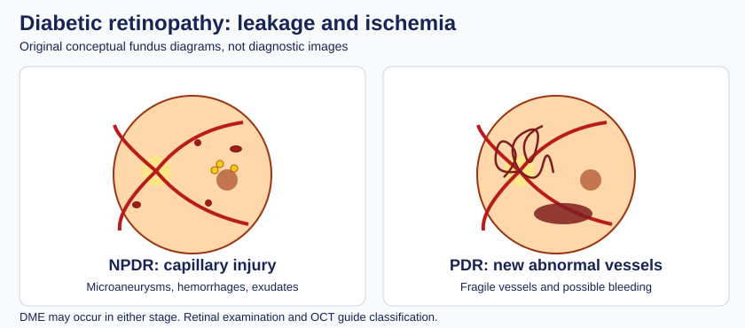

# 👁️ Diabetic Retinopathy and Nursing

**Study-ready, unattempted.** NORCET / HP Staff Nurse / CHO. Retinal-specific assessment and nursing care. General diabetes complications and glucose management remain in [Endocrine Part 8](../../Endocrine-System/Concepts/08-Diabetes-Complications-Community-Other-Hormones.md).

[Chapter](../README.md) · [32 original MCQs](../MCQs/Diabetic-Retinopathy-32-MCQs.md) · [Exam evidence](../Previous-Year-Questions/Diabetic-Retinopathy-Exam-Evidence.md)

## Mechanism

**🔴 MOST IMPORTANT**

Retina aankh ki light-sensitive layer hai. Iske chhote blood vessels ko capillaries kehte hain. Inko chhoti water pipes samjho. Jab diabetes mein glucose lambe samay tak high rehta hai, capillary wall aur usko support karne wale pericytes damage ho sakte hain. Kuch vessels weak hokar fluid leak karti hain aur kuch block ho jaati hain. Leakage se swelling hoti hai. Blockage se retina ko oxygen kam milti hai, jise ischemia kehte hain.

Ischemic retina vascular endothelial growth factor (VEGF) jaise signals release karti hai. Ye naye blood vessels banne ko stimulate karte hain. Lekin naye vessels fragile hote hain aur easily bleed kar sakte hain. Early stages mein patient ko koi symptom nahi bhi ho sakta. Isliye normal reading vision ya pain absent hona retinal disease exclude nahi karta.

Hard exudates retinal vessels se leaked lipid-rich material ke deposits hain. Cotton-wool spots nerve fiber layer ischemic injury aur disrupted axonal transport se related pale fluffy areas hain. Dot-blot hemorrhages retinal tissue ke andar bleeding represent karte hain. Ye findings stage aur distribution ke saath interpret hoti hain.

## Staging

**🔴 MOST IMPORTANT**

| International clinical stage | Main finding |
|---|---|
| No apparent DR | Examination mein visible diabetic retinal changes nahi milte |
| Mild NPDR | Microaneurysms only |
| Moderate NPDR | Microaneurysms se zyada changes, severe criteria se kam |
| Severe NPDR | At least one severe 4-2-1 criterion, without proliferative signs |
| PDR | Neovascularization and/or vitreous or preretinal hemorrhage in the appropriate diabetic context |

NPDR ka matlab nonproliferative diabetic retinopathy hai. Existing retinal vessels damage hote hain, lekin abnormal new vessels ka proliferative stage establish nahi hota. PDR mein abnormal new vessels optic disc par (NVD) ya retina ke other areas mein (NVE) grow kar sakte hain.

**4-2-1 rule:** International scale mein more than 20 intraretinal hemorrhages in each of four quadrants, definite venous beading in at least two quadrants, ya prominent intraretinal microvascular abnormalities (IRMA) in at least one quadrant mein se koi ek finding severe NPDR support karti hai, provided proliferative signs absent hain. IRMA ischemic retina ke andar abnormal vascular channels hain. US grading standard photographs use kar sakti hai. Ye advanced grading enrichment hai, nurse independently definitive stage diagnose nahi karti.

PDR mein fragile vessels se vitreous hemorrhage aur fibrovascular membrane contraction se tractional detachment possible hai. Iris neovascularization neovascular glaucoma cause kar sakti hai. In complications ke existing [glaucoma](Glaucoma-and-Nursing-Management.md) aur [detachment](Retinal-Detachment-and-Surgical-Nursing.md) questions ko repeat count nahi kiya gaya.

## Macular edema

**🔴 MOST IMPORTANT**

Macula central detailed vision ke liye important retinal area hai. Diabetic macular edema (DME) mein damaged vessels se fluid macula ke retinal tissue mein leak hota hai. Retina thick ho sakti hai aur reading, face recognition ya fine work difficult ho sakta hai. DME mild NPDR se PDR tak different stages mein occur kar sakti hai. Stage aur edema separately document hote hain.

Optical coherence tomography (OCT) retina ka cross-sectional structural image deta hai. Foveal center mein fluid involvement ko center-involved DME kehte hain. Visual acuity achhi hone par bhi OCT changes possible hain. Specialist acuity, edema, ocular status aur patient preference ke basis par management select karta hai.

## Assessment

**🟠 HIGH YIELD**

Dilated retinal examination se clinician microaneurysms, hemorrhage, exudates, venous abnormalities aur new vessels assess karta hai. Fundus photography screening aur comparison mein help karti hai. Fluorescein angiography sequential vascular images provide karti hai. Leakage mein fluorescent area time ke saath spread aur borders blur ho sakte hain. Nonperfusion mein retinal capillary filling absent ya reduced hoti hai. OCT retinal thickness aur fluid assess karti hai. Ye angiography ka identical substitute nahi.

Nurse onset of visual symptoms, diabetes duration, previous retinal treatment, medicines, BP, glucose trends aur appointment history document karti hai. Sudden vision loss, new floaters or curtain-like field change urgent eye evaluation maangte hain. Normal acuity early disease rule out nahi karti.

## Screening

**🔴 MOST IMPORTANT**

ADA 2026 adult guidance ke according type 2 diabetes mein first comprehensive dilated eye exam diagnosis par hota hai, kyunki hyperglycemia diagnosis se pehle bhi present ho sakti hai. Adult type 1 diabetes mein routine first exam onset ke five years baad recommended hai, if no separate indication. Children ke schedules age, puberty aur duration specific hote hain. Symptoms ho toh routine date ka wait nahi karna.

Subsequent exam usually annual ya more frequent ho sakta hai depending on disease. ADA selected patients mein one-to-two-year interval consider karti hai when one or more annual exams normal hon aur glycemic indicators goal mein hon. Indian community pathway regular annual check promote karti hai. Local protocol aur eye-care clinician plan follow karo.

Preexisting type 1/type 2 diabetes mein pregnancy retinopathy progression risk badha sakti hai. Preconception aur first trimester examination arrange karo. Retinal status ke according every trimester aur up to one year postpartum monitoring needed ho sakti hai. True gestational diabetes alone mein ADA routine DR-specific exam require nahi karti. Suspected preexisting diabetes aur new visual symptoms alag assessment require karte hain. NEI general public page pregnancy screening broadly advise karti hai. Is distinction ke liye ADA specialty guidance use ki gayi hai.

Rapid glycemic improvement selected patients mein early transient worsening se associated ho sakti hai. Long-term glucose management protective hai. Diabetes medicines independently stop mat karo. Existing retinopathy mein intensive treatment ke saath eye follow-up coordinate karo.

Indian operational guidance mein trained personnel fundus imaging aur visual acuity screen kar sakte hain. Example: kisi eye ka acuity 6/18 ho aur photo no DR report kare, tab bhi referral needed hai because acuity 6/12 se worse hai. Ungradable image normal result nahi hai. Repeat image ya comprehensive assessment local referral protocol ke according arrange karo. Remote grading aur validated AI screening access improve kar sakte hain, lekin positive/ungradable result ke liye effective referral pathway chahiye.

## Treatment

**🔴 MOST IMPORTANT**

Glucose, BP aur lipid control retinopathy onset/progression reduce karne mein help karte hain. Ocular treatment stage aur macular involvement par depend karta hai. Any DME, moderate or worse NPDR or any PDR mein prompt ophthalmology referral ADA recommend karti hai.

| Treatment | Nursing understanding |
|---|---|
| Intravitreal anti-VEGF | VEGF action block karke leakage aur abnormal vessels reduce kar sakti hai. Most center-involved DME with impaired vision mein first-line option. |
| Panretinal photocoagulation (PRP) | Peripheral retinal laser se ischemic angiogenic drive reduce hoti hai. High-risk PDR mein severe vision loss risk reduce karta hai. |
| Intravitreal corticosteroid | Selected persistent DME ya alternative treatment setting. Raised IOP aur cataract risk monitor karo. |
| Vitrectomy | Selected nonclearing vitreous hemorrhage ya tractional pathology mein surgeon consider karta hai. |
| Close observation | Good visual acuity wale selected center-involved DME eyes mein close monitoring possible hai. All eyes require immediate injections assume mat karo. |

PDR mein anti-VEGF selected patients ke liye PRP alternative ho sakta hai. Follow-up reliably possible hai ya nahi, ye treatment selection affect karta hai. Pregnancy mein anti-VEGF benefit-risk specialist team assess karti hai. Laser selected cases mein useful ho sakti hai. Exact drug, dose, interval aur operation independent nursing decision nahi hain.

## Injection care

**🔴 MOST IMPORTANT**

Intravitreal injection vitreous cavity mein medicine dene ka specialist procedure hai. Patient identity, laterality, prescription, consent aur aseptic preparation verify karo. Treating clinician antiseptic protocol follow karta hai. Nurse allergy history aur postprocedure instructions confirm karti hai. Patient ko eye rub nahi karna aur discharge advice follow karni hai.

Small painless subconjunctival red patch superficial bleeding se ho sakta hai. Increasing pain, redness, discharge ya reduced vision urgent ophthalmic evaluation require karti hai. Ye endophthalmitis ya other serious complication ho sakti hai. Routine next injection appointment ka wait mat karo.

## Long-term care

**🔴 MOST IMPORTANT**

Retinopathy alone indicated cardioprotective aspirin ka contraindication nahi hai according to ADA. Prescribed aspirin independently stop mat karo. Individual bleeding aur cardiovascular risk clinician review karega.

Nurse patient ko samjhaye ki symptoms absent hone par bhi screening necessary hai. Referral slip issue karna completion nahi hai. Consent-based recall, transport support, local-language education aur specialist feedback se continuity improve hoti hai. If permanent visual impairment remains, accessible medicine labels, lighting, mobility safety aur low-vision rehabilitation arrange karo.

## Quick revision

- Microaneurysms early visible finding. PDR means proliferative signs.
- 4-2-1 indicates severe NPDR if proliferative findings absent.
- DME any stage mein possible. OCT structural fluid assessment.
- Adult ADA screening: type 2 at diagnosis, type 1 five years after onset.
- Preexisting diabetes in pregnancy needs early assessment. True GDM alone different.
- Anti-VEGF for most vision-impairing center-involved DME. PRP for high-risk PDR. Follow-up matters.
- New severe pain or reduced vision after injection = urgent eye assessment.

## ▶️ Teaching and practice

| Scope | Teaching lead | MCQ practice |
|---|---|---|
| Beginner mechanism and symptoms | [Dr Sumeet Agrawal — diabetic retinopathy Hinglish](https://www.youtube.com/watch?v=TYD7uOSEVK4) | [Cerebellum Academy — Dr Gaurav Nagpal, MCQ-based DR review](https://www.youtube.com/watch?v=LGrY8j9cpgE) |
| Staging, screening and laser | [DR pathogenesis, stages and treatment](https://www.youtube.com/watch?v=dbU4_tPb0bg) | Same Cerebellum review description names stages, findings, screening and laser, specialist enrichment |
| Injection care and community referral | Clinical references below | No suitable dedicated nursing MCQ video verified |

Metadata and published descriptions checked 27 November 2026. Exact playback, item coverage and timestamps not authenticated. 18 broad leads and 14 specific gaps in 32 originals.

## References

- [ADA Standards of Care 2026, section 12](https://doi.org/10.2337/dc26-S012), indexed recommendations. Direct PMC open blocked.
- [AAO DR preferred practice pattern](https://www.aao.org/education/preferred-practice-pattern/diabetic-retinopathy-ppp), indexed grading and treatment extracts.
- [NEI diabetic retinopathy](https://www.nei.nih.gov/eye-health-information/eye-conditions-and-diseases/diabetic-retinopathy), direct text retrieved.
- [Indian operational guidelines summary](https://pmc.ncbi.nlm.nih.gov/articles/PMC7001164/), indexed guidance on screening and referral.
- [Endotext diabetic retinopathy](https://www.ncbi.nlm.nih.gov/sites/books/NBK278967/?report=reader), indexed clinical review.

[Chapter](../README.md) · [Original MCQs](../MCQs/Diabetic-Retinopathy-32-MCQs.md) · [Exam evidence](../Previous-Year-Questions/Diabetic-Retinopathy-Exam-Evidence.md)
