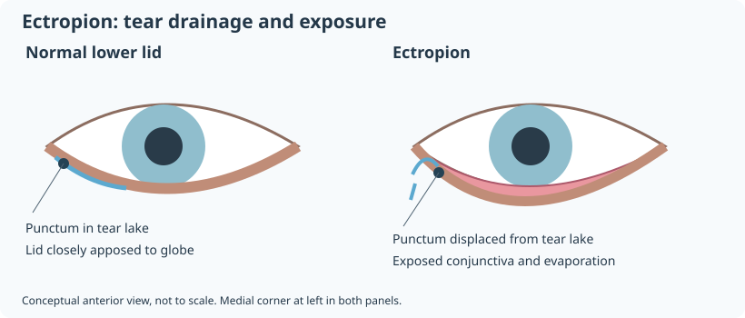

# 📚 Ectropion — detailed Roman Hinglish nursing concepts

**Study-ready, not studied.** [Chapter](../README.md) · [30 original MCQs](../MCQs/Ectropion-30-MCQs.md) · [Exam evidence](../Previous-Year-Questions/Ectropion-Exam-Evidence.md)

## Mechanism and types

Ectropion mein eyelid margin bahar ki taraf rotate hota hai, commonly lower lid. Normal lid globe se closely apposed rehta hai, jisse blink tears ko surface par spread karta hai aur medial punctum tear lake se contact maintain karta hai. Punctum ko drain ke inlet ki tarah samjho. Inlet water se door ho toh drainage passage open hone ke bawajood tears drain nahi ho paate. Ectropion mein epiphora (tears overflowing) aur dry eye dono saath ho sakte hain. Epiphora sirf excessive tear production nahi hai. Punctal malposition, weak lacrimal pump, surface evaporation aur reflex tearing contribute kar sakte hain.

| Type | Main mechanism |
|---|---|
| Involutional | Age-related horizontal support laxity and tissue relaxation |
| Cicatricial | Anterior lamellar shortage, sometimes middle lamellar scarring, producing outward traction |
| Paralytic | CN VII weakness and loss of orbicularis tone or incomplete blink |
| Mechanical | Tumor, mass or facial tissue descent displaces the lid |
| Congenital | Rare developmental malposition |

Entropion mein margin inward turn hota hai, commonly posterior shortening in cicatricial type. Ectropion mein anterior shortage outward pull kar sakti hai. Eyelid retraction means margin displaced inferiorly or superiorly and may occur without eversion. Lagophthalmos means incomplete eyelid closure. Ye findings coexist kar sakti hain.

## Assessment and differential

History mein onset, progression, previous surgery or burns, skin disease, facial palsy, topical medicines, eye rubbing, tumor symptoms, tearing and visual changes ask karo. Document lid margin position, punctal apposition, facial symmetry, blink completeness, closure gap and visual acuity. Punctal ectropion early stage mein ho sakta hai even when rest of lid appears nearly normal. Examine conjunctiva for chronic redness, thickening and keratinization, and cornea for epithelial damage. Persistent atypical lesion, ulceration or lash loss needs specialist review.

Clinician lateral support maneuver se check kar sakta hai ki lid tightening simulate karne par margin normal position mein aata hai ya nahi. Persisting outward traction suggests a cicatricial component. Upgaze with mouth opening stretches anterior lamella, and worsening eversion can suggest skin shortage. Snap-back and distraction tests pichhle Entropion bank mein covered hain. Cutoffs vary by method and reference, so isolated numerical cutoffs se diagnosis mat karo.

Facial palsy mein forehead movement, smile symmetry and gentle eye closure assess karo. New facial weakness with arm weakness, speech disturbance or other acute neurological findings emergency stroke assessment demand karti hai. Isolated facial weakness bhi prompt medical assessment require karti hai, Bell palsy automatically assume nahi karna. Bell phenomenon is upward globe rotation during attempted closure and is distinct from Bell palsy. It may partly protect the cornea, but does not prove complete protection.

## Ocular surface protection

Exposure se tear film rapidly evaporate ho sakti hai. Inferior cornea commonly vulnerable hoti hai. Fluorescein punctate epithelial staining or larger defect show kar sakta hai. Corneal sensation reduced ho toh serious injury ke bawajood discomfort mild ho sakta hai. New reduced acuity, photophobia, significant pain, corneal opacity or epithelial defect needs urgent ophthalmic review. Assess closure before sleep and during routine care.

Prescribed artificial tears during daytime, lubricating ointment at night, moisture chamber or clinician-directed closure taping surface protect kar sakte hain. Taping mein skin injury aur adhesive contact with eye avoid karo. Closure actually complete hai ya nahi check karo. An ordinary patch over an open eyelid does not automatically prevent exposure. Do not tape over a suspected open-globe injury. Ointment temporary blur de sakti hai, so safe mobility education useful hai. Follow specific orders for drug timing. Persistent severe exposure requires urgent specialist intervention.

Tears ko wipe karte waqt lower lid repeatedly downwards pull karne se laxity worsen ho sakti hai. Clean soft tissue se gently blot karo without pulling. Underlying dermatitis, allergy or medication-associated irritation assess karo. Eye drops independently discontinue mat karo, especially glaucoma therapy. Clinician can assess a suitable alternative.

## Repair and nursing management

Cause-specific repair main principle hai. Involutional ectropion mein lateral canthal tightening often useful hai. Medial spindle procedure everted punctum ko tear lake ke against reappose karta hai, and may be combined with horizontal tightening. Medial canthal support carefully assess karo, excessive lateral traction can displace punctum. Cicatricial type mein scar release and appropriate skin graft or local flap anterior shortage correct kar sakte hain. Mechanical type mein mass evaluation and removal with reconstruction may be needed. Paralytic type mein lower lid support plus upper lid closure management important hai. Selected cases mein implanted upper lid weight, temporary or permanent tarsorrhaphy, or other specialist reconstruction indicated ho sakti hai. Tarsorrhaphy partially joins lids to reduce exposed surface, it does not restore facial nerve function. Timing depends on corneal risk, likelihood of nerve recovery and clinical context. Do not postpone surface protection until recovery.

Rare congenital upper lid eversion at birth may present with marked conjunctival chemosis. Prompt pediatric ophthalmology assessment, moisture preservation and corneal monitoring are needed. Do not force the swollen lid back independently. Some cases respond to conservative specialist-directed care and others need surgery.

Preoperative assessment mein surface condition, baseline vision, closure, tear symptoms, procedure and laterality verify karo. After repair, check margin apposition and closure, monitor graft viability if applicable and observe for wound issues. New severe pain, vision loss or rapid swelling emergency assessment require karte hain. Persistent tearing despite corrected lid may reflect residual pump weakness or separate lacrimal drainage disease, so avoid declaring failure without reassessment. Persistent exposure may need additional closure intervention. Community nurse referral completion, caregiver technique and surface symptoms document kare.

## ▶️ Teaching and practice

- [Cybersight: Turning In and Turning Out](https://www.youtube.com/watch?v=QKe58RKFNSc), verified lecture title, also [lecture transcript](https://cybersight.org/library/lecture-turning-in-and-turning-out-management-of-entropion-and-ectropion/). Teaching only.
- [Eyelid ophthalmology high-yield MCQs](https://www.youtube.com/watch?v=0tTcBtFP0nU), indexed description explicitly lists ectropion. Supplemental medical-exam topic practice, not exact nursing-question verification. All 30 nursing-specific mappings remain pending.

## Clinical references

- [EyeWiki Ectropion](https://eyewiki.aao.org/Ectropion), directly retrieved.
- [MSD Professional, January 2026 review](https://www.msdmanuals.com/professional/eye-disorders/eyelid-and-lacrimal-disorders/entropion-and-ectropion), directly retrieved.
- [EyeWiki Medial Spindle Procedure](https://eyewiki.aao.org/Medial_Spindle_Procedure), directly retrieved.
- [Indian lower eyelid malposition algorithm 2025](https://pubmed.ncbi.nlm.nih.gov/40425154/), indexed abstract.
- [EyeWiki lower eyelid examination, November 2026](https://eyewiki.aao.org/Examination_Techniques_for_Lower_Eyelid_Malposition), indexed.
- [NHSRC CHO and staff nurse eye-care training 2022](https://nhsrcindia.org/sites/default/files/2022-08/Eye%20Care%20for%20CHO%20%26%20SN-%20Common%20Eye%20Conditions%20%28PART%201%29.pdf), indexed extract only.
