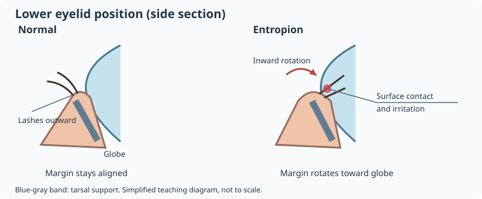

# 📚 Entropion — eyelid malposition and nursing

**Study-ready, not studied.** [Chapter](../README.md) · [30 original MCQs](../MCQs/Entropion-30-MCQs.md) · [Exam evidence](../Previous-Year-Questions/Entropion-Exam-Evidence.md)

## Anatomy and mechanics

Entropion mein eyelid margin inward rotate hota hai. Lashes aur keratinized margin cornea/conjunctiva ko rub kar sakte hain. Ectropion mein margin outward turn hota hai. Is chapter mein trachoma ki infection, WHO grading aur SAFE strategy already covered hain. Yahan structural malposition aur its correction focus hai.

Eyelid ki anterior lamella skin aur orbicularis muscle se banti hai. Posterior lamella mainly tarsus aur conjunctiva se banti hai. Tarsal plate firm support deti hai, canthal tendons lid ko horizontal stability dete hain. Lower lid retractors downgaze mein lid movement aur position maintain karte hain. In structures ka balanced pull lid margin ko globe ke against appropriate position mein rakhta hai.

Door ke hinge ka example samjho. Agar support loose ho aur pulling force uneven ho, edge wrong direction mein rotate kar sakta hai. Eyelid living tissue hai, isliye muscle spasm, scar contraction aur anatomical weakening saath mein contribute kar sakte hain.

## Types and causes

| Type | Main mechanism | Clinical context |
|---|---|---|
| Involutional | Horizontal laxity, lower retractor weakness, preseptal orbicularis override | Older adults, mostly lower lid |
| Cicatricial | Posterior lamellar shortening and scar contraction | Trachoma, chemical injury, mucous membrane pemphigoid, Stevens–Johnson syndrome |
| Spastic | Reflex orbicularis contraction, sometimes pre-existing laxity | Irritation, inflammation or recent surgery |
| Congenital | Developmental structural abnormality | Infants/children, uncommon |

Involutional entropion mein age-related tissue support weaken hota hai. Preseptal orbicularis pretarsal segment ke upar override kar sakta hai. Weak retractors lid downward pull maintain nahi kar paate. Single factor har case mein responsible nahi hota. Spastic disease intermittent ho sakti hai and irritation–spasm–rubbing cycle maintain ho sakta hai. Cicatricial entropion mein posterior conjunctival surface shorten hoti hai. Fixed malposition easily evert nahi ho sakta. Active inflammatory scarring disease ko specialist coordinate karke control karna zaroori hai before elective reconstructive surgery when feasible.

## Assessment and differentiation

History: onset, intermittent vs constant, prior surgery, trauma/burns, autoimmune skin or mucosal disease, previous correction, foreign-body sensation, tearing, pain and visual change. Examine lid position at rest and with normal blinking, corneal surface and measured visual acuity. Clinician gentle dynamic examination can assess spasm, lid laxity, downgaze excursion and scarring. Nurses should not forcefully manipulate an injured eye.

Snap-back test checks return of lower lid to globe after gentle displacement. Delayed return or need to blink suggests reduced lid tone/laxity. Distraction test assesses distance lid can be pulled away from globe. These tests together identify mechanical factors, neither alone diagnoses direction of rotation. Lower lid retractor dysfunction may reduce downward excursion and produce abnormal inferior fornix depth. Cicatricial posterior shortening may cause difficult eversion, conjunctival scar or symblepharon (adhesion between palpebral and bulbar conjunctiva).

Distichiasis means abnormal extra lashes, often arising from meibomian orifices. Epiblepharon means redundant skin/muscle fold redirects lashes even though lid margin is not primarily inverted. It is common in Asian children and may improve with growth. Persistent symptomatic corneal injury needs pediatric ophthalmic review. True congenital entropion must be distinguished from epiblepharon. Trichiasis without margin inversion has been introduced in trachoma; separate lash-directed treatment will be covered in its own bank.

## Surface protection and referral

Mechanical abrasion causes foreign-body sensation, redness, reflex tearing and photophobia. Fluorescein shows epithelial injury pattern, not structural cause by itself. Repeated trauma can cause epithelial defects, microbial keratitis, ulceration and permanent scar. Reflex tearing can occur despite a compromised ocular surface. Persistent reduced vision, significant pain, photophobia, opacity or an epithelial defect requires urgent ophthalmic evaluation. Small children may show rubbing, blinking or avoidance of light rather than describing pain. Assess ability to protect vision and arrange age-appropriate evaluation.

Artificial tears and prescribed lubricating ointment reduce friction temporarily. Clinician-directed lower-lid taping can reposition the margin while awaiting surgery in selected nonfixed disease. Avoid direct adhesive contact with the eye, skin trauma and pressure. Check skin sensitivity, safe technique and effect on lid position. Specialist-fitted bandage lens may protect surface in selected cases, but requires infection surveillance and must not be self-fitted. Botulinum toxin injection can temporarily reduce excessive orbicularis action in selected spastic/involutional cases. Temporary measures do not necessarily correct structural laxity or scarring. Do not assume permanent correction when symptoms improve.

## Surgical principles and nursing

Definitive management often requires surgery matched to the anatomical cause. Quickert everting sutures rotate the margin outward and may suit selected patients, but recurrence may be greater if associated laxity and retractor dysfunction remain. Lateral tarsal strip addresses horizontal instability. Lower retractor reattachment or plication addresses vertical support. Combined techniques may be appropriate in multifactorial disease. Cicatricial repair may need posterior lamellar lengthening or mucous membrane graft, chosen by specialist. Trachomatous tarsal rotation procedures are separate programme-specific techniques. Indian AIIMS 2025 transconjunctival repair publication supports tailoring vertical correction with or without horizontal tightening. It is a procedural teaching publication, not a universal nursing algorithm.

Before surgery verify consent, laterality, baseline acuity, corneal status, allergies and medication instructions. Review anticoagulant use with procedural team, never independently stop prescribed medication. Explain intended benefit (reduce rubbing and preserve surface) and possible residual symptoms from previous scarring. Postoperative care: prescribed ointment, dressing and follow-up, no rubbing, document lid position and ability to close eye. Mild bruising may occur. New severe pain, rapid swelling, significant bleeding, vision loss or wound breakdown warrants immediate review. Overcorrection may produce ectropion or exposure, undercorrection may leave lashes touching the globe. Persistent lash misdirection despite corrected lid needs separate lash assessment. Recurrence is possible. Recheck corneal healing rather than documenting only cosmetic appearance.

At primary care coordinate referral, surface protection as ordered, transport and follow-up. Document eye, onset, trigger, margin position, visual symptoms and referral completion. Older adults may need help with ointment administration. Teach-back and caregiver involvement help adherence.

## ▶️ Teaching and practice

- [Cybersight lecture: Turning In and Turning Out](https://www.youtube.com/watch?v=QKe58RKFNSc), indexed description covers anatomy, clinical findings and repair options.
- [AAO EyeSmart: What are entropion and ectropion?](https://www.youtube.com/watch?v=6FS0fXDa6uw), teaching.
- [Eyelid ophthalmology high-yield MCQs](https://www.youtube.com/watch?v=0tTcBtFP0nU), description explicitly names entropion and ectropion, supplemental medical-exam topic lead for Q1–4 and Q20–23. Individual question coverage and nursing recruitment alignment not verified. All 30 dedicated nursing MCQ gaps pending.

## Clinical references

- [EyeWiki Entropion](https://eyewiki.aao.org/Entropion), directly retrieved.
- [MSD Professional January 2026](https://www.msdmanuals.com/professional/eye-disorders/eyelid-and-lacrimal-disorders/entropion-and-ectropion), directly retrieved.
- [AAO involutional entropion management](https://www.aao.org/eyenet/article/diagnosis-management-of-involutional-entropion), indexed.
- [StatPearls Entropion](https://www.ncbi.nlm.nih.gov/books/NBK470352/), indexed.
- [StatPearls Entropion Eyelid Reconstruction](https://www.ncbi.nlm.nih.gov/sites/books/NBK470540/), indexed.
- [AIIMS New Delhi 2025 Indian Journal of Ophthalmology surgical demonstration](https://pubmed.ncbi.nlm.nih.gov/39853147/), indexed abstract.
- [Indian lower lid malposition algorithm 2025](https://pubmed.ncbi.nlm.nih.gov/40425154/), indexed abstract.
- [LV Prasad Eye Institute cicatricial entropion study](https://pubmed.ncbi.nlm.nih.gov/36702380/), indexed.
- [NHSRC AB-HWC medical officer eye care manual](https://www.nhsrcindia.org/sites/default/files/2021-12/Eye%20Care%20Training%20Manual%20for%20Medical%20Officer%20at%20AB-HWC.pdf), indexed extract only, not full PDF reviewed.
