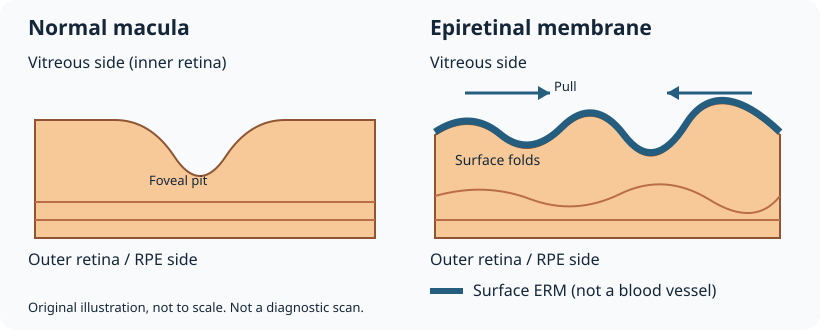

# 📚 Epiretinal Membrane (ERM) — detailed nursing concepts

**Study-ready, not studied.** Nursing-level core plus labelled retinal specialist enrichment. This is educational content, not individual treatment advice.

[Chapter](../README.md) · [30 original MCQs](../MCQs/Epiretinal-Membrane-30-MCQs.md) · [Exam evidence](../Previous-Year-Questions/Epiretinal-Membrane-Exam-Evidence.md)

## Mechanism

Macula retina ka beech wala hissa hai. Fovea macula ke bilkul centre mein hoti hai aur fine detail dekhne mein help karti hai. Epiretinal membrane (ERM) ek patli fibrocellular layer hai jo retina ki inner surface par ban jaati hai. Fibrocellular ka matlab hai ki is layer mein cells aur supporting fibrous material hota hai. Isko macular pucker ya cellophane maculopathy bhi kehte hain. Ye lens ke upar bani hui cataract nahi hai.

Ek smooth bedsheet socho. Agar uske upar ek patli layer chipak jaaye aur woh layer sikudne lage, toh bedsheet par wrinkles banenge. ERM mein bhi surface par contraction hota hai. Isse retinal layers apni normal alignment se khisak sakti hain aur foveal contour flatten ya irregular ho sakta hai. Light aankh mein aa rahi hoti hai, lekin central retina se milne wali image ki arrangement badal jaati hai. Isliye seedhi lines tedhi aur letters uneven lag sakte hain.

ERM usually avascular hoti hai, yaani usmein apni blood vessels nahi hoti. Isko diabetic proliferative fibrovascular tissue ke saath confuse mat karna. Dono mein pulling ho sakti hai, lekin mechanism aur management alag ho sakte hain.

*Diagram: educational schematic, not a diagnostic OCT scan. Left side mein normal foveal depression hai. Right side mein inner retinal surface ki membrane ke contraction se folds dikhaye gaye hain.*

## Risk factors and causes

Age badhne par vitreous gel liquefy aur separate ho sakti hai. Is process ko posterior vitreous detachment (PVD) kehte hain. Vitreoretinal interface par cellular changes ERM formation mein contribute kar sakte hain. PVD ka matlab automatically ERM nahi hota. Kai logon mein identifiable secondary disease nahi milti, jise idiopathic ERM kehte hain.

Secondary ERM mein retinal vein occlusion, diabetic retinopathy, prior retinal tear or detachment, uveitis, trauma ya prior intraocular surgery jaise associations mil sakte hain. Uveitis aankh ke andar inflammation hoti hai. Nurse medical aur ocular history mein diabetes, retinal treatment, surgery, trauma aur previous inflammation document karti hai. Associated disease ka treatment specialist alag se plan karta hai.

## Symptoms and functional assessment

Kuch logon mein membrane routine dilated examination mein detect hoti hai aur unko koi takleef nahi hoti. Kuch log gradually reading, sewing, phone use aur faces pehchanne mein difficulty report karte hain. Metamorphopsia ka matlab image ki shape distort hona hai. Macropsia mein image badi lag sakti hai aur micropsia mein chhoti. Aniseikonia ka matlab dono aankhon se perceived image size mein difference hai. Isse binocular fusion, yaani dono images ko ek saath combine karna, difficult ho sakta hai.

Snellen visual acuity achhi hone ke baad bhi patient ko everyday work mein problem ho sakti hai. Nurse functional complaint ko ignore nahi karti. Har eye ki acuity alag record karo, patient ka reading distance aur use hone wala correction note karo, aur symptoms ke onset, progression aur task impact ko document karo. Amsler grid distortion document karne mein help kar sakta hai, lekin cause confirm nahi karta.

Stable gradual distortion routine retina assessment ka reason hai. Nayi sudden major vision loss, new flashes/floaters, curtain ya postoperative severe pain and increasing redness ko purani ERM maan kar delay nahi karna chahiye. Urgent ophthalmic assessment arrange karo.

## Diagnosis and differential

Ophthalmologist dilated fundus examination mein macular surface par sheen, retinal folds ya distorted vessels dekh sakta hai. Optical coherence tomography (OCT) light ki help se retinal cross-section banata hai. ERM OCT par bright linear surface tissue ke roop mein dikhti hai. Retina ka thickness badh sakta hai aur foveal pit shallow ho sakti hai. OCT par outer retinal layers aur associated fluid bhi assess hote hain. Single thickness measurement se patient ki disability ya surgery ki need decide nahi hoti.

| Finding | ERM | Related condition |
|---|---|---|
| Main mechanical force | Surface membrane contracts tangentially | VMT mein residual vitreous attachment retina ko anteroposterior direction mein pull karti hai |
| Foveal appearance | Contour irregular ya flattened ho sakta hai | Full-thickness macular hole mein actual neural retinal defect hota hai |
| Intraretinal spaces | Tractional changes ho sakte hain | Diabetic or vein-occlusion edema mein vascular leakage bhi relevant ho sakti hai |
| Other macular pathology | Surface membrane coexist kar sakti hai | AMD mein outer retinal and RPE changes important hote hain |

VMT ka detailed next package separate rahega. Macular pseudohole aur lamellar hole ka differential pehle [macular hole package](Macular-Hole-and-Nursing.md) mein cover ho chuka hai. OCT findings ko retina specialist interpret karta hai.

## Management and perioperative nursing

Mild ya asymptomatic ERM mein observation aur scheduled ophthalmology follow-up reasonable ho sakte hain. Glasses optical correction improve kar sakte hain par retinal membrane ko dissolve nahi karte. Routine eye drops, laser ya injections idiopathic ERM ko mechanically peel nahi karte. Agar associated vascular leakage ya inflammation hai, specialist uska disease-specific treatment de sakta hai.

Surgery ka decision patient ki actual functional difficulty, symptom progression, OCT findings, fellow-eye function, other eye disease, expectations aur surgical risk ke basis par individual hota hai. Pars plana vitrectomy (PPV) mein vitreous gel remove ki jaati hai taaki surgeon retinal surface access kar sake. Fine instruments se ERM peel ki jaati hai. Internal limiting membrane (ILM) retina ki innermost boundary hai. Kuch cases mein surgeon recurrence ka risk kam karne ke liye ILM bhi peel kar sakta hai. Ye specialist choice hai aur har patient ke liye mandatory nahi. Gas bubble isolated ERM surgery mein automatically required nahi hota.

Preoperatively nurse baseline visual function aur eye laterality confirm karti hai, allergies, medicines and systemic history record karti hai, consent process aur prescribed fasting/anesthesia instructions verify karti hai. Anticoagulants ko patient khud band na kare. Surgical and prescribing teams ka plan follow hona chahiye. Patient ko explain karo ki surgery distortion aur vision improve kar sakti hai, lekin perfect vision ki guarantee nahi. Associated cataract aur longstanding retinal damage outcome limit kar sakte hain.

## Recovery, safety and rehabilitation

Postoperative prescribed eye drops, shield aur follow-up instructions ko teach-back se check karo. Gas use hui hai ya nahi, discharge record se verify karo. Agar intraocular gas present hai toh air travel, high altitude aur nitrous oxide restriction specialist ke clearance tak follow karni hoti hai. Face-down posture sirf prescribed ho toh follow karo. General retinal surgery safety details [retinal detachment notes](Retinal-Detachment-and-Surgical-Nursing.md) mein hain.

Vision aur distortion mein recovery gradual ho sakti hai. Anatomical improvement aur functional improvement ek hi cheez nahi. Cataract progression, raised intraocular pressure, retinal tear or detachment, infection, recurrent membrane aur persistent visual impairment possible complications hain. Severe increasing pain, redness, sudden visual decline ya new curtain urgent assessment maangte hain. Scheduled appointments attend karna important hai.

Reading aids, good task lighting, larger phone font aur occupational adaptations patient ko independence maintain karne mein help kar sakte hain. Dono aankhon ke image size difference se binocular tasks difficult ho toh specialist orthoptic or low-vision assessment useful ho sakta hai. Nurse safety aur independence dono support karti hai.

## Clinical examples

**Example 1:** Ek older adult chart par reasonably well read karta hai lekin bookkeeping mein columns crooked lagte hain. Nurse acuity ko alone normal result maan kar complaint dismiss nahi karti. Functional history aur retina review important hain.

**Example 2:** Diabetic patient ke OCT mein surface ERM aur intraretinal fluid dono hain. Sirf membrane dekh kar har fluid pocket ko mechanical traction ka result declare nahi karna. Specialist traction aur vascular leakage dono ka assessment karega.

**Example 3:** Stable ERM wala patient surgery discuss kar raha hai. Usko batana hai ki benefit aur risk individual hote hain. Patient ke reading goals aur present daily function decision mein important hain.

## ▶️ Teaching and practice resources

| Sections | Teaching | Dedicated MCQ practice |
|---|---|---|
| Mechanism, symptoms, risk, diagnosis | [Macular pucker: why do you see things as distorted? — Dr. Fleur Goezinne](https://www.youtube.com/watch?v=5WsdjRV0iY4), indexed title/description only | Specific video pending, see Q1–19 |
| Management and recovery | [Moorfields clinical patient guidance](https://www.moorfields.nhs.uk/eye-conditions/epiretinal-membrane/diagnosis-and-treatment) and [Cambridge University Hospitals leaflet](https://www.cuh.nhs.uk/patient-information/epiretinal-membrane/), text sources, not videos | Specific video pending, see Q20–30 |

No question-level video playback or timestamps verified. The teaching video is not counted as MCQ practice.

## Clinical references

- [AAO 2024 Preferred Practice Pattern: Idiopathic Epiretinal Membrane and Vitreomacular Traction](https://www.aao.org/education/preferred-practice-pattern/idiopathic-epiretinal-membrane-vitreomacular-tract-2)
- [National Eye Institute: Macular Pucker](https://www.nei.nih.gov/eye-health-information/eye-conditions-and-diseases/macular-pucker)
- [StatPearls: Epiretinal Membrane](https://www.ncbi.nlm.nih.gov/books/NBK560703/)
- [Cambridge University Hospitals: ERM patient information](https://www.cuh.nhs.uk/patient-information/epiretinal-membrane/)
- [Moorfields: ERM diagnosis and treatment](https://www.moorfields.nhs.uk/eye-conditions/epiretinal-membrane/diagnosis-and-treatment)

Indexed source extracts reviewed 27 November 2026. Independent clinical and rendered layout audit pending. Specialist OCT subtypes and surgical techniques are enrichment, not claimed mandatory recruitment syllabus.
