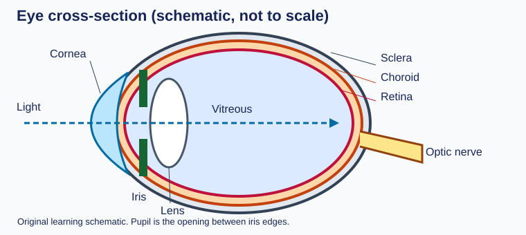
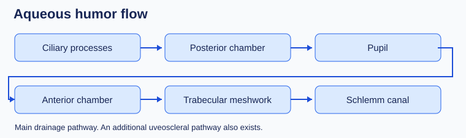

# 👁️ Eye Anatomy and Physiology — Complete Hinglish Notes

**Study-ready, unattempted.** AIIMS NORCET / HP Staff Nurse / CHO. Basic se exam level tak.

[🏠 Chapter](../README.md) · [📝 Topic-wise MCQs](../MCQs/Eye-Anatomy-and-Physiology-30-MCQs.md) · [📜 Previous Year Questions](../Previous-Year-Questions/Eye-and-ENT-Nursing-Past-Paper-Research-Register.md)

## 📚 Is guide mein kya-kya hai?

- [Eye ki layers](#eye-ki-layers)
- [Light aur vision](#light-aur-vision)
- [Eye ke fluids](#eye-ke-fluids)
- [Accommodation aur pupils](#accommodation-aur-pupils)
- [Tears aur eye movements](#tears-aur-eye-movements)

## Eye ki layers

**🟠 HIGH YIELD**

Aankh ko ek camera ki tarah samjho. Camera mein lens light ko focus karta hai aur sensor image ko record karta hai. Aankh mein cornea aur lens light ko focus karte hain. Retina us light ko nerve signals mein badalti hai. Brain in signals ko samajhta hai aur tab humein cheez dikhai deti hai.

| Layer | Parts | Kaam |
|---|---|---|
| Outer fibrous layer | Sclera, cornea | Sclera aankh ko shape aur protection deti hai. Cornea transparent hoti hai aur light ko bend karti hai. |
| Middle vascular layer (uvea) | Choroid, ciliary body, iris | Choroid outer retina ko blood supply deti hai. Ciliary body lens ka focus badalne aur aqueous humor banane mein madad karti hai. Iris pupil ka size control karti hai. |
| Inner neural layer | Retina | Retina light ko nerve signals mein badalti hai. |

Cornea aankh ka clear front window hai. Ismein normally blood vessels nahi hoti. Isliye transparency maintain rehne mein madad milti hai. Sclera aankh ka white part hai. Conjunctiva ek patli membrane hai jo eyelid ke andar aur sclera ke saamne wale visible part ko cover karti hai. Ye cornea ko cover nahi karti.

## Light aur vision

**🔴 MOST IMPORTANT**

Light ka route dekho: Cornea → aqueous humor → pupil → lens → vitreous humor → retina. Iske baad light khud brain mein nahi jaati. Retina ke cells light ko electrical signals mein badalte hain. Signal optic nerve se brain tak jaata hai. Optic nerve cranial nerve II hai. Visual information optic chiasm, optic tract, thalamus aur occipital cortex tak pahunchti hai. Optic chiasm mein nasal retinal fibers cross karte hain.

Retina mein rods aur cones naam ke photoreceptors hote hain. Rods kam light mein dekhne mein madad karte hain. Cones bright light, colour vision aur fine details mein madad karte hain. Fovea centralis macula ke centre mein hoti hai. Yahan fine detail dekhne ki ability sabse zyada hoti hai. Optic disc par nerve fibers aankh se bahar jaate hain aur photoreceptors nahi hote. Isliye ise physiological blind spot kehte hain.

| Structure | Exam ke liye yaad rakho |
|---|---|
| Rods | Dim light vision |
| Cones | Colour aur fine detail |
| Fovea | Sharp central vision |
| Optic disc | Physiological blind spot |
| Optic nerve | Signal brain tak le jaati hai |

**Clinical example:** Agar patient ko raat mein kam dikhne ki complaint hai, toh nurse history mein nutrition aur night vision changes poochti hai. Sirf symptom se vitamin A deficiency diagnose nahi karte. Agar patient ko naya central blurred vision hai, toh macula se judi problem bhi possibility hai. Assessment aur referral zaroori hain.

## Eye ke fluids

**🟠 HIGH YIELD**

Aqueous humor paani jaisa clear fluid hai. Ciliary processes ise banate hain. Ye iris ke peeche aur lens ke aage wale posterior chamber se pupil ke through anterior chamber mein jaata hai. Wahan se zyada fluid trabecular meshwork aur Schlemm canal ke raaste drain hota hai. Kuch fluid doosre drainage route se bhi nikalta hai. Agar fluid ka outflow kam ho jaaye, toh intraocular pressure badh sakta hai. Intraocular pressure ka matlab aankh ke andar ka pressure hai.

Vitreous humor lens ke peeche bada jelly jaisa material hai. Ye eyeball ki shape banaye rakhne mein madad karta hai. Isko aqueous humor ke continuously flowing system se confuse mat karo.

**Dhyan de:** Glaucoma optic nerve damage ka disease group hai. Sirf pressure ka badhna diagnosis nahi hota. Normal pressure par bhi glaucoma ho sakta hai.

## Accommodation aur pupils

**🟠 HIGH YIELD**

Accommodation ka matlab aankh ka focus near aur distant objects ke liye adjust hona hai. Jab tum paas ki kitab padhti ho, ciliary muscle contract hoti hai. Lens ko kheenchne wale zonular fibers par tension kam hota hai. Lens zyada round ho jaata hai aur light ko zyada bend karta hai. Door dekhte waqt muscle relax hoti hai aur lens comparatively flat hota hai.

Near response mein dono eyes andar ki taraf turn karti hain, pupils chhote hote hain aur lens ka focus adjust hota hai. Bright light mein pupil chhota hota hai. Dim light mein pupil bada hota hai.

Light reflex mein CN II light ka signal brain tak le jaati hai. CN III pupil ko constrict karne wale response mein kaam karti hai. Ek aankh mein light shine karne par normal condition mein usi aankh aur doosri aankh ke pupils constrict hote hain. Inhe direct aur consensual response kehte hain.

## Tears aur eye movements

**🟡 IMPORTANT**

Lacrimal gland tears banati hai. Tears aankh ko moist rakhte hain aur surface ko clean rakhne mein madad karte hain. Blink karne se tears spread hote hain. Tears inner corner ke puncta se nasolacrimal duct ke raaste nose mein drain hote hain. Isliye rote waqt nose bhi watery ho sakta hai.

Eye ko move karne ke liye extraocular muscles hoti hain. Lateral rectus aankh ko bahar ki taraf move karti hai aur CN VI se supply milti hai. Superior oblique ko CN IV supply karti hai. Baaki four extraocular muscles ko CN III supply karti hai. Eyelid band karne wali orbicularis oculi muscle CN VII se supply paati hai.

**Exam trick:** LR6, SO4, baaki extraocular muscles 3.

**Nursing example:** Agar patient eyelid close nahi kar paa raha hai, cornea dry hone aur injury ka risk ho sakta hai. Nurse eye protection ki prescribed care follow karti hai. Naya double vision, unequal pupils ya sudden visual loss ko routine complaint samajhkar delay nahi karti.

## ▶️ YouTube teaching aur practice

| Topic | Teaching | Dedicated MCQ practice |
|---|---|---|
| Layers, rods/cones, optic nerve, fluids, extraocular muscles | [PW Nursing College Prep — model-based eye anatomy](https://www.youtube.com/watch?v=rMmGCyXEIMU) | Anatomy-specific practice verification pending |
| Eye disorders and perioperative application | [Nursing Wallah — Eye Anatomy and Physiology](https://www.youtube.com/watch?v=knOaWAixuiQ) (anatomy foundation) | [VS Nursing Academy — Eye Disorders MCQ session](https://www.youtube.com/watch?v=GCMk4wrOvBg) (disorders, not exact anatomy questions) |

Published titles/descriptions checked 27 Nov 2026. Full playback and exact-question timestamps not checked. Video titles do not establish past examination appearance.

## 🔎 Clinical sources

- [OpenStax — sensory perception](https://openstax.org/books/anatomy-and-physiology-2e/pages/14-1-sensory-perception)
- [OpenStax — clinical eye assessment](https://openstax.org/books/clinical-nursing-skills/pages/22-2-eyes)
- [Open RN — eye and ear assessment](https://www.ncbi.nlm.nih.gov/books/NBK593200/)

[Chapter](../README.md) · [Topic-wise MCQs](../MCQs/Eye-Anatomy-and-Physiology-30-MCQs.md) · [Previous Year Questions](../Previous-Year-Questions/Eye-and-ENT-Nursing-Past-Paper-Research-Register.md)
