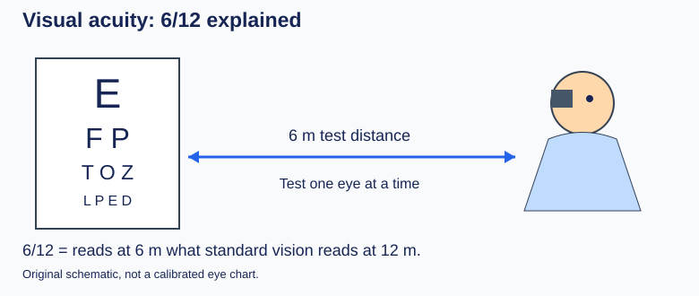

# 👁️ Eye Assessment and Diagnostic Tests — Detailed Hinglish Notes

**Study-ready, unattempted.** NORCET / Staff Nurse / CHO. Basic se clinical application tak.

[Chapter](../README.md) · [30 topic-wise MCQs](../MCQs/Eye-Assessment-and-Diagnostics-30-MCQs.md) · [Reported exam questions](../Previous-Year-Questions/Eye-Assessment-Reported-Exam-Practice.md) · [Anatomy](Eye-Anatomy-and-Physiology.md)

## 📚 Is guide mein kya hai?

- [History aur safety](#history-aur-safety)
- [Visual acuity aur Snellen](#visual-acuity-aur-snellen)
- [Near aur colour vision](#near-aur-colour-vision)
- [Visual field aur pupils](#visual-field-aur-pupils)
- [Diagnostic tests](#diagnostic-tests)
- [Nursing care](#nursing-care)

## History aur safety

**🔴 MOST IMPORTANT**

Eye assessment ka matlab sirf patient ko chart padhana nahi hai. Nurse pehle poochti hai ki problem ek aankh mein hai ya dono mein, kab start hui, achanak hui ya dheere-dheere, pain hai ya nahi aur patient ko flashes, floaters, double vision ya light se takleef ho rahi hai ya nahi. Diabetes, hypertension, medicines, contact lens, injury aur previous eye surgery ki history bhi useful hoti hai.

Patient ki eyelids, discharge, redness, swelling, eye alignment aur pupils observe karo. Sudden vision loss, severe pain, eye trauma ya chemical exposure mein routine examination ke liye emergency treatment delay nahi karo. Chemical splash mein immediate copious irrigation priority hai. Suspected open-globe injury mein aankh ko press nahi karna, tonometry nahi karni aur rigid shield ke saath emergency ophthalmic review arrange karna hai.

## Visual acuity aur Snellen

**🔴 MOST IMPORTANT**

Visual acuity ka matlab hai patient kitni clearly fine details dekh sakta hai. Snellen chart distance vision measure karta hai. Standard chart 6 metres ya 20 feet ke liye calibrated hota hai. Kuch charts shorter distance ya mirror setup ke liye bane hote hain. Hamesha chart ki specified distance follow karo.

Patient ko suitable lighting mein bithao ya khada karo. Distance spectacles normally use karta hai toh presenting vision with spectacles record karo. Ek eye cover karo bina pressure diye. Doosri eye se patient ko letters read karne do. Phir side change karo. Result mein eye, correction status, chart distance aur smallest successfully read line record karo. OD right eye, OS left eye, OU both eyes ke liye use hota hai. Dono eyes ka result alag hona important hai.

**6/6:** Patient 6 m par woh line read karta hai jo reference vision bhi 6 m par read kar sakti hai.

**6/12:** Patient 6 m par woh line read karta hai jo reference vision 12 m par read kar sakti hai. Iska matlab 6/6 se reduced distance acuity hai. Ye 50% vision loss ka diagnosis nahi hai.

**6/60:** Patient 6 m par woh detail read karta hai jo reference vision 60 m par read kar sakti hai. Denominator bada hone ka matlab same test distance par poorer acuity hai.

Agar largest line bhi read nahi hoti, chart protocol ke hisaab se distance reduce karo. Phir counting fingers (CF), hand movements (HM), perception of light (PL) aur no perception of light (NPL) assess aur record kiye ja sakte hain. CF ke saath distance likhna zaroori hai. Patient letters nahi pehchanta toh tumbling E ya suitable picture chart use karo.

**Pinhole test:** Chhoti opening peripheral light rays ko block karti hai aur blur kam kar sakti hai. Agar pinhole se vision improve hoti hai toh refractive component likely hai. Isse retinal disease rule out nahi hoti. Improvement nahi hone par further evaluation zaroori hai.

## Near aur colour vision

**🟠 HIGH YIELD**

Near vision ka matlab paas ki kitab ya medicine label clearly padhna hai. Jaeger ya standardized near chart ko manufacturer ki distance par use karo, commonly 33–40 cm. Patient ka usual reading correction record karo. Near aur distance acuity same measurement nahi hain.

Ishihara plates mein coloured dots se number ya pattern bana hota hai. Ye mainly red-green colour vision deficiency screening ke liye use hota hai. Proper lighting aur test instructions important hain. Ye har type ki colour vision disorder ka complete test nahi hai.

## Visual field aur pupils

**🟠 HIGH YIELD**

Visual field ka matlab centre mein dekhte hue aas-paas kitna area nazar aata hai. Confrontation test ek bedside screening hai. Patient aur examiner aamne-saamne baithte hain, corresponding eyes cover karte hain aur patient central fixation maintain karta hai. Examiner peripheral targets ko different quadrants mein present karta hai. Perimetry visual field ko more systematically map karti hai.

Amsler grid central vision mein distortion ya missing area screen karne ke liye use hota hai. Ek eye se centre dot par focus karte hue patient batata hai ki lines straight hain ya wavy, ya koi part missing hai. Naya distortion urgent assessment maang sakta hai.

PERRLA ka matlab pupils equal, round, reactive to light and accommodation hai. Pupils ka actual size, symmetry aur response document karo. Swinging flashlight test mein light ek eye se doosri par move ki jaati hai. Relative afferent pupillary defect (RAPD) mein affected eye par light shift karne par dono pupils relatively dilate ho sakte hain, kyunki sensory signal kam hai. Ye optic nerve ya severe asymmetric retinal dysfunction ka clue hai, standalone diagnosis nahi.

Cover-uncover test manifest ocular misalignment ko detect karne mein help karta hai. Extraocular movement test mein patient head steady rakhkar target follow karta hai. New diplopia ya neurological signs urgently assess karo.

## Diagnostic tests

**🔴 MOST IMPORTANT**

| Test | Kya assess hota hai? | Nursing exam clue |
|---|---|---|
| Tonometry | Intraocular pressure (IOP) | Pressure ko mmHg mein record karo |
| Gonioscopy | Iris-cornea drainage angle | Open aur narrow/closed angle assess |
| Perimetry | Visual field | Glaucoma field defects ko monitor karne mein help |
| Ophthalmoscopy / funduscopy | Retina, optic disc, retinal vessels | Posterior segment |
| Slit lamp | Magnified anterior eye examination | Cornea, anterior chamber, iris, lens |
| Fluorescein surface staining | Corneal epithelial defects | Blue light mein defect highlight hota hai |
| Optical coherence tomography (OCT) | Cross-sectional retinal/optic nerve images | Non-invasive light-based imaging |
| Fluorescein angiography | Retinal vascular filling/leakage | IV dye, not the same as surface staining |
| Refraction | Optical focusing error | Spectacle prescription |
| A-scan ultrasound / optical biometry | Axial length and other biometry | IOL power calculation before cataract surgery |

Goldmann applanation tonometry cornea ka small area flatten karne ke liye required force se pressure estimate karti hai. Common adult reference IOP range roughly 10–21 mmHg hai. Corneal thickness, measurement method aur time of day result influence kar sakte hain. Sirf normal IOP se glaucoma rule out nahi hota aur high IOP alone glaucoma diagnosis nahi hai.

## Nursing care

**🔴 MOST IMPORTANT**

Before examination patient ko simple language mein procedure samjhao aur consent/local policy follow karo. Hand hygiene aur clean equipment se cross infection kam karo. Topical anaesthetic, dilation ya dye sirf authorized protocol ke according administer karo. Dilation ke pehle relevant history aur risk assessment karwana important hai. Dilated pupils ke baad temporary blurred near vision aur photophobia ho sakti hai. Patient ko driving avoid karne ko bolo jab tak vision normal na ho aur safe transport arrange karne mein help karo.

IV fluorescein angiography se pehle prior reactions aur relevant medical history check karo, IV access aur emergency readiness local protocol ke hisaab se maintain karo. Dye injection ke baad nausea ya temporary yellowish skin/urine changes ho sakte hain. Breathing difficulty, swelling ya collapse par emergency response activate karo.

Contact instrument ko approved disinfection method se clean karo. Corneal sensation test, contact tonometry aur invasive investigation trained authorized clinician ke scope mein hi karo. Patient ke baseline aur abnormal findings report karo. Test ka result patient ki symptoms aur clinical findings ke saath interpret hota hai.

## ▶️ Teaching aur MCQ practice

| Topic | Teaching | MCQ practice |
|---|---|---|
| History, external exam, pupils, motility | [RegisteredNurseRN — Eye Assessment Nursing](https://www.youtube.com/watch?v=pgSj3l9iV6k) | Dedicated matching video pending |
| Snellen, near and colour vision | [Santiniketan Medical College — Eye Exam Masterclass](https://www.youtube.com/watch?v=Z2LgTf6bfwY) | [RRB Nursing Superintendent practice Part 19 — vision assessment section 47:22](https://www.youtube.com/watch?v=o-gP6xMIBNA&t=2842s) |
| Fundus, pressure, anterior segment | [AAO basic eye examination](https://www.aao.org/medical-students/basic-ophthalmology-lectures/video-detail/chapter-1-eye-examination) (web lecture) | Dedicated matching video pending |

Published descriptions/chapters checked. Full playback, exact question match and RRB video's channel verification pending. No video-based historical claim.

## 🔎 Sources

- [Merck professional eye evaluation](https://www.merckmanuals.com/professional/eye-disorders/approach-to-the-ophthalmologic-patient/evaluation-of-the-ophthalmologic-patient)
- [AAO eight-point eye exam](https://www.aao.org/young-ophthalmologists/yo-info/article/the-8-point-eye-exam)
- [UCSF eye examination handbook](https://hospitalhandbook.ucsf.edu/01-eye-anatomy-and-physical-exam/01-eye-anatomy-and-physical-exam)
- [AAO eye pressure testing](https://www.aao.org/eye-health/glasses-contacts/eye-pressure-testing)
- [Merck patient eye examination](https://www.merckmanuals.com/home/eye-disorders/diagnosis-of-eye-disorders/the-eye-examination?media=full)

[Chapter](../README.md) · [MCQs](../MCQs/Eye-Assessment-and-Diagnostics-30-MCQs.md) · [Reported exam practice](../Previous-Year-Questions/Eye-Assessment-Reported-Exam-Practice.md)
