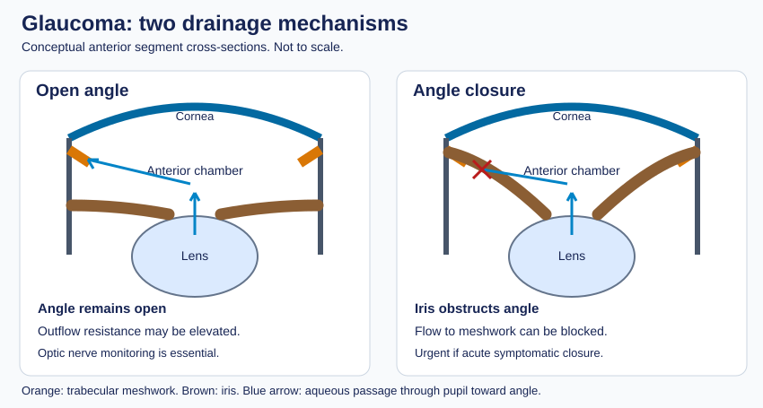
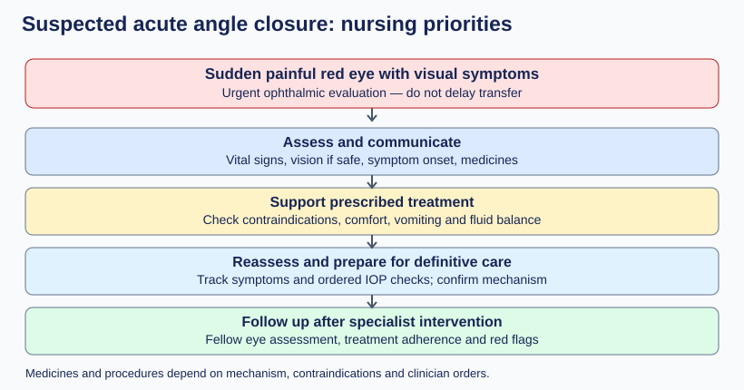

# 👁️ Glaucoma and Nursing Management

**Study-ready, unattempted.** AIIMS NORCET / HP Staff Nurse / CHO. Glaucoma is also called kala motia in common Hindi. Integrated package contains 39 new original MCQs plus one preserved starter.

[Chapter](../README.md) · [39 new MCQs](../MCQs/Glaucoma-Additional-39-MCQs.md) · [Reported exam practice](../Previous-Year-Questions/Glaucoma-Reported-Exam-Practice.md) · [Eye assessment](Eye-Assessment-and-Diagnostics.md)

## Contents

[Classification](#classification) · [Assessment](#assessment) · [Medications](#medications) · [Emergency](#emergency) · [Procedures](#procedures) · [Long-term care](#long-term-care)

## Classification

**🔴 MOST IMPORTANT**

Glaucoma mein optic nerve ko progressive damage hota hai. Aankh ko camera aur optic nerve ko camera ki data cable samjho. Retina light ko electrical signals mein convert karti hai. Retinal ganglion cells ke axons in signals ko brain tak le jaate hain. Glaucoma mein ye axons damage ho jaate hain, isliye visual field ka kuch part gradually lose ho sakta hai. Jo nerve damage establish ho chuka hai, woh usually reverse nahi hota. Early treatment remaining vision preserve karne mein help karti hai.

Eye ke anterior segment mein aqueous humor continuously banta hai. Ciliary body se fluid posterior chamber mein aata hai, pupil se anterior chamber mein jaata hai, phir major conventional drainage trabecular meshwork aur canal of Schlemm se hoti hai. Ek additional uveoscleral outflow route bhi hai. IOP yani intraocular pressure fluid formation aur drainage balance se influence hota hai. Aqueous humor aur tears alag hain. Tears eye surface par hote hain.

Typical adult IOP reference roughly 10–21 mmHg hai. Ye statistical reference hai, diagnosis ka rigid cutoff nahi. High pressure ke saath nerve damage absent ho sakta hai, aur normal pressure ke saath glaucoma bhi ho sakta hai. Target pressure patient-specific hota hai.

| Condition | Mechanism and nursing clue |
|---|---|
| Primary open-angle glaucoma (POAG) | Angle open hota hai, par drainage resistance badh sakti hai. Progressive nerve damage often painless aur initially silent hota hai. |
| Normal-tension glaucoma | Open-angle type mein glaucomatous damage statistically normal IOP ke saath bhi hota hai. |
| Ocular hypertension | IOP elevated hai, lekin established glaucomatous structural/functional damage nahi mila. Risk-based management chahiye. |
| Primary angle-closure suspect | Angle potentially occludable hai, lekin closure-related pressure rise, adhesions ya glaucomatous damage establish nahi hua. |
| Primary angle closure | Angle obstruction ke saath raised IOP aur/or peripheral anterior synechiae, lekin established glaucomatous nerve damage nahi. |
| Primary angle-closure glaucoma | Angle closure ke saath glaucomatous optic neuropathy present hai. Chronic ya acute presentation ho sakti hai. |

Pupillary block ko samjho. Aqueous passage pupil ke through restricted ho toh posterior chamber ka pressure anterior chamber se relative zyada ho sakta hai. Peripheral iris aage bow karti hai, jise iris bombe kehte hain. Isse drainage angle close ho sakta hai. Har angle closure pupillary block se nahi hoti. Plateau iris configuration, lens-related aur secondary mechanisms bhi hain. Mechanism specialist assess karta hai.

Secondary glaucoma mein identifiable ocular disease ya drug effect ho sakta hai. Long-term corticosteroids susceptible patients mein trabecular outflow resistance badha sakte hain. Pseudoexfoliative material ya dispersed pigment meshwork ko affect kar sakte hain. Retinal ischemia ke baad new iris vessels aur fibrovascular tissue neovascular glaucoma cause kar sakte hain. Trauma aur uveitis bhi important secondary causes hain.

Primary congenital glaucoma mein early drainage development abnormal ho sakta hai. Infant mein tearing, photophobia aur blepharospasm yani eyelid squeezing classical warning signs hain. Corneal enlargement, clouding aur buphthalmos yani enlarged globe ho sakta hai. Ye urgent pediatric eye assessment maangta hai. Simple tear duct blockage assume mat karo.

## Assessment

**🔴 MOST IMPORTANT**

Open-angle glaucoma early stages mein symptoms nahi bhi de sakta. Side vision progressively affect ho sakti hai. Patient central chart par achha read karne ke baad bhi obstacles miss kar sakta hai. Advanced damage tunnel vision cause kar sakta hai. Central ya paracentral field bhi affected ho sakte hain. No pain ka matlab no disease nahi.

Family history, older age, raised IOP, relevant refractive status, steroid exposure, previous trauma aur systemic/ocular history assess karo. First-degree family members ko risk-based comprehensive eye examination ke liye encourage karo. Community staff nurse referral pathway aur regular follow-up support karti hai.

| Test | Role |
|---|---|
| Goldmann applanation tonometry | IOP measurement. Corneal characteristics influence interpretation. |
| Gonioscopy | Drainage angle open, narrow ya closed hai aur synechiae present hain ya nahi, clinician assess karta hai. |
| Optic disc examination | Cup, neuroretinal rim, nerve fiber loss aur disc hemorrhage jaise structural findings assess hote hain. Large cup alone diagnostic nahi. |
| Standard automated perimetry | Functional visual field defects aur progression detect karne mein help. Reliability indices important hain. |
| OCT nerve fiber layer and ganglion cell analysis | Structural thickness aur serial change assess karne mein help. Artifacts aur advanced disease limitations consider karo. |
| Pachymetry | Central corneal thickness measure karke IOP interpretation aur risk assessment mein help. |

Inferior retinal nerve fibers superior visual field ko represent kar sakti hain. Isliye inferior rim loss ke saath superior field defect anatomically correlate kar sakta hai. Early defects mein nasal step, paracentral ya arcuate scotoma possible hain. Scotoma visual field ka area hai jahan sensitivity reduced hoti hai.

Ek single IOP reading ya unreliable field test se progression diagnose mat karo. Fixation losses, fatigue aur understanding test affect kar sakte hain. Repeat test aur baseline comparison clinician decide karega. Target pressure baseline damage, estimated progression risk aur individual needs ke according decide hota hai. Example: 18 mmHg statistical range mein hai, lekin advanced glaucoma patient ka target lower ho sakta hai. Reproducible progression ho toh plan reassessment chahiye.

## Medications

**🔴 MOST IMPORTANT**

Pressure lower karna glaucoma treatment ka major modifiable goal hai. Drops ya toh aqueous production reduce karti hain, ya drainage improve karti hain. Specific medicines clinical condition, contraindications, affordability aur availability ke according choose hoti hain. Nurse independently dose ya drug select nahi karti.

| Class and examples | Mechanism | Important nursing safety |
|---|---|---|
| Prostaglandin analogues: latanoprost, travoprost | Mainly uveoscleral outflow improve | Iris darkening, lash growth, redness. Changes discuss karo. |
| Beta blockers: timolol, betaxolol | Aqueous formation reduce | Timolol nonselective hai. Asthma, bradycardia, heart block aur cardiac contraindications verify karo. Topical route systemic adverse effects exclude nahi karti. |
| Carbonic anhydrase inhibitors: dorzolamide, brinzolamide, systemic acetazolamide | Aqueous production reduce | Systemic acetazolamide renal function, electrolytes aur acid-base balance affect karti hai. Significant renal/hepatic disease aur contraindications verify karo. |
| Alpha-2 agonists: brimonidine, apraclonidine | Aqueous production reduce, brimonidine outflow bhi improve kar sakti hai | Drowsiness, hypotension, allergy. Brimonidine very young children mein serious CNS/respiratory depression risk rakhti hai. |
| Muscarinic miotic: pilocarpine | Pupil constriction aur ciliary muscle action se selected mechanisms mein outflow improve | Brow ache, near blur, dim-light difficulty. Acute closure mein mechanism aur pressure check important. |
| Rho kinase inhibitor: netarsudil | Conventional outflow improve, other mechanisms may contribute | Redness aur corneal changes possible. Specialist enrichment, India availability not verified. |
| Hyperosmotic agent: IV mannitol | Osmotic gradient se vitreous water reduce karke pressure lower kar sakta hai | Acute specialist-directed use. Renal/cardiac status aur fluid balance monitor karo. |

Long-term open-angle treatment mein prostaglandin analogues common initial medical therapy hain. NICE NG81 selected newly diagnosed non-advanced chronic open-angle cases ke liye 360-degree selective laser trabeculoplasty (SLT) first-line offer karne ko recommend karti hai. Ye UK guidance hai, India mein availability aur clinician plan differ kar sakte hain. Exam mein "only one universal first-line treatment" assume mat karo.

Eye drop dene se pehle prescription, patient, correct eye, drug aur time verify karo. Hand hygiene karo. Lower lid gently pull karke conjunctival sac mein prescribed drop instill karo. Bottle tip surface se touch mat karo. Gentle eyelid closure aur inner canthus par nasolacrimal occlusion systemic absorption reduce kar sakti hai. Globe par pressure mat do. Different drops ke beech prescribed interval follow karo. Patient se return demonstration lo.

Timolol use karne wale patient mein wheezing, dizziness ya symptomatic bradycardia assess aur promptly escalate karo. Persistent burning aur dryness ke liye formulation ya regimen review discuss karo, patient ko independently all drops stop karne ko mat bolo. A patient who cannot squeeze the bottle or read labels may need a dosing aid, accessible instructions or caregiver support.

## Emergency

**🔴 MOST IMPORTANT — acute angle closure**

Sudden painful red eye, blurred vision, coloured halos, headache aur nausea/vomiting acute angle closure ke warning symptoms hain. Corneal edema, shallow chamber aur mid-dilated poorly reactive pupil possible clinical signs hain. Symptoms alone definitive diagnosis nahi. Emergency ophthalmic assessment aur treatment delay nahi karna.

Nurse rapid assessment, symptom onset, visual change, vital signs, nausea, vomiting aur medication history document karti hai. Safe transfer coordinate karo. Local protocol aur ophthalmic orders ke according analgesia, antiemetic aur pressure-lowering treatment assist karo. Allergy, asthma, pulse, kidney function, cardiac status aur fluid balance relevant ho sakte hain. Ordered IOP reassessment aur symptom response document karo. Oral route vomiting mein unreliable ho sakti hai.

Pupillary-block attack mein topical aqueous suppressants aur systemic acetazolamide indicated ho sakte hain. Severe or refractory cases mein hyperosmotic agent specialist consider kar sakta hai. Mannitol heart failure ya renal dysfunction mein serious fluid complications la sakta hai. I/O aur renal status monitor karo. Exact regimen clinician decide karega.

Pilocarpine pupil constrict karti hai, lekin very high pressure par iris sphincter ischemic ho sakta hai aur drug response poor ho sakta hai. Royal College pathway mein IOP above 40 mmHg par pilocarpine defer karne ka example diya gaya hai. Ye specific pathway hai, universal self-treatment threshold nahi. Non-pupillary-block mechanisms mein miotic inappropriate ya harmful ho sakti hai.

Topiramate-associated angle closure mein ciliary body/choroidal effusion se lens-iris diaphragm forward shift ho sakta hai, often bilateral with myopic shift. Ye primary pupillary block nahi hai. Urgent specialist aur prescribing-team coordination chahiye. Routine pilocarpine ya LPI ko har case par apply mat karo.

## Procedures

**🔴 MOST IMPORTANT**

Laser peripheral iridotomy (LPI) peripheral iris mein tiny opening banati hai, jisse posterior aur anterior chamber ke beech aqueous passage improve hota hai. Pupillary block relieve karne mein useful hai. Acute attack control aur corneal clarity ke baad definitive intervention clinician decide karta hai. Fellow eye similar anatomical risk rakh sakti hai. Preventive assessment aur management important hain. LPI retinal damage reverse nahi karti, aur residual angle closure ya glaucoma monitoring needed ho sakti hai.

SLT open angle mein trabecular meshwork target karti hai. Drainage improve hone se IOP lower ho sakta hai. Ye LPI se different hai. Treatment response variable hai. Postlaser inflammation ya IOP spike ke liye prescribed monitoring follow karo.

Trabeculectomy controlled new filtration route banati hai, jahan aqueous subconjunctival space mein jaakar filtering bleb form karta hai. Mitomycin C ya other antifibrotic therapy selected cases mein excessive scar formation reduce kar sakti hai. Bleb leak, infection, hypotony yani excessively low IOP, wound healing aur pressure problems monitor karne hote hain. Glaucoma drainage device tube se fluid external plate region tak route karta hai. Minimally invasive glaucoma surgery selected patients mein option ho sakti hai. Cyclodestructive procedures aqueous production reduce kar sakte hain. Surgery type individual disease severity aur mechanism ke hisaab se decide hoti hai.

Preoperative care mein consent, intended eye, allergies, current medication aur surgeon plan verify karo. Postoperative care mein comfort, visual complaints, prescribed drops, shield if ordered, pressure avoidance aur follow-up instructions teach karo. Bleb par massage independently mat karna. New pain, redness, discharge ya vision reduction months later bhi bleb-related infection ka clue ho sakte hain. Urgent ophthalmic assessment chahiye.

## Long-term care

**🔴 MOST IMPORTANT**

Glaucoma long-term condition ho sakti hai. Patient ko samjhao ki pain absent hone ka matlab treatment unnecessary nahi. Prescribed drops, laser/surgery follow-up aur repeat field/optic nerve monitoring vision preservation ke liye important hain. Cost, availability, administration difficulty aur adverse effects identify karo. Reminders, written schedule aur teach-back patient ke practical barriers ke according use karo.

Peripheral vision loss mein patient objects se collide kar sakta hai. Adequate lighting, clear walking pathways, stable furniture placement, systematic head/eye scanning aur low-vision rehabilitation independence support karte hain. Driving safety applicable standards aur clinical advice se assess karo. Central acuity alone safety guarantee nahi.

HP NHM hosted staff-nurse eye-care manual chapter 10 community risk identification, linkage to vision centres, referral completion, adherence support aur records ka role describe karta hai. Screening diagnosis nahi. IOP-only screening normal-tension disease miss kar sakti hai. Suspected patients ko comprehensive assessment ke liye refer karo.

## Quick revision

- Glaucoma = optic nerve damage, not merely high IOP.
- Open angle = drainage resistance despite open angle. Acute closure = urgent assessment.
- Normal IOP does not exclude glaucoma, and high IOP does not by itself confirm it.
- Timolol = production down, check asthma and pulse. Prostaglandin analogue = outflow up.
- LPI = iris opening for pupillary block. SLT = trabecular outflow. Trabeculectomy = filtration bleb.
- Established visual loss usually irreversible. Preserve remaining vision through follow-up.

## ▶️ Teaching and separate MCQ practice

| Topic | Teaching video lead | Dedicated MCQ lead |
|---|---|---|
| Open-angle and angle closure | [Pammi mam — Glaucoma, BSc Nursing 4th Semester](https://www.youtube.com/watch?v=pSZwVQ84lXA) | [Vineet Sehgal — MCQ Series Glaucoma, NEET-PG](https://www.youtube.com/watch?v=ZaRq7crTKig) |
| Comprehensive clinical and nursing care | [Dr. Atkinson Nursing — Glaucoma, MS2](https://www.youtube.com/watch?v=tkL0nkgBNuY) | Dedicated nursing-specific question coverage pending |
| Emergency mechanism | [Iram Fatima Nursing — complete ophthalmology for NORCET](https://www.youtube.com/watch?v=YlogEu5ijnQ), mixed-topic lead | [MCQ 2: Essentials in Acute Angle Closure Glaucoma, UKMLA](https://www.youtube.com/watch?v=3M07VcgIZvo) |

Titles/descriptions retrieved on 27 November 2026. Direct YouTube opens failed or were throttled. Broad topic mapping only, exact items, playback, creator for UKMLA lead and timestamps not authenticated. Specialist videos may exceed nursing syllabus depth.

## Clinical references

- [NEI glaucoma types](https://www.nei.nih.gov/eye-health-information/eye-conditions-and-diseases/glaucoma/types-glaucoma) directly retrieved.
- [NICE NG81 recommendations](https://www.nice.org.uk/guidance/ng81/chapter/Recommendations) indexed, direct open blocked. Last review 26 March 2025.
- [AAFP glaucoma clinical review](https://www.aafp.org/afp/2023/0300/glaucoma) direct text retrieved.
- [Royal College angle-closure guideline](https://www.rcophth.ac.uk/wp-content/uploads/2026/06/Management-of-Angle-Closure-Glaucoma.pdf), printed p22 acute pathway screenshot inspected.
- [AAO medication-induced closure](https://www.aao.org/eyenet/article/medication-induced-acute-angle-closure-glaucoma) indexed.
- [DailyMed brimonidine/timolol label](https://dailymed.nlm.nih.gov/dailymed/drugInfo.cfm?setid=038cf2ba-ad08-4981-a3cc-bff0e4ba5dfb) indexed.
- [HP NHM staff nurse manual](https://nhm.hp.gov.in/storage/app/media/uploaded-files/Eye%20Care%20Training%20Manual%20for%20Staff%20Nurse%20at%20AB-HWC.pdf), chapter 10 text retrieved. Screenshot timed out. The manual's educational role is not a substitute for current individualized specialist care.

[Chapter](../README.md) · [Original MCQs](../MCQs/Glaucoma-Additional-39-MCQs.md) · [Reported exam practice](../Previous-Year-Questions/Glaucoma-Reported-Exam-Practice.md)
