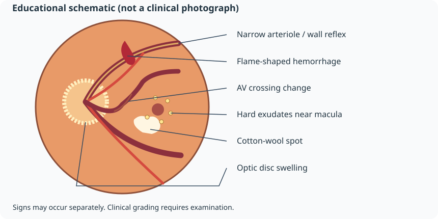

# 📚 Hypertensive Retinopathy — Nursing Concepts

**Study-ready, not studied.** Retinal manifestations, eye assessment and emergency referral. Systemic hypertension and antihypertensive pharmacology remain in Cardiovascular. Obstetric hypertensive disorders remain in Obstetric and Midwifery Nursing.

[Chapter](../README.md) · [30 original MCQs](../MCQs/Hypertensive-Retinopathy-30-MCQs.md) · [Exam evidence](../Previous-Year-Questions/Hypertensive-Retinopathy-Exam-Evidence.md)

## Mechanism

Retina ko blood supply chhoti arteries aur arterioles ke through milti hai. Jab BP increase hota hai toh retinal arterioles initially contract karke blood flow regulate karne ki koshish karti hain. Isko autoregulation kehte hain. Long-standing hypertension mein vessel walls thicken aur stiff ho sakti hain. Isliye lumen permanently narrow ho sakta hai.

Ek flexible water pipe imagine karo. Pressure se bachne ke liye pipe ka opening temporarily narrow ho sakta hai. Agar pipe ki wall long term mein thick aur stiff ho jaaye, toh flow regulate karna difficult ho jaata hai. Retina ki living vessels mein smooth muscle aur endothelial cells ye response regulate karte hain. Severe acute BP elevation autoregulation overwhelm kar sakti hai. Endothelial injury se leakage aur ischemia dono develop ho sakte hain. Ischemia ka matlab tissue ko adequate blood supply na milna hai.

## Fundus signs

- Generalized arteriolar narrowing mein arteries ka caliber veins ke comparison mein kam hota hai. Early functional narrowing reversible ho sakti hai.
- Focal narrowing mein arteriole ka specific segment narrow dikhta hai.
- Copper wiring aur silver wiring arteriolar wall opacity aur altered light reflex ko describe karte hain. Silver wiring generally more advanced sclerosis show karti hai. Ye actual metal deposits nahi hain.
- AV nicking mein artery-vein crossing par venule ka contour narrowed ya displaced dikhta hai. Chronic vessel wall changes contribute karte hain.
- Flame-shaped hemorrhage superficial retinal nerve fiber layer mein blood spread hone se flame jaisa dikhta hai.
- Cotton-wool spots focal nerve fiber layer ischemic injury aur axoplasmic transport interruption ke signs hain. Ye lipid deposits ya pus nahi hain.
- Hard exudates lipid-rich deposits hain jo vascular leakage ke baad retina mein remain kar sakte hain. Macula ke radial fibers ke along ye macular star form kar sakte hain. Macular star hypertension ka exclusive sign nahi hai.
- Optic disc edema mein disc margins blurred aur elevated dikh sakte hain. Classical textbooks grade 4 mein papilledema term use karte hain. Strict terminology mein papilledema raised intracranial pressure se related disc edema hai. Severe hypertension-related disc swelling ko automatically raised intracranial pressure ka proof mat samjho.

Diagram conceptual hai, clinical photograph nahi. Signs ek hi patient mein mandatory nahi hain.

## Classification

**Classical Keith–Wagener–Barker (KWB)** is an exam convention, not a standalone treatment algorithm.

| Grade | Typical features |
|---|---|
| 1 | Mild generalized arteriolar narrowing |
| 2 | More definite narrowing and AV crossing changes |
| 3 | Grade 2 changes plus retinal hemorrhages, cotton-wool spots and/or exudative changes |
| 4 | Grade 3 findings plus optic disc swelling |

**Wong–Mitchell population-based classification:** Mild includes narrowing, AV nicking or wall reflectivity changes. Moderate includes hemorrhage, microaneurysm, cotton-wool spots or hard exudates. Severe/malignant includes moderate signs with optic disc swelling. Dono systems interchangeable numbers nahi hain. Acute target-organ injury disc edema ke bina bhi ho sakti hai. Old grades 1–2 ki reproducibility limited ho sakti hai. Clinical urgency overall patient assessment se decide hoti hai.

## Choroid and optic nerve involvement

Severe sudden hypertension choroidal circulation bhi injure kar sakti hai. RPE ke small ischemic lesions ko Elschnig spots kehte hain. Healed lesions pigmented centers aur pale halos dikha sakte hain. Siegrist streaks choroidal arteries ke course ke along linear pigmentary changes hain. RPE barrier damage se serous retinal detachment possible hai. Ye rhegmatogenous tear-related detachment se alag mechanism hai.

Hypertensive optic neuropathy optic nerve head ko involve karti hai. Severe disc edema aur ischemia visual damage cause kar sakte hain. Retinopathy, choroidopathy aur optic neuropathy overlap kar sakti hain.

## Assessment and differentiation

Mild disease mein patient ko symptoms nahi bhi hote. Advanced changes mein blur, field defect ya reduced vision report ho sakti hai. Nurse onset, laterality, medication adherence, recent BP readings, pregnancy/postpartum status, kidney disease, diabetes, neurological aur cardiac symptoms document karti hai.

Fundus examination aur photography vessel changes aur lesions document karte hain. OCT macular edema, subretinal fluid aur structural changes assess kar sakta hai. Fundus findings alone systemic BP reading replace nahi karti. Diabetes bhi hemorrhages, cotton-wool spots aur hard exudates cause kar sakti hai. Hypertension aur diabetes coexist kar sakte hain. Unilateral sectoral venous congestion aur hemorrhage BRVO ka clue ho sakta hai, jabki diffuse bilateral arteriolar changes hypertensive disease support karte hain. Specialist full context se diagnosis karta hai.

## Emergency nursing and follow-up

Severe BP elevation ke saath acute retinal hemorrhages, disc edema, new confusion, chest pain ya breathlessness target-organ injury ka concern raise karte hain. NICE NG136 mein clinic BP 180/120 mmHg or higher with retinal hemorrhage or disc swelling same-day specialist assessment ka criterion hai. Is threshold ko har patient ke liye universal safe cutoff mat samjho. Pregnancy mein lower severe-range BP thresholds aur separate maternity protocols apply hote hain.

Patient ko appropriate emergency pathway mein escalate karo. BP repeat correct technique se karo, par referral delay mat karo. ABC, vital signs, consciousness, neurological symptoms, urine output aur vision changes assess/document karo as appropriate. Acutely uncontrolled BP ko apni taraf se rapidly normalize karne ke liye extra tablets mat do. Clinician-directed monitored BP reduction chahiye, kyunki excessively rapid fall brain, heart, kidneys aur retina ki perfusion reduce kar sakta hai.

Pregnant ya recently postpartum patient with new visual symptoms needs urgent maternity assessment even if fundus findings normal hain. Visual symptoms retinal disease ke alawa cerebral involvement se bhi aa sakte hain. Magnesium sulfate monitoring aur obstetric treatment separate chapter ke scope mein hain.

Stable chronic changes mein prescribed BP management, cardiovascular/kidney risk assessment, smoking cessation support aur eye follow-up important hain. Patient ko explain karo ki vision normal lagne se vascular damage exclude nahi hota. Follow-up fundus photographs aur OCT retinal response document kar sakte hain. Some acute changes resolve, but established sclerosis or ischemic damage persist kar sakta hai. Local retinal treatment selected complications ke liye specialist consider karta hai, systemic BP control ka substitute nahi.

## Exam clues

| Clue | Think |
|---|---|
| Copper/silver wiring | Chronic arteriolar sclerosis |
| Cotton-wool spot | Nerve fiber layer ischemic injury |
| Radial lipid pattern | Macular star |
| Grade 3 plus disc edema | Classical KWB grade 4 |
| Elschnig spots | Hypertensive choroidopathy |
| Severe BP plus acute retinal injury | Emergency systemic assessment |

## ▶️ Learning and practice

Teaching: [Hypertensive Retinopathy — Jatoi Clinical Ophthalmology](https://www.youtube.com/watch?v=qz8AfRhUBu0), indexed description confirms grading and clinical signs. Playback not verified. Dedicated practice lead: [KWB grading MCQ short](https://www.youtube.com/watch?v=H65WKqKW390), indexed title only, direct access failed. Q12–15 topic lead only, exact question coverage pending. No verified dedicated question video coverage counted. See evidence register.

## Clinical references

- [Merck Manual Professional](https://www.merckmanuals.com/professional/eye-disorders/retinal-disorders/hypertensive-retinopathy) — directly retrieved.
- [StatPearls](https://www.ncbi.nlm.nih.gov/books/NBK525980/) — indexed clinical text.
- [AAO EyeWiki](https://eyewiki.aao.org/Hypertensive_retinopathy) — indexed text.
- [Review of hypertensive retinopathy and chorioretinopathy](https://pmc.ncbi.nlm.nih.gov/articles/PMC7211319/) — indexed extract, direct access CAPTCHA.
- [NICE NG136](https://www.nice.org.uk/guidance/ng136/chapter/Recommendations) — indexed official recommendation.
- [Cardiovascular master guide](../../Cardiovascular-System/Concepts/Cardiovascular-System-Master-Guide.md) · [Obstetric chapter](../../Obstetric-and-Midwifery-Nursing/README.md).
