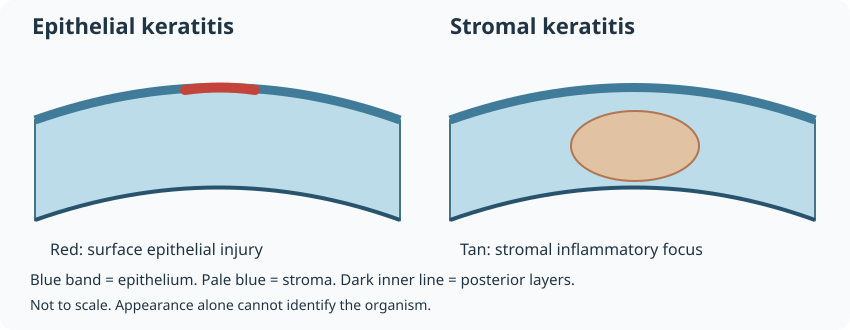

# 📚 Keratitis — detailed Roman Hinglish nursing concepts

**Study-ready, not studied.** This bank owns corneal inflammation, etiology-specific differentiation and treatment principles. Ulcer depth, healing, perforation and therapeutic surgery will be covered separately in the corneal ulcer bank.

[Chapter](../README.md) · [30 original MCQs](../MCQs/Keratitis-30-MCQs.md) · [Exam evidence](../Previous-Year-Questions/Keratitis-Exam-Evidence.md)

## Anatomy and mechanism

Cornea transparent anterior tissue hai. Iski regular stromal collagen arrangement aur controlled hydration se light accurately transmit hoti hai. Epithelium surface barrier banata hai, stroma strength provide karta hai aur endothelium fluid pump karke transparency maintain karta hai. Cornea mein sensory nerve supply rich hoti hai. Surface damage se pain, foreign-body sensation, tearing aur light sensitivity develop ho sakti hai.

Keratitis ka meaning corneal inflammation hai. Ye infectious ya noninfectious ho sakti hai. Corneal ulcer mein epithelial defect ke saath underlying stromal inflammation ya tissue loss hota hai. Har keratitis ulcerative nahi hoti. Sirf epithelial abrasion mein stromal infiltrate necessary nahi hota. Corneal infiltrate white/grey inflammatory focus hai. Edema hydration aur structural changes ki wajah se diffuse haze create kar sakta hai.

Ek transparent glass window par fog imagine karo. Light pass ho sakti hai lekin image clear nahi dikhegi. Inflamed cornea mein edema, inflammatory cells aur later scar vision disturb kar sakte hain. Ye analogy sirf transparency samajhne ke liye hai.

## Bacterial and fungal keratitis

Contact lens overwear, epithelial injury, surgery, ocular surface disease aur immunosuppression microbes ko access de sakte hain. Pseudomonas particularly contact lens-related bacterial disease mein important hai. Staphylococci aur streptococci bhi causes hain. Rapid progression aur stromal destruction possible hai. Nocardia soil-associated infection hai aur patchy wreath-like infiltrates suggestive ho sakte hain. Appearance organism prove nahi karta.

India mein agricultural injury aur vegetative matter exposure fungal keratitis ke important clues hain. Filamentous fungi mein Fusarium aur Aspergillus common considerations hain. Candida yeast compromised ocular surface mein possible hai. Dry-looking infiltrate, feathery margins, satellite lesions aur slow course fungal suspicion raise karte hain, but no single sign is definitive. Fungal disease deep stroma tak extend ho sakti hai.

Corneal scraping trained ophthalmic clinician karta hai. Gram stain bacterial morphology aur KOH wet preparation fungal elements identify karne mein help kar sakte hain. Fungal culture aur bacterial culture appropriate media par inoculate ki jaati hain. Result negative hone se infection completely exclude nahi hota. Nurse specimens transport aur prescribed treatment coordinate karti hai.

ICMR 2025 ocular antimicrobial guidance filamentous fungal disease mein natamycin 5% ko first-line topical agent list karti hai. Ye suspension hai, product directions ke according shake karo. Amphotericin B selected yeast disease mein specialist choice ho sakti hai. MUTT I evidence natamycin ko topical voriconazole se overall better outcomes ke saath support karta hai in studied filamentous ulcers. MUTT II mein severe filamentous ulcers ke liye routine add-on oral voriconazole se overall primary outcome improve nahi hua aur adverse events zyada hue. Selected deep disease/systemic extension mein specialist systemic drug consider kar sakta hai. Nurse independent regimen select nahi karegi.

Bacterial keratitis mein intensive topical antibiotics clinician severity, local resistance aur culture ke hisaab se prescribe karta hai. Severe cases fortified preparations require kar sakte hain. AAO 2024 guidance selected bacterial cases mein at least 48 hours effective antibiotic therapy aur organism identification and/or response ke baad steroid consider karti hai. Ye automatic nursing order nahi. Fungal, Acanthamoeba aur Nocardia infection mein unsupervised steroids harmful ho sakte hain.

## Herpetic keratitis

HSV primary infection ke baad trigeminal ganglion mein latent reh sakta hai. Reactivation recurrent ocular disease cause kar sakti hai. Epithelial HSV mein actively replicating virus epithelial defect create karta hai. True dendritic ulcer mein branching lesion aur terminal bulbs hote hain. Fluorescein ulcer base stain kar sakta hai. Corneal sensation reduced ho sakti hai. Reduced sensation se severe damage ke bawajood symptoms unexpectedly mild ho sakte hain.

Epithelial HSV ko clinician oral/topical antiviral se manage karta hai. Active epithelial disease mein corticosteroid monotherapy unsafe hai. Stromal immune inflammation mein specialist antiviral cover ke saath steroid prescribe kar sakta hai. Necrotizing stromal infection alag higher-risk condition hai. Epithelial status, stromal depth aur infection activity reassess ki jaati hai. Recurrent episodes ke baad scar, neovascularization aur neurotrophic epithelial defect possible hain. Long-term suppressive antiviral selected recurrent cases mein specialist consider kar sakta hai.

VZV ophthalmicus mein unilateral trigeminal V1 distribution rash, forehead/eyelid vesicles aur ocular involvement possible hai. Nasal tip lesions (Hutchinson sign) ocular involvement risk badhate hain. Sign absent hone se ocular involvement exclude nahi hota. VZV pseudodendrites typically elevated ho sakte hain aur classic HSV terminal bulbs absent hote hain. Prompt medical assessment aur prescribed systemic antiviral important hai. Treatment start ko eye appointment ke liye unnecessarily delay nahi karna.

## Acanthamoeba keratitis

Acanthamoeba free-living amoeba hai jo water, soil aur environment mein mil sakti hai. Contact lens ke saath tap-water exposure, showering, swimming ya poor hygiene risk increase karte hain. Early disease bacterial ya HSV keratitis jaisi lag sakti hai. Severe pain disproportionate to early visible findings ek clue hai, but pain absent bhi ho sakta hai. Radial keratoneuritis aur later ring infiltrate suggestive hain, pathognomonic nahi. Ring infiltrate ka wait karna diagnosis delay kar sakta hai.

Trophozoite active form hai aur cyst resistant form hai. Cyst persistence prolonged treatment aur recurrence ka reason ho sakti hai. Specialist corneal scraping, culture on special media, PCR aur in-vivo confocal microscopy use kar sakta hai. Negative initial test suspicion ko automatically dismiss nahi karta. PHMB (polyhexamethylene biguanide) ya chlorhexidine based topical therapy specialist protocol ke according long duration tak chal sakti hai. Exact formulation availability, concentration and combinations clinician decide karta hai. Do not use household disinfectants in eyes.

## Noninfectious keratitis

Incomplete eyelid closure aur reduced blink se tear film evaporate hoti hai. Exposure keratopathy mein inferior cornea particularly vulnerable ho sakti hai. Sedated patients mein eyelid closure check karo, prescribed lubricant aur approved moisture chamber/closure protocol follow karo. Existing microbial infection mein routine pressure patch different concern hai. Neurotrophic disease mein trigeminal sensory impairment se reflex tearing aur epithelial repair compromised ho sakte hain. Pain absence safety prove nahi karti.

UV photokeratitis welding arc ya reflected ultraviolet exposure ke kuch hours baad bilateral pain, tearing aur punctate epithelial damage cause kar sakti hai. Protective UV-rated eyewear prevent karta hai. Bilateral pattern aur delay clue hain, penetrating foreign body history exclude karna important hai.

Sterile marginal keratitis eyelid disease ke saath immune response se related ho sakti hai. Peripheral infiltrate aur limbus ke beech clear interval possible hai. Peripheral ulcerative keratitis with thinning systemic autoimmune disease ka clue ho sakti hai. Infection exclude aur urgent cornea/systemic evaluation necessary hai.

## Assessment and nursing

Symptoms, onset, trauma, lens habits, water contact, previous herpes, ocular surgery, topical steroid/anaesthetic exposure aur systemic disease record karo. Slit lamp depth aur morphology evaluate karta hai. Fluorescein epithelial damage visualize karta hai, pathogen identify nahi karta. Baseline visual acuity, pain and corneal findings document karo. Corneal sensation assessment topical anaesthetic se pehle trained examiner kare.

Contact lens hygiene education mein fresh disinfecting solution, no topping off, no water exposure, prescribed replacement aur hand drying include karo. Lens/case may be retained for clinician-directed culture rather than reused. Do not independently apply patch, steroid or repeated home topical anaesthetic. Prescribed frequent drops ke liye timing chart, correct eye and medication identity check karo. Different preparations mein prescribed spacing rakho. Overnight frequency order verify karo. Escalate worsening pain, vision, opacity or inability to administer treatment. Urgent corneal assessment delay mat karo.

## ▶️ Teaching and practice

- [Cybersight — Dr Madhu Uddaraju, Microbial Keratitis update](https://www.youtube.com/watch?v=IuI4FfwKWV8): indexed description verifies organism differentiation and microbiology teaching.
- [Dr Kritika Ophthal — Cornea & Uveitis, NEET PG question discussion](https://www.youtube.com/watch?v=a3Im-WHVeFI): published cornea segment 0:00–17:08 lists fungal ulcer, dendritic ulcer and Acanthamoeba. Supplemental medical entrance practice, not nursing recruitment evidence. Topic leads for Q8, Q13, Q14, Q19, Q20. Exact playback and question timestamps not verified. Other specific practice gaps remain.

## Clinical sources

- [ICMR AMRTG 2025, ocular infections](https://amrtg.icmr.org.in/section-info/11/1) — indexed text, direct open failed.
- [AAO bacterial keratitis PPP 2024](https://www.aaojournal.org/article/S0161-6420%2824%2900007-1/fulltext) and [2025 benchmark](https://www.aao.org/education/summary-benchmark-detail/cornea-external-disease-summary-benchmarks-2020) — indexed text.
- [AAO HSV treatment guideline](https://www.aao.org/education/clinical-statement/herpes-simplex-virus-keratitis-treatment-guideline) and [2025 infectious keratitis review](https://pmc.ncbi.nlm.nih.gov/articles/PMC12429233/) — indexed.
- [CDC Acanthamoeba clinical overview](https://www.cdc.gov/acanthamoeba/hcp/clinical-overview-acanthamoeba-keratitis/) — indexed, direct open failed.
- [MUTT II and MUTT I comparison](https://jamanetwork.com/journals/jamaophthalmology/fullarticle/2569673) — indexed abstract.
- [StatPearls Keratitis](https://www.ncbi.nlm.nih.gov/sites/books/NBK559014/) — indexed.
