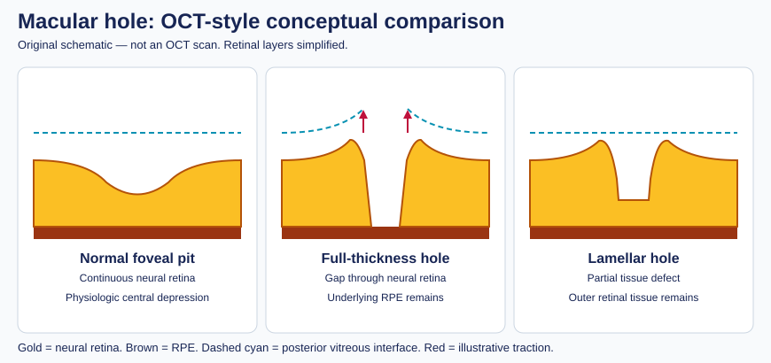

# 👁️ Macular Hole and Nursing

**Study-ready, unattempted.** NORCET / Staff Nurse. OCT staging and complex surgical techniques are specialist enrichment. Epiretinal membrane and vitreomacular traction need their own later banks.

[Chapter](../README.md) · [30 original MCQs](../MCQs/Macular-Hole-30-MCQs.md) · [Exam evidence](../Previous-Year-Questions/Macular-Hole-Exam-Evidence.md)

[Mechanism](#mechanism) · [Recognition](#recognition) · [Assessment](#assessment) · [Management](#management) · [Surgery](#surgery) · [Follow-up](#follow-up)

## Mechanism

**🔴 MOST IMPORTANT**

Macula retina ka central part hai jo reading, faces aur fine detail dekhne mein help karta hai. Fovea macula ke center mein ek natural shallow pit hai. Normal pit ka matlab disease nahi hai. Jab fovea ki neural retinal layers mein actual full-thickness gap ban jaata hai, usko full-thickness macular hole (FTMH) kehte hain. Underlying retinal pigment epithelium (RPE) ko necessarily tear hona zaroori nahi.

Age ke saath vitreous gel liquefy aur separate ho sakti hai. Agar posterior vitreous interface fovea se attached reh jaaye aur pull kare toh foveal contour change ho sakta hai. Vitreomacular adhesion (VMA) mein attachment hai lekin structural distortion nahi. Vitreomacular traction (VMT) mein attachment ke saath foveal anatomy affected hai. Selected cases mein traction progress karke macular hole bana sakti hai. Har VMA hole nahi banti.

Idiopathic hole age-related interface change se ho sakti hai. Trauma ke baad young patient mein traumatic macular hole possible hai. High myopia mein posterior globe elongation aur traction-related abnormalities macular hole-associated retinal detachment ka risk create kar sakti hain. Subretinal fluid extending away from posterior pole needs specialist evaluation. Eye injury mein associated damage bhi assess karna hai.

## Recognition

**🔴 MOST IMPORTANT**

Patient central blur, straight lines distorted, missing central letters, central scotoma (blind spot), ya micropsia (objects smaller appear hona) notice kar sakta hai. Peripheral vision relatively preserved reh sakti hai. Unilateral disease binocular activities mein mask ho sakti hai because better eye compensate karti hai. Isliye visual acuity each eye separately record karna useful hai. Fellow eye interface changes bhi specialist review karta hai. First eye mein hole hone se doosri eye mein hole guaranteed nahi hoti.

Agar sudden severe monocular visual loss ya new curtain, flashes, neurologic symptoms ya acute trauma ho toh emergency differential assess karo. Gradually developing central distortion bhi prompt retinal evaluation maangti hai, lekin confirmed stable macular hole ke management ko CRAO stroke protocol ke saath confuse mat karo.

## Assessment

**🔴 MOST IMPORTANT**

Optical coherence tomography (OCT) retina ka cross-sectional image banati hai. Full-thickness hole mein neural retinal layers through actual gap dikh sakta hai. Lamellar hole partial foveal tissue defect hai. Pseudohole mein epiretinal membrane ke contraction se steep contour ban sakta hai, lekin true tissue loss absent hota hai. Clinical appearance alone se ye conditions reliably distinguish nahi hoti.

| Finding | Clinical interpretation |
|---|---|
| VMA | Attachment, no foveal structural distortion |
| VMT | Attachment with structural distortion |
| FTMH | Full neural retinal defect |
| Lamellar hole | Partial-thickness foveal tissue loss |
| Macular pseudohole | ERM-related steep contour without true loss |

Traditional IVTS OCT classification: small ≤250 micrometers, medium >250 to ≤400 micrometers, large >400 micrometers. Minimum linear diameter opening ki narrowest horizontal width describe karti hai. Ye traditional thresholds hain, surgical complexity ke liye further classifications bhi proposed hain. Example: 320 micrometers = medium under traditional IVTS.

Classic Gass classification fundus appearance aur vitreous status par based thi. Stage 1 impending hole mein foveal changes hote hain lekin established full-thickness gap nahi. Stage 2 early full-thickness hole, often persistent attachment. Stage 3 larger full-thickness hole without complete PVD. Stage 4 full-thickness hole with complete PVD. Modern OCT size aur vitreofoveal attachment separately report karti hai. Gass aur IVTS categories identical nahi.

Watzke-Allen historical slit-beam test mein patient foveal lesion ke across projected beam interrupted ya thinned perceive kar sakta hai. Ye suggestive finding hai, definitive substitute for OCT nahi. Nurse ko diagnosis independently assign nahi karna.

## Management

**🔴 MOST IMPORTANT**

Recent symptomatic full-thickness macular hole mein prompt retinal referral important hai. Hole enlargement aur longer duration surgical outcome influence kar sakte hain. Clinician OCT, symptoms, size, duration, lens status, fellow eye function aur patient's preferences review karta hai.

Selected small asymptomatic holes mein initial observation with reliable repeat OCT may be reasonable. 2025 Asia-Pacific consensus mein small asymptomatic holes <250 micrometers with regular OCT monitoring ka option discuss hua hai, lekin agreement universal nahi tha. Larger symptomatic or VMT-associated holes mein early surgery often preferred. New acuity decline ya structural enlargement ho toh management decision reassess karna chahiye.

Some traumatic holes spontaneously close kar sakti hain, particularly selected younger patients. Associated injury exclude aur close specialist review necessary hai. Every case observe karna safe rule nahi hai. Routine antibiotics, topical steroids ya stronger spectacle number structural idiopathic foveal gap close nahi karte.

## Surgery

**🔴 MOST IMPORTANT**

Pars plana vitrectomy (PPV) mein surgeon vitreous traction relieve karta hai. Internal limiting membrane (ILM) retina ki innermost boundary layer hai. ILM peeling se remaining tangential traction reduce ho sakti hai aur anatomic closure rate improve ho sakta hai. Large or refractory holes mein selected inverted ILM flap technique healing scaffold provide kar sakti hai. Ye advanced operative decisions surgeon ke hain.

Temporary intraocular gas bubble macular surface contact aur fluid isolation support karti hai. Isse healing facilitate ho sakti hai. Face-down positioning ki need aur duration hole size, surgical technique aur surgeon's plan par depend karti hai. Fixed 14-day instruction sabke liye apply mat karo. 2025 Asia-Pacific consensus individualization emphasize karti hai. Nurse preoperative counseling mein actual prescribed positioning plan, tolerability aur practical support clarify karti hai.

Phakic patient ke natural lens mein vitrectomy ke baad cataract progression possible hai. Existing significant cataract ho toh combined or staged surgery discuss ho sakti hai. Operation selection, lens power aur tamponade surgeon ke decisions hain.

Peripheral retinal tear laser retinopexy ka aim tear ke around adhesion create karna hai. Idiopathic macular hole foveal traction-related defect hai. Routine destructive laser fovea par use karna central vision harm kar sakta hai. Inko same procedure mat samjho.

General gas safety: [Retinal detachment surgical nursing](Retinal-Detachment-and-Surgical-Nursing.md). Intraocular gas remain karne tak flying and nitrous oxide unsafe hain. High-altitude travel surgeon se clear karwao. Emergency healthcare team ko gas status communicate karo. Patient-specific written instructions follow karna essential hai.

## Follow-up

**🔴 MOST IMPORTANT**

Early postoperative visual blur gas bubble se expected ho sakta hai, lekin new severe pain, increasing redness ya marked deterioration urgent review maangti hai. OCT closure document kar sakti hai, including selected early imaging through gas when image quality allows. Nurse patient ko follow-up schedule aur prescribed posture teach-back karwati hai. Surgeon ki permission ke bina posture stop nahi karna.

Anatomic closure ka matlab full visual recovery guaranteed nahi. Chronic foveal photoreceptor injury, outer retinal ellipsoid zone disruption aur other ocular disease detailed vision limit kar sakti hain. Recovery gradual ho sakti hai. Persistent hole kabhi documented close nahi hui. Reopened hole previous closure ke baad again appear hoti hai. Specialist repeat treatment need assess karta hai.

Patient ko clear expectations do aur reading aids/low-vision support if needed discuss karo. Exact surgery risks and benefits treating team explain karti hai.

## Quick revision

- FTMH = full neural retinal gap at fovea.
- VMA no distortion, VMT distortion, pseudohole no true tissue loss.
- OCT key structural investigation.
- Traditional IVTS small ≤250, medium >250–400, large >400 micrometers.
- Selected small stable holes observe with OCT. Symptomatic progressing holes prompt specialist review.
- PPV + ILM peel + gas is a common treatment, positioning individualized.
- Closure and functional recovery are distinct.

## Teaching and MCQ practice

| Scope | Teaching | Dedicated MCQ practice |
|---|---|---|
| VMA, VMT, Gass and OCT classification | [Insight Ophthalmology — Classification of macular hole](https://www.youtube.com/watch?v=VQKWQfizC6U), title and description indexed | Verification pending |
| Postoperative positioning | [Macular Hole: Post-Operative](https://www.youtube.com/watch?v=Gt86ZahDixU), indexed description only, creator/playback pending, do not copy fixed schedule | Verification pending |

Checked 27 November 2026. No specific dedicated question-solving video verified for any of 30 items. Teaching is separate from practice, no invented timestamps.

## References

- [National Eye Institute macular hole](https://www.nei.nih.gov/eye-health-information/eye-conditions-and-diseases/macular-hole), directly retrieved public page.
- [Asia-Pacific 2025 consensus](https://link.springer.com/article/10.1186/s40662-025-00446-0), directly retrieved full-text page.
- [AAO idiopathic macular hole PPP](https://www.aao.org/education/preferred-practice-pattern/idiopathic-macular-hole-ppp) and [AAO diagnosis and management](https://www.aao.org/eyenet/article/diagnosis-and-management-of-macular-holes), indexed guidance.
- [EyeWiki macular hole](https://eyewiki.aao.org/Macular_Hole), indexed structural distinctions.
- [ASRS patient information](https://www.asrs.org/patients/retinal-diseases/4/macular-hole), indexed.
- [Watzke-Allen test study](https://jamanetwork.com/journals/jamaophthalmology/fullarticle/413469), indexed historical evidence.

[Chapter](../README.md) · [MCQs](../MCQs/Macular-Hole-30-MCQs.md) · [Exam evidence](../Previous-Year-Questions/Macular-Hole-Exam-Evidence.md)
