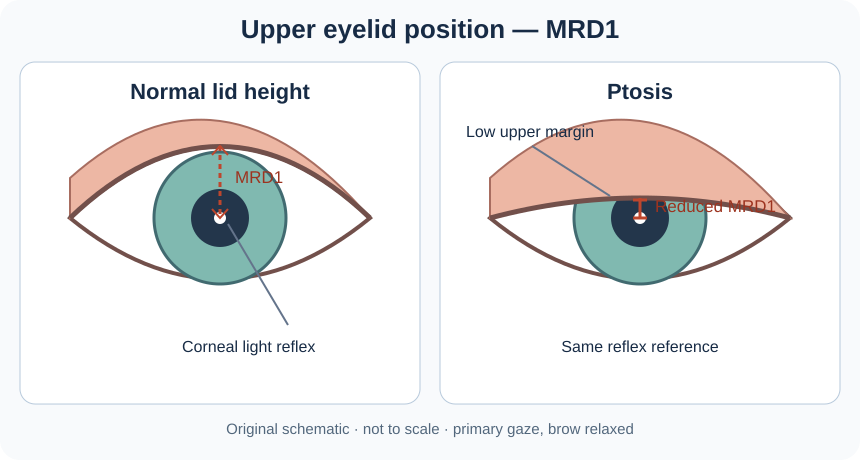

# 📚 Ptosis — detailed concepts and nursing care

**Study-ready, not studied.** [Chapter](../README.md) · [30 original MCQs](../MCQs/Ptosis-30-MCQs.md) · [Exam evidence and dedicated practice](../Previous-Year-Questions/Ptosis-Exam-Evidence.md)

[Anatomy](#anatomy) · [Assessment](#assessment) · [Causes](#causes) · [Neurology](#neurology) · [Children](#children) · [Management](#management) · [Nursing](#nursing) · [Practice resources](#practice-resources)

## anatomy

**🟠 HIGH YIELD — Ptosis kya hai?** Jab upper eyelid ka actual margin normal position se neeche aa jata hai, usko blepharoptosis ya ptosis kehte hain. Ek eye ya dono eyes affect ho sakti hain. Isko sirf skin loose hone, eyelash direction change ya lower lid eversion se confuse mat karo.

Socho ki upper lid ek curtain hai. Usko lift karne wali main muscle levator palpebrae superioris hai. Third cranial nerve is muscle ko motor signal deti hai. Levator aponeurosis muscle ki pulling force lid ke tarsal plate aur skin tak transfer karne mein help karti hai. Müller muscle ek smooth muscle hai jo sympathetic nerve signal se thodi additional elevation provide karti hai. Frontalis forehead ki muscle hai. Jab patient brow raise karke low lid se compensate karta hai, tab humein forehead wrinkles aur brow elevation dikh sakti hain. Orbicularis oculi facial nerve ke control mein lid close karti hai.

| Structure | Main role |
|---|---|
| Levator palpebrae superioris | Upper lid ko actively lift karti hai. |
| Levator aponeurosis | Muscle ki force ko lid tak transfer karti hai. |
| Müller muscle | Sympathetic stimulation se additional lid elevation maintain karti hai. |
| Frontalis | Brow elevate karti hai aur compensation mein help kar sakti hai. |
| Orbicularis oculi | Eye closure aur blink mein help karti hai. |

Practice Q1–3.

## assessment

**🟠 HIGH YIELD — Measurement ko samjho.** History mein onset, old photographs, progression, fatigue ke saath change, diplopia, pupil change, head ya neck pain, trauma aur past eye surgery poochho. Visual acuity har eye mein separately note karo. Pupil size aur response, ocular movement, actual upper margin, excess skin, brow position, lid crease aur lid closure document karo. New neurological signs par urgent assessment chahiye.

MRD1 ka matlab upper lid margin aur central corneal light reflex ke beech vertical distance hai jab patient straight dekhta hai. MRD2 lower lid margin aur same reflex ka distance hai. Normal MRD1 generally around 4–5 mm hoti hai, lekin individual variation aur technique important hain. Reflex covered ho to MRD1 zero ya negative ho sakti hai. Same vertical line par palpebral fissure height = MRD1 + MRD2. Agar MRD1 1 mm aur MRD2 5 mm ho, opening 6 mm hai. Reverse check 6 minus 5 = 1 mm.

Levator excursion measure karne ke liye trained examiner brow ko gently stabilize karta hai aur upper lid ka movement maximal downgaze se maximal upgaze tak note karta hai. Isse frontalis compensation ka effect kam hota hai. Bahut poor movement jaise 3 mm surgical planning mein relevant hota hai. Exact cutoffs sources aur surgical protocol mein vary karte hain. EyeWiki 0–5 mm ko poor category mein rakhta hai, jabki kuch congenital ptosis references 4 mm se kam ko very poor function describe karte hain. Isliye actual measurement record karo aur universal cutoff assume mat karo.

Hering phenomenon mein dono levators ka shared motor drive important hai. Unilateral ptosis mein compensatory drive opposite lid ko bhi elevate kar sakti hai. Jab examiner affected lid ko lift karta hai aur opposite lid lower ho jata hai, masked contralateral droop assess ki ja sakti hai. Dermatochalasis mein redundant skin lashes ke upar hang kar sakti hai lekin actual lid margin normal ho sakta hai. Dono conditions ek saath bhi ho sakti hain.

Superior visual field comparison with and without lid support functional obstruction document karne mein help kar sakta hai. Ye neurological emergency exclude karne ka test nahi hai. Practice Q4–10.

## causes

**🟠 HIGH YIELD — Ptosis ke alag mechanisms.** Aponeurotic ptosis frequently older adults mein hoti hai. Muscle lift kar sakti hai, lekin stretched ya detached attachment ki wajah se force efficiently transfer nahi hoti. High lid crease aur relatively preserved excursion useful clues hain. Myogenic ptosis mein muscle ya muscle-related transmission ki function affect hoti hai. Congenital levator maldevelopment common pediatric example hai. Neurogenic ptosis mein neural supply affect hoti hai. Mechanical ptosis mein heavy lesion, swelling ya tissue restriction lid ko lift nahi hone deti. Trauma direct muscle, aponeurosis ya nerve damage kar sakta hai.

**Clinical example:** Older adult mein gradually droop develop hua hai aur lid crease high hai. Levator excursion preserved hai. Is pattern se aponeurotic cause suspect hota hai. Agar same adult mein sudden onset ke saath movement deficit ho, to cosmetic explanation assume mat karo. Neurological cause urgently evaluate hona chahiye. Practice Q11–13.

## neurology

**🔴 MOST IMPORTANT — Emergency signs.** Third cranial nerve levator aur multiple extraocular muscles ko supply karti hai. Palsy mein ptosis, impaired adduction/elevation aur diplopia ho sakte hain. Complete palsy mein eye classically down and out position mein ho sakti hai. Pupil dilated bhi ho sakti hai. New acute suspected third nerve palsy ko urgently assess karwana chahiye, even if pupils equal hain. Pupil sparing se dangerous compression reliably exclude nahi hota. Clinician urgent neuroimaging ka appropriate plan decide karta hai.

Horner syndrome mein sympathetic supply interrupt hoti hai. Isliye mild upper lid droop aur same-side small pupil ho sakti hai. Darkness mein normal pupil dilate karti hai, affected pupil properly dilate nahi kar pati. Difference darkness mein prominent ho sakta hai. New Horner pattern ke saath sudden neck pain carotid artery dissection ka warning sign ho sakta hai. Isko emergency mein escalate karo. Sweating changes lesion location ke hisab se vary kar sakte hain.

Myasthenia gravis neuromuscular junction ki disorder hai. Ismein repeated activity se weakness badh sakti hai aur rest se temporarily improve ho sakti hai. Pupils generally unaffected rehti hain. Supervised ice test selected cases mein supportive ho sakta hai, lekin standalone definitive diagnosis nahi hai. Antibody tests aur electrophysiology specialist decide karta hai. Agar fluctuating ptosis ke saath weak cough, dysphagia ya breathing difficulty develop ho, to possible bulbar aur respiratory weakness ko priority do. Airway aur breathing assessment delay mat karo. Detailed systemic management neurological chapter ka scope hai.

| Finding | Clinical concern |
|---|---|
| New ptosis with extraocular movement deficit | Third nerve or other neurological lesion, urgent evaluation |
| Mild droop, miosis, anisocoria greater in darkness | Sympathetic pathway dysfunction |
| Variable droop, fatigability, normal pupils | Possible myasthenia |
| Ptosis plus weak cough, dysphagia, dyspnoea | Possible respiratory or bulbar emergency |

Practice Q14–20. Pupil and movement findings ko report karo, khud definitive diagnosis ya imaging protocol prescribe mat karo.

## children

**🔴 MOST IMPORTANT — Visual development.** Congenital ptosis mein levator muscle ka development incomplete ho sakta hai. Child forehead raise kar sakta hai ya chin up rakh sakta hai taaki lid ke neeche se dekh sake. Agar lid pupil cover kar rahi hai to developing visual pathway ko adequate clear input nahi mil sakta. Isse deprivation amblyopia develop ho sakti hai. Astigmatism aur anisometropia bhi amblyopia ka risk badha sakte hain, even jab pupil open dikhti hai.

Marcus Gunn jaw-winking mein jaw movement ke saath affected lid transiently rise kar sakti hai. Ye abnormal neural connection ka clinical clue hai. Caregiver feeding ya sucking ke time movement observe kar sakta hai. Specialist ko finding communicate karo. Blepharophimosis jaise syndromic features aur other ocular movement abnormalities ka bhi assessment ho sakta hai.

Mild ptosis jisme visual development threatened nahi hai, usmein specialist follow-up ke saath observation choose kar sakta hai. Severe visual axis obstruction mein fixed cosmetic surgery age ka wait appropriate nahi ho sakta. Timing visual risk ke according decide hoti hai. Refraction, spectacles aur amblyopia treatment specialist plan ke according continue karo. Ptosis surgery se lid height improve ho sakti hai, lekin developing visual pathway ki existing problem automatically resolve nahi hoti.

Practice Q21–25. Mock 01 amblyopia treatment adherence items separate aur reserved hain.

## management

**🟠 HIGH YIELD — Cause-specific treatment.** Pehle cause assess hota hai. Suspected neuromuscular disorder ya acute cranial nerve problem mein underlying medical cause ka treatment priority hai. Mechanical lesion mein lesion evaluate aur manage kiya jata hai. Stable structural ptosis ke suitable cases mein surgery consider hoti hai.

| Procedure | Basic principle |
|---|---|
| Levator advancement or reattachment | Aponeurosis ki attachment aur force transmission improve karna. |
| Levator resection | Remaining working levator ko shorten/tighten karke elevation improve karna. |
| Frontalis suspension | Poor levator function mein lid ko forehead muscle se link karna taaki indirect lift mile. |
| Müller muscle-conjunctival resection | Selected mild ptosis aur good levator function mein posterior approach. Clinician-performed phenylephrine response selection mein useful ho sakta hai. |

Ye table procedural principles ke liye hai, nursing-independent surgery ya drug testing instruction nahi. Technique selection patient-specific hai. Phenylephrine ko self-medication ke roop mein suggest mat karo. Indian RML Hospital ophthalmology SOP mein congenital ptosis evaluation, amblyopia risk aur these surgical principles discuss kiye gaye hain. MRD1 aur levator excursion ke standardized methods ke liye EyeWiki aur StatPearls ka primary-gaze and brow-stabilized approach follow karo. Exact ranges mein source variation hai. Practice Q26–28.

## nursing

**🔴 MOST IMPORTANT — Corneal protection aur follow-up.** Before elective repair patient ki vision, baseline closure, dry-eye history, ocular surface findings aur clinician-assessed Bell response document karo. Bell phenomenon attempted lid closure mein globe ka upward protective rotation hai. Poor closure ya weak Bell response postoperative exposure risk increase kar sakta hai. Surgeon ko appropriate correction target plan karna hota hai.

Aftercare mein prescribed lubrication, wound care, positioning aur eye protection instructions follow karo. Lid height better dikhne ke baad bhi closure incomplete ho sakti hai. Nurse ko redness, increasing pain, photophobia, discharge aur vision reduction par prompt review instructions deni chahiye. Severe sudden pain ya vision loss emergency evaluation require kar sakta hai. Patient ko eye rubbing aur unprescribed drops avoid karne ko bolo. Follow-up mein corneal safety, lid symmetry, closure, function aur children mein visual development assess hota hai. Practice Q29–30.

## practice resources

| Topic | Teaching | Dedicated MCQ practice |
|---|---|---|
| Assessment and levator function | [AP's Ophthalmology pearls — Checklist for ptosis evaluation](https://www.youtube.com/watch?v=n1KzZR9MiD8), indexed title, playback not inspected | Specific nursing MCQ mapping pending |
| Clinical causes and management | [Dr Sourabh Sharma — Ptosis IN TOTO](https://www.youtube.com/watch?v=nY0dAbdczFM), indexed title, playback not inspected | [Akki Sir NORCET-10 mixed nursing MCQ session](https://www.youtube.com/watch?v=hVBAo6nI5G4), indexed chapter description at 6:46 discusses related ptosis/diplopia differential. Q14, Q15 and Q18 supplemental topic mapping, exact items not verified. |
| Pediatric ptosis and corneal safety | [AAPOS clinical explanation](https://www.aapos.org/glossary/ptosis), not a video | Specific nursing MCQ practice verification pending |

**Quick revision:** Lid elevator CN III, Müller sympathetic, orbicularis CN VII. Measure actual margin and levator excursion. Acute nerve signs urgently escalate karo. Child ki vision development protect karo. Treatment cause-specific hai aur aftercare mein corneal safety important hai.

### Clinical references checked 27 November 2026

- [EyeWiki Blepharoptosis](https://eyewiki.aao.org/Blepharoptosis), directly retrieved, lid measurements and Hering phenomenon.
- [StatPearls Blepharoptosis](https://www.ncbi.nlm.nih.gov/sites/books/NBK539828/), directly retrieved, classification, neurological differentiation and treatment.
- [AAPOS Ptosis](https://www.aapos.org/glossary/ptosis), directly retrieved, pediatric visual development and treatment.
- [StatPearls CN III palsy](https://www.ncbi.nlm.nih.gov/sites/books/NBK526112/?report=reader), indexed clinical text, acute evaluation.
- [AAO dangerous asymmetric ptosis](https://www.aao.org/young-ophthalmologists/yo-info/article/five-causes-of-dangerous-asymmetric-ptosis), indexed extract, acute Horner and cranial nerve concerns.
- [AAO aponeurotic ptosis](https://eyewiki.aao.org/Aponeurotic_Ptosis), indexed extract, surgical selection.
- [EyeWiki congenital ptosis](https://eyewiki.aao.org/Ptosis%2C_Congenital), indexed extract.
- [Dr RML Hospital, MoHFW ophthalmology SOP](https://rmlh.mohfw.gov.in/WriteReadData/LINKS/Ophthalmology_Manual4e00aa70-c0fc-4dde-a80f-393299298d1d.pdf), Ptosis section directly extracted text. PDF screenshot attempt failed. Local SOP is not a universal national protocol.

[Chapter](../README.md) · [Original MCQs](../MCQs/Ptosis-30-MCQs.md) · [Evidence](../Previous-Year-Questions/Ptosis-Exam-Evidence.md)
