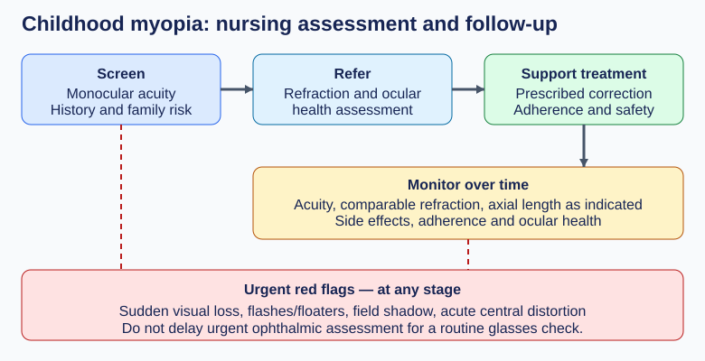

# 👁️ Refractive Errors — Myopia, Hypermetropia, Astigmatism and Presbyopia

**Study-ready, unattempted.** NORCET / Staff Nurse / CHO. Basic se exam level tak.

[Chapter](../README.md) · [30 original MCQs](../MCQs/Refractive-Errors-30-MCQs.md) · [Reported exam practice](../Previous-Year-Questions/Refractive-Errors-Reported-Exam-Practice.md) · [Eye assessment](Eye-Assessment-and-Diagnostics.md)

## Refraction kya hai

**🟠 HIGH YIELD**

Aankh ko ek camera samjho. Camera ka focus galat ho toh photo blur aati hai. Aankh mein cornea aur lens light ko bend karke retina par image focus karte hain. Light ka direction badalne ko refraction kehte hain. Jab relaxed eye mein distance se aane wali light retina par sahi focus ho, toh ise emmetropia kehte hain. Jab focus sahi na bane, toh refractive error kehte hain. Ye optical problem hai. Har blurred vision refractive error nahi hoti.

## Myopia

**🔴 MOST IMPORTANT**

Myopia ko near-sightedness kehte hain. Patient ko paas ki cheezein relatively clear aur door ki cheezein blur dikh sakti hain. Aksar eye ki front-to-back length zyada hoti hai, ya cornea aur lens ki optical power zyada hoti hai. Jab distance se parallel light aati hai aur accommodation relaxed hai, toh focus retina se pehle ban jaata hai. Retina par light spread ho chuki hoti hai, isliye image blur hoti hai.

Concave ya minus lens incoming light ko diverge karta hai. Iska matlab rays pehle thodi spread hoti hain. Eye phir unhe retina par focus kar sakti hai. Example: school child board nahi padh paata lekin copy padh leta hai. Nurse visual acuity screen karti hai, correction status record karti hai aur refraction ke liye refer karti hai. Sirf complaint se diagnosis confirm nahi karte. High myopia ke saath retinal detachment ka risk zyada ho sakta hai. Naye flashes, floaters ya curtain-like shadow ko emergency ophthalmic review chahiye.

**Reported exam evidence:** [ESIC Staff Nurse 2016](https://testbook.com/question-answer/myopia-is-corrected-by--6241c53a0eb7d4f00fab8e4e), [RRB 2019 Shift II](https://testbook.com/question-answer/myopia-is-corrected-by-using--61a9f81425363842160e4b3a), [Safdarjung 2019 recall](https://testbook.com/question-answer/concave-lens-is-used-to-correct--6267cdc866ee819ba1a078ee). Same correction concept, official keys pending.

## Myopia expanded clinical notes

[24 additional original MCQs](../MCQs/Myopia-Additional-24-MCQs.md) · [Six earlier myopia questions Q1–6](../MCQs/Refractive-Errors-30-MCQs.md). Total 30 allocated originals, separate from reported questions.

### Classification

**🟠 HIGH YIELD**

Myopia mein eye ki optical power aur eye ki length ka balance bigad jaata hai. Agar eye ki length zyada hai toh axial myopia kehte hain. Agar normal-length eye mein cornea ya lens ki optical power primary problem hai toh refractive myopia kehte hain. Specific drug ya disease se related change secondary myopia ho sakta hai. Ye terms reason samajhne ke liye useful hain.

IMI research classification ke hisaab se relaxed accommodation mein spherical equivalent −0.50 D ya isse more negative ho toh myopia hai. −6.00 D ya more negative high myopia hai. Other public-health definitions different cutoffs use kar sakti hain. Spherical equivalent (SE) ek summary value hai. Formula SE = sphere + cylinder/2. Example: sphere −3 D aur cylinder −2 D hai toh SE = −3 + (−2/2) = −4 D. Ye full spectacle prescription ka replacement nahi hai.

High myopia aur pathologic myopia same nahi hain. High myopia refractive magnitude describe karti hai. Pathologic myopia mein posterior eyeball mein tissue-level damage hota hai. Posterior staphyloma ka matlab eye wall ka local outward bulge hai. Myopic maculopathy mein central vision ke important retinal area mein structural changes aa sakte hain. Sirf minus prescription dekhkar tissue damage diagnose mat karo.

### Risk and monitoring

**🟠 HIGH YIELD**

Family mein myopia, especially both parents mein, aur childhood mein early onset future progression risk ko assess karne mein helpful clues hain. Child grow karta hai toh axial length bhi change ho sakti hai. Isliye same prescription wale do children ka future risk same hona zaroori nahi hai. Safe outdoor activity aur reasonable near-work breaks encourage karo. Inse existing refractive error cure hone ka promise nahi karna.

Follow-up mein old aur new refraction ko comparable testing conditions mein compare karo. Example: −1.50 D se −2.25 D in 12 months. Difference −0.75 D hai. Myopic magnitude 0.75 D badhi hai. Nurse records compare karne aur appointments track karne mein help karti hai. Ocular biometry axial length directly measure kar sakti hai. Clinician age, growth aur treatment ke context mein result interpret karta hai.

### Assessment and correction

**🔴 MOST IMPORTANT**

School screening mein child symptom report na kare tab bhi each eye ka result important hai. Failed screening ko normal assume mat karo. Parents ko result explain karo, proper referral arrange karo aur follow-up completion track karo. Classroom mein seating adjust karna temporary help hai, examination aur correction ka replacement nahi.

Child ki active accommodation measurement ko more negative bana sakti hai. Isliye authorized clinician cycloplegic refraction use kar sakta hai. Cycloplegia temporary focusing relaxation hai. Agar noncycloplegic aur cycloplegic results different hain, clinician pseudomyopia ya accommodation-related shift assess karta hai. Sirf short-term difference se eyeball growth diagnose nahi karte.

Suitable spectacles clear distance vision provide karti hain. Prescribed correction ko jaan-boojhkar kam karna established myopia-control method nahi hai. Agar good correction ke baad bhi acuity poor hai, ocular pathology ya visual development problem investigate karni hai. Driver ko safe distance vision aur applicable licensing standard follow karne ko bolo.

### Myopia control and safety

**🟠 HIGH YIELD**

Myopia correction aur progression control mein difference samjho. Ordinary glasses current blur correct karti hain. Specialist selected children mein special spectacle/contact lens designs ya low-dose atropine jaise options consider kar sakta hai, jinka goal progression slow karna hai. Har child ka response same nahi hota. Dose aur product choice ophthalmologist decide karega.

Atropine pupil dilation aur near focusing change cause kar sakti hai. Mild glare ya near blur ko assess aur report karo. Severe systemic signs jaise confusion, fever, flushing ya suspected overdose mein urgent medical evaluation chahiye. Medicine ko child ki reach se door rakho. Nurse independent concentration change nahi karti.

Orthokeratology mein special rigid contact lens cornea ki shape temporarily change karti hai. Ye specialist-fitted treatment hai aur strict lens safety, hygiene aur review chahiye. Isko unsupervised overnight lens wear ke permission ki tarah mat samjho. Growing child mein elective LASIK generally routine myopia management nahi hai.

### Complications

**🔴 MOST IMPORTANT**

Highly myopic eye mein posterior tissues ke changes aur retinal complications ka risk badh sakta hai. Clear vision after glasses ya refractive surgery ka matlab risk completely khatam hona nahi hai. Clinician ke schedule ke according dilated retinal review follow karo. New flashes, sudden floaters, curtain-like field shadow, sudden visual loss ya central distortion ko routine glasses issue samajhkar delay mat karo.

Very young child mein unusually severe myopia ke saath developmental ya skeletal abnormalities hon toh timely pediatric eye specialist evaluation chahiye. Specialist zaroorat par other disciplines involve kar sakta hai.

### Teaching and separate MCQ practice

- Concept lecture lead: [Refractive Errors in Hindi — BSc Nursing/GNM](https://www.youtube.com/watch?v=4nOvszLGJas). Published description indexed, direct playback throttled, channel confirmation pending.
- Dedicated MCQ lead: [Myopia — A complete revision (Learn by MCQ: Part 1)](https://www.youtube.com/watch?v=Vgksz7DvqtY). Indexed title, direct fetch throttled. Optometry-oriented, exact nursing-level coverage and creator unconfirmed. Do not count as verified per-question video.
- Specific risk, clinical safety and progression calculation MCQ video gaps remain.

**Clinical sources checked 27 November 2026:** [NEI myopia](https://www.nei.nih.gov/eye-health-information/eye-conditions-and-diseases/nearsightedness-myopia), [Indian national consensus, 2023](https://pmc.ncbi.nlm.nih.gov/articles/PMC10491088/), [AAPOS child myopia](https://aapos.org/glossary/myopia-and-treatment-of-myopia-in-children), [IMI classification](https://pubmed.ncbi.nlm.nih.gov/30817826/), [IMI 2025 interventions](https://pmc.ncbi.nlm.nih.gov/articles/PMC12448128/), [DailyMed ophthalmic atropine safety](https://dailymed.nlm.nih.gov/dailymed/drugInfo.cfm?setid=b39f5876-5d6f-4a8f-bd24-bd4be24ff568). Clinical sources support the notes, not a claim of exam appearance. Some specialist classification and treatment items are nursing enrichment.

## Hypermetropia

**🔴 MOST IMPORTANT**

Hypermetropia ko hyperopia ya farsightedness bhi bolte hain. Eye comparatively short ho sakti hai ya optical power kam ho sakti hai. Relaxed eye mein distant rays ka theoretical focus retina ke peeche hota hai. Young patient apni accommodation badhakar kuch blur compensate kar sakta hai. Isliye distance chart normal hone ke baad bhi reading mein strain ya headache ho sakta hai. Zyada hyperopia mein distance vision bhi blur ho sakti hai.

Convex ya plus lens light ko converge karta hai. Matlab rays ko andar ki taraf bend karta hai, jisse eye ko extra focusing power milti hai. Child mein significant uncorrected hyperopia se strabismus ya amblyopia ka risk ho sakta hai. Amblyopia ka matlab visual development ke dauran ek ya dono eyes ki vision properly develop nahi hui. Early eye examination aur prescribed correction important hain. Cycloplegic refraction mein authorized clinician temporary accommodation relax karne ke liye drops use kar sakta hai. Isse hidden hyperopia detect karne mein help milti hai.

**Reported exam evidence:** [🔵 HPSSC Staff Nurse 1 August 2021 — convex correction](https://testbook.com/question-answer/which-is-used-for-correcting-hypermetropia--697c8326cda47ca28dacf515). Official key pending.

## Hypermetropia expanded clinical notes

[24 additional original MCQs](../MCQs/Hypermetropia-Additional-24-MCQs.md) · [Six earlier Q7–12](../MCQs/Refractive-Errors-30-MCQs.md). Total 30 allocated originals.

### Hyperopia classification

**🟠 HIGH YIELD**

Hyperopia sirf short eyeball se nahi hoti. Agar cornea flat hai ya lens ki optical power kam hai toh normal axial length ke saath bhi hyperopic error ho sakta hai. Young children mein mild symmetric hyperopia normal development ka part ho sakti hai. Emmetropization ka matlab growing eye ka optical balance emmetropia ke closer aana hai. Har child mein spontaneous correction guaranteed nahi hoti. Age, acuity, alignment aur specialist examination ke basis par prescription decide hoti hai.

Total hyperopia ka latent portion tonic accommodation se hidden ho sakta hai. Manifest portion routine noncycloplegic assessment se identify hota hai. Manifest portion ka facultative component accommodation se compensate ho sakta hai, absolute component available accommodation se overcome nahi hota. Ye classifications specialist enrichment hain.

### Hyperopia optics and assessment

**🟠 HIGH YIELD — simplified calculations**

Total = manifest + latent. Manifest = facultative + absolute. Example: Total +4 D aur manifest +2.50 D ho toh latent +1.50 D. Agar manifest +2.50 D mein absolute +1 D hai toh facultative +1.50 D. Ye calculations prescription advice nahi hain.

Near demand simplified model mein 1/distance in metres hai. Uncorrected +1 D hyperope agar distance par compensate kar sakta hai aur 50 cm par read karta hai, toh total demand 1 + 2 = 3 D. Distance hyperopia properly corrected ho toh ideal model mein near task ki 2 D demand remain karti hai. Actual response aur vertex distance vary karte hain.

Asthenopia visual fatigue ya eyestrain hai. Reading-related brow discomfort refractive problem ka clue ho sakta hai, lekin symptom alone hyperopia confirm nahi karta. Onset, task pattern, pain, monocular acuity aur near function assess karo. Sudden visual change ya severe pain ko routine refraction ke liye delay mat karo.

Retinoscopy mein trained examiner light reflex observe karke refractive error estimate karta hai. Ye chhote child mein useful hai jo subjective lens choices reliably nahi bata sakta. Cycloplegia specialist indication aur protocol ke according hoti hai. Nurse independently prescription change nahi karti.

### Hyperopia child care

**🔴 MOST IMPORTANT**

Accommodation aur convergence near response mein connected hain. Jab hyperopic child clear image banane ke liye extra accommodation karta hai, susceptible child ki eyes andar turn kar sakti hain. Ise accommodative esotropia kehte hain. Har hyperopic child mein crossing nahi hoti. Prescribed plus correction extra focusing demand kam kar sakti hai aur alignment improve ho sakti hai.

Known accommodative esotropia mein glasses utarne par inward turn wapas aa sakta hai. Isse alone treatment failure prove nahi hota. Prescribed full-time wear aur specialist follow-up support karo. Correct glasses pehenne ke baad bhi deviation persist kare toh reassessment chahiye. Nurse ghar par power change ya random patching recommend nahi karti.

Anisometropia ka matlab dono eyes ki refractive correction alag hona hai. Agar ek eye consistently blurred image deti hai, developing brain clearer eye prefer kar sakta hai. Isse amblyopia ka risk hota hai. Child complaint na bhi kare toh monocular assessment important hai. Patching prescribe hui ho toh correct eye aur exact timing follow karo. Spectacles clinician ke plan ke hisaab se continue karo. Frame comfort aur proper positioning adherence mein help karte hain.

### Hyperopia clinical safety

**🔴 MOST IMPORTANT**

Aphakia mein natural lens absent hoti hai. Lens ki converging power loss hone se marked hyperopic shift ho sakti hai agar implant ya other correction absent ho. Specialist individual optical rehabilitation decide karta hai.

Short hyperopic eyes mein anterior chamber crowded ho sakta hai. Isliye angle closure susceptibility consider ki ja sakti hai. Hyperopia se glaucoma diagnose nahi hota. Severe pain, halos, vomiting ya sudden blur mein urgent assessment zaroori hai.

Community nurse affordable correction, referral completion aur functional needs assess karti hai. Poor near vision mein label reading, medicine identification aur daily work affect ho sakta hai. Sirf prescription likhna rehabilitation complete hone ka proof nahi hai.

### Teaching and separate MCQ practice

- Teaching lead: [Refractive Errors in Hindi — BSc Nursing/GNM](https://www.youtube.com/watch?v=4nOvszLGJas). Indexed description, direct fetch throttled.
- MCQ lead: [Hypermetropia or Long sightedness — Learn By MCQ Part 1](https://www.youtube.com/watch?v=G0GkxCm_QEc). Indexed title, optometry-oriented, exact content and channel unconfirmed.
- Child care, safety and numerical question-specific MCQ video verification pending.

**Clinical sources checked 27 November 2026:** [NEI hyperopia](https://www.nei.nih.gov/eye-health-information/eye-conditions-and-diseases/farsightedness-hyperopia), [AAPOS accommodative esotropia](https://aapos.org/browse/glossary/entry?GlossaryKey=072d05d4-c183-49e5-9ab3-2b7b87f3f796), [AAPOS anisometropia](https://aapos.org/glossary/anisometropia), [AAPOS glasses for children](https://www.aapos.org/glossary/glasses-for-children), [StatPearls hyperopia](https://www.ncbi.nlm.nih.gov/books/NBK560716/) (indexed, direct fetch blocked), [retinoscopy](https://www.ncbi.nlm.nih.gov/books/NBK597373/) (indexed). [HPSSC 1 August 2021 reported correction question](../Previous-Year-Questions/Refractive-Errors-Reported-Exam-Practice.md) retained. No authenticated new official hyperopia question located.

## Astigmatism

**🟠 HIGH YIELD**

Astigmatism mein cornea ya lens ki curvature different directions mein equal nahi hoti. Ek smooth round ball aur thodi oval rugby ball ka difference socho. Ye sirf analogy hai. Eye mein optical power alag meridians, yaani directions, mein different ho sakti hai. Is wajah se light ek sharp point par focus nahi hoti. Door aur paas dono mein blur, ghosting ya distortion ho sakti hai.

Regular astigmatism ko cylindrical spectacle lens ya toric contact lens se correct kiya ja sakta hai. Prescription mein CYL cylinder power batata hai aur AXIS uski orientation degrees mein batata hai. Sphere aur cylinder ek saath bhi prescribe ho sakte hain, kyunki astigmatism myopia ya hyperopia ke saath coexist kar sakta hai. Keratometry cornea ki curvature measure karti hai aur corneal topography surface curvature ka map deti hai. Irregular astigmatism mein specialist assessment zaroori hai.

## Presbyopia

**🔴 MOST IMPORTANT**

Age badhne par natural lens ki flexibility kam ho jaati hai. Jab patient paas ki kitab padhna chahta hai, lens utna round nahi ho paata jitna near focus ke liye zaroori hai. Is age-related accommodation loss ko presbyopia kehte hain. Ye aksar 40s mein noticeable hoti hai. Patient phone ya book ko door karke padhne ki koshish kar sakta hai. Distance vision normal bhi ho sakti hai.

Reading glasses mein plus near addition focusing demand kam karti hai. Bifocal mein distance aur near ke do optical zones hote hain. Progressive lens mein power gradual change hoti hai. Presbyopia aur hyperopia same nahi hain. Hyperopia relaxed eye ki optical focusing problem hai aur presbyopia age-related near focusing ability ka loss hai. Myopic patient ko bhi presbyopia ho sakti hai. Uski near addition positive hoti hai, lekin total near prescription necessarily positive nahi hoti.

| Condition | Optical issue | Common correction |
|---|---|---|
| Myopia | Distance focus retina se pehle | Minus / concave |
| Hyperopia | Relaxed focus retina ke peeche | Plus / convex |
| Astigmatism | Directions mein different power | Cylinder / toric |
| Presbyopia | Near accommodation kam | Plus near add, readers, bifocal/progressive as indicated |

## Lens power aur numericals

**🟠 HIGH YIELD — basic optics practice**

Diopter (D) lens power ki unit hai. Formula P = 1/f hai, jahan signed focal length f metres mein hai. Converging lens ka sign positive aur diverging lens ka sign negative hota hai. Ye simplified thin-lens calculations hain. Actual patient prescription refraction se decide hoti hai.

**Example 1:** Convex lens ka focal length +50 cm hai. Pehle metres mein convert karo: +0.50 m. P = 1/0.50 = +2 D.

**Example 2:** Concave lens ka focal length −25 cm hai. P = 1/(−0.25) = −4 D.

**Example 3:** Myopic eye ka far point 50 cm hai. Ideal thin spectacle lens eye ke paas assume karo. Distance object ke parallel rays ko virtual image far point par banana hai. f = −0.50 m. P = −2 D. Actual vertex distance aur clinical measurement ko ignore karne ki stated assumption hai.

**Example 4:** Distance sphere −2.50 D aur near addition +1.75 D hai. Near sphere = −2.50 + 1.75 = −0.75 D. Add positive hai, lekin resulting near lens negative hai. Cylinder aur axis unchanged assume kiye gaye hain.

## Nursing management aur community screening

**🔴 MOST IMPORTANT**

Nurse distance aur near vision screen karti hai, usual spectacles ke saath aur bina correction ke result ko clearly document karti hai, patient ko optometrist ya ophthalmologist ke paas refer karti hai. School screening mein child ko appropriate chart do aur parents ko follow-up explain karo. Correct glasses ko regularly wear karna aur replacement/follow-up advice follow karna functional vision improve kar sakta hai. Children ko safe outdoor play encourage kar sakte hain. Ye existing myopia ka cure nahi hai.

Contact lens handle karne se pehle hands wash aur dry karo. Lenses ko water se rinse ya store mat karo aur swimming/shower se pehle remove karo. Fresh recommended disinfecting solution use karo, purane solution mein naya top-up mat karo. Sleep mein contact lenses avoid karo unless specifically prescribed. Painful red eye, photophobia ya sudden blurred vision mein lens remove karo aur urgent eye assessment lo. Contact lens keratitis serious ho sakti hai.

Refractive surgery cornea ki optical shape change kar sakti hai. LASIK har patient ke liye suitable nahi hai aur age-related accommodation automatically restore nahi karta. Preoperative evaluation, prescribed eye drops, postoperative precautions aur red flags ka education treating team ke protocol ke hisaab se hota hai.

## ▶️ Teaching aur MCQ practice

| Topic | Teaching lead | Separate question-practice lead |
|---|---|---|
| Myopia, hyperopia, astigmatism, presbyopia | [NursesTechOnline — Refractive errors Hindi lecture](https://www.youtube.com/watch?v=ioFBqihOBoM) | [MCQ - Refractive Errors and Accommodation](https://www.youtube.com/watch?v=v4QVL_v3ymY) |
| Lens correction and numericals | Same lecture indexed for refractive errors. Numerical coverage not verified. | Specific numerical MCQ video pending |
| Contact lens safety and screening | Dedicated teaching video pending | Dedicated MCQ video pending |

Indexed search titles/descriptions located 27 November 2026. Direct YouTube retrieval failed for both primary leads. Practice video's channel, exact questions and timestamps not established. These are leads, not fully verified topic or historical matches.

## Clinical sources

- [NEI types of refractive errors](https://www.nei.nih.gov/eye-health-information/eye-conditions-and-diseases/refractive-errors/types-refractive-errors) — directly retrieved.
- [NEI eyeglasses](https://www.nei.nih.gov/eye-health-information/eye-conditions-and-diseases/refractive-errors/eyeglasses-refractive-errors) — indexed.
- [NEI presbyopia](https://www.nei.nih.gov/eye-health-information/eye-conditions-and-diseases/presbyopia) — indexed.
- [OpenStax lens power](https://openstax.org/books/physics/pages/16-3-lenses) — indexed.
- [CDC contact lens infection prevention](https://www.cdc.gov/contact-lenses/prevention/index.html) — indexed.
- [NEI refractive surgery](https://www.nei.nih.gov/eye-health-information/eye-conditions-and-diseases/refractive-errors/surgery-refractive-errors) — indexed.

[Chapter](../README.md) · [MCQs](../MCQs/Refractive-Errors-30-MCQs.md) · [Reported exam practice](../Previous-Year-Questions/Refractive-Errors-Reported-Exam-Practice.md)
