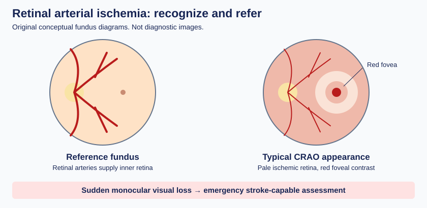

# 👁️ Retinal Artery Occlusion and Emergency Nursing

**Study-ready, unattempted.** NORCET and staff nurse preparation. Acute retinal ischemia is an emergency. Medication and reperfusion decisions are clinician-directed. Do not apply cerebral stroke drug protocols automatically to isolated retinal artery occlusion.

[Chapter](../README.md) · [30 original MCQs](../MCQs/Retinal-Artery-Occlusion-30-MCQs.md) · [Exam evidence and gaps](../Previous-Year-Questions/Retinal-Artery-Occlusion-Exam-Evidence.md)

[Mechanism](#mechanism) · [Recognition](#recognition) · [Emergency](#emergency) · [Arteritic disease](#arteritic-disease) · [Systemic workup](#systemic-workup) · [Follow-up](#follow-up)

## Mechanism

**🔴 MOST IMPORTANT**

Retina aankh ki light-sensitive neural layer hai. Isko oxygen aur nutrients continuously chahiye. Central retinal artery inner retina ko blood supply karti hai. Outer retina aur photoreceptors ka major support choroidal circulation se aata hai.

Retinal artery occlusion (RAO) ka matlab retinal arterial blood flow block hona hai. Central retinal artery occlusion (CRAO) mein large retinal area ki perfusion compromise ho sakti hai. Branch retinal artery occlusion (BRAO) mein ek arterial territory affected hoti hai. Ophthalmic artery occlusion aur proximal ho sakti hai, jisme retinal aur choroidal supply dono affect ho sakti hain.

Ischemia ka matlab inadequate blood supply hai. Jab oxygen supply interrupt hoti hai toh retina ke cells dysfunctional ho jaate hain. Sustained ischemia irreversible infarction produce kar sakti hai. Retinal infarction ischemic stroke ki category mein aata hai. Isi wajah se ocular symptom ko sirf spectacle problem nahi samajhna chahiye.

Embolus ek material hai jo vascular circulation mein travel karke small vessel ko block kar sakta hai. Carotid atherosclerotic disease aur cardiac thromboembolism important possible sources hain. Hollenhorst plaque ek classic cholesterol embolus hai. Atrial fibrillation cardiac embolic source ki possibility raise kar sakti hai. Cause evaluation treating team karti hai.

[Practice Q1–4](../MCQs/Retinal-Artery-Occlusion-30-MCQs.md)

## Recognition

**🔴 MOST IMPORTANT**

CRAO classically sudden, painless, monocular visual loss ke saath present hota hai. Relative afferent pupillary defect (RAPD) affected eye ki afferent visual pathway dysfunction indicate kar sakta hai. Ye sign isolated CRAO ka proof nahi hai. Fundus mein pale retinal swelling aur cherry-red foveal spot dikh sakta hai. Fovea comparatively thin hoti hai, isliye surrounding swollen inner retina ke contrast mein underlying choroidal colour visible reh sakta hai. Ye actual central hemorrhage ka compulsory sign nahi hai.

Early examination mein classic retinal whitening subtle ya absent ho sakti hai. Some patients mein cilioretinal artery macular supply preserve karti hai, isliye central acuity unexpectedly better ho sakti hai. Visual field still affected ho sakta hai. BRAO sectoral field defect produce kar sakta hai. Superior retinal territory damage inferior field ko affect kar sakti hai.

| Condition | Typical distinguishing clue |
|---|---|
| CRAO | Abrupt painless monocular loss, retinal pallor and possible cherry-red contrast |
| BRAO | Sudden sectoral field loss, localized arterial territory whitening |
| CRVO | Venous dilation, tortuosity and widespread hemorrhages, next topic |
| Retinal detachment | Flashes, floaters or curtain-like shadow, not exclusive |
| Optic neuritis | Eye movement pain and colour desaturation can be clues |
| Acute angle closure | Often severe pain, red eye, halos and nausea |

Ye comparison diagnosis establish nahi karta. All sudden unexplained visual loss needs prompt emergency assessment.

[Practice Q5–10](../MCQs/Retinal-Artery-Occlusion-30-MCQs.md)

## Emergency

**🔴 MOST IMPORTANT**

Agar patient suddenly ek eye se nahi dekh paa raha hai, toh emergency pathway activate karo. Normal speech aur limb strength se retinal stroke exclude nahi hota. Transient monocular visual loss jo ischemic cause se hua ho, amaurosis fugax ke naam se describe ho sakta hai. Vision wapas aane ke baad bhi retinal TIA risk assess karna zaroori hai.

1. Immediate safety aur basic emergency assessment karo. Clinical condition ke according airway, breathing, circulation aur local stroke protocol follow karo.
2. Last known normal vision aur symptom discovery time accurately record karo. Wake-up symptom mein assumed onset time invent mat karo.
3. Visual symptom laterality, associated neurological symptoms, vital signs aur glucose per protocol document karo. Emergency transfer ko nonessential testing ke liye delay mat karo.
4. Relevant vascular history, allergies, anticoagulant ya antiplatelet medicine, last dose aur bleeding history handover karo.
5. Nearest appropriate emergency stroke-capable facility aur ophthalmology pathway coordinate karo.

**Old textbook trap:** Routine ocular massage, anterior chamber paracentesis aur hemodilution ke benefit ka reliable evidence establish nahi hai. AHA scientific statement possible harm bhi describe karti hai. Nurse independently globe massage, pressure, invasive procedure ya unprescribed medication initiate nahi kare. Emergency referral priority hai.

**Current evidence update:** AHA 2021 statement selected disabling CRAO mein stroke-specialist alteplase assessment consider karti thi. 2026 TenCRAOS randomized trial mein early IV tenecteplase oral aspirin se significantly better 30-day visual recovery establish nahi kar saka aur serious safety concerns reported hue. Isliye cerebral stroke ke treatment-window rules ko isolated CRAO par automatically apply karna appropriate nahi hai. Acute specialist evaluation still urgent hai, including assessment for concurrent cerebral ischemia, treatable causes and secondary prevention. Exact drug eligibility local specialist protocol aur evolving evidence par depend karti hai. No guaranteed restoration claim.

[Practice Q11–17](../MCQs/Retinal-Artery-Occlusion-30-MCQs.md)

## Arteritic disease

**🔴 MOST IMPORTANT**

Giant cell arteritis (GCA) large aur medium arteries ki inflammatory disease hai. Age above 50 ke patient mein new temporal headache, scalp tenderness, jaw claudication, constitutional symptoms aur acute visual ischemia serious clues ho sakte hain. Jaw claudication mein chewing ke time ischemic pain ya fatigue hoti hai. GCA ocular arteries aur optic nerve circulation ko affect karke irreversible vision loss cause kar sakti hai.

ESR, CRP aur complete blood count with platelets commonly requested hote hain. Inflammatory markers supportive hain, lekin normal ya modestly elevated result strong clinical suspicion ko automatically eliminate nahi karta. Temporal artery ultrasound, biopsy ya other investigations specialist choose karta hai.

Agar clinician sight-threatening GCA strongly suspect karta hai, urgent systemic corticosteroid treatment diagnostic biopsy ke wait mein delay nahi karna chahiye. Nurse prescribed treatment facilitate karti hai. Already damaged eye ki vision fully recover hone ki guarantee nahi hai. Urgent treatment fellow eye aur other vascular territories protect karne ke liye important ho sakta hai.

[Practice Q18–23](../MCQs/Retinal-Artery-Occlusion-30-MCQs.md)

## Systemic workup

**🟠 HIGH YIELD**

Retinal arterial ischemia isolated ocular problem nahi ho sakti. Stroke team carotid imaging, cardiac examination, ECG/rhythm monitoring aur indicated brain imaging plan kar sakti hai. Cerebral ischemia motor symptoms ke bina bhi coexist kar sakti hai. Patient ke BP, glucose, lipid profile, tobacco use aur other cardiovascular risks evaluate kiye jaate hain.

Antiplatelet aur anticoagulant medicines interchangeable nahi hain. Vascular source, bleeding risk aur comorbidities ke according clinician secondary prevention plan banata hai. Every RAO patient ko automatically same lifelong anticoagulant prescribe nahi karna. Patient ko self-start ya self-stop advice mat do.

[Practice Q24–28](../MCQs/Retinal-Artery-Occlusion-30-MCQs.md)

## Follow-up

**🟠 HIGH YIELD**

Some ischemic eyes mein later abnormal vessels develop ho sakti hain. Iris aur drainage angle neovascularization secondary neovascular glaucoma cause kar sakti hai. New ocular pain, redness ya further vision deterioration ko promptly report karna chahiye. Follow-up schedule treating ophthalmologist decide karta hai.

Persistent monocular visual loss depth perception aur daily task safety affect kar sakti hai. Safe mobility, task-specific compensatory techniques, accessible reading aids aur individualized rehabilitation support do. Usable eye protect karne ki advice specialist ke plan se align karo. Patient ki independence aur consent maintain karo.

[Practice Q29–30](../MCQs/Retinal-Artery-Occlusion-30-MCQs.md)

## ▶️ Teaching and MCQ practice

| Topic | Teaching | Separate MCQ practice |
|---|---|---|
| CRAO/BRAO mechanisms | [Smart Optometry Academy — CRAO vs BRAO](https://www.youtube.com/watch?v=NGx8EPb4eBc) | Specific video pending |
| Acute visual loss and GCA | [Acute Vision Loss — CRAO as a Stroke and GCA](https://www.youtube.com/watch?v=C_ZXaF4CfBg) | Specific video pending |
| Stroke referral and treatment evidence | Clinical sources below | Specific video pending |

Indexed descriptions identify relevant teaching, not verified question-solving segments. All 30 original items have specific dedicated video gaps. No video timestamps invented.

## Clinical references

- [AHA CRAO scientific statement summary](https://professional.heart.org/en/science-news/management-of-central-retinal-artery-occlusion/top-things-to-know), directly retrieved.
- [Merck retinal artery occlusion](https://www.merckmanuals.com/professional/eye-disorders/retinal-disorders/central-retinal-artery-occlusion-and-branch-retinal-artery-occlusion), directly retrieved.
- [2026 TenCRAOS trial abstract](https://pubmed.ncbi.nlm.nih.gov/41604638/), directly retrieved. [2025 THEIA trial](https://pubmed.ncbi.nlm.nih.gov/41109232/) indexed, direct page access failed. No new blanket reperfusion protocol inferred.
- [AAO retinal and ophthalmic artery occlusions PPP](https://www.aao.org/education/preferred-practice-pattern/retinal-ophthalmic-artery-occlusions-ppp), indexed, full guideline review pending.
- [Merck giant cell arteritis](https://www.merckmanuals.com/professional/musculoskeletal-and-connective-tissue-disorders/vasculitis/giant-cell-arteritis), indexed extract supports urgent corticosteroid therapy when clinically suspected.

**Quick revision:** CRAO = retinal arterial ischemia and stroke emergency. Cherry-red spot can be absent early. Transient ischemic loss still urgent. GCA with visual symptoms = urgent clinician-directed systemic treatment. No routine massage or guaranteed thrombolysis. Systemic vascular prevention matters.

[Chapter](../README.md) · [MCQs](../MCQs/Retinal-Artery-Occlusion-30-MCQs.md) · [Exam evidence](../Previous-Year-Questions/Retinal-Artery-Occlusion-Exam-Evidence.md)
