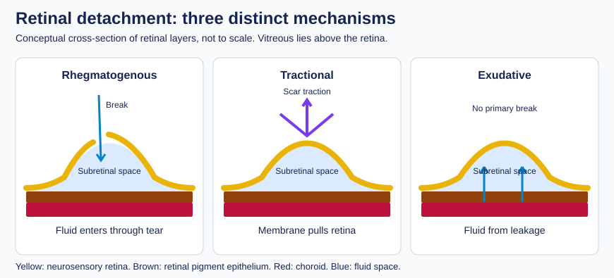
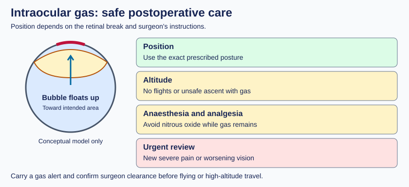

# 👁️ Retinal Detachment and Surgical Nursing

**Study-ready, unattempted.** NORCET / HP Staff Nurse / CHO. 29 additional originals plus preserved starter Q2 = 30 allocated originals. Myopia and other previously allocated warning-sign questions remain in their original banks.

[Chapter](../README.md) · [29 new MCQs](../MCQs/Retinal-Detachment-Additional-29-MCQs.md) · [Reported exam practice](../Previous-Year-Questions/Retinal-Detachment-Reported-Exam-Practice.md) · [Eye assessment](Eye-Assessment-and-Diagnostics.md)

[Mechanisms](#mechanisms) · [Assessment](#assessment) · [Preoperative](#preoperative) · [Procedures](#procedures) · [Postoperative](#postoperative) · [Complications](#complications)

## Mechanisms

**🔴 MOST IMPORTANT**

Retina ko camera ki light-sensitive screen samjho. Retina ke photoreceptors light ko signals mein convert karte hain. Neurosensory retina normally underlying retinal pigment epithelium (RPE) ke close contact mein rehti hai. RPE photoreceptors ko metabolic support deti hai aur fluid balance maintain karne mein help karti hai. Jab neurosensory retina is layer se separate ho jaati hai, tab retinal detachment kehte hain. Photoreceptor function aur vision threaten hoti hai. Early specialist treatment important hai.

| Type | Mechanism |
|---|---|
| Rhegmatogenous retinal detachment (RRD) | Retinal tear ya break se liquefied vitreous neeche jaati hai. Ye most common type hai. |
| Tractional retinal detachment | Fibrous ya fibrovascular membranes retina ko pull karti hain. Proliferative diabetic retinopathy common cause hai. |
| Exudative retinal detachment | Vascular leakage ya inflammation se subretinal fluid collect hota hai without primary retinal break or traction. |

Posterior vitreous detachment (PVD) aur retinal detachment same nahi hain. Age ke saath vitreous gel liquefy aur shrink ho sakti hai. Jab posterior vitreous retina se separate hoti hai toh PVD kehte hain. Har PVD retinal tear nahi banati. Lekin firm adhesion ke point par traction tear bana sakti hai. Agar fluid tear se retina ke neeche enter kare, toh RRD develop ho sakti hai.

High myopia, previous retinal detachment in other eye, relevant family history, trauma, lattice degeneration, aging-related vitreous change aur previous eye surgery risk assessment mein important hain. Diabetes-related proliferative disease tractional detachment cause kar sakti hai. Inflammation, some tumors aur vascular disorders exudative type cause kar sakte hain. Combined mechanisms bhi possible hain.

## Assessment

**🔴 MOST IMPORTANT**

New flashes ko photopsia kehte hain. Vitreous traction retina ko mechanically stimulate kar sakti hai, aur brain light flash perceive kar sakta hai. Floaters eye ke andar moving opacities ke shadows ho sakte hain. Sudden new floaters, flashes, visual field curtain ya new vision loss urgent retinal assessment maangte hain. Retinal detachment usually painless ho sakti hai. Pain absent hone se danger exclude nahi hota. Is symptom recognition ko preserved starter Q2 mein already test kiya gaya hai.

Macula retina ka central detailed-vision area hai. Macula-on detachment mein macula still attached hai, isliye central acuity relatively preserved ho sakti hai. Macula-off detachment mein central macula detach ho gayi hai. Dono situations urgent specialist evaluation maangti hain. Operation timing location, progression, onset aur clinical findings ke according retinal surgeon decide karta hai. Fixed delay safe assume mat karo.

Visual acuity aur field complaint document karo. Superior retina inferior visual field ko represent karti hai. Peripheral tear identify karne ke liye dilated fundus examination aur indirect ophthalmoscopy with indicated scleral depression trained specialist karta hai. Shafer sign mein anterior vitreous mein pigment granules nazar aa sakte hain. Acute PVD mein ye retinal break suspicion increase karta hai. Vitreous hemorrhage ke saath fundus view obscured ho sakta hai. Intact globe mein clinician B-scan ultrasound consider kar sakta hai. Suspected open-globe injury mein routine pressure-based examination avoid karo.

OCT macular involvement aur other structural changes evaluate karne mein useful ho sakti hai. Lekin normal central OCT peripheral tear exclude nahi karti. Initial symptomatic PVD exam mein no tear mila ho tab bhi clinician-advised re-examination important ho sakti hai. Worsening flashes, floaters ya field symptoms immediately report karo. Asymptomatic lattice degeneration ka har lesion prophylactic laser require nahi karta. Decision lesion characteristics aur risk ke basis par specialist leta hai.

## Preoperative

**🔴 MOST IMPORTANT**

Urgent referral delay mat karo. Patient ka symptom onset, affected eye, previous retinal surgery, trauma, medications, allergies, baseline visual function aur medical history document karo. Planned procedure aur operative eye verify karo. NPO aur other preoperative instructions anesthesia team se confirm karo. Unprescribed tight pressure patch ya forceful positioning retina ko safely reattach nahi karti. Surgeon-directed position, activity instructions aur transfer plan follow karo.

Gas-based surgery plan ho toh patient ki posture maintain karne ki ability assess karo. Severe arthritis, spine disease, breathing limitation aur caregiver support procedure selection influence kar sakte hain. Mobility problem surgeon ko before procedure report karo. Informed consent aur postoperative restrictions explain karne mein assist karo.

## Procedures

**🔴 MOST IMPORTANT**

| Procedure | Simple explanation |
|---|---|
| Laser retinopexy | Selected tear ke around controlled tissue reaction se adhesion create hoti hai. |
| Cryopexy | Controlled freezing se tear ke around adhesion develop hoti hai. |
| Pneumatic retinopexy | Selected retinal detachment mein gas bubble break ko support karti hai, with laser ya cryopexy. |
| Scleral buckle | Outer scleral wall ko flexible material indent karta hai, jisse break support aur traction management mein help milti hai. |
| Pars plana vitrectomy | Vitreous remove karke traction relieve aur internal repair ki ja sakti hai. Gas, air ya silicone oil support ke liye use ho sakte hain. |

Tamponade ka matlab internal support hai jo retinal repair ko stable rakhne mein help karta hai. Gas temporary hoti hai aur time ke saath absorb hoti hai. Silicone oil selected complex detachments mein longer support de sakti hai. Later removal ya long-term management surgeon decide karta hai. Gas aur oil ko same substance mat samjho.

Laser or freezing selected tears ko seal karne mein useful hain. Extensive detached retina ke liye surgical reattachment required ho sakti hai. Tractional aur exudative cases mein underlying pathology ka treatment bhi important hai. Sab patients ke liye same procedure appropriate nahi.

## Postoperative

**🔴 MOST IMPORTANT — gas bubble safety**

Gas bubble buoyant hoti hai, yani eye ke uppermost part ki taraf float karti hai. Surgeon desired retinal area aur operation technique ke according head position prescribe karta hai. Face-down posture kuch surgeries mein important hai, lekin har patient ko same position ya same duration nahi deni. Position ka return demonstration lo aur written instructions do. Neck pain, pressure marks, breathing problems ya inability to maintain posture report karo. Approved supports aur pressure-area checks se injury prevention mein help milti hai. Operated globe par direct pressure avoid karo.

Gas remains in eye toh flying aur significant altitude increase unsafe ho sakta hai. Ambient pressure kam hone se bubble expand ho sakti hai. Eye closed space hai, isliye IOP dangerously rise aur retinal circulation compromise ho sakti hai. Mountain road travel bhi relevant hai. Patient bubble visibly smaller hone par travel safe assume na kare. Surgeon se confirmation lo ki gas completely clear hai aur travel safe hai.

**Nitrous oxide (N2O) must be avoided while intraocular gas remains.** Nitrous oxide anesthesia aur inhaled analgesic mixtures (for example Entonox) mein ho sakti hai. Ye bubble mein quickly diffuse karke expansion aur severe IOP rise cause kar sakti hai. Patient alert card/bracelet ya written information carry kare aur emergency, dental, maternity aur anesthesia teams ko inform kare. Clinical team safe alternatives select karegi.

Prescribed drops, eye protection, activity restrictions aur follow-up schedule explain karo. Gas disappearance time agent aur patient factors par depend karta hai. Fixed calendar period alone gas absence prove nahi karta. Patient ke discharge documents mein procedure, gas status aur emergency advice clearly record karo.

## Complications

**🔴 MOST IMPORTANT**

Postoperative severe new pain, headache, vomiting, worsening vision, increasing redness ya discharge urgent ophthalmic assessment maangte hain. Raised IOP, infection, recurrent detachment aur other complications consider karni hoti hain. Mild expected discomfort aur serious deterioration ka difference samjhao.

Proliferative vitreoretinopathy (PVR) mein cellular scar-like membranes develop aur contract ho sakti hain. Ye retina ko again pull karke redetachment ya repair failure cause kar sakti hain. Other potential complications include cataract progression after vitrectomy, bleeding, pressure abnormalities aur silicone-oil-related problems.

Anatomical reattachment successful hone ke baad bhi visual recovery macula involvement, duration, photoreceptor damage aur coexisting disease par depend karti hai. Patient ko guaranteed normal vision promise mat karo. Functional needs reassess karo aur accessible low-vision rehabilitation support where needed arrange karo.

## Quick revision

- Retinal detachment = neurosensory retina separates from RPE.
- RRD = break and fluid. Tractional = scar pulls. Exudative = leakage without primary break.
- New flashes, floaters or curtain = urgent examination.
- Gas position = surgeon-specific. Gas present = avoid flying, unsafe altitude change and nitrous oxide.
- New severe postoperative pain or vision loss = urgent review.

## ▶️ Teaching and MCQ resources

| Topic | Teaching lead | Separate MCQ practice |
|---|---|---|
| Detachment symptoms and treatment | [Iram Fatima Nursing — Complete Ophthalmology for NORCET](https://www.youtube.com/watch?v=YlogEu5ijnQ) | [Doc Swati — Ophthalmology MCQs, NEET-PG/INICET](https://www.youtube.com/watch?v=-F_VvO2_H-o), description names symptom recognition only, relevant to preserved starter |
| Classification and surgical repair | Dedicated nursing video not separately verified | Dedicated item-level practice pending |
| Gas precautions and postoperative nursing | [Royal College safety alert](https://curriculum.rcophth.ac.uk/2018/12/ophthalmic-safety-alert-use-of-nitrous-oxide-when-there-is-gas-in-an-operated-eye/), written clinical reference, not a video | No specific verified MCQ video located |

Search metadata checked 27 November 2026. No exact playback, creator confirmation beyond indexed titles or item timestamps authenticated. All 29 new item-specific video mappings pending.

## References

- [NEI types and causes](https://www.nei.nih.gov/eye-health-information/eye-conditions-and-diseases/retinal-detachment/types-and-causes-retinal-detachment), [NEI surgery](https://www.nei.nih.gov/eye-health-information/eye-conditions-and-diseases/retinal-detachment/surgery-retinal-detachment), [NEI vitrectomy](https://www.nei.nih.gov/eye-health-information/eye-conditions-and-diseases/retinal-detachment/vitrectomy) direct text retrieved.
- [AAO 2024 PVD and retinal break Preferred Practice Pattern](https://www.aao.org/education/preferred-practice-pattern/posterior-vitreous-detachment-retinal-breaks-latti), [AAO retinal detachment assessment](https://www.aao.org/young-ophthalmologists/yo-info/article/yo-need-to-know-retinal-detachment-what-to-know), indexed.
- [Asia-Pacific 2025 RRD consensus](https://doi.org/10.1016/j.apjo.2025.100254), indexed extracts, direct open blocked.
- [Royal College nitrous oxide alert](https://curriculum.rcophth.ac.uk/2018/12/ophthalmic-safety-alert-use-of-nitrous-oxide-when-there-is-gas-in-an-operated-eye/) direct text reviewed, [AAO positioning](https://www.aao.org/eye-health/treatments/face-down-recovery-after-retinal-surgery) indexed, direct open blocked.

[Chapter](../README.md) · [Original MCQs](../MCQs/Retinal-Detachment-Additional-29-MCQs.md) · [Reported exam practice](../Previous-Year-Questions/Retinal-Detachment-Reported-Exam-Practice.md)
