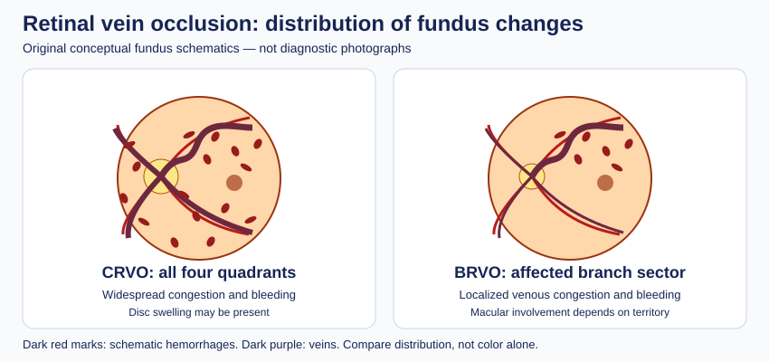

# 👁️ Retinal Vein Occlusion and Nursing

**Study-ready, unattempted.** NORCET / HP Staff Nurse / CHO. Advanced angiographic grading is specialist enrichment, not a claim of official nursing exam weightage.

[Chapter](../README.md) · [30 original MCQs](../MCQs/Retinal-Vein-Occlusion-30-MCQs.md) · [Exam evidence](../Previous-Year-Questions/Retinal-Vein-Occlusion-Exam-Evidence.md) · [Retinal artery occlusion](Retinal-Artery-Occlusion-and-Emergency-Nursing.md)

[Mechanism](#mechanism) · [Classification](#classification) · [Assessment](#assessment) · [Systemic care](#systemic-care) · [Triage](#triage) · [Treatment](#treatment) · [Follow-up](#follow-up)

## Mechanism

**🔴 MOST IMPORTANT**

Retina ko blood supply aur blood drainage dono chahiye. Artery fresh oxygen-rich blood retina tak laati hai, aur vein used blood ko wapas le jaati hai. Ek water tank socho. Inlet pipe open hai, lekin outlet pipe block ho gayi hai. Paani bahar properly nahi ja paata aur pressure build up hota hai. Retinal vein occlusion (RVO) mein bhi venous drainage obstruct ho jaati hai. Is wajah se retinal capillaries mein congestion, leakage aur hemorrhage ho sakte hain.

Central retinal vein optic nerve head ke lamina cribrosa region se guzarti hai. Yahan restricted flow aur thrombosis central retinal vein occlusion (CRVO) ka mechanism ho sakte hain. Branch retinal vein occlusion (BRVO) often arteriovenous crossing par develop hoti hai, jahan artery aur vein closely placed hoti hain. Stiffened artery adjacent vein par compression kar sakti hai. Disturbed blood flow aur vascular wall injury clot formation mein contribute karte hain.

Venous obstruction se capillary perfusion bhi compromise ho sakti hai. Ischemia ka matlab tissue ko adequate oxygenated blood supply na milna hai. Ischemic retina VEGF jaise angiogenic signals release kar sakti hai. VEGF vascular permeability badhata hai, isliye fluid retina ke tissue mein leak hota hai. Macular edema aur pathological new vessels important complications hain.

## Classification

**🔴 MOST IMPORTANT**

| Type | Main clinical distinction |
|---|---|
| CRVO | Main retinal venous drainage obstruct hoti hai. Widespread retinal hemorrhages aur tortuous dilated veins all four quadrants mein dikh sakti hain. |
| BRVO | Ek smaller venous branch obstruct hoti hai. Hemorrhages usually affected drainage sector mein distributed hoti hain. |
| Hemiretinal vein occlusion | Major venous trunk obstruct hone se approximately half retina affected ho sakti hai. Management generally CRVO framework follow karti hai. |
| Macular BRVO | Chhoti drainage territory bhi reading ko markedly affect kar sakti hai if macula involved ho. |

Classic CRVO fundus ko **blood and thunder appearance** kehte hain. Ismein widespread superficial aur deep retinal bleeding, dilated tortuous veins, retinal edema, cotton-wool spots aur optic disc swelling ho sakte hain. Har sign every patient mein present nahi hota. BRVO mein distribution generally sectoral hoti hai.

Ischemic CRVO mein capillary nonperfusion extensive ho sakti hai. Vision markedly reduced ho sakti hai, aur relative afferent pupillary defect (RAPD) prominent ho sakta hai. RAPD affected eye se light signal relatively weak hone ka clinical clue hai. Nonischemic CRVO mein perfusion relatively better hoti hai. Initial nonischemic disease later ischemic disease mein convert ho sakti hai. Classification ek single sign ya acuity reading par based nahi karni.

## Assessment

**🔴 MOST IMPORTANT**

Patient usually one eye mein painless blurred vision notice karta hai. Kabhi mild disease asymptomatic bhi ho sakti hai. Macular involvement central visual function ko affect karta hai. Nurse onset, duration, affected eye, previous RVO treatment, medications, BP, diabetes, glaucoma history aur functional difficulty note karti hai. Sudden visual loss ko routine appointment ke liye delay mat karo.

| Examination | Clinical role |
|---|---|
| Best-corrected visual acuity | Functional vision baseline aur treatment response record karne mein help. |
| Pupillary assessment | RAPD severe retinal afferent dysfunction ka clue ho sakta hai. |
| Dilated fundus examination | Hemorrhage distribution, venous tortuosity, edema, collaterals aur abnormal vessels assess hote hain. |
| OCT | Cross-sectional retinal image se intraretinal fluid, macular thickening aur response assess karte hain. |
| Fluorescein angiography | Dye transit, vascular leakage, capillary nonperfusion aur neovascularization assessment mein help karti hai. |
| Slit lamp, IOP and gonioscopy | Iris aur angle neovascularization aur pressure-related complications assess karte hain. |

Traditional CRVO studies mein more than ten disc areas of capillary nonperfusion on conventional angiography ischemic classification ke liye use hua tha. Ye conventional imaging field ka criterion hai. Ultra-widefield image much larger area dikhati hai, isliye same number blindly apply nahi karna. Specialist location, nonperfusion extent aur functional findings combine karta hai. Dense hemorrhage fluorescence mask kar sakti hai. Dark region hamesha true capillary closure prove nahi karti. Repeat imaging required ho sakti hai.

Old CRVO ke baad optic disc collaterals develop ho sakte hain. Ye alternative drainage channels hain aur active pathological disc neovascularization ke identical nahi hain. Clinician examination aur indicated angiography se differentiate karta hai.

Example: Patient ka OCT treatment ke baad thinner aur less edematous hai, lekin vision abhi bhi poor hai. Iska matlab injection automatically fail nahi hui. Macular ischemia ya established retinal cell injury functional recovery limit kar sakti hai. Isliye OCT aur visual acuity dono monitor karte hain.

## Systemic care

**🔴 MOST IMPORTANT**

Age, systemic hypertension, diabetes, dyslipidemia, arteriosclerosis, glaucoma aur ocular hypertension RVO ke associated risk factors hain. New RVO ke baad BP aur relevant systemic history document karo. Primary care ke saath coordination karke hypertension, glucose aur lipids manage karne mein help karo. Glaucoma treatment and monitoring continue karna important hai, lekin pressure-lowering drops retinal vein clot directly dissolve nahi karti.

Typical older adult mein first unilateral RVO ke liye routine broad inherited thrombophilia panel solely because of RVO usually indicated nahi hota. Young patient, bilateral/recurrent disease, unusual thrombosis history ya inflammatory clues mein targeted medical or hematologic evaluation appropriate ho sakti hai. Nurse independent investigation panel prescribe nahi karti.

RVO aur leg DVT ko same treatment pathway mat samjho. Royal College guideline routine anticoagulant/antiplatelet treatment solely for isolated RVO ke liye strong evidence establish nahi karti. Other indications, for example AF, previous VTE ya cardiovascular disease, separate medical review require karte hain. Existing indicated medication independently stop mat karo.

## Triage

**🔴 MOST IMPORTANT — do not miss retinal stroke**

Agar patient bolta hai ki ek eye mein achanak vision kam ho gayi hai, toh sirf history se CRVO assume mat karo. CRAO, BRAO, retinal detachment, optic nerve disorders aur other sight-threatening conditions differential mein aati hain. New sudden monocular visual loss urgent assessment require karti hai. Suspected retinal arterial ischemia ko emergency stroke pathway mein escalate karo. See [arterial occlusion emergency notes](Retinal-Artery-Occlusion-and-Emergency-Nursing.md).

Confirmed venous occlusion ka ocular treatment alag hai. Routine ocular massage, arterial thrombolysis or leg-DVT protocols apply mat karo. New pain, redness ya further vision deterioration during follow-up urgent ophthalmic reassessment maangti hai.

## Treatment

**🔴 MOST IMPORTANT**

Treatment ka main purpose remaining retinal function preserve karna aur complications treat karna hai. Har blocked vein ko physically open karne ki guaranteed treatment nahi hai. Specialist visual acuity, macular edema, ischemic burden, comorbidities aur follow-up ability assess karta hai.

| Treatment | Kya karta hai aur kab consider hota hai |
|---|---|
| Intravitreal anti-VEGF | Vision-impairing RVO-associated macular edema mein usual first-line option. VEGF-mediated leakage reduce karta hai, direct clot-dissolving drug nahi. |
| Intravitreal steroid implant | Selected cases mein edema reduce kar sakta hai. Cataract aur IOP elevation risks consider hote hain. Previous steroid-related pressure response report karo. |
| Observation | Selected mild BRVO with good functional vision mein close monitoring initially reasonable ho sakti hai. Deterioration par management reassess hoti hai. |
| Macular grid laser | Selected BRVO edema mein historical role. CRVO macular edema mein comparable visual benefit demonstrate nahi hua. Anti-VEGF usual first-line hai. |
| Sectoral scatter laser | BRVO mein retinal neovascularization develop ho toh affected ischemic sector target karne mein use ho sakti hai. |
| Panretinal photocoagulation (PRP) | CRVO-associated neovascular complications mein indicated treatment. Reliable follow-up wale eye mein blanket prophylactic PRP nahi. Limited follow-up jaise selected high-risk circumstances mein specialist prophylactic treatment consider kar sakta hai. |

Anti-VEGF repeat injections needed ho sakti hain. Drug, interval, number aur procedure individual clinical plan ke according hote hain. Steroid implant discuss karte waqt previous pressure response, glaucoma aur lens status communicate karo. General injection identity, laterality, infection prevention aur urgent red flags already [DR injection care](Diabetic-Retinopathy-and-Nursing.md#injection-care) mein explained hain.

## Follow-up

**🔴 MOST IMPORTANT**

Ischemic retina se persistent angiogenic signal new vessels iris (NVI) aur angle (NVA) mein grow karwa sakta hai. Ye vessels aur accompanying tissue drainage angle obstruct kar sakte hain. IOP increase hone par neovascular glaucoma develop ho sakta hai. Iris changes pain ya pressure rise se pehle bhi present ho sakte hain.

Older textbooks ka 100-day glaucoma term CRVO complication ka historical memory clue hai. Iska matlab exactly 100 din par disease develop hogi, aisa nahi hai. Risk earlier ya later bhi ho sakta hai. AAO benchmark CRVO aur ischemic CRVO after anti-VEGF cessation mein early frequent, sometimes monthly for six months, anterior segment monitoring describe karta hai. Royal College ka schedule ischemic risk aur treatment status ke according vary karta hai. Exact appointment interval specialist specify karega.

Anti-VEGF neovascularization temporarily suppress kar sakti hai. Underlying ischemia necessarily resolve nahi hoti. Injections extend ya stop hone ke baad close surveillance important hai. Undilated iris examination aur gonioscopy when feasible early NVI/NVA detect karne mein help karti hai. IOP, OCT aur retinal exam bhi plan ka part ho sakte hain.

Patient ko samjhao ki no pain ka matlab no progression nahi. Appointment miss hone par prompt rescheduling, transport support aur teach-back helpful hain. Fellow eye same vascular risk factors share kar sakti hai, but bilateral RVO inevitable nahi. Risk-factor treatment aur regular eye review continue karo. Persistent impairment mein low-vision rehabilitation, individualized home safety aur accessible instructions offer karo.

## Quick revision

- CRVO = main vein, widespread hemorrhage and congestion. BRVO = branch, sectoral changes.
- Ischemic CRVO = higher risk of pathological new vessels.
- OCT fluid assess karta hai, angiography perfusion assess karti hai.
- Acute unexplained monocular loss = urgent assessment, suspected arterial occlusion = emergency stroke pathway.
- RVO macular edema = anti-VEGF usual first-line, not direct thrombolysis.
- PRP/sectoral scatter laser = selected neovascular complications. Monitoring even if symptoms improve.
- 100-day glaucoma is not a fixed time rule.

## ▶️ Teaching and MCQ practice

| Topic | Teaching video lead | Dedicated practice lead |
|---|---|---|
| CRVO and BRVO mechanism and distribution | [Operating Ophthalmology Clinic — RVO comparison](https://www.youtube.com/watch?v=buUdN34Nkos) | Specific verified practice pending |
| Ischemic CRVO and treatment | [CRVO types and treatment, Jatoi chapter 15](https://www.youtube.com/watch?v=Njx8zF41XbY) | [Dr Sudha Ma'am — FMGE Ophthalmology Test & Discussion, 07:52](https://www.youtube.com/watch?v=tUH9RB7BDi0&t=472s) published chapter names ischemic CRVO and 100-day glaucoma |
| Nursing assessment, imaging and follow-up | Clinical sources below | Specific nursing practice video pending |

Search metadata checked 27 November 2026. The FMGE chapter marker is topic-level evidence, not verification of exact item wording or playback. Specialist exam depth may exceed NORCET requirements. Six mapped broad leads in the original bank and 24 remaining specific gaps. No exact playback or invented timestamps.

## References

- [NEI central retinal vein occlusion](https://www.nei.nih.gov/eye-health-information/eye-conditions-and-diseases/central-retinal-vein-occlusion-crvo), full public page retrieved.
- [AAO retinal vein occlusion Preferred Practice Pattern, 2024 updated 2026](https://www.aao.org/education/preferred-practice-pattern/retinal-vein-occlusions-ppp), indexed recommendations.
- [AAO retina summary benchmarks](https://www.aao.org/education/summary-benchmark-detail/retina-summary-benchmarks-2020), indexed follow-up guidance.
- [Royal College RVO guidance](https://www.rcophth.ac.uk/guidance-resources/retinal-vein-occlusion-guideline/) and [2022 executive summary](https://pmc.ncbi.nlm.nih.gov/articles/PMC9046155/), indexed recommendations, journal preview retrieved.
- [AAO RVO disease review](https://www.aao.org/education/disease-review/retinal-vein-occlusion), indexed historical laser evidence.
- [AAO EyeWiki CRVO](https://eyewiki.aao.org/Central_Retinal_Vein_Occlusion), indexed clinical details.

[Chapter](../README.md) · [30 original MCQs](../MCQs/Retinal-Vein-Occlusion-30-MCQs.md) · [Exam evidence](../Previous-Year-Questions/Retinal-Vein-Occlusion-Exam-Evidence.md)
