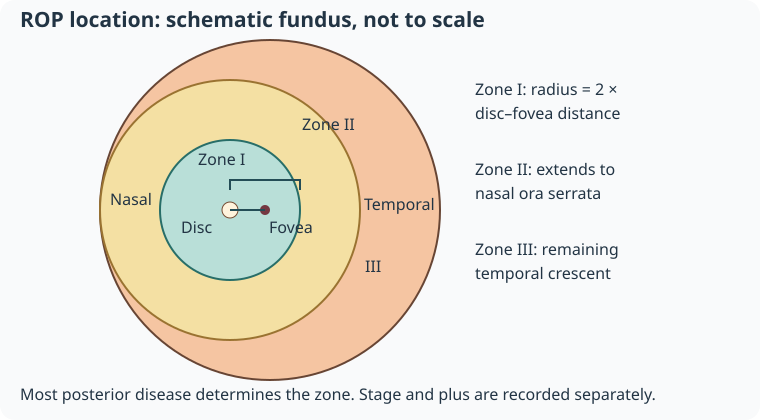
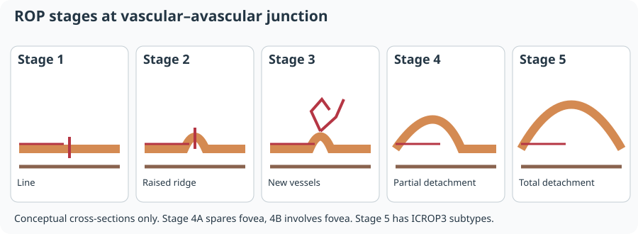

# 📚 Retinopathy of Prematurity (ROP) — nursing concepts

**Study-ready, not studied.** Retinal disease, screening and eye-specific nursing are owned here. [Neonatal care](../../Neonatal-Nursing/README.md) and [Child Health](../../Child-Health-Nursing/README.md) retain general resuscitation, nutrition and respiratory care.

[Chapter](../README.md) · [30 original MCQs](../MCQs/Retinopathy-of-Prematurity-30-MCQs.md) · [Exam evidence](../Previous-Year-Questions/Retinopathy-of-Prematurity-Exam-Evidence.md)

## Mechanism and risk

Baby ke retina ki blood vessels pregnancy ke dauran optic disc se peripheral retina ki taraf grow karti hain. Premature delivery ke time peripheral retina abhi avascular, yaani normal vessels ke bina, ho sakti hai. ROP is developing retinal vasculature ka disorder hai. Purana naam retrolental fibroplasia severe scarring ke historical description se aaya hai. Har premature infant ko ROP nahi hoti.

Do-phase model samjho. Birth ke baad immature retina ko womb ke comparison mein relatively higher oxygen exposure aur growth factors ki kami mil sakti hai. Normal vessel growth slow ya stop ho sakti hai. Phase 2 mein developing retina ka oxygen demand badhta hai. Avascular retina relatively hypoxic ho sakti hai aur vascular endothelial growth factor (VEGF) signal increase hota hai. Abnormal vessels grow kar sakti hain. Fibrovascular tissue contract kare toh retina pull hokar detach ho sakti hai. Oxygen fluctuations aur excessive exposure important modifiable risk factors hain, lekin prematurity, low birth weight, illness severity, sepsis, poor postnatal growth, transfusion aur respiratory support bhi associated hain.

Ek building ki wiring imagine karo jo centre se corners ki taraf install ho rahi hai. Agar normal installation ruk jaaye aur baad mein uncontrolled repair ho, toh abnormal arrangement ban sakti hai. Retina mein actual vessels aur growth signals involved hote hain. Analogy disease mechanism simplify karti hai.

## Indian screening and timing

Indian babies mein ROP higher gestational ages aur birth weights par bhi detect ho sakti hai. Isliye foreign narrow eligibility cutoffs blindly apply nahi karne.

| Source | Eligibility and timing |
|---|---|
| RBSK 2.0 operational guidelines 2026, ROP awareness poster p83 | Premature infants below 34 weeks, birth weight below 2000 g, and sick newborns with risks. Initial screening 3–4 weeks after birth. |
| Detailed revised NHM universal newborn eye screening guideline, printed p37 | Either birth weight below 2000 g or gestation below 34 weeks, also 34–36 weeks with risk factors and unstable high-risk infants. Initial screen at 4 weeks, but gestation below 28 weeks OR birth weight below 1200 g at 2–3 weeks after birth. |
| Indian operational summary 2020, based on national guidance | Inclusive cutoffs of gestation 34 weeks or less OR birth weight 2000 g or less, additional at-risk infants. First exam by 25–30 days, before earlier discharge as appropriate. |

Boundary wording sources mein different hai. Exactly 34 weeks ya 2000 g wale baby ko narrower poster wording ke basis par exclude mat karo. Local SNCU/NICU screening protocol aur ophthalmologist/neonatologist decision verify karo. Clinical risk ho toh age/weight se independent referral relevant ho sakta hai. Early screening exception ko general poster timing se override mat karo.

Chronological age = birth se elapsed time. Postmenstrual age (PMA) = gestational age at birth + chronological age. Example: 29 weeks 4 days par born baby ka 24 days later PMA = 29 weeks 4 days + 3 weeks 3 days = 33 weeks exactly. PMA aur postnatal age interchangeable nahi. First-screen deadlines guideline-specific postnatal age par bhi based hote hain.

Early ROP externally visible nahi hoti. Baby ka normal red reflex ya apparently normal visual behavior screening cancel karne ka reason nahi hai. Dilated retinal assessment by trained ophthalmologist or validated image-based screening pathway with appropriate expert interpretation chahiye. First exam normal ho sakti hai but vessels immature hon toh repeat schedule required hai.

## Classification

Zone location batata hai, stage severity batati hai aur clock hours extent batate hain. Har eye separately document karo.

- Zone I optic disc centred circle hai jiska radius disc-centre to fovea-centre distance ka twice hota hai.
- Zone II uske bahar se nasal ora serrata tak optic-disc centred region hai.
- Zone III residual temporal crescent hai. ICROP3 mein posterior zone II aur notch terminology bhi hai. Most posterior lesion zone determine karti hai.

| Stage | Finding |
|---|---|
| No ROP, immature vascularization | Vessels incomplete hain, pathological junction lesion absent hai |
| 1 | Vascular aur avascular retina ke beech demarcation line |
| 2 | Raised ridge |
| 3 | Extraretinal neovascular tissue, including flat neovascularization |
| 4A | Partial retinal detachment, fovea attached |
| 4B | Partial retinal detachment involving fovea |
| 5 | Total retinal detachment |

ICROP3 specialist enrichment: 5A mein optic disc visible, 5B mein disc not visible due to retrolental tissue or closed-funnel detachment, 5C mein 5B ke saath anterior segment changes. Plus disease posterior retinal vascular dilation aur tortuosity ka abnormal severity pattern hai. Pre-plus abnormality plus ke level tak nahi pahunchti. Aggressive ROP (A-ROP, older AP-ROP) rapid progression aur severe vascular changes ke saath present ho sakti hai aur usual sequential stages bypass kar sakti hai. ICROP3 term posterior-only restriction hataata hai.

## Treatment decision and follow-up

ETROP type 1 (treatment-requiring): zone I any stage with plus, zone I stage 3 without plus, zone II stage 2 or 3 with plus. Type 2 (close observation): zone I stage 1 or 2 without plus, zone II stage 3 without plus. Progression par urgent reassessment. A-ROP urgent specialist treatment require karti hai. Nurse referral immediately coordinate kare. Type 1 usually treated promptly within 48–72 hours according to local protocol and severity, A-ROP may need faster action. Routine wait mat karo.

Laser peripheral avascular retina ablate karke hypoxia-driven VEGF stimulus reduce karta hai. Anti-VEGF injection selected eyes, especially posterior/aggressive disease, mein abnormal angiogenic signaling suppress karti hai. Local drug approval, dose, risks and choice specialist decide karega. Anti-VEGF ke baad peripheral vascularization incomplete reh sakti hai aur delayed reactivation possible hai. Long follow-up zaroori hai, often at least 65 weeks PMA or until specialist-defined safe endpoints, sometimes longer. Laser ke baad bhi regression aur untreated areas check karte hain. Stage 4–5 mein selected vitreoretinal surgery consider ho sakti hai. Advanced disease mein normal vision guarantee nahi.

ROP follow-up interval zone, stage, plus, treatment aur examiner findings par depend karta hai. One fixed interval sab infants par apply mat karo. Screening formally stop karne ka decision retina specialist kare. RBSK poster ka 45-week periodic review message anti-VEGF follow-up ko automatically stop karne ki permission nahi hai. Later myopia, strabismus, amblyopia and other visual developmental problems ke liye pediatric ophthalmic follow-up bhi important hai.

## Oxygen safety and neonatal nursing

Oxygen lifesaving medicine hai. ROP prevention ka matlab hypoxemia tolerate karna ya prescribed oxygen abruptly band karna nahi. NICU mein air-oxygen blender se prescribed FiO2 deliver karo, continuous pulse oximetry aur appropriately ordered alarms use karo. NNF 2021 guideline indexed recommendation for preterm infants at or below 34 weeks receiving oxygen/respiratory support is SpO2 91–95%. Older national documents different ranges (90–93% with alarms 88–95%, or poster 90–95%) mention karte hain. Exact target local neonatal protocol, condition and clinical order se follow karo. Delivery-room transitional targets separate hain. Sensor poor perfusion, motion ya displacement se unreliable reading de sakta hai. Baby assess karo, signal quality check karo, sustained abnormal value par authorized titration/escalation karo.

Screening se pehle baby identity, gestation, birth weight, clinical stability, oxygen requirements, current medicines, scheduled exam and consent process check karo. Prescribed dilating drops correct eye, concentration, timing aur dose ke according do. Excess repeat drops systemic adverse effects cause kar sakti hain. Comfort measures such as containment, swaddling and prescribed sucrose/local analgesia local protocol ke hisaab se use karo. Exam ke dauran heart rate, respiration, saturation aur distress observe karo. Apnea/bradycardia ya desaturation ho toh examiner/neonatal team ko immediately alert karo and stabilize per protocol. After examination monitoring continue as indicated.

Discharge/transfer se pehle next ROP date, location, ophthalmologist contact aur findings family and receiving team ko written form mein hand over karo. A stable baby who feeds well can still have ROP. Missed appointments ka tracking, accessible appointment planning aur family teach-back important hain. NICU register mein eligible infant, first screen due date, completion, findings, referral, treatment and next visit status maintain karo.

## Clinical examples

- 35-week infant, birth weight 1850 g: weight criterion se eligible even if clinically stable. 
- 27-week infant at day 14: revised detailed guideline ka early 2–3-week screen window relevant hai. Routine 4-week wait nahi.
- Zone II stage 3 without plus: type 2 close review. Plus develop ho toh type 1 urgent pathway.
- Anti-VEGF after apparent regression: family ko prolonged monitoring ka reason samjhao. External eye normal dikhna late recurrence exclude nahi karta.

## ▶️ Teaching and MCQ practice

[Level Up RN — pediatric conjunctivitis and ROP](https://www.youtube.com/watch?v=7HVxZtNmOwU) indexed description covers mechanism, risks and management. [Nursing Adda247 NORCET 10 ROP concept-based MCQ practice](https://www.youtube.com/watch?v=0fF_d4c5T9o) indexed title/description explicitly identifies ROP question practice and stages. Direct video access throttled, so exact question/time and individual coverage not verified. Use as supplementary topic practice for basic mechanism, risk and staging (Q1–4, Q10–17). Indian guideline specifics, individual treatment algorithms and nursing safety question coverage pending. Not an exam PYQ source.

## Sources and verification

- [RBSK 2.0 operational guidelines 2026 p83](https://nhm.gov.in/images/pdf/programmes/RBSK/RBSK%202.0_Operational_Guidelines_2026_English.pdf) text retrieved, screenshot failed because PDF exceeds fetch limit.
- [NHM detailed revised screening guideline p37](https://nhm.gov.in/images/pdf/programmes/RBSK/Resource_Documents/Revised_ROP_Guidelines-Web_Optimized.pdf) text and page image inspected. [Indian operational summary 2020](https://pmc.ncbi.nlm.nih.gov/articles/PMC7001189/) indexed.
- [ICROP3 2021](https://www.aaojournal.org/article/S0161-6420%2821%2900416-4/fulltext) indexed abstract/text, PMC direct CAPTCHA. [ETROP original trial](https://pmc.ncbi.nlm.nih.gov/articles/PMC1280104/) indexed.
- [NNF neonatal oxygen 2021](https://www.nnfi.org/assests/upload/usefull-links-pdf/Oxygen_therapy_in_neonates_NNFI_CPG_Dec2021.pdf) indexed recommendation, full PDF verification pending.
- [CPS recent screening guidance](https://cps.ca/en/documents/position/retinopathy-of-prematurity-screening) indexed, international reference not Indian eligibility.
- [RCH NICU eye-examination nursing guidance](https://www.rch.org.au/rchcpg/hospital_clinical_guideline_index/Neonatal_eye_examination_on_the_Newborn_Intensive_Care_Unit_Butterfly_Ward/) indexed.
