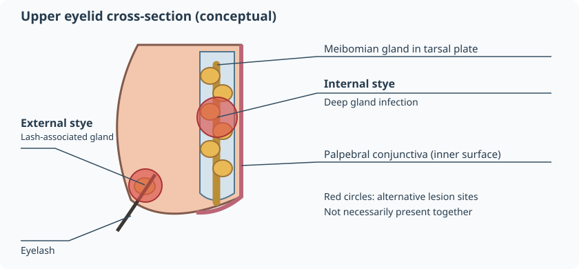

# 📚 Stye (Hordeolum) — Roman Hinglish nursing concepts

**Study-ready, not studied.** [Chapter](../README.md) · [30 original MCQs](../MCQs/Stye-Hordeolum-30-MCQs.md) · [Exam evidence](../Previous-Year-Questions/Stye-Hordeolum-Exam-Evidence.md)

## Anatomy and mechanism

Eyelid ko ek protective shutter samjho. Eyelash ke base ke paas Zeis ki sebaceous gland aur Moll ki modified apocrine sweat gland hoti hain. Tarsal plate ke andar vertically arranged meibomian glands hoti hain. Ye tear film ke lipid component mein contribute karti hain. In structures mein localized acute infection aur pus collection ko hordeolum ya stye kehte hain. Staphylococci, especially Staphylococcus aureus, common pathogens hain. Normal skin bacteria barrier compromise hone par infection kar sakte hain. Har swollen eyelid stye nahi hoti.

| Feature | External hordeolum | Internal hordeolum |
|---|---|---|
| Site | Lash follicle, Zeis or Moll gland | Meibomian gland within tarsus |
| Appearance | Tender focal swelling near lash root | Deeper tender swelling, sometimes diffuse edema |
| Pointing | Usually outward near lash base | Often toward palpebral conjunctiva |
| Clinical course | May drain spontaneously | May be more painful, drainage may be difficult |
| Management | Conservative care initially if uncomplicated | Clinician assessment, possible systemic therapy or drainage |

## Clinical assessment

Onset often acute over days. Focal tenderness, warmth, redness, localized lump aur occasionally yellow pus point mil sakta hai. Blinking par discomfort ho sakta hai. Internal lesion ko outer skin se dekhna difficult ho sakta hai. Clinician zaroorat par gently lid evert karke tarsal conjunctiva assess karta hai. Forceful manipulation nahi.

Ask onset, progression, recurrent episodes, cosmetics/lens use, previous treatment, lid disease, diabetes/immunosuppression, fever and visual symptoms. Check visual acuity, extent of swelling, eye movements and general condition. Uncomplicated stye usually actual visual acuity preserve karta hai. Discharge-related transient blur possible hai, but persistent acuity loss is a red flag. Eye movement pain, diplopia, proptosis or inability to assess the eye because of severe swelling require urgent evaluation. Skin redness dark skin tones mein less obvious ho sakti hai, warmth, tenderness, swelling aur progression bhi assess karo.

Chalazion typically sterile lipid-related granulomatous lump hai, often painless later. Early chalazion tender ho sakta hai. Stye acute infection hai, usually tenderness prominent hoti hai. Internal hordeolum resolve hone ke baad residual chalazion develop ho sakta hai. Blepharitis diffuse lid-margin inflammation hai aur recurrent styes ka risk factor hai. Medial lower lid swelling mein lacrimal sac infection (maximum tenderness below medial canthus near nose) ya canaliculitis (punctum-centered changes) consider karo. Lateral upper lid fullness lacrimal gland disease bhi ho sakti hai. Persistent atypical lesion, lash loss or recurrence at same site needs specialist assessment, not repeated empirical treatment.

## Conservative care and medicines

Uncomplicated stye often spontaneously improves. Clean comfortably warm compress closed eyelid par apply karo. NHS suggests 5–10 minutes, 2–4 times daily. Indian AB-HWC staff nurse manual recommends repeated dry warm compresses, not excessively hot. Local protocol aur patient tolerance follow karo. Heat se secretion soften aur natural drainage facilitate ho sakti hai. Heat ka purpose tissue burn ya sterilization nahi. Children aur reduced sensation wale patients mein temperature carefully check karo. Clean material use karo, vigorous rubbing aur pressure avoid karo.

Patient ko squeeze, puncture ya eyelash self-pluck nahi karna. Agar lesion drain hoti hai toh clean pad se gently secretion remove karo. Hand hygiene aur separate towels use karo. Active lesion heal hone tak contact lenses aur eye makeup avoid karo. Simple pain relief clinician advice, age, allergy and contraindications ke according.

Antibiotics har uncomplicated lesion mein required nahi. Indian AB-HWC 2021 nurse manual simple stye/chalazion ke liye routine oral antibiotic role nahi batata. Mizoram 2025 STG external stye ke liye broader antibiotic options list karti hai. Merck 2026 internal hordeolum aur accompanying preseptal cellulitis mein oral treatment aur selected drainage describe karta hai. In recommendations ka scope different hai. Simple external lesion ke liye routine systemic antibiotic automatically start nahi karna aur deep infection/spreading cellulitis mein oral therapy ko blanket contraindicated nahi bolna. Clinician site, severity, allergy, age, comorbidities aur local antimicrobial protocol se decision kare. Topical ointment selected associated surface infection mein prescribe ho sakti hai. Internal abscess mein topical antibiotic alone adequate nahi ho sakta. A 2022 retrospective study found no added resolution benefit from routine antibiotic addition, but it cannot establish equivalence for all high-risk infections. Cochrane 2017 review found no eligible randomized trials for nonsurgical acute internal hordeolum treatment. Evidence limitations samjho.

## Complications and referral

Localized stye se surrounding eyelid infection spread ho sakti hai. Preseptal cellulitis orbital septum ke anterior soft tissues mein hoti hai. Typical findings diffuse lid warmth/swelling, usually intact eye movements and vision, without proptosis. Orbital cellulitis septum ke posterior tissues mein infection hai. Painful/restricted movements, proptosis, diplopia, reduced vision, severe headache or systemic illness concern raise karte hain. Not every sign present hona necessary hai. If examination unreliable, especially young child, urgent assessment arrange karo. Orbital infection emergency hai, vision loss and intracranial spread possible hain.

Uncomplicated stye ko routine imaging or culture nahi chahiye. Atypical, recurrent, severe, spreading or nonresponsive infection mein clinician targeted investigations decide karta hai. Fever, rapid spread, severe pain or swelling, new vision change and immunocompromise lower threshold for urgent review. Children close follow-up require karte hain. Do not delay referral to complete a compress session.

Persistent localized abscess mein ophthalmologist incision/drainage consider kar sakta hai. External lash removal only trained authorized clinician, never patient self-treatment. Nurse consent, identity, laterality, allergies, equipment and prescribed medication verify kare. If specimen ordered, collect/label per protocol. After procedure worsening bleeding, redness, fever, pain or visual change promptly report karo.

## Recurrence and community nursing

Recurrent stye mein underlying blepharitis, meibomian gland dysfunction, rosacea, diabetes and hygiene habits assess karo. HP NHM training manual community follow-up and clinician-directed diabetes/refractive error screening describes. Refractive error ko proven direct bacterial cause mat samjho. Diabetes screen eligibility and local protocol ke according karo, recurrence alone diabetes diagnosis nahi.

Clean hands, avoid eye rubbing, remove cosmetics before sleeping, do not share eye cosmetics or towels. Teach compress safety using demonstration and teach-back. Record lesion site, symptoms, baseline vision, referral urgency, follow-up date and patient education. At AB-HWC assist medical officer referral and monitor treatment adherence. Persistent lump after tenderness subsides may be chalazion and needs reclassification. Detailed chalazion procedures and chronic blepharitis care will be separate topics.

## ▶️ Teaching and MCQ practice

[Smart Optometry with Samir — External Hordeolum](https://www.youtube.com/watch?v=Y4PcqcpInlo) indexed teaching description. [Eyelid ophthalmology high-yield MCQs](https://www.youtube.com/watch?v=0tTcBtFP0nU) indexed description explicitly includes hordeolum and specialist/medical exams. Supplemental topic lead for Q1–4 and Q8 only, exact item coverage not verified. [Shubham Sir eye-disorders MCQ session](https://www.youtube.com/watch?v=GCMk4wrOvBg) broad nursing practice lead without stye-specific mapping. See evidence gaps. No exact playback verified.

## References

- [HP NHM AB-HWC staff nurse eye care manual, printed pp32–33](https://nhm.hp.gov.in/storage/app/media/uploaded-files/Eye%20Care%20Training%20Manual%20for%20Staff%20Nurse%20at%20AB-HWC.pdf) — retrieved text, screenshot cache miss.
- [Mizoram Health and Family Welfare STG, 2025](https://hfwmizoramstg.in/guidelines/stye) — retrieved.
- [Merck Professional, reviewed January 2026](https://www.merckmanuals.com/professional/eye-disorders/eyelid-and-lacrimal-disorders/chalazion-and-hordeolum-stye) — retrieved.
- [NHS stye guidance](https://www.nhs.uk/conditions/stye/) — retrieved.
- [College of Optometrists](https://www.college-optometrists.org/clinical-guidance/clinical-management-guidelines/hordeolum) — indexed.
- [2022 retrospective antibiotic study](https://pmc.ncbi.nlm.nih.gov/articles/PMC8931268/) and [Cochrane 2017](https://pmc.ncbi.nlm.nih.gov/articles/pmid/28068454/) — indexed.
- [Royal Children's Hospital orbital cellulitis guideline](https://www.rch.org.au/clinicalguide/guideline_index/Periorbital_and_orbital_cellulitis/) and [2026 Canadian Paediatric Society guidance](https://cps.ca/en/documents/position/preseptal-orbital-cellulitis) — indexed.
