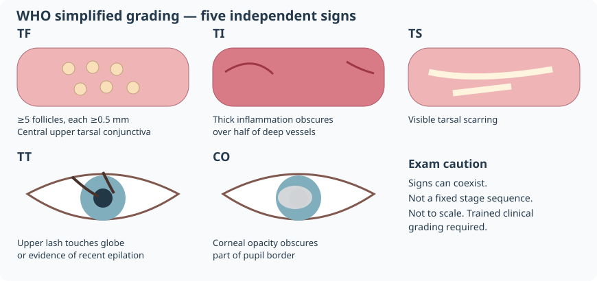

# 📚 Trachoma — clinical grading, SAFE and community nursing

**Study-ready, not studied.** [Chapter](../README.md) · [30 original MCQs](../MCQs/Trachoma-30-MCQs.md) · [Exam evidence](../Previous-Year-Questions/Trachoma-Exam-Evidence.md)

## Etiology and transmission

Trachoma Chlamydia trachomatis ke ocular serovars A, B, Ba aur C se associated chronic recurrent infection hai. Ye obligate intracellular bacterium hai, virus nahi. Adult inclusion conjunctivitis aur neonatal chlamydial infection generally different serovars D–K se associated hain. Active trachoma young children mein common hai, particularly endemic communities mein. Infection eye/nasal secretions ke contact, contaminated hands, towels, clothes, bedding aur eye-seeking flies se spread ho sakti hai. Musca sorbens important mechanical vector hai in many endemic settings. Poor water access, crowded housing, inadequate sanitation aur facial discharge transmission promote karte hain. Water-washed disease ka matlab water peene se infection nahi, inadequate washing facilities risk increase karti hain.

## Pathogenesis and clinical assessment

Repeated childhood infection upper tarsal conjunctiva mein inflammation create karti hai. Healing aur repeated injury se scarring badh sakti hai. Scar contraction lid margin ko inward turn kar sakti hai (entropion). Inward/misdirected lashes globe rub karti hain (trichiasis). Repeated mechanical injury corneal abrasion, ulceration aur opacity produce kar sakti hai. Antibiotic active infection clear kar sakta hai but established scarring reverse nahi karta. Think of repeatedly scratched transparent glass: scratch accumulation clarity reduce karti hai. Biological tissue inflammation and scarring actual process hai.

Active symptoms gritty sensation, irritation, discharge, tearing, redness and photophobia ho sakte hain, but some affected children minimal symptoms report karte hain. Field grading trained examiner good light and magnification ke saath karta hai. Upper tarsal conjunctiva inspect karo using appropriate technique. Visual acuity separately document karo. Each eye separately grade karo. History of lash epilation specifically ask karo. Severe pain, acute visual loss or suspected corneal injury urgent referral demand karti hai. Clinical signs plus epidemiological context important hain. Follicles alone other conjunctivitis mein bhi ho sakte hain. Molecular testing selected investigations mein useful ho sakti hai, routine WHO field grading necessarily laboratory confirmation require nahi karti.

Classical additional signs: Herbert pits healed limbal follicles ke depressed scars hain. Pannus superficial corneal vascularization/inflammatory tissue growth hai. Arlt line upper tarsal conjunctival scar band describe karti hai. Ye classic exam terms hain, independent modern WHO grades nahi. MacCallan historical stages I–IV (incipient, established, cicatrizing and healed) older classification hai. Current programme survey mein WHO simplified signs use karo.

## WHO simplified grading

Mnemonic FISTO: Follicular, Intense, Scarring, Trichiasis, Opacity. Ye five independently recorded clinical signs hain, compulsory consecutive mutually exclusive stages nahi.

| Code | Clinical threshold |
|---|---|
| TF | At least five follicles, each at least 0.5 mm across, in central upper tarsal conjunctiva |
| TI | Marked inflammatory thickening hiding over half the normal deep tarsal blood vessels |
| TS | Readily visible upper tarsal conjunctival scars |
| TT | At least one upper-lid eyelash contacting the globe, or evidence of recent removal of inward upper-lid lashes |
| CO | Readily visible corneal opacity dense enough to obscure part of the pupil border |

TF and/or TI represent active clinical inflammation. A person can have TF and TI together, or scarring and trichiasis together. Grade thresholds are specific: four qualifying follicles do not meet TF. Exactly half of deep vessels obscured does not meet TI criterion. Amended TT definition excludes lower-lid-only lash contact for programme grading. Lower lash injury still clinically matters. TT is not synonymous with entropion: abnormal lash direction can occur without whole lid margin turning in. CO threshold refers to cornea, not lens cataract.

## SAFE strategy and treatment

| Letter | Action | Nursing application |
|---|---|---|
| S | Surgery | Identify TT, assess visual function, link to trained surgical services and follow-up |
| A | Antibiotics | Clear infection with prescribed treatment and programme-directed mass drug administration where indicated |
| F | Facial cleanliness | Promote regular face washing and removal of ocular/nasal discharge with safe water |
| E | Environmental improvement | Improve sanitation and water access, reduce fly breeding, coordinate community partners |

WHO clinical guidance for TF/TI includes single oral azithromycin 20 mg/kg up to 1 g or tetracycline 1% eye ointment to both eyes twice daily for six weeks. This is guideline learning, not independent prescribing. Age eligibility, contraindications, pregnancy, drug interactions and local protocol verify karo. Antibiotic regimen and community MDA decision separate hain. MDA public health programme determines based on surveillance and prevalence. India elimination ke baad every red-eye case par nationwide MDA assume nahi karna. TS alone has no specific scar-reversing treatment. TT and CO need visual assessment and referral. Corrective lid surgery reduces lash contact. Regular epilation can be selected management by trained staff when appropriate, not universal substitute for referral. 2021 NHSRC staff nurse manual mentions referral for corrective surgery when more than three lashes turn in. Current WHO TT definition already met with one upper lash contact, and WHO advises eye-unit assessment. Old procedure threshold is not diagnostic cutoff or permission to delay referral. Do not self-pluck or forcefully manipulate eye. Surgery does not reverse established dense corneal opacity. Low-vision support may be required.

## India elimination and surveillance

WHO validated India on **8 October 2024** for elimination of trachoma as a public health problem. India was third in WHO South-East Asia Region after Nepal and Myanmar at that time. 1963 trachoma control project integrated into national blindness control programme after its launch in 1976. NPCBVI (National Programme for Control of Blindness and Visual Impairment) includes ongoing eye-care services. WHO November 2026 fact sheet (status 16 November) still lists India as validated.

Elimination as public health problem does not mean zero infections, eradication or end of services. WHO thresholds in each formerly endemic district:

- TF prevalence in children aged 1–9 years below 5%, maintained at least two years without ongoing antibiotic MDA.
- TT unknown to health system in adults aged 15 years and above below 0.2%.
- Funded system to detect and manage new TT cases.

These are population indicators, not diagnostic thresholds for one patient. Exactly 5% TF or 0.2% unknown TT is not below threshold. Numerator and denominator correct age group se use karo. Known TT cases are still entitled to care, even if excluded from unknown-to-system indicator. Surveillance and referral continue after validation. Old training manual geographical statements reflect historical context, not current endemic status. Updated WHO evidence use karo.

## Nursing and community follow-up

At AB-HWC assist MO with identification, referral to Vision Centre/ophthalmologist, records, case reports, medicine adherence and health promotion. Suspected recurrence or cluster notify programme team according to local reporting pathway. Do not independently declare district transmission or restart MDA. Assess water access and family barriers without blaming families. Teach safe face cleaning, separate cloths, clean hands, sanitation, and avoid sharing secretion-contaminated material. Coordinate school, ASHA, sanitation and water services. Arrange TT surgical follow-up and ensure transport/financial barriers addressed. Document affected eye, findings, visual acuity, epilation history, referral completion and care status. Persistent vision loss assess rehabilitation needs.

## ▶️ Teaching and MCQ practice

- [Anand's nursing files — Trachoma nursing care plan](https://www.youtube.com/watch?v=59X3es5e4HY), indexed nursing teaching description.
- [MedLive By Dr. Priyanka — Trachoma masterclass](https://www.youtube.com/watch?v=eJa3yzT1KRI&t=1450s), description lists teaching at 24:10 and mixed image questions at 36:00. Exact trachoma image-question coverage not verified, teaching lead only.
- [Top Eye Disorders Nursing Practice Questions](https://www.youtube.com/watch?v=BebRfEEgkQc), broad nursing MCQ lead, specific trachoma items unverified.
- [Pearson microbiology trachoma practice](https://www.pearson.com/channels/microbiology/exam-prep/set/default/trachoma), indexed practice question on transmission, non-YouTube supplemental resource. No claim of nursing PYQ.

All 30 dedicated nursing YouTube MCQ mappings pending.

## References

- [WHO simplified grading](https://www.who.int/teams/control-of-neglected-tropical-diseases/trachoma/diagnosis) direct text.
- [WHO trachoma clinical Q&A](https://www.who.int/news-room/questions-and-answers/item/trachoma) direct text.
- [WHO amended grading](https://pmc.ncbi.nlm.nih.gov/articles/PMC7652564/) indexed.
- [WHO 8 October 2024 India validation](https://www.who.int/news/item/08-10-2024-elimination-of-trachoma-as-a-public-health-problem-in-india) direct.
- [WHO current fact sheet](https://www.who.int/news-room/fact-sheets/detail/trachoma) direct thresholds, indexed status as of 16 November 2026.
- [NHSRC staff nurse eye-care manual 2021, printed pp41–43](https://nhsrcindia.org/sites/default/files/2021-12/Eye%20Care%20Training%20Manual%20for%20Staff%20Nurse%20at%20AB-HWC.pdf) text retrieved, screenshot cache miss.
- [PIB 18 March 2025 update](https://www.pib.gov.in/PressReleasePage.aspx?PRID=2112480&lang=2&reg=48) indexed.
- [EyeWiki Trachoma](https://eyewiki.aao.org/Trachoma) indexed.
