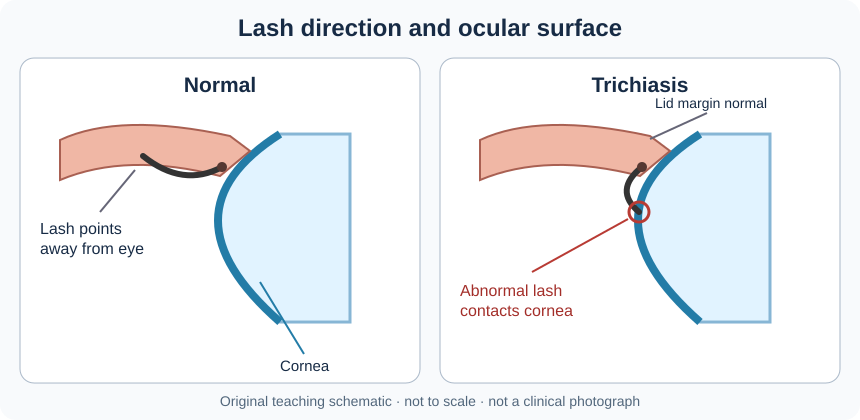

# 📚 Trichiasis — lash direction, corneal safety and nursing management

**Study-ready, not studied.** [Chapter](../README.md) · [30 original MCQs](../MCQs/Trichiasis-30-MCQs.md) · [Exam evidence and video practice](../Previous-Year-Questions/Trichiasis-Exam-Evidence.md)

[Assessment](#assessment) · [Causes](#causes) · [Cornea](#cornea) · [Management](#management) · [Nursing](#nursing) · [Practice resources](#practice-resources)

## assessment

**🟠 HIGH YIELD — Kya hai?** Socho ki eye ke aage ek smooth, transparent protective surface hai. Isko cornea kehte hain. Eyelashes normally bahar ki taraf rehti hain aur dust ke against protection mein help karti hain. Trichiasis mein kuch lashes ka direction galat ho jata hai. Unke tips eye ki surface se contact kar sakte hain, chahe eyelid margin ki overall position normal ho. Har blink par repeated friction ho sakti hai.

Ye diagram ek simplified side view hai. Blue curve cornea represent karti hai. Normal lash globe se door point karti hai. Abnormal lash ka tip cornea ke contact mein hai. Actual examination mein upper aur lower lid dono inspect kiye ja sakte hain.

Entropion mein eyelid margin khud andar rotate ho jata hai. Ectropion mein margin bahar evert hota hai. Dono ki detailed theory alag files mein hai. Yahan individual lash contact aur follicle-directed care par focus hai. Trachomatous trichiasis ki public-health definition aur WHO grading ke liye [Trachoma](Trachoma-Concepts.md) padho. Har trichiasis active trachoma nahi hoti.

**Assessment sequence:** Patient se symptom timing, scratchiness, light se pain, vision change, prior eyelid procedure aur recent lash removal ki history lo. Visual acuity safely record karo. Adequate light aur magnification mein eye surface aur lashes ka relation dekha jata hai. Front view mein fine lash miss ho sakti hai. Side ya below view se actual contact locate karna easier hota hai. Tight lid squeezing ya globe pressure natural alignment badal sakta hai. Record mein side, lid segment, number, direction, cornea/conjunctiva contact aur associated lid abnormality likho. Recent epilation bhi note karo, kyunki temporary absence ka matlab cure nahi hai.

**Terminology revision:** Poliosis mein lash white ho jati hai. Madarosis mein lash ya eyebrow hair loss hota hai. Distichiasis extra lash row ka term hai. Sirf white lash ya extra row dekh kar ordinary trichiasis ka diagnosis nahi lagana chahiye. Actual contact aur origin assess karo. Practice Q1–5 aur Q9.

## causes

**🟠 HIGH YIELD — Follicle ka role.** Follicle skin ke andar hair banane wali structure hai. Agar injury ya chronic inflammation ke baad surrounding tissue ki healing uneven ho, to hair wrong angle par grow kar sakta hai. Blepharitis mein lid margin repeatedly inflamed reh sakta hai. Purani lid injury aur surgery se localized scar ke paas lash alignment badal sakti hai. Stevens-Johnson syndrome aur mucous membrane pemphigoid mein ocular surface aur lid tissues mein chronic scarring ho sakti hai. Aise patient ko underlying disease ke liye specialist evaluation bhi chahiye.

Agar ek abnormal lash ke paas persistent lid ulcer ya irregular lesion dikh raha hai, to sirf lash repeatedly remove karna enough nahi hai. Lesion ka cause investigate karna zaroori hai. Kuch prostaglandin-analogue glaucoma medicines lashes mein changes kar sakti hain. Nursing role medicine history record karna aur prescriber se review coordinate karna hai. Glaucoma medication khud se discontinue nahi karna chahiye.

**Example:** Patient ka old eyelid laceration heal ho chuka hai. Scar ke paas teen lashes eye se contact kar rahi hain, lekin whole margin rotate nahi hua. Nurse focal lash problem ki finding document karegi aur ophthalmic assessment arrange karegi. Pehle se published entropion questions mein lid rotation correction detail mein hai. Yahan follicle aur scar alignment ka role samjho. Practice Q6–10.

## cornea

**🔴 MOST IMPORTANT — Surface injury aur red flags.** Cornea ki sabse outer cell layer ko epithelium kehte hain. Ye outer barrier ka kaam karti hai. Repeated rubbing se chhote surface defects ya abrasion ban sakti hai. Is wajah se irritation, pain, redness aur watering ho sakti hai. Damage ke baad infection aur scar ka risk bhi ho sakta hai. Central scar vision affect kar sakta hai.

Clinical fluorescein examination surface injury assess karne mein useful hai. Dye epithelial defect ko highlight kar sakti hai. Ye lash follicle ki viability ya microbial organism identify nahi karti. Agar dye se corneal defect detect nahi hota, lekin lash conjunctiva se rub kar rahi hai, to contact phir bhi relevant ho sakta hai.

**Nursing safety:** New vision loss, severe pain, marked photophobia, focal white corneal infiltrate, worsening symptoms ke saath discharge ya painful red eye in a contact lens wearer par urgent eye assessment arrange karo. Patient ko contact lens wear stop karne ki advice do jab tak clinician safe return plan na de. Bina authorised examination ke topical steroid ya repeated take-home anaesthetic use karne ki advice mat do. Visible lash ke saath keratitis bhi ho sakti hai. Lash removal ke baad persistent significant pain ko ignore mat karo. Detailed [Keratitis](Keratitis-Concepts.md) aur [Corneal ulcer](Corneal-Ulcer-Concepts.md) packages alag hain. Practice Q11–16.

## management

**🟠 HIGH YIELD — Treatment ka aim.** Har patient mein aim offending lash ka ocular contact kam karna aur corneal damage prevent karna hai. Management cause, number, location, severity, associated lid disease aur patient preference par depend karta hai. Prescribed lubricant comfort mein help kar sakta hai, lekin hair direction permanently correct nahi karta. Antibiotics infection ya selected epithelial injury ke context mein clinician decide karta hai, mechanical misdirection ko cure karne ke liye nahi.

| Method | Kya samajhna hai |
|---|---|
| Mechanical epilation | Trained practitioner suitable forceps se offending hair remove karta hai. Follicle survive kare to lash phir grow kar sakti hai. Isliye immediate symptom relief permanent cure ke barabar nahi hai. |
| Electrolysis / radiofrequency | Individual follicle target karke regrowth kam karne ki koshish hoti hai. Focal cases mein useful ho sakti hai. Precise targeting aur repeat treatment ki need ho sakti hai. |
| Laser ablation | Selected follicles ko light energy se treat kiya jata hai. Pigment, depth aur technique selection important hai. Cornea ko protect karna zaroori hai. |
| Cryotherapy | Freezing se targeted follicle damage hota hai. Surrounding tissue injury, pigment change, margin scarring aur distortion possible hain. Specialist selection zaroori hai. |
| Lash resection / reconstruction | Extensive recurrent disease, scarring ya associated structural problem mein specialist wider correction consider kar sakta hai. Har patient ko major surgery nahi chahiye. |

Indian Journal of Ophthalmology mein 2026 argon laser review indexed hai. Ismein repeated sessions aur evidence uncertainty ka discussion hai. LV Prasad Eye Institute se affiliated 2024 retrospective study selected non-trachomatous cicatricial ocular surface disease mein electroepilation aur lash resection compare karti hai. Selected study result ko har patient ke liye universal protocol nahi banana chahiye. [Study abstract](https://pubmed.ncbi.nlm.nih.gov/38796788/) · [2026 review](https://pubmed.ncbi.nlm.nih.gov/42330218/). Indexed abstract evidence retrieved. Full study aur independent applicability review pending.

**Clinical example:** Patient ne ek localized lash remove karwayi thi. Kuch hafton ke baad wahi area phir scratch karne laga. Clinician pehle corneal condition aur lash position recheck karega. Agar recurrent follicle identify hota hai to targeted treatment consider ho sakta hai. Patient ko guarantee nahi deni chahiye ki ek session ke baad recurrence impossible hai. Practice Q17–25.

## nursing

**🔴 MOST IMPORTANT — Nursing process.** History aur visual acuity document karne ke baad corneal injury ke red flags identify karo. MO ya ophthalmic team ko exact findings communicate karo. Procedure sirf authorised practitioner aur local scope ke andar hona chahiye. Correct patient, eye, consent, clean hands, appropriate processed equipment aur supported position verify karo. Patient ko eye rub karne, household scissors ya chemical hair-removal products eye ke paas use karne se bachne ko bolo.

NHSRC ka Indian AB-HWC staff nurse eye-care manual trachoma-associated lash changes, primary-care referral aur follow-up cover karta hai. Ismein local training context ke liye more-than-three inward lashes par corrective surgery referral ka example hai. Ye general trichiasis ke liye universal treatment cut-off nahi hai. Single offending lash bhi corneal injury ke saath urgent evaluation require kar sakti hai. Indian manual ke procedural scope ko current institutional authorization aur specialist direction ke saath apply karo.

Aftercare instructions treating clinician ke according do. Agar ablation planned hai, prior self-epilation ke baare mein clinic se advice lo, kyunki visible lash target identify karne mein help kar sakti hai. Worsening pain, vision changes, increasing redness ya discharge par early review arrange karo. Follow-up mein number aur location of residual/recurrent lashes, corneal status, comfort aur visual acuity compare karo. Lower count ko complete success mat bolo agar harmful contact abhi present hai. Practice Q26–30.

## practice resources

| Concept | Teaching video | Dedicated MCQ practice |
|---|---|---|
| Clinical assessment and terminology | [smart optometry — How to Treat Trichiasis](https://www.youtube.com/watch?v=od5RuaU-oZ0), indexed title and description, playback not verified | [Optometry Fans — premium optometry MCQ test series](https://www.youtube.com/watch?v=WEOe7Lsatsg), published differential marker 01:45, supplementary only. Mapped to Q9 at topic level. Nursing-specific item pending. |
| Corneal safety, treatment selection and nursing care | Same teaching lead for treatment modalities, not a verified nursing lecture | Nursing-specific question video verification pending. See [question gap register](../Previous-Year-Questions/Trichiasis-Exam-Evidence.md). |

**Quick recap:** Normal lid margin ke saath misdirected lash ko trichiasis samjho. Epilation temporary ho sakti hai. Corneal injury aur cause separately assess karo. Recurrent problem specialist-directed follicle treatment ya reconstruction require kar sakti hai. Staff nurse safe referral aur follow-up coordinate karti hai.

### Clinical references

- [MSD Manual Professional — Trichiasis, January 2026](https://www.msdmanuals.com/professional/eye-disorders/eyelid-and-lacrimal-disorders/trichiasis), directly retrieved.
- [AAO EyeWiki — Trichiasis](https://eyewiki.aao.org/Trichiasis), directly retrieved. General management and procedural selection.
- [American Academy of Ophthalmology — What Is Trichiasis, January 2026](https://www.aao.org/eye-health/diseases/what-is-trichiasis), indexed full-text extract.
- [NHSRC Staff Nurse Eye Care Training Manual](https://www.nhsrcindia.org/sites/default/files/2021-12/Eye%20Care%20Training%20Manual%20for%20Staff%20Nurse%20at%20AB-HWC.pdf), directly retrieved text, printed p42. Screenshot retrieval unavailable.
- [Mizoram Health and Family Welfare STG — Trachoma, 2025](https://hfwmizoramstg.in/guidelines/trachoma), directly retrieved. Trachoma-associated disease only. Current WHO grading remains in Trachoma notes.
- [IGNOU eGyanKosh ocular adnexa unit](https://egyankosh.ac.in/bitstream/123456789/32704/1/Unit-8.pdf), printed p103 terminology text retrieved, screenshot unavailable.
- [2024 comparative clinical study](https://pubmed.ncbi.nlm.nih.gov/38796788/) and [Indian Journal of Ophthalmology 2026 review](https://pubmed.ncbi.nlm.nih.gov/42330218/), indexed abstracts. No independent full-text review.
- [Dorset clinic leaflet, indexed preparation advice](https://www.uhd.nhs.uk/uploads/about/docs/our_publications/patient_information_leaflets/Eye_Department/Radiosurgery_or_electrolysis_for_trichiasis_083-21.pdf). Follow individual treating clinic instructions.

Checked 27 November 2026. [Chapter](../README.md) · [Original MCQs](../MCQs/Trichiasis-30-MCQs.md) · [Exam evidence and videos](../Previous-Year-Questions/Trichiasis-Exam-Evidence.md)
