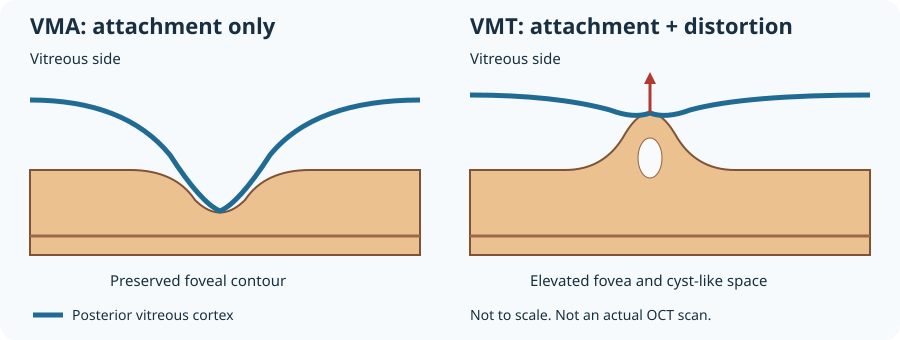

# 📚 Vitreomacular Traction (VMT) — detailed nursing concepts

**Study-ready, not studied.** Nursing core with clearly identified specialist enrichment. [Chapter](../README.md) · [30 original MCQs](../MCQs/Vitreomacular-Traction-30-MCQs.md) · [Exam evidence](../Previous-Year-Questions/Vitreomacular-Traction-Exam-Evidence.md)

## Mechanism and anatomy

Vitreous aankh ke pichhle bade chamber mein bhara transparent gel hai. Iska outer cortical layer retina ki inner surface ke paas rehta hai. Age ke saath gel ke kuch parts watery hone lagte hain. Isko liquefaction kehte hain. Saath hi retina aur gel ka attachment dheere-dheere weak ho sakta hai. Jab posterior vitreous retina se separate hoti hai toh ise posterior vitreous detachment (PVD) kehte hain. PVD aur retinal detachment ek hi condition nahi hain.

Ek plastic sheet ko smooth surface se uthate hue imagine karo. Agar sheet ke beech ka point abhi chipka hua ho aur baaki part uth jaaye, toh central point par tension pad sakti hai. Isi tarah jab vitreous macula ke aas-paas separate ho lekin ek hissa chipka rahe, toh macula kheench sakti hai. Macula fine detail aur reading vision ke liye important hai. Agar attachment retina ko deform kar rahi hai toh isse VMT kehte hain. Sirf attachment without structural change ko VMA kaha jaata hai. Ye earlier macular hole bank Q3 mein already tested hai.

Liquefaction aur adhesion weakening ka balance important hai. Agar gel liquefy ho jaaye lekin central attachment strong rahe, toh incomplete separation se traction ho sakti hai. Retina ke andar small spaces, swelling ya local elevation develop ho sakti hai. Severe cases mein actual macular hole bhi ban sakta hai. Har patient mein progression zaroori nahi hai.

*Educational schematic. Normal foveal shape with residual attachment (VMA) is compared with a pulled-up central retina (VMT). Not a diagnostic scan.*

## Risk and assessment

Older age aur female sex VMT ke reported associations hain. High myopia, diabetic retinal disease, retinal vein occlusion aur wet AMD ke saath bhi VMT coexist kar sakti hai. Risk factor hona diagnosis nahi hai. Nurse symptom history, previous retinal disease, prior OCT aur previous treatments note karegi.

Patient ko central blur, image distortion, objects chhote lagna ya central spot notice ho sakta hai. Symptoms sudden ya gradual ho sakte hain. Har symptom ko traction alone assume mat karo. Visual acuity dono eyes mein separately measure karo. Pehle se chal rahi disease aur naye symptoms ki timeline alag document karo. Nayi flashes, floaters, curtain ya major visual loss par urgent ophthalmic assessment arrange karo, kyunki peripheral tear ya another acute retinal problem bhi possible hai.

## OCT and classification

Optical coherence tomography (OCT) light se retina ke cross-sectional images banata hai. Is test mein clinician posterior vitreous line, residual attachment aur retinal layer changes assess karta hai. VMT mein attachment ke paas retina ki shape change ho sakti hai. Kabhi retina ke andar cyst-like spaces ya retina ke neeche small fluid pocket dikhta hai. Ye fluid har case mein vascular leakage prove nahi karta. Fundus examination ke saath OCT important hai. Ultrasound selected circumstances mein vitreous movement assess karne mein helpful ho sakta hai, lekin detailed foveal layer analysis OCT ka role hai.

**Specialist enrichment: IVTS anatomical classification.** OCT par fovea se 3 mm ke radius ke andar remaining vitreous attachment aur perifoveal separation dekhi jaati hai. VMT mein associated anatomical distortion hoti hai, lekin VMT without full-thickness hole ke liye poori neural retina mein through-and-through defect nahi hota. Attachment ka widest diameter 1500 micrometres ya kam ho toh focal aur isse zyada ho toh broad category hai. Ye width attachment ki hai, macular hole ke minimum diameter ki nahi. 1500 micrometres = 1.5 mm. Width alone urgency ya surgery decide nahi karti.

Morphology-based older description mein V-shaped configuration mein central attachment ke dono taraf separation hoti hai. J-shaped mein asymmetric separation hoti hai. Ye descriptors specialist interpretation ke liye hain, nursing exam ke mandatory facts ke roop mein claim nahi kiye jaate. VMT isolated ho sakti hai ya concurrent macular disease ke saath ho sakti hai.

## Differential and progression

ERM surface par cellular membrane hoti hai. VMT mein vitreous attachment force transmit kar rahi hoti hai. Dono ek hi eye mein mil sakte hain. Macular hole mein actual tissue defect ki presence aur extent assess hoti hai. Pehle published ERM aur macular hole banks mein definitions aur basic differences covered hain, unhe repeat count nahi kiya gaya.

OCT par cyst-like spaces ke saath vascular edema ka suspicion ho toh clinician diabetes, RVO aur other disease context aur zaroorat par angiography consider karta hai. Focal traction mein fluorescein leakage minimal ya absent ho sakti hai, lekin chronic broad traction ya associated vascular disease mein leakage bhi ho sakti hai. Isliye absence of leakage ko universal rule mat banao. Follow-up mein attachment release, persistent traction, worsening distortion aur development of a hole alag outcomes hain. Traction release hone par bhi permanent structural damage ki wajah se vision fully recover na ho sakti hai.

## Monitoring and treatment

Mild stable symptoms mein retina specialist observation aur scheduled repeat OCT choose kar sakta hai. Observation ka matlab treatment abandon karna nahi hai. Patient ko follow-up date, symptom changes report karne ka plan aur urgent contact route samjhao. Kuch eyes mein attachment naturally release ho jaati hai, par guarantee nahi hai. AAO guideline extract mein small attachments ke selected groups mein lagbhag 30–40% spontaneous release 1–2 years ke follow-up mein reported hai. Ye group estimate individual prediction nahi hai.

Significant functional loss, progression ya threatening structural change mein specialist active intervention discuss kar sakta hai. Pars plana vitrectomy (PPV) mein vitreous ko remove karke persistent traction release ki jaati hai. Associated ERM ya hole ho toh surgical plan modify ho sakta hai. Lens cataract progression, retinal break/detachment, infection aur other complications discuss hote hain. Surgery ko normal vision ki guarantee mat bolo. Patient ki only useful eye ho, follow-up difficult ho ya other macular disease present ho toh team individualized benefit-risk decision karegi.

**Historical pharmacological option:** Ocriplasmin ek proteolytic enzyme hai jo vitreoretinal interface proteins ko cleave karne ke liye develop hua tha. Iska goal attachment release karna tha. Selected focal VMT without ERM mein historical response better ho sakta tha. Transient vision reduction aur color perception changes jaise adverse effects report hue. EU marketing authorization 30 August 2023 ko commercial reasons se withdraw hui. NICE guidance bhi marketing discontinuation note karti hai. India mein current availability is run mein establish nahi hui. Isko routinely available current therapy ya nursing-administered treatment assume nahi karna.

**Specialist evidence:** Pneumatic vitreolysis mein intravitreal gas se vitreous separation induce karne ki koshish ki gayi. DRCR Retina Network AG/AH trials retinal tears aur detachments ke safety concerns ke kaaran early stop hue. Isliye gas injection ko harmless standard first-line alternative mat batao. General gas precautions already [retinal detachment notes](Retinal-Detachment-and-Surgical-Nursing.md) mein covered hain.

## Nursing and follow-up

Baseline symptoms aur OCT date record karo. Patient ki reading, medication labels aur daily activities ka impact assess karo. Agar patient follow-up miss kar raha hai toh transport, language aur appointment access barriers identify karo. Scheduled follow-up ko remind karo. Imaging normal dikhne par bhi persistent symptom ophthalmologist ko communicate karo. New acute symptoms mein routine appointment ka wait mat karvao.

After vitrectomy operative record mein actual procedure aur tamponade status check karo. Prescribed medications aur precautions ko teach-back se verify karo. Postoperative pain with visual decline, increasing redness ya new field loss urgent review require karte hain. Generic postoperative safety questions earlier banks mein hain. Yahan VMT-specific baseline, trajectory aur referral focus hai.

## ▶️ Teaching and practice

| Concept | Teaching | Dedicated question practice |
|---|---|---|
| Mechanism, OCT, classification | [Vitreomacular Traction Syndrome — clinical OCT case](https://www.youtube.com/watch?v=U_WUyU3RwRE), indexed description confirms OCT teaching, channel/playback not independently confirmed | Q1–18 specific video verification pending |
| Differential and treatment | [Case based OCT Analysis of Vitreomacular Disease](https://www.youtube.com/watch?v=Madyu1jP3v0), indexed title only, playback throttled | Q19–30 specific video verification pending |

Teaching videos are not counted as MCQ practice. No exact question timestamps verified.

## Clinical sources

- [ASRS patient information](https://www.asrs.org/patients/retinal-diseases/12/vitreomacular-traction-syndrome), directly retrieved.
- [2025 review of VMT](https://pmc.ncbi.nlm.nih.gov/articles/PMC11885654/), directly retrieved.
- [IVTS classification, 2013](https://pubmed.ncbi.nlm.nih.gov/24053995/), indexed original abstract.
- [AAO 2024 Preferred Practice Pattern](https://www.aao.org/education/preferred-practice-pattern/idiopathic-epiretinal-membrane-vitreomacular-tract-2), indexed extracts, direct page returned 403.
- [EMA Jetrea withdrawal](https://www.ema.europa.eu/en/medicines/human/EPAR/jetrea) and [NICE TA297](https://www.nice.org.uk/guidance/ta297), indexed regulatory and guidance pages.
- [DRCR AG/AH trial](https://pmc.ncbi.nlm.nih.gov/articles/PMC8545749/), indexed study findings.

Sources checked 27 November 2026. Detailed OCT classification and vitreolysis trial evidence are specialist enrichment rather than authenticated recruitment syllabus facts.
