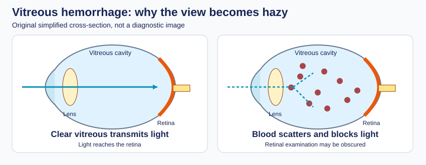

# 👁️ Vitreous Hemorrhage and Nursing

**Study-ready, unattempted.** NORCET / Staff Nurse. Advanced sonography, secondary glaucoma subtypes and trial interpretation are enrichment.

[Chapter](../README.md) · [30 original MCQs](../MCQs/Vitreous-Hemorrhage-30-MCQs.md) · [Exam evidence](../Previous-Year-Questions/Vitreous-Hemorrhage-Exam-Evidence.md)

[Mechanism](#mechanism) · [Causes](#causes) · [Assessment](#assessment) · [Triage](#triage) · [Management](#management) · [Complications](#complications) · [Follow-up](#follow-up)

## Mechanism

**🔴 MOST IMPORTANT**

Vitreous humor ek transparent gel hai jo lens ke peeche aur retina ke aage wali cavity fill karti hai. Normal gel se light easily retina tak jaati hai. Jab blood is cavity mein enter karta hai, toh usko vitreous hemorrhage (VH) kehte hain. Clear glass mein thoda sa colored liquid mix karne par uske paar dekhna mushkil ho sakta hai. Waise hi dispersed red blood cells light scatter karte hain. Blood ki quantity aur visual axis mein location ke hisaab se vision mildly hazy se severely reduced ho sakti hai.

Hyphema anterior chamber mein bleeding hai. Subconjunctival hemorrhage eye surface ke neeche visible red patch hai. VH posterior cavity mein hoti hai aur bahar se eye normal dikh sakti hai. Patient painless sudden haze, floaters, cobwebs, shadows ya red tint report kar sakta hai. Pain absent hona safe condition ka proof nahi hai.

## Causes

**🔴 MOST IMPORTANT**

| Mechanism | Examples |
|---|---|
| Fragile abnormal new vessels | Proliferative diabetic retinopathy (PDR), ischemic retinal vein occlusion, sickle cell retinopathy |
| Rupture of existing vessels | Posterior vitreous detachment (PVD) with vitreoretinal traction, retinal tear, trauma |
| Blood from adjacent tissue | Neovascular AMD, retinal arterial macroaneurysm and other adjacent hemorrhage |
| Systemic conditions | Bleeding disorders, intracranial hemorrhage with Terson syndrome, selected Valsalva-related bleeding |

Age-related PVD mein vitreous retina se separate hoti hai. Kabhi attachment point par traction retinal vessel ya retinal tissue tear kar deti hai. Blood retina ka view hide kar sakta hai. Isliye acute PVD with VH mein hidden retinal break urgently exclude karna important hai.

PDR mein ischemia ke response mein abnormal vessels develop hoti hain. Ye fragile hoti hain aur bleeding kar sakti hain, even after prior laser. Prior BRVO mein ischemic retinal sector se delayed neovascularization aur VH develop ho sakti hai. Existing [DR](Diabetic-Retinopathy-and-Nursing.md) aur [RVO](Retinal-Vein-Occlusion-and-Nursing.md) management ko repeat nahi kiya gaya.

Valsalva retinopathy mein severe straining, coughing ya vomiting ke time pressure suddenly rise kar sakta hai. Retinal venous pressure badhne se small vessels rupture ho sakti hain. Blood often premacular preretinal space mein collect hota hai, kabhi vitreous mein extend ho sakta hai. Cause establish karna zaroori hai.

Terson syndrome intracranial hemorrhage, including subarachnoid hemorrhage, ke saath intraocular bleeding ko describe karta hai. Neurologic emergency priority hai. Vision complaint ko stabilize hone ke baad ignore nahi karna.

## Assessment

**🔴 MOST IMPORTANT**

Nurse onset, affected eye, progression, pain, flashes, field loss, recent trauma, straining, diabetes, previous retinal surgery or laser, anticoagulant use aur systemic bleeding history document karti hai. Visual acuity aur pupils assess karo if safe. RAPD marked ho toh clinician ko associated retinal or optic nerve dysfunction consider karni chahiye. Normal external appearance serious posterior disease rule out nahi karti.

| Investigation | Kya information milti hai |
|---|---|
| Dilated peripheral retinal examination | Visible retina mein tear, detachment, abnormal vessels aur bleeding source assess hote hain. |
| B-scan ultrasound | Opaque media ke through retinal status aur vitreous echoes evaluate hote hain, provided globe integrity and safety assessed hain. |
| OCT | Adequate optical view ho toh macular structure aur premacular blood ki plane evaluate kar sakte hain. |
| Fluorescein angiography | Sufficient view mein neovascularization aur ischemia assess kar sakte hain. |
| Fellow eye examination | Diabetic or vascular retinal disease ka clue mil sakta hai, lekin normal fellow eye cause exclude nahi karti. |
| Targeted blood tests | Unexplained bleeding, bruising ya systemic clues mein clinician CBC, platelets, glucose aur coagulation studies consider karta hai. |

Fresh VH ultrasound par mobile particulate echoes generate kar sakti hai. Organized blood membrane jaisa appear kar sakta hai. Retinal detachment membrane ko specialist movement aur attachments assess karke distinguish karta hai. Dense blood optical photography/OCT limit kar sakta hai. Negative initial B-scan se every small retinal tear conclusively exclude nahi hota. AAO PVD guidance close repeat examination recommend karti hai when retina not adequately visualized. Retinal view milne tak short interval reassessment may be necessary. Timing individual findings par depend karti hai.

Premacular hemorrhage boat-shaped appear kar sakti hai. Subhyaloid aur sub-ILM collection different anatomical planes hain. Exact location specialist OCT if adequate view se assess kar sakta hai.

## Triage

**🔴 MOST IMPORTANT**

Sudden new floaters, flashes, marked vision reduction ya curtain-like field loss urgent same-day eye assessment maangte hain. Severe sudden monocular visual loss mein retinal arterial ischemia bhi differential mein hai, jiske liye stroke pathway activate karna chahiye if suspected. Patient ko routine refraction ke liye delay mat karo.

Trauma mein open globe ya metallic intraocular foreign body suspect ho toh globe par pressure mat do. Rigid protective shield aur urgent emergency specialist care local protocol ke according arrange karo. Tonometry ya contact ultrasound suspected open globe mein routinely perform nahi karna. Metal foreign body exclude kiye bina MRI unsafe ho sakti hai. Clinician-directed CT useful ho sakti hai. Life-threatening head injury or suspected intracranial hemorrhage mein stabilization first.

Prescribed anticoagulants or antiplatelets independent stop ya change nahi karo. Bleeding severity, indication, thrombosis risk aur procedure plan ke basis par prescribing clinician aur retina team decision leti hai.

## Management

**🔴 MOST IMPORTANT**

Treatment cause aur retinal status par depend karta hai. Blood clear hone ka wait karna har patient ke liye safe nahi hai. Selected stable cases mein specialist observation choose kar sakta hai after urgent retinal assessment. Head elevation if clinician advises se blood inferiorly settle ho sakta hai aur visual axis temporarily clear ho sakta hai. Ye permanent cure nahi hai. New symptoms par immediate return aur short-interval reassessment important hain.

Dense hemorrhage ke peeche retinal tear/detachment suspect ho, bleeding persist ya recur kare, secondary glaucoma develop ho, ya urgent visual rehabilitation ki need ho toh vitrectomy consider ho sakti hai. Pars plana vitrectomy mein surgeon vitreous aur blood remove karta hai, retina visualize karta hai aur indicated cause treat karta hai. Retinal tear laser or cryotherapy aur detachment repair require kar sakte hain. PDR mein clearing blood ke baad endolaser PRP possible ho sakti hai. See [retinal detachment surgery](Retinal-Detachment-and-Surgical-Nursing.md).

Selected PDR-related VH mein anti-VEGF abnormal new vessel activity suppress kar sakti hai while existing blood gradually clear hota hai. Ye blood ko immediately aspirate nahi karti. DRCR Protocol AB mein 24-week average visual acuity primary outcome statistically different nahi tha between initial aflibercept and vitrectomy plus PRP, lekin surgery group early recovery faster thi. Ye trial all VH causes ya urgent macula-threatening detachment ke liye blanket rule nahi hai. Selected eyes later crossover treatment require karti hain. Patient-specific surgical timing, follow-up ability aur retinal status important hain.

Preoperative anti-VEGF selected PDR surgery mein useful ho sakti hai, lekin severe fibrovascular disease mein membrane contraction se traction worsen ho sakti hai. Surgery unexpectedly postpone ho toh retinal team ko notify karo. Repeat injections independently decide nahi karni.

## Complications

**🟠 HIGH YIELD**

Ghost cell glaucoma mein old blood ke degenerated rigid erythrocytes anterior chamber mein pahunch kar trabecular meshwork obstruct kar sakte hain. IOP rise ho sakta hai. Khaki-colored cells characteristic clue hain. Hemolytic glaucoma mein hemoglobin-containing macrophages aur blood breakdown products outflow obstruct kar sakte hain. Neovascular glaucoma ka mechanism alag hai, iris/angle new vessels aur fibrovascular tissue drainage compromise karte hain.

Infants mein persistent dense opacity developing visual system ko clear image se deprive kar sakti hai aur amblyopia risk increase kar sakti hai. Timely pediatric ophthalmology assessment required hai. Exact treatment and safeguarding evaluation clinical context par depend karti hai.

## Follow-up

**🔴 MOST IMPORTANT**

Patient ko samjhao ki temporary clearing ya comfortable eye safe retina prove nahi karti. New flashes, curtain, marked reduction, increasing pain or redness par urgent review. Follow-up date teach-back se confirm karo. Vision poor ho toh medicine labels readable/accessible banwao, fall risks assess karo aur consent-based assistance arrange karo. Recurrent VH after vitrectomy bhi retina team reassess karegi. Existing general gas precautions [retinal detachment nursing](Retinal-Detachment-and-Surgical-Nursing.md) mein hain. Gas positioning surgeon-specific hoti hai.

## Quick revision

- VH = posterior cavity mein blood, hyphema = anterior chamber mein blood.
- Acute PVD + VH = hidden retinal tear ka concern.
- Dense VH with negative ultrasound does not conclusively exclude small tear.
- Observation = active reassessment, not unattended waiting.
- PDR-related VH mein anti-VEGF and/or vitrectomy selected treatment options hain.
- Ghost cells rigid old RBCs hain. New pain, field loss or visual deterioration urgent review maangti hai.

## Teaching and MCQ practice

| Scope | Teaching lead | Practice lead |
|---|---|---|
| Mechanism, causes and assessment | [Insight Ophthalmology — Vitreous hemorrhage](https://www.youtube.com/watch?v=JEv0NALiK0A), indexed description | Specific nursing practice pending |
| PDR hemorrhage management | [AAO retinal vascular and vitreous lecture](https://www.aao.org/education/resident-lectures-video/retinal-vascular-diseases-diseases-of-vitreous) | [PDR management MCQ short](https://www.youtube.com/watch?v=bA7sPU7EU8g), indexed title only, creator/playback pending |
| Complications and nursing follow-up | Clinical sources below | Specific practice pending |

Checked 27 November 2026. Four broad title-level leads, all 30 exact question/video mappings pending. No invented timestamps.

## References

- [StatPearls vitreous hemorrhage](https://www.ncbi.nlm.nih.gov/books/NBK559131/), directly retrieved clinical text.
- [AAO PVD, retinal breaks and lattice degeneration PPP](https://www.aaojournal.org/article/S0161-6420%25252824%25252900787-5/fulltext), indexed follow-up recommendations.
- [AAO EyeWiki VH](https://eyewiki.aao.org/Vitreous_Hemorrhage), indexed mechanisms and treatment.
- [DRCR Protocol AB primary trial](https://jamanetwork.com/journals/jama/fullarticle/2774049), indexed, and [secondary analysis](https://jamanetwork.com/journals/jamaophthalmology/fullarticle/2779735), directly retrieved.
- [Ghost cell glaucoma](https://eyewiki.aao.org/Ghost_Cell_Glaucoma), [Valsalva retinopathy](https://eyewiki.aao.org/Valsalva_Retinopathy), [Terson syndrome](https://eyewiki.aao.org/Terson_Syndrome), indexed specialty review.

[Chapter](../README.md) · [MCQs](../MCQs/Vitreous-Hemorrhage-30-MCQs.md) · [Exam evidence](../Previous-Year-Questions/Vitreous-Hemorrhage-Exam-Evidence.md)
