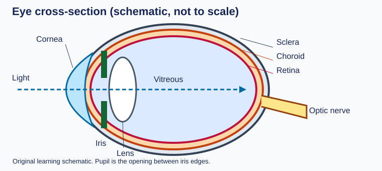

# 👁️ Eye and ENT Nursing

**Study-ready, not studied.** AIIMS NORCET / HP Staff Nurse / CHO. Chapter expansion in progress, not complete.

## 📚 Study resources

### Concepts and syllabus coverage

- [Topic map](Concepts/Eye-and-ENT-Nursing-Topic-Coverage-Map.md)

### Eye anatomy and physiology

- [Detailed Hinglish notes and diagrams](Concepts/Eye-Anatomy-and-Physiology.md)

### Eye assessment and diagnostics

- [Detailed notes and Snellen schematic](Concepts/Eye-Assessment-and-Diagnostics.md)
- [30 new MCQs](MCQs/Eye-Assessment-and-Diagnostics-30-MCQs.md)

### Refractive errors

- [Detailed concepts and diagrams](Concepts/Refractive-Errors.md)
- [30 integrated MCQs](MCQs/Refractive-Errors-30-MCQs.md)
- [Myopia 24 additional](MCQs/Myopia-Additional-24-MCQs.md)
- [Hypermetropia 24 additional](MCQs/Hypermetropia-Additional-24-MCQs.md)
- [Astigmatism 24 additional](MCQs/Astigmatism-Additional-24-MCQs.md)
- [Presbyopia 25 additional](MCQs/Presbyopia-Additional-25-MCQs.md)
- [Optics 26 additional](MCQs/Refractive-Optics-Additional-26-MCQs.md)
- [Nursing 27 additional](MCQs/Refractive-Nursing-Additional-27-MCQs.md)

### Cataract

- [Detailed Hinglish concepts and diagrams](Concepts/Cataract-and-Perioperative-Nursing.md)
- [30 original MCQs](MCQs/Cataract-30-MCQs.md)
- [3 reported exam adaptations](Previous-Year-Questions/Cataract-Reported-Exam-Practice.md)

### Glaucoma

- [Detailed Hinglish concepts and two diagrams](Concepts/Glaucoma-and-Nursing-Management.md)
- [39 additional originals](MCQs/Glaucoma-Additional-39-MCQs.md) + one preserved starter
- [4 source-traced adaptations](Previous-Year-Questions/Glaucoma-Reported-Exam-Practice.md)

### Retinal detachment

- [Detailed concepts and two diagrams](Concepts/Retinal-Detachment-and-Surgical-Nursing.md)
- [29 additional originals](MCQs/Retinal-Detachment-Additional-29-MCQs.md) + one preserved starter
- [2 source-traced adaptations](Previous-Year-Questions/Retinal-Detachment-Reported-Exam-Practice.md)

### Diabetic retinopathy

- [Detailed Hinglish concepts and original diagram](Concepts/Diabetic-Retinopathy-and-Nursing.md)
- [32 original MCQs](MCQs/Diabetic-Retinopathy-32-MCQs.md)
- [Exam evidence and gaps](Previous-Year-Questions/Diabetic-Retinopathy-Exam-Evidence.md)

### Age-related macular degeneration

- [Detailed Hinglish concepts and original diagram](Concepts/Age-Related-Macular-Degeneration-and-Nursing.md)
- [30 original MCQs](MCQs/AMD-30-MCQs.md)
- [AIIMS 2019 reported adaptation](Previous-Year-Questions/AMD-Reported-Exam-Practice.md)

### Retinal artery occlusion

- [Detailed emergency nursing concepts and fundus diagram](Concepts/Retinal-Artery-Occlusion-and-Emergency-Nursing.md)
- [30 original MCQs](MCQs/Retinal-Artery-Occlusion-30-MCQs.md)
- [Exam evidence and gaps](Previous-Year-Questions/Retinal-Artery-Occlusion-Exam-Evidence.md)

### Retinal vein occlusion

- [Detailed Hinglish concepts and original fundus diagram](Concepts/Retinal-Vein-Occlusion-and-Nursing.md)
- [30 original MCQs](MCQs/Retinal-Vein-Occlusion-30-MCQs.md)
- [Exam evidence and gaps](Previous-Year-Questions/Retinal-Vein-Occlusion-Exam-Evidence.md)

### Vitreous hemorrhage

- [Detailed Hinglish theory and original diagram](Concepts/Vitreous-Hemorrhage-and-Nursing.md)
- [30 original MCQs](MCQs/Vitreous-Hemorrhage-30-MCQs.md)
- [Exam research](Previous-Year-Questions/Vitreous-Hemorrhage-Exam-Evidence.md)

### Macular hole

- [Detailed Hinglish concepts and original OCT-style schematic](Concepts/Macular-Hole-and-Nursing.md)
- [30 original MCQs](MCQs/Macular-Hole-30-MCQs.md)
- [Exam evidence](Previous-Year-Questions/Macular-Hole-Exam-Evidence.md)

### Epiretinal membrane

- [Detailed Hinglish concepts and original OCT-style schematic](Concepts/Epiretinal-Membrane-and-Nursing.md)
- [30 original MCQs](MCQs/Epiretinal-Membrane-30-MCQs.md)
- [Exam evidence](Previous-Year-Questions/Epiretinal-Membrane-Exam-Evidence.md)

### Vitreomacular traction

- [Detailed Hinglish concepts and original OCT-style schematic](Concepts/Vitreomacular-Traction-Concepts.md)
- [30 original MCQs](MCQs/Vitreomacular-Traction-30-MCQs.md)
- [Exam evidence](Previous-Year-Questions/Vitreomacular-Traction-Exam-Evidence.md)

### Central serous chorioretinopathy

- [Detailed Hinglish concepts and original cross-section](Concepts/Central-Serous-Chorioretinopathy-Concepts.md)
- [30 original MCQs](MCQs/Central-Serous-Chorioretinopathy-30-MCQs.md)
- [Exam evidence](Previous-Year-Questions/Central-Serous-Chorioretinopathy-Exam-Evidence.md)

### Hypertensive retinopathy

- [Detailed Hinglish concepts and original fundus schematic](Concepts/Hypertensive-Retinopathy-Concepts.md)
- [30 original MCQs](MCQs/Hypertensive-Retinopathy-30-MCQs.md)
- [GMCH 2019 reported adaptation and evidence gaps](Previous-Year-Questions/Hypertensive-Retinopathy-Exam-Evidence.md)

### Retinopathy of prematurity

- [Detailed Hinglish concepts and two original schematics](Concepts/Retinopathy-of-Prematurity-Concepts.md)
- [30 original MCQs](MCQs/Retinopathy-of-Prematurity-30-MCQs.md)
- [JIPMER 2020 reported adaptation and gaps](Previous-Year-Questions/Retinopathy-of-Prematurity-Exam-Evidence.md)

### Conjunctivitis

- [Detailed Hinglish concepts and original schematic](Concepts/Conjunctivitis-Concepts.md)
- [30 original MCQs](MCQs/Conjunctivitis-30-MCQs.md)
- [NORCET 7 reported concept adaptation and evidence gaps](Previous-Year-Questions/Conjunctivitis-Exam-Evidence.md)

### Keratitis

- [Detailed Hinglish concepts and original schematic](Concepts/Keratitis-Concepts.md)
- [30 original MCQs](MCQs/Keratitis-30-MCQs.md)
- [Exam evidence and gaps](Previous-Year-Questions/Keratitis-Exam-Evidence.md)

### Corneal ulcer

- [Detailed Hinglish concepts and original depth schematic](Concepts/Corneal-Ulcer-Concepts.md)
- [30 original MCQs](MCQs/Corneal-Ulcer-30-MCQs.md)
- [Exam evidence and gaps](Previous-Year-Questions/Corneal-Ulcer-Exam-Evidence.md)

### Stye (hordeolum)

- [Detailed Hinglish concepts and original eyelid schematic](Concepts/Stye-Hordeolum-Concepts.md)
- [30 original MCQs](MCQs/Stye-Hordeolum-30-MCQs.md)
- [Exam evidence and gaps](Previous-Year-Questions/Stye-Hordeolum-Exam-Evidence.md)

### Chalazion

- [Detailed Hinglish concepts and original lipogranuloma diagram](Concepts/Chalazion-Concepts.md)
- [30 original MCQs](MCQs/Chalazion-30-MCQs.md)
- [Exam evidence and gaps](Previous-Year-Questions/Chalazion-Exam-Evidence.md)

### Blepharitis

- [Detailed Hinglish concepts and original diagram](Concepts/Blepharitis-Concepts.md)
- [30 original MCQs](MCQs/Blepharitis-30-MCQs.md)
- [Exam evidence and gaps](Previous-Year-Questions/Blepharitis-Exam-Evidence.md)

### Trachoma

- [Roman Hinglish concepts and WHO grading schematic](Concepts/Trachoma-Concepts.md)
- [30 original MCQs](MCQs/Trachoma-30-MCQs.md)
- [UP NHM CHO reported adaptation and evidence gaps](Previous-Year-Questions/Trachoma-Exam-Evidence.md)

### Entropion

- [Detailed Hinglish concepts and original diagram](Concepts/Entropion-Concepts.md)
- [30 original MCQs](MCQs/Entropion-30-MCQs.md)
- [Exam evidence and gaps](Previous-Year-Questions/Entropion-Exam-Evidence.md)

### Ectropion

- [Detailed Hinglish concepts and original diagram](Concepts/Ectropion-Concepts.md)
- [30 original MCQs](MCQs/Ectropion-30-MCQs.md)
- [Exam evidence and gaps](Previous-Year-Questions/Ectropion-Exam-Evidence.md)

### Trichiasis

- [Detailed Hinglish concepts and original diagram](Concepts/Trichiasis-Concepts.md)
- [30 original MCQs](MCQs/Trichiasis-30-MCQs.md)
- [Exam evidence and video gaps](Previous-Year-Questions/Trichiasis-Exam-Evidence.md)

### Ptosis

- [Detailed Hinglish concepts and original diagram](Concepts/Ptosis-Concepts.md)
- [30 original MCQs](MCQs/Ptosis-30-MCQs.md)
- [Indexed DSSSB evidence and video gaps](Previous-Year-Questions/Ptosis-Exam-Evidence.md)

### Dacryocystitis

- [Detailed Hinglish concepts and original diagram](Concepts/Dacryocystitis-Concepts.md)
- [30 original MCQs](MCQs/Dacryocystitis-30-MCQs.md)
- [Exam evidence and video gaps](Previous-Year-Questions/Dacryocystitis-Exam-Evidence.md)

### Congenital nasolacrimal duct obstruction

- [Detailed Hinglish concepts and original diagram](Concepts/Congenital-Nasolacrimal-Duct-Obstruction-Concepts.md)
- [30 original MCQs](MCQs/Congenital-Nasolacrimal-Duct-Obstruction-30-MCQs.md)
- [Exam evidence and practice gaps](Previous-Year-Questions/Congenital-Nasolacrimal-Duct-Obstruction-Exam-Evidence.md)

### Dacryoadenitis

- [Detailed Hinglish concepts and original diagram](Concepts/Dacryoadenitis-Concepts.md)
- [30 original MCQs](MCQs/Dacryoadenitis-30-MCQs.md)
- [Exam evidence and practice gaps](Previous-Year-Questions/Dacryoadenitis-Exam-Evidence.md)

### Topic-wise MCQs

- [30 new anatomy MCQs](MCQs/Eye-Anatomy-and-Physiology-30-MCQs.md)
- [4 preserved starter MCQs](MCQs/Eye-and-ENT-Nursing-Topic-Wise-Starter-MCQs.md)

### 📜 Previous Year Questions

- [8 refractive error adaptations](Previous-Year-Questions/Refractive-Errors-Reported-Exam-Practice.md)
- [3 assessment exam adaptations](Previous-Year-Questions/Eye-Assessment-Reported-Exam-Practice.md)
- [Research register](Previous-Year-Questions/Eye-and-ENT-Nursing-Past-Paper-Research-Register.md)
- [🔵 RRB 2019 reported adaptation](Previous-Year-Questions/RRB-2019-Eye-Anatomy-Reported-Practice.md)
- [Existing HPSSC 2022 reported adaptation](Previous-Year-Questions/Eye-and-ENT-Nursing-India-Wide-Additional-Reported-PYQs.md)

### 🧪 Mock Tests

- [Ten-test plan](Mock-Tests/Eye-and-ENT-Nursing-Mock-Test-Plan.md)

### ▶️ YouTube teaching

- [PW Nursing College Prep eye anatomy](https://www.youtube.com/watch?v=rMmGCyXEIMU)

### ▶️ YouTube MCQ practice

- [GS India anatomy practice](https://www.youtube.com/watch?v=bSc66vwFzLk) (topic-level, exact questions not verified)

## Progress and next topic

- 1094 original question slots: 1064 prior verified + 30 dacryoadenitis originals (3 Easy, 15 Medium, 12 Difficult). Glaucoma 40 and retinal detachment 30 allocated including their respective starters.
- Twenty-three previously counted source-traced adaptations unchanged. Four provisional source-based adaptations (GMCH 2019, JIPMER 2020, NORCET 7 Prelims 2024 related concept and UP NHM CHO 7 September 2022 Shift 1) published, not yet counted pending repository-wide provenance reconciliation. Existing Mizoram PSC January 2017 vitreous hemorrhage floaters adaptation linked, not counted twice. No new attributable VH or macular-hole recruitment item authenticated. Official keys and exact-question authentication pending.
- Forty-two original SVG diagrams. Markdown and remote file contents checked. Rendered mobile layout not tested.
- Ten custom 120-question mocks planned, 0 published.
- Next: canaliculitis and other distinct lacrimal topics, then eye emergencies. AMD, retinal vascular occlusions, vitreous hemorrhage and macular hole minimum original counts reached. Independent clinical/semantic audit and video verification pending. Continue from [coverage map](Concepts/Eye-and-ENT-Nursing-Topic-Coverage-Map.md).
- Continue in the same chapter with Respiratory teaching format, no duplicate chapter. Follow both skills and all job claims. Global index reconciliation deferred while shared claims are active.

**Verified content commits:** anatomy notes and video a827d9ec3d0cc07d72b1ed38e7cda8788fc56ed5, MCQ bank and video 8dc2a7ee5c8d8d4ed3b3293f4c367edbf10843c0, RRB adaptation e669be233328244e8ad6b93a03418f4de353ee05, mock plan 86500bd131b5fb789e808e3431942c6b05f5ae79. Assessment notes b8944bf6cb8f7f491afff7276e57579808f98a03, schematic 7b490afcc04b97bb41a828797e1634abf3ae6449, MCQs e29fe90f7cb5dc14f1de8e802682e50bdc098bd5, reported evidence e2d7b8e6411c6b00864820b215b5f8cdf07fea7e. 30 stems, four options each, matching answer keys and hidden solutions validated. 13 broad video leads, 17 pending, zero exact video matches.

Refractive errors: concepts a5592cf4267ff1ff2c49c692cda2accdcbebbdb3, corrected diagram 46025218120384d0c865c805d63ce57e60f87f2e, MCQs c7fb76e6dbdf5d34e3102281bacc9ff333b48612, reported evidence 1011b8b9252bb81009d2e82aa4072ddc24b67462. Exact normalized stems checked against 64 earlier originals, no matches. All 30 new stems, four options, matching answer keys and hidden solutions verified. Individual topic counts and full semantic audit pending. 23 indexed broad practice leads, seven without leads; all 30 confirmed coverage pending. Official papers/keys and rendered UI pending. Both skill files fetched, heading/rule review and prior context used, not a fresh full line-by-line audit.

Individual expansion: myopia MCQs e7157edaa92d841bdebb167cff01d9b64df2d9c2, hypermetropia MCQs 9358aa32bd0e1c89cdca5ee869a2f50aa2f44451, expanded notes e8b4783683cd21aeee033f60663b1a0831557fce, myopia diagram ee16395ff6b5f6842ff797c3847d5b1ea71a141c, hyperopia diagram 829fc6820e5a6d9a49d8695a97c7bb8821d35801, reported evidence f3574946759c99efbea5afc87ce8a8ccb995ee11, map 8b2b5c56159167b5e307390af7b2b5e99ee8c93d, register 2871944803a53803f9871500241542d1577b8164. All 142 exact normalized original stems distinct, 48 new answer mappings and four options checked, concept anchors valid. Clinical references and direct third-party reports checked, official authentication pending. Fourteen indexed MCQ-video leads, 34 without dedicated leads, all 48 confirmed coverage pending due to throttling or missing evidence. Fresh complete skill files fetched with unchanged hashes, relevant rules and prior context used; fresh independent full line-by-line review not certified. One concurrent head conflict recovered through fresh SHA and claim check. No shared index changes while other jobs active. Rendered UI and complete semantic audit pending.

Astigmatism/presbyopia expansion: astigmatism MCQs 231ca5f0d676f71ef9b75bbc6a7e0614c19f729c, presbyopia MCQs 50ce6844700a21b321eb2ed754036c16b3768624, expanded notes 00b52f0b208583ee973c373d74a1f012d51f1631, astigmatism diagram 7fe3e8ada1ecb6e6c6994b40f655d823dbaea6c4, presbyopia diagram 8141937cf243bf69608f8a54589f0714bb99bd21, reported evidence bb46dae31aa8ce0d1815bd4d5bb731cc552268db, coverage map cfeb56075c7c19e6c25da7510111599b86fe32a9, evidence register ba56e99e23587e06bd80bc6b2b10e34817ba7e83. All 191 normalized stems distinct, 49 new answer mappings and concept anchors valid. AIIMS Raipur 2017 Shift II and RRB 29 April 2025 Shift I source-traced reports, not authenticated exact official questions. 15 indexed broad video leads, 34 specific lead gaps, direct playback failed, all 49 confirmed coverage pending. Both complete skill files fetched with unchanged hashes and relevant rules/prior context reviewed, full fresh line-by-line review not certified. Rendered UI and full semantic/clinical review pending. All five job claims checked, no global index edits while concurrent jobs active.

Optics/nursing expansion: optics final 904306d417315553532a9f9cd33b7e6a5c7bf301, nursing final aeddf6a6b970d915d90125a95177adc5b13aa263, expanded notes 66246229ec3ab51a3dd482b0241329a2caea4e9d, lens diagram afa7b03756ce16a1c3a4f142419441dbf03f43db, referral diagram 85374dac8794d9cb546dfddb8e7820b3840220fc, evidence 9dde8557f7c8001389e3d28e521e734a398e9d30, map c072afe3506a850d6703aee51d0d9722d547239c, register 87d49ce4241dd884fd2aacad8059eeff19de0d14. All 244 normalized stems distinct, 53 new answers and concept anchors valid. Two overlapping newly authored items replaced before checkpoint. Three RRB reported adaptations added, official keys pending. 14 description-level practice leads and 39 specific gaps in new originals. No exact video matches or playback verified. Initial concurrent head conflict recovered. Both complete skills retrieved, relevant passages and prior context used, fresh full line-by-line review not certified. Global index deferred while other claims active. No chapter-completion claim.

Cataract expansion: MCQs ea889f459afabfc07ed3157fed65f89c4747f5e3, notes 2175722956132b16620986c8b1b03dd1a381da70, classification diagram c095e41dd9cd0f1b75709829f7a1b6eea513fc1d, recovery diagram 766ee9b9111c4ec70949b515ab2ae548777176ac, reported evidence 8873b6c729a91c2756c2bb7085dbd457254f4608, map e26dc4aa937700a895298d57792484169f136089, register 856a5085f975b96d0f67f7321097865de3bb539f. All 274 normalized stems distinct, 30 cataract answer mappings and concept anchors validated, three reported adaptations based on four retrieved third-party reports. Total this run 83 originals, six reported adaptations and four original diagrams. 21 description-level MCQ leads and 62 specific video gaps across new originals. Direct playback, official paper/key, rendered UI and full independent clinical/semantic audit pending. Full skill files fetched but a fresh complete line-by-line review not certified. Initial head conflict recovered, intermediate readback separately verified after tool call limit. Five other claims checked, shared index not changed this run to avoid concurrent writer conflicts.

Glaucoma and retinal detachment: glaucoma originals a21751c57cb94dcee548cb79c2d796107fae5b28, concepts ca149aeada05c461d1e042a2946b49703808f9a2, diagrams cb898dd1ca7b63c8b37df55ce7585c166d9efb76 and 11531f6895e690728535cd49b9484b534f478f74, adaptations f935dbbc2bfafb8895ed2f047e4281003842c162. Retinal originals a3d39acd5fba78aa3c4866bd741f772006ad5b1b, concepts a9ed2450dce9048345177f2b21a3d456cf0bb5b8, diagrams 1eb6e8c63f0aefbb27cbf72902056d11ce635dec and 4dd5d0d1408c2cd59f5399f6652efac488b4d00f, adaptations f6283c623c14336e261654c4378f9b3b24fabf24. Map dcf68b55dee8aeb8dbe8b9b3d60b40f6196676ec, register 5ba85de5d8809f782aeccad91a61e740066274eb. All 342 normalized stems distinct across 13 files, 68 new option/answer/distractor/hidden-block checks pass. One semantic overlap replaced. Six source-traced adaptations, no authenticated exact official key. 21 broad description-level practice leads and 47 specific gaps, all 68 exact playback pending. Both complete skills retrieved and reviewed during run, AGENTS and relevant audit learnings reviewed, all five job claims checked. Shared global index not edited under chapter-only scope. Rendered UI and independent full clinical/semantic audit pending.

Diabetic retinopathy expansion: question bank readback blob 71ce879678e84fd110a6785a775c04c80502dd35, concepts 850e7c478e2fbe8f109a94bf1f4285156f24b815, diagram edea7b0f7b4768540d1f2629beabd08cc5f12ef3, evidence 0eb0d2ebc849f8411c49106995fbb6d0efa645dc, map b26e071956b420b396f9b88dba9e6908f143b4ec, register 4c6b88baf76256be1b58cae5fdd67f62c7a84dae. 32 new normalized stems checked against 342 earlier originals before create. Four options, matching keys, all distractor labels, hidden blocks and concept anchors verified by remote readback. Create response interrupted by tool-call limit, existing file verified instead of recreating. Endocrine related banks and concept file reviewed for overlap, no general diabetes classification repeated. 18 broad MCQ-based description leads, 14 specific gaps, all exact playback pending. No new historical adaptation counted. Both skill files retrieved, canonical first section and relevant prior unchanged-hash rules consulted; complete fresh line-by-line skill and audit-log review not certified. AGENTS/Copilot and all five job claims checked. Chapter-only updates, no global index changes. Rendered UI and independent clinical/semantic audit pending.

AMD and retinal artery occlusion expansion, 27 November 2026: resumed at newer live checkpoint 374 originals rather than the requested historical 274. AMD MCQs 3cced0ef6033c24c0e3773dc66473728a6c539e9, concepts 2d15fcceee4ba4d766993b63a314a394ac9038fe, diagram 6539c90aa62ffee5619836d827054225bca16b7f, reported adaptation c64312d02fe3328b42a72f823b157700ad488ad4. Retinal artery occlusion MCQs bbe2df7daa91506e2e7d2f13d4d17b2768f25a73, concepts b3004c0141417fbea04dba95357b8ebf269e13be, corrected diagram e3fdfdc20b6368447956ed20b8b52a7bf25af716, evidence fc9e3c18723a7fe17c10d8e4532a5c7886a16db8. Latest map 3a6039926aa07e53eab78b1a61d27edca9c4c216, register c0565016bfc3e1bcba13daac77d2509c13e699cd. Remote readback verifies 434 distinct normalized stems across 16 banks, all 60 new four-option/key/distractor/hidden-block/concept-anchor checks pass. One newly authored overlap replaced before final checkpoint. All 61 new original/adapted specific MCQ video mappings pending; teaching leads separate. AIIMS 2019 report triangulated, official booklet/key unavailable. Both full SKILL.md files read in sections; AGENTS/Copilot and all five other claim files checked; latest audit log passages reviewed, full historical line-by-line audit-log review not certified. No global index edits under chapter-local scope. Clinical research includes updated geographic atrophy and retinal stroke evidence. Full independent clinical/semantic audit and rendered UI verification pending. No chapter completion claim.

Retinal vein occlusion expansion, 27 November 2026: resumed at latest 434-original checkpoint after prior AMD/RAO reconciliation. RVO MCQs a4440823f5b66417593ebef01f34c5d4a05e70cf, fundus diagram 210a17693474dbbbf3f06cf8ed1acf73975a995e, concepts 1e9cf6fb1bfdfaf6eacd7a6b0bd038ccef82f3bf, evidence 3a971b4e216e5389356ed3d8077b46f2c1dc0908, map f7f02f88b7b6a51a90e598dadad95dbd4e6ef2af, register cba020dbdad8f4ccf3ef6952d0a1c4fdca4246ce. All 464 normalized stems across 17 remote banks distinct. All 30 new four-option/key/distractor/hidden-block and concept anchor checks pass. Six topic-level MCQ video leads (FMGE published chapter marker), 24 specific gaps, exact item/playback verification pending for all. No authenticated RVO-specific recruitment item, no added exam adaptation. Both complete skills read in sections, all five other claims checked, latest audit passages reviewed. Full historical audit-log reread and independent clinical/semantic audit remain pending. Chapter-local scope only, global index not changed. Rendered UI untested. No chapter-completion claim.

Vitreous hemorrhage and macular hole expansion, 27 November 2026: resumed from 464 verified originals. VH bank final 803d310c073874ec61956b028be9a4f3a85c5d32, concepts 7b0d450484ee1024f66e9929f3ada353259b64a2, diagram 4df566838ded14c9818491c84295bd69cfb12b46, evidence 7282cc5abb4b55b66c07416682e853fb1ee2a788. Macular hole bank 2a50ea35ee3789a2a1044875e1b6e1be42e7917a, concepts df242d655b732378ed094d5836e72a51aa333c51, diagram 5a95819332b483aab9be52fa2b07fcbc952c64c8, evidence 8270a55499e8edaa2e53004451687edeb4f0bf57. Coverage map 5888c2c03499e7231b69e3f17e2a7f6f786c67f0, register e6cafa3b1580cf3d992f36165d379d586f8d988d. All 524 normalized original stems distinct across 19 remote banks. All 60 new four-option/key/distractor/hidden-block/concept-anchor checks passed. One new overlapping curtain item replaced before checkpoint. Four title-only VH practice leads, zero verified exact mappings, all 60 exact practice gaps pending, teaching separate. No new attributable exam adaptation. Both skills retrieved unchanged hashes and prior full reads consulted, not a fresh complete line-by-line reread. AGENTS, latest audit passages and all five claims checked. Independent full clinical/semantic audit, complete historical audit-log reread, official exam source inspection and rendered UI pending. Shared global index unchanged, chapter-local work only. No chapter-completion claim.

Epiretinal membrane expansion, 27 November 2026: resumed at checkpoint 9a36487da96eb8bd8a8f91fd1bb4268bd233e30a (524 originals). ERM notes a8983e404b915a043d2d1c98795714a5390db730, diagram d3c74fc96e8b60adeb6068d325764eaf80dc2b77, MCQ bank 13439de57e30da5663a26930e84d8eae52e3ad13, evidence d04d09682f8d4d960a9f2e9790ae4db992db6b27, coverage map 7ca0c3c347336d12ad6646f8e7c493a4076700e0, research register e451139fed4c2b75bcf9547182207c1d7d6d9993. All six files exact remote readback. New 30 distinct normalized stems compared against 524 prior stems in 19 banks, zero exact matches. All 30 four-option, key, distractor, hidden-block and concept-anchor checks passed. Tool-call limit interrupted initial MCQ creation attempt, confirmed file absent and then successfully created and verified. No new authenticated historical question, 23 earlier reported adaptations unchanged. One indexed ERM teaching video, zero dedicated MCQ video mappings and all 30 specific gaps recorded. AAO, NEI, StatPearls, NHS and Moorfields indexed clinical sources. Both complete skill files retrieved, applicable excerpts reviewed, fresh full line-by-line reread and full historical audit log review not certified. AGENTS and Copilot reviewed, all five claims checked, chapter-local scope only, global index not edited. Full independent clinical/semantic and rendered UI audits pending. Next VMT. No chapter-completion claim.

Vitreomacular traction expansion, 27 November 2026: resumed at e7ed701d0a1604fca9380a505df622176152947a (554 originals). VMT notes final 116ab766d8d51043300688099e6412119e78777d, diagram 4eea65997fffbbe5e2b7ed05dd29e71beb7dcb81, MCQ bank final c23d0c59070e98edc3b6841e3eb22e0441c35a58, evidence 5701aca72693c826e669f7427781c5bfd9109d24, map ae2d2e6ab9006f8e6fe777942564430731ec9bb0, register ad80f1a0b86c747f2561031cce09e2ba50bcc427. All six final files exact remote readback. New 30 distinct normalized stems checked against 554 prior stems across 20 banks, no exact matches. Four items revised for conceptual overlap and final option-key/distractor/dropdown checks passed. Direct ASRS and 2025 review retrieved; AAO/IVTS, EMA withdrawal and DRCR trial evidence indexed. No new attributable nursing PYQ, 23 previous reported adaptations unchanged. Two teaching leads, zero verified VMT-specific MCQ video mappings, 30 specific gaps. All five claims checked, both complete skill files retrieved with headings and prior applicable rules consulted, AGENTS/Copilot and latest audit learning reviewed, fresh complete line-by-line reread and full historical audit log not certified. Chapter-local only; global index unchanged. Independent clinical/semantic audit, full paper-level evidence and video playback, rendered UI remain pending. Next central serous chorioretinopathy, then hypertensive retinopathy and ROP. No chapter-completion claim.

Central serous chorioretinopathy expansion, 27 November 2026: resumed at 1814b84008f7a981ec12beeecd009dec6127cb73 (584 originals). CSC notes 30479aa98a0c06d8506d3eba889f7ac11af34a1c, diagram 6905ff28bafc9f48b889659eb1e7d1c26f5fd06e, MCQ bank final 10fda4628b052634e4c3e67392dc74cbd7cbf23b, evidence 0b8f36ec30618ba12554d458686fb26fce8584a0, map b334d4f82b2e11e43ea53a8a72cdabdf5fc378b3, register c4171a713e68977d3a6c202f799c6b6b15530ea6. All six files exact remote readback. New 30 distinct normalized stems compared against 584 earlier stems in 21 banks, no exact matches. One overlapping item replaced and final option/key/distractor/dropdown checks passed. ASRS directly retrieved, recent guidelines and label indexed, PubMed and StatPearls direct views blocked. No new authenticated nursing exam item, 23 reported adaptations unchanged. Two indexed teaching leads, zero verified dedicated question videos, 30 explicit gaps. Both full skills retrieved with applicable latest excerpts reviewed, AGENTS and latest audit learning reviewed, complete fresh line-by-line reread and full historical audit-log review not certified. All five job claims checked. Initial cardiovascular/Neonatal navigation and selected file overlap review performed, exhaustive bank-level cross-chapter check pending. Chapter-local indexes updated, global index unchanged to avoid concurrent lane edits. Independent clinical/semantic audit, all-India paper-level verification, video playback and rendered UI pending. Next hypertensive retinopathy, then ROP. No chapter-completion claim.

Hypertensive retinopathy expansion, 27 November 2026: resumed at ba16135a79b4e25f87617d6b073cc7691d37d224 (614 originals). Theory 7bdfcf04b5f9bb27c2b9ea109d4d74513b32f6a6, diagram b891385897c357e24d47fc22a8924fffc13ece5b, MCQs f4c39039676bbba64814627468fefe34718fa7ce, evidence 74b11179e30e1e054a6138846ec52761597996d7, map 2e2bf0dad227c835bc03c3d482027b20e192658a, register c32e9d2f19dc72296d780f0306b3278962822be2. All six files exact remote readback. New 30 distinct normalized stems compared against 614 prior stems across 22 banks, zero exact matches. All option/key/distractor/dropdown and concept-anchor checks passed. Merck directly retrieved, StatPearls, AAO EyeWiki and NICE indexed. One GMCH 2019 related source-based adaptation published and third-party report directly retrieved, official paper and key not authenticated. Count remains 23 until provenance reconciliation. One teaching lead and one title-only KWB MCQ lead for Q12–15, direct access failed, all 30 dedicated video gaps explicit. Cardiovascular master guide, selected banks/mocks and PYQ index screened, Neonatal and Obstetric starter banks reviewed, full cross-chapter audit pending. Both skills fetched complete, relevant headings and previously reviewed rules consulted, fresh complete line-by-line reread and full historical audit log review not certified. AGENTS and latest audit learning reviewed. All five job claims checked. Chapter-local indexes updated, shared global index not edited during concurrent Job 2 work. Full independent clinical/semantic audit, paper-level all-India evidence, video playback and rendered UI pending. Next ROP. No chapter-completion claim.

ROP expansion, 27 November 2026: resumed at 35af0d1256943569cc6557146362421866751030 (644 originals). Final concepts a1a5691e80ba574a8883d8b64b88efe160e0c8c3, zones 8fb78637187227ab160be98fb427c0382fecf4ef, stages dfdb16a508842366831d96510f9e7813815405a4, MCQs 9ac78d04adda697fb0e034feabdd68fdfdc304c2, evidence final 1c48063b357734dbe10f759a960973fed2c2d1b0, map 858b0936cf8aac10371d051f2ed1a2c78f58a1ae, register 57450f75fdfd0de1efb0a91fa0d902f9a8ebadb5. Seven final files exact remote readback. Thirty new distinct normalized stems compared with 644 prior stems across 23 banks, zero exact matches. All keys, four options, distractor explanations, dropdowns and concept anchors passed structural validation. Indian RBSK 2026 text, detailed NHM p37 screenshot and text, 2020 summary boundary distinction, ICROP3, ETROP and NNF oxygen guidance covered. JIPMER 2020 reported source directly retrieved, mixed NORCET 2020 attribution downgraded, 23 counted adaptations unchanged and two provisional. Nursing Adda247 dedicated topic MCQ video indexed description, 12 supplemental mappings and 18 specific gaps, all 30 exact item mappings pending, playback throttled. Neonatal and Child Health starter banks and reported adaptations checked. All five job claims inspected, own claim released. Both full skills retrieved, applicable excerpts and AGENTS and recent audit learning reviewed, fresh complete line-by-line skills/log reread not certified. Independent full clinical/semantic audit, official historical evidence and rendered UI pending. Shared global index unchanged to preserve other work. Next conjunctivitis. No chapter completion claim.

Conjunctivitis expansion, 27 November 2026: resumed newer verified checkpoint 6631592fc2e07ac4e04486029887a0df242c41f1 (674 originals). ROP package preserved, selected ROP guideline and oxygen content checked. Conjunctivitis concepts eed1ea6a8fe36564879ba49295fda2eeba75c994, diagram 6bb389be6b2b939b6e15d9736c2063881b90ad22, MCQs 12c5a5a3cc8a3ddef63f151b62fecd0a2dbbbe29, evidence 06365083210bf25e164a49d027058da865f39aa4, map 924210b69349ddcfd92209254b46fb70605859cd, register 4a0020fd88144f618ab3f66af213db863c86d8be. Five files exact readback; coverage map first exact comparison false but subsequent direct read and commit diff confirmed all intended navigation changes, no exact byte equality claim for map. Thirty new distinct normalized stems compared with 674 prior stems across 24 banks, zero exact matches. All 30 keys, four options, distractor explanations, hidden blocks and concept anchors passed structural checks. CDC 2026 infection control and ICMR directly retrieved, AAO 2024 PPP and neonatal STI guidance indexed. One NORCET 7 Prelims 2024 third-party memory report retrieved with ambiguous key, related source-based adaptation published with clinical correction, official paper/key not authenticated. 23 counted adaptations and three provisional. Two teaching and two broad practice/mixed video leads, zero confirmed specific MCQ mappings, all 30 gaps explicit. Neonatal and Child Health starter banks and reported evidence screened. Both full skills fetched, applicable sections and AGENTS and latest audit learning reviewed, fresh complete line-by-line skills/log reread not certified. Five claims checked and only Eye/ENT chapter-local files changed, global index deferred for shared-lane coordination. Full independent clinical/semantic audit, all-India paper-level extraction, video playback and rendered UI pending. Next keratitis and corneal ulcer. No chapter-completion claim.

Keratitis expansion, 27 November 2026: resumed eeb7b966c8cbadc85ed944415a9e074816fb01b9 (704 originals). Concepts 751cda94b8fbd3e9e660d8a6dc0abe55177d5e5d, diagram 8d2d5ebe39861eb0638074ce8a468d1c8aff2a26, MCQs 49ce7c7ba87481786f48da1abe88a16991f1aa99, evidence c645ed7d12ebf07d32aa328b92228b3c729d4e59, map 81a4cece7ea0961de3f95dea76d306109a0c8aa4, register b8c762c2637d5dda8dd14fa2e77b3581d6235d96. Six files exact remote readback. New 30 normalized stems distinct and checked against 704 earlier stems in 25 banks, zero exact matches. All four options, answer keys, distractor explanations, details and concept anchors validated. ICMR 2025, AAO 2024 and 2025, CDC, HSV guideline and MUTT indexed evidence, direct ICMR and CDC open failed. AIIMS Nagpur 2018 indexed terminology lead not authenticated, no new historical credit, 23 counted and three provisional unchanged. Five supplemental NEET PG cornea topic mappings, 30 nursing-specific gaps, no exact playback. Conjunctivitis stems reviewed, Nursing Foundations exposure-eye-care evidence reserved for reconciliation. Both full skills retrieved, applicable excerpts and AGENTS and latest audit learning reviewed, full fresh line-by-line skills/log reread not certified. All five claims checked, shared global index unchanged to preserve other jobs. Full independent clinical/semantic audit, exhaustive cross-chapter check, historical paper extraction, video playback and rendered UI pending. Next corneal ulcer. No chapter-completion claim.

Corneal ulcer expansion, 27 November 2026: resumed a0c9fbde1bc0f0ba3b17dc93454d257a2876f5ac (734 originals). Concepts 6823865622efff5298108674665fc244a6136961, final diagram aec4b0a032a57506daab1bde251ea0adf623237b, MCQs 7916c78f3b88416e0e13fe3a61354d563573d166, evidence 0e035409a017d1f18dcdc415ca30bb31b1df0ed9, map feead04cc78b671a9b81a9d1ccd2e87be3f26790, register 146ac69f108d89f544bd309356a542a57241c00a. Six files exact remote readback. Thirty distinct normalized stems compared with 734 previous stems across 26 banks, zero exact matches. All keys, four options, 120 rationales, hidden blocks and concept anchors checked. MoHFW guideline text and EyeWiki direct retrieval, PDF screenshot unavailable, AAO 2024, ICMR and Indian 2025 review indexed. No authenticated new nursing recruitment item, 23 counted and three provisional unchanged. Two supplemental specialist video topic mappings, all 30 nursing-specific gaps, no exact playback. Both complete skills retrieved, applicable excerpts and AGENTS and latest audit learning reviewed, full fresh line-by-line reread not certified. All five claims checked. Global index unchanged to avoid shared-lane edits. Independent clinical/semantic and cross-chapter audit, exhaustive historical paper extraction, video playback and rendered UI remain pending. Next stye and chalazion. No chapter-completion claim.

Stye expansion, 27 November 2026: resumed 9814bfd5b36c6ec0256d02edfbd6a1146b3e6f0f (764 originals). Concepts a5b2d8cfe911969e9d51315d7ac5980da4aca10c, diagram 419b4be3d29abb0d756c4def81e4144f78235695, MCQs 0ecad63bd7a22eceeb1e9c4d9158b1afe1318d07, evidence d90059d2815e4e7c5c5856b47d94e4681daa0b3f, map e05f893d7b4bfd9f302d02461c640b7c628ec79e, register bd86c8acd2e66c472e897066a01dd61351bc051c. Six files exact remote readback. Thirty distinct normalized stems compared with 764 previous stems across 27 banks, zero exact matches. All 30 keys, four options, 120 rationales, hidden blocks and concept anchors checked. HP NHM staff nurse manual, Mizoram 2025 STG, Merck 2026 and NHS retrieved, PDF screenshot unavailable. Antibiotic scope differences and orbital red flags documented. ESIC 2016 indexed mention unverified, historical count remains 23 counted and three provisional. Five supplemental topic leads, all 30 dedicated nursing-video gaps, no playback. Both full skills retrieved, applicable excerpts, AGENTS and current audit learning reviewed, complete fresh line-by-line reread not certified. All five claims checked, global index unchanged to avoid shared lane edits. Independent clinical/semantic and exhaustive cross-chapter audit, all-India paper extraction and rendered UI pending. Next chalazion. No chapter-completion claim.

Chalazion expansion, 27 November 2026: resumed 72942c472c491a407fccaaec0a2323bb5647ee6c (794 originals). Concepts a74767acb237753dbf3d4415a1884dcc56343d13, diagram 5433469c51116129cd1add7a50c8a671ffa5da42, MCQs 23060807fbbe16fcad581774b4b028f2fa22bed5, evidence e74c80da25f7b1d77dad33b3197abb8e941f7489, map b6c22b3c49eff29341d2006f1d046b9ceb2c7daf, register b5ee9cb599f1809c13bb7fca7cb57de4caea5d23. Six files exact remote readback. Thirty distinct normalized stems compared with 794 previous stems across 28 banks, zero exact matches. All 30 keys, four options, 120 rationales, hidden blocks and concept anchors checked. EyeWiki, Mizoram STG and EBI direct retrieval, clinical and commissioning indications distinguished. No new authenticated nursing recruitment item, 23 counted and three provisional unchanged. All 30 nursing-specific video gaps documented. Renal concurrent commit conflict resolved by retry after rechecking own claim; no other scope changed. Both full skills retrieved in same session, applicable excerpts, AGENTS and current audit learning reviewed, fresh full line-by-line reread not certified. All five claims checked; global index not edited because other chapter work is concurrent. Independent clinical/semantic and exhaustive cross-chapter audit, historical extraction and rendered UI pending. Next blepharitis. No chapter-completion claim.

Blepharitis expansion, 27 November 2026: resumed ef30c809ef7f59b01088fd23e268af87687e3275 (824 originals). Concepts 308e369c5e12d2c3b6ff523b83bbc298c38ae2d4, diagram 8650d5bdbd801fbf0d2903305bc2352860bc9788, MCQs 745a9f5ec1dd16d1503c276dc6225a0c4ea66a2f, evidence d874dfc8ce34351f256de15b0b6b1714d20e2965, map 853951da6bd457d71466f29d5918a7e1e2cd172b, register fbaa18371b375f7b4e71f4c1efcbd2af3fb5ff97. Six files exact remote readback. Thirty distinct normalized stems compared against 824 prior stems in 29 banks, zero exact matches. All keys, four options, 120 rationales, hidden blocks and concept anchors checked. AAO 2024, 2026 College guidance and Indian MGD guideline indexed, EyeWiki and US lotilaner label directly retrieved. Indian lotilaner authorization not verified. No new authenticated nursing recruitment item. Seven supplemental video topic leads, all 30 nursing-specific item gaps remain. Both full skills fetched, latest applicable excerpts, AGENTS and latest audit learning reviewed, full fresh line-by-line reread not certified. All five claims and separate Renal AKI scope checked, no shared global index changes. Independent clinical/semantic and cross-chapter audit, all-India historical extraction, exact video playback and rendered UI pending. Next trachoma. No chapter-completion claim.

Trachoma expansion, 27 November 2026: resumed 5e0a3292ee5aa74bb9b35b0bb3aa2741525fa4da (854 originals). Concepts d9644bdf27cddabdef104358ffe33d5405957fbd, diagram 31709700afb1d466c05de35d7ed41b1f6d594f50, MCQs c59c8e3f71c470084e019959f57567d1dc425a4b, evidence 8a611f6b2b3bc18856930ca1fdbe84eb8147678b, map c07b14574ab206778d54e5ad99edb4ce89246c26, register 4b69748cca7c599a53e6fa2312af7e1d8cbba102. Six files exact remote readback. Thirty distinct normalized stems compared against 854 earlier stems in 30 banks, zero exact matches. All keys, four options, 120 original rationales, hidden blocks and concept anchors checked. Three numerical answers independently computed. WHO clinical grading, current elimination thresholds and 8 October 2024 India validation directly retrieved; NHSRC manual text retrieved, PDF screenshots unavailable. Current TT definition and historical Indian procedure threshold distinguished. UP NHM CHO 7 September 2022 Shift 1 third-party report directly retrieved, one provisional source-based adaptation, official original/key not authenticated. 23 counted and four provisional adaptations. Two teaching links and broad practice leads, all 30 original and one adaptation dedicated nursing-video gaps pending. Both full skills retrieved in this session, applicable excerpts, AGENTS and latest audit learning reviewed, complete fresh line-by-line reread not certified. All five claims and Renal scope checked, shared global index unchanged. Independent clinical/semantic and full cross-chapter audit, exhaustive historical extraction, playback and rendered UI remain pending. Next remaining eyelid/lacrimal disorders. No chapter-completion claim.

Entropion expansion, 27 November 2026: resumed 373c3427f438fa91d912869838c0dd05d2281ac7 (884 originals). Concepts beaf7eea788e1819ec1ba04d1099e8fcc2260839, diagram c35fd803b58719bd4d0869cb3f24bee42fdadeca, MCQs c6e4bc1f094696b6296124acf3f988e88614a6f2, evidence 3f38152c01d8aa668527bfa6eee3d004d6e5e6bb, map 81769274d74b4b0c61d8868fd6e9e72a208ba62c, register fb2a69db2205808f8c6c7160f18432aabdd50303. Six files exact remote readback. Thirty normalized stems compared against 884 prior stems in 31 banks, zero exact matches. All keys, four options, 120 rationales, hidden blocks and concept anchors checked. EyeWiki and MSD January 2026 directly retrieved; AAO and AIIMS 2025 surgical article indexed. No specific historical nursing item verified, 23 counted and four provisional unchanged. Eight supplemental medical-exam topic leads, 30 nursing-specific video gaps. Both complete skills retrieved, applicable excerpts, AGENTS and latest audit learning reviewed, full fresh line-by-line reread not certified. All five claims and manual Renal scope checked, shared global index unchanged to preserve other jobs. Exhaustive clinical/semantic and cross-chapter audit, all-India source extraction, exact video playback and rendered UI pending. Next ectropion. No chapter-completion claim.

Ectropion expansion, 27 November 2026: resumed c250a58ec22a9f80302cc2e681c3090cf6c072fe (914 originals). Concepts 109c6ea2b56210b032f19b9de739b4991dbd92bf, diagram 7d4f9116c299fd9076e9759209e2b74e92967387, MCQs ccd13825ed10af0c6212fc8db79673d52d31ff0b (video-reference narrowing 3130322758740de576ef47637c64c8a883430b8f), evidence e0ea51e2e7473677063dfa2a27a867425e51647d, map c02c24078e1e204607c79fae3399b68450da9696, register 9b6c817d8c835788788a46c8e7a07b6cde90fdb0. Exact remote readback verified. Thirty distinct normalized stems compared against 914 prior stems across 32 banks, zero exact matches. 15 Medium, 15 Difficult, all keys, four options, 120 individual rationales, hidden blocks and anchors checked. EyeWiki and MSD January 2026 directly retrieved, Indian 2025 algorithm and November 2026 examination article indexed. No specific authenticated historical nursing item, 23 counted and four provisional unchanged. Broad ectropion MCQ practice lead and separate teaching source, 30 dedicated question-level video gaps. Both complete skills retrieved, applicable excerpts, AGENTS and latest audit learning reviewed, full fresh line-by-line reread not certified. All five claims and manual renal scope checked. Shared global index unchanged. Independent clinical and semantic cross-chapter audit, all-India historical extraction, exact video playback and rendered UI review pending. Next trichiasis. No chapter-completion claim.

Trichiasis expansion, 27 November 2026: resumed at bc3677f2ff78d3efcfb6c0701ab950ab523a8a1b (944 originals). MCQ bank 1aed76e0da6067e55bd66c74266516846d1c9fcb, diagram b897f823cb737edb71ae3df91a2730e92aeab29b, concepts 6df8d207e24843f3b5089ebc2bcf0aa606b453aa, evidence 30194026e99492c4e14588b5a90a5cc47aaec912, map 4780541b64c0f5430b8b1193aa531276f3812d56, register cce05a82bdd19253e01225b01f7661efe0a7843c. Six files exact remote readback. Thirty distinct normalized stems, zero exact matches against 90 related Trachoma, Entropion and Ectropion stems. All 30 answer-letter/text mappings, 120 options, 120 individual rationales, closed details blocks and internal links checked. Initial multi-file attempt failed with GitHub API error and was recovered using sequential writes after checking absence. MSD Professional, EyeWiki, NHSRC text and Mizoram STG directly retrieved, AAO, Indian 2024 study and 2026 review indexed. No new attributable nursing recruitment question, 23 counted plus four provisional unchanged. One supplementary optometry topic mapping Q9, all 30 nursing-specific practice gaps. Both full skills fetched and reviewed using canonical bounded ranges and duplicate root sections, AGENTS and audit prevention/latest findings reviewed. Full fresh historical audit-log line-by-line review, independent clinical/semantic audit across all 974 items, official exam extraction, rendered UI and exact video playback not certified. All five job claims and manual OBG/Gynecology/Renal scopes checked. Global index and scheduled jobs preserved. Next ptosis. No chapter-completion claim.

Ptosis expansion, 27 November 2026: resumed at 3ba35c45d384cb9d4060a6da6731a9e09ca0b690 (974 originals). MCQ bank 8cdeed87ccea9d50dfab0d630b8d211c59bf2968, diagram 74f59f6d62ccc3e1fdc977e230b845fc2ff53045, concepts 7996d3fcad1b0a927cd130e61152d7713261f433, evidence 28532f01764eee1b0acf5138584e4e4323692bff, map 5997d1efbc122785c4c8c5ac167f5d0349688962, register a48caa43f6be2f305a3949b8aec73b42a39a5f46. Six files exact remote readback. Thirty distinct stems, zero exact matches against 154 related prior topic stems and 120 reserved mock stems. All answer-letter/text mappings, 120 options, 120 individual rationales, closed details blocks and internal links checked. One calculation and reverse check. EyeWiki, StatPearls and AAPOS directly retrieved, Indian RML SOP text retrieved but screenshot failed. DSSSB 12 August 2024 terminology lead indexed only, direct retrieval failed, one independently worded uncounted exercise, no historical count change. One mixed nursing MCQ session indexed topic marker mapped to Q14, Q15 and Q18, all 30 exact video mappings pending. Concurrent index commit conflict recovered by fresh read and retry. Original-only mock draft scope and all five main claims plus OBG/Gynecology/Renal claims respected. Mock files untouched. Both latest skill versions previously retrieved and reviewed, full fresh line-by-line skills and audit log reread not certified. Independent clinical, whole-chapter semantic and official exam extraction, rendered UI and exact video playback pending. Global index left unchanged to preserve other work. Next dacryocystitis. No chapter-completion claim.

Dacryocystitis expansion, 27 November 2026: resumed at f04bd3e76db4ac73c919acfe00b51a7f521a3087 (1004 originals). MCQ bank 10b1af1b35db1d97e969fa26b9cb7a690befdbd4, diagram 53e3a6a20f88bcf08bf16c67c7d8b78d49797d08, concepts 1601716f9b99baf533db59189221672cde2d0f90, evidence b722e11d025876941ab225fb2a084ac85808bc07, map b0f44d895233c2ce344b6448c08384fb8b4c8ae0, register 88b44d642cf5652306386b58d1c8e8a2afa9bfa5. Six files exact remote readback. Thirty distinct normalized stems, zero exact matches against 150 related prior topic stems and 120 assembled Mock 01 stems. All 30 correct answer mappings, 120 options and 120 individual rationales, closed answer blocks and internal links checked. EyeWiki, StatPearls, Merck and CUH directly retrieved, Indian NHSRC manual section 7.6 text retrieved, screenshot attempt failed. Indexed OSSSC 19 March 2023 distractor-only appearance and AIIMS CRE 2023 term lead recorded, no authenticated dacryocystitis recruitment question and no historical count change. Two teaching/revision video leads, all 30 dedicated MCQ practice mappings pending. All five main claims plus OBG/Gynecology/Renal and mock scope checked. Mock 01 and all drafts unchanged. Both current skill versions retrieved with latest rules and audit prevention excerpts, fresh full line-by-line reread of skills and complete audit history not certified. Comprehensive independent clinical, semantic, historical and rendered UI audit pending. Global index and scheduled jobs unchanged. Next congenital nasolacrimal duct obstruction, then dacryoadenitis. No chapter-completion claim.

CNLDO expansion, 27 November 2026: resumed at 1892068bf3dfee4f22583b054b59be9bb41ec7f3 (1034 originals). MCQ bank 5686e73ffb136277c4b69d7dd6c739fe2a61a767, diagram 09a37934254d6179c1f7c0ac0d68f5fff3928a74, concepts 227f078ea316c302870e4c711ecaacb5c7555a4b, evidence 9d75fef9899e24f62808cb431997da903d0077e5, map 7c381d530e6280a00934b525846a42e2f735ead7, register 9161a624f44e630b48efaaf0aea37dad7714e415. Six files exact remote readback. Thirty distinct normalized stems, zero exact matches against 120 related prior topic stems and 120 assembled Mock 01 stems. All 30 key/option mappings, 120 options and individual rationales, closed answer blocks and local links checked. AAPOS September 2025 directly retrieved; StatPearls 2026, AAO, 2018 timing study, Indian South India and CUP studies and 2024 guideline indexed. StatPearls direct reader cache miss. No new verified historical question and no change to 23 counted plus four provisional. All 30 dedicated nursing MCQ video mappings pending. Whole-bank duplicate batch exceeded connector per-call limit; targeted comparison completed. Both current skills fetched, relevant rules and audit prevention excerpts reviewed, complete fresh line-by-line reread not certified. All five main and manual OBG/Gynecology/Renal plus mock scope checked. Mock 01 and drafts untouched, separate mock plan may advance independently. Global index and schedules unchanged. Full independent clinical, comprehensive semantic and historical, rendered UI and video verification pending. Next dacryoadenitis then canaliculitis. No chapter-completion claim.

Dacryoadenitis expansion, 27 November 2026: resumed at ffce0f63b43d3b75ac89ef97d0cab6de5c436dc1 (1064 originals). MCQ bank 3ac8353a5b4bd4518a531e939009719e7729dc82, diagram a19b9efc68ba1058291af6d62988ee5045aab6de, concepts c9bd8994f8f7c70063db991418f5dd8c1b8afa0d, evidence 6a0090942b1d77fb2a67a47d0db21197d3228eb6, map 5a547f66e1ab3fc372ffe14b32dbe481aa31875f, register 43dcfcda9a1f1576a206d1770204155c7ee32225. Six files exact remote readback. Thirty distinct normalized stems, no exact matches against 150 related prior topic stems and 120 assembled Mock 01 stems. All 30 answer mappings, 120 English options and individual rationales, closed answer blocks and local links checked. StatPearls and EyeWiki directly retrieved, LV Prasad review indexed with direct CAPTCHA, JIPMER rare TB case indexed. No verified new historical item, 23 counted and four provisional unchanged. Two description-checked teaching videos, all 30 dedicated nursing MCQ mappings pending. Both skills fetched with canonical bounded ranges and relevant root rules reviewed, AGENTS and audit prevention/latest excerpts reviewed. Complete fresh line-by-line review, exhaustive whole-chapter semantic comparison, independent clinical audit, official exam extraction and rendered UI not certified. All five main claims and manual OBG/Gynecology/Renal plus separate mock scope checked. Mock-only files, schedules and global index not edited. Next canaliculitis. No chapter-completion claim.

[Full syllabus index](../NORCET-Full-Chapter-Index.md) · [Repository home](../../README.md)

<!-- Manual Eye/ENT scope claim: FREE. Verified chapter-local checkpoint above. -->
