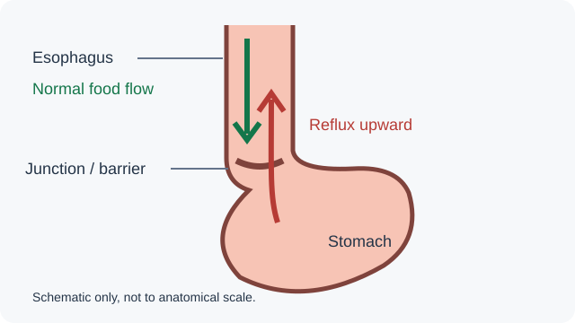

# 📚 GERD and Reflux Nursing

**Study-ready candidate, abhi padha nahi gaya hai.** Independent review pending hai.

[Chapter](../README.md) · [20 original MCQs](../MCQs/01-GERD-and-Reflux-Nursing-20-MCQs.md) · [Evidence](../Previous-Year-Questions/01-GERD-and-Reflux-Nursing-Evidence.md) · [Past-paper register](../Previous-Year-Questions/Gastrointestinal-System-Past-Paper-Research-Register.md)

## Reflux ka mechanism

Esophagus ek food pipe hai aur stomach ek acidic container hai. Jab hum khana nigalte hain, toh food pipe ke muscles khane ko neeche bhejte hain. Junction par lower esophageal sphincter aur diaphragm milkar antireflux barrier ka hissa banate hain. Jab barrier transiently relax hota hai ya pressure balance disturb hota hai, gastric content upar aa sakta hai. Sliding hiatal hernia mein junction ka position badal sakta hai aur diaphragmatic support disturb ho sakta hai. Kabhi-kabhi reflux hona aur baar-baar takleef dene wali reflux disease ek hi baat nahi hain.

Diagram mein normal food ka direction neeche hai. Reflux mein gastric content opposite direction mein jaata hai. Repeated exposure esophageal lining ko irritate kar sakta hai. Patient ko chest ke beech burning, sour taste ya regurgitation feel ho sakti hai. Regurgitation mein content bina forceful vomiting ke mouth tak aa sakta hai. [NIDDK symptoms](https://www.niddk.nih.gov/health-information/digestive-diseases/acid-reflux-ger-gerd-adults/symptoms-causes).

## Assessment aur red flags

Nurse patient se puchti hai ki symptoms kab hote hain, meal aur lying down se kya relation hai, kaunsi medicines chal rahi hain aur swallowing mein dikkat hai ya nahi. Agar chest pressure ke saath sweating aur arm pain ho, toh cardiac emergency assess karna priority hai. GERD history cardiac disease exclude nahi karti. Progressive swallowing difficulty ko dysphagia kehte hain. Ye inflammation, narrowing ya doosri disease ka clue ho sakti hai. Persistent vomiting, unexplained weight loss aur bleeding bhi alarm features hain. In situations mein prompt medical evaluation arrange karo.

## Investigations ka logic

| Test | Nurse ko kya samajhna chahiye? |
|---|---|
| Upper GI endoscopy | Camera se clinician upper GI lining inspect karta hai. Zaroorat par biopsy le sakta hai. |
| Ambulatory reflux monitoring | Monitor esophagus mein reflux exposure record karta hai. Patient meal timing, position aur symptoms likhe toh clinician correlation assess kar sakta hai. |
| Esophageal manometry | Ye contractions aur pressure patterns assess karti hai. Selected patients mein surgery se pehle major motility disorder exclude karne mein help karti hai. |

Normal endoscopy se GERD hamesha exclude nahi hota. Unproven GERD mein off-therapy monitoring ka goal diagnosis establish karna hota hai. Pehle se proven GERD mein treatment ke bawajood symptoms hone par selected on-therapy impedance-pH testing se mechanism samajhne mein help mil sakti hai. Patient test ke liye khud medicine band nahi karta. Specialist ke instructions follow karo. [NIDDK diagnosis](https://www.niddk.nih.gov/health-information/digestive-diseases/acid-reflux-ger-gerd-adults/diagnosis) aur [ACG guideline](https://doi.org/10.14309/AJG.0000000000001538).

## Nursing teaching aur treatment

Overweight patient mein gradual individualized weight management symptoms kam karne mein help kar sakta hai. Raat ko reflux hota hai toh upper body elevate karna aur meal ke baad letne se pehle do se teen ghante ka gap rakhna helpful ho sakta hai. Sab food groups ko restrict karne ke bajay diary se patient-specific triggers identify karo.

Antacid existing acid neutralize karke short relief de sakta hai. PPI acid secretion ko reduce karta hai. Standard omeprazole jaise formulations mein meal se pehle timing important ho sakti hai. Prescription aur formulation verify karo. Symptoms persist karein toh missed doses, actual timing aur alternative diagnosis assess karne mein clinician ki help karo. Nurse independently dose double nahi karti.

Severe erosive disease mein clinician maintenance plan decide karta hai. Barrett's esophagus mein lining ka type change hota hai aur risk-based follow-up ki zaroorat ho sakti hai. Fundoplication selected patients mein junction ka antireflux barrier strengthen karti hai. [NIDDK treatment](https://www.niddk.nih.gov/health-information/digestive-diseases/acid-reflux-ger-gerd-adults/treatment) aur [ACG guideline](https://doi.org/10.14309/AJG.0000000000001538).

## Clinical example

Ek patient ko dinner ke turant baad letne par burning hoti hai. Nurse meal timing, medicine adherence aur symptom triggers assess karti hai. Agar wahi patient solids nigalne mein progressive difficulty bataye, toh simple counselling alone sufficient nahi hai. Prompt evaluation arrange karna zaroori hai.

## Videos aur practice

| Topic | Teaching | Practice |
|---|---|---|
| GERD mechanism, symptoms, diagnosis aur treatment | [RegisteredNurseRN GERD lecture](https://www.youtube.com/watch?v=Xg1bqjKv-zg), description retrieved, playback pending | [Utkarsh Nursing Classes GERD theory + MCQs](https://www.youtube.com/watch?v=uP3rBUb2G-E), description confirms topic and MCQs, exact item and practice-only evidence pending |

[20 original questions](../MCQs/01-GERD-and-Reflux-Nursing-20-MCQs.md) · [Evidence](../Previous-Year-Questions/01-GERD-and-Reflux-Nursing-Evidence.md) · [Chapter](../README.md)
