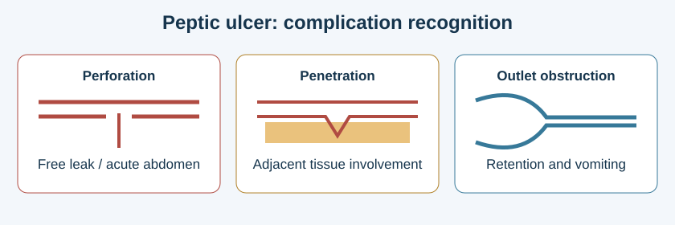

# Peptic ulcer disease — concept guide

[20 MCQs](../MCQs/02-Peptic-Ulcer-Disease-20-MCQs.md) · [Evidence](../Previous-Year-Questions/02-Peptic-Ulcer-Disease-Evidence.md)

## Mucosal injury
H. pylori aur NSAID exposure important causes hain. NSAID-related prostaglandin reduction mucus, bicarbonate aur perfusion protection compromise kar sakta hai. Medication reconciliation mein OTC drugs include karo. Pain meal ke saath vary kar sakta hai, lekin symptoms alone ulcer location establish nahi karte. Kuch ulcers asymptomatic bhi hote hain.

## Diagnosis and eradication
Stool antigen, urea breath test aur indicated endoscopic sampling active infection evaluate karte hain. Serology persistent antibody detect kar sakti hai aur cure confirm nahi karti. Prescribed multidrug therapy complete karna important hai. ACG 2024 guidance mein empiric clarithromycin use resistance concern ke karan restricted hai. Regimen local resistance, allergies aur clinician orders ke mutabik verify karo. Test of cure generally antibiotics complete hone ke at least four weeks baad, clinician-directed PPI/PCAB hold ke saath. Persistent infection mein prior regimen review karo.

## Complication recognition
Sudden severe pain, guarding aur free air perforation suggest karte hain. Adjacent-organ extension penetration ho sakti hai. Persistent vomiting of retained food outlet obstruction suggest karta hai. Prolonged gastric acid loss hypochloremic metabolic alkalosis kar sakta hai. Nonhealing gastric ulcer mein specialist malignancy exclusion consider karta hai. Urgent deterioration promptly escalate karo.

## Follow-up
Symptoms settle hone ke baad bhi prescribed eradication follow-up zaroori hai. NSAID need aur gastroprotection review clinician karta hai. Bland diet alone infection eradicate nahi karti.

## References
- [NIDDK symptoms and causes](https://www.niddk.nih.gov/health-information/digestive-diseases/peptic-ulcers-stomach-ulcers/symptoms-causes)
- [NIDDK diagnosis](https://www.niddk.nih.gov/health-information/digestive-diseases/peptic-ulcers-stomach-ulcers/diagnosis)
- [NIDDK treatment](https://www.niddk.nih.gov/health-information/digestive-diseases/peptic-ulcers-stomach-ulcers/treatment)
- [ACG H. pylori guideline commentary 2024](https://gi.org/journals-publications/ebgi/schoenfeld_sep2024/)
- [NIDDK definition and complications](https://www.niddk.nih.gov/health-information/digestive-diseases/peptic-ulcers-stomach-ulcers/definition-facts)
- [Merck Manual peptic ulcer disease (indexed)](https://www.merckmanuals.com/professional/gastrointestinal-disorders/gastritis-and-peptic-ulcer-disease/peptic-ulcer-disease)

- [RegisteredNurseRN PUD teaching video](https://www.youtube.com/watch?v=u94FEb_69G4) — indexed title; playback not independently checked.
