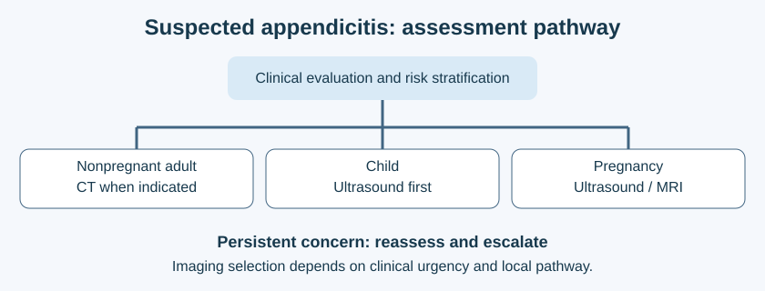

# Appendicitis and appendectomy — concept guide

[MCQs](../MCQs/03-Appendicitis-and-Appendectomy-20-MCQs.md) · [Evidence](../Previous-Year-Questions/03-Appendicitis-and-Appendectomy-Evidence.md)

## Pathology and symptoms
Appendix lumen obstruction pressure aur local inflammation increase kar sakti hai. Visceral pain poorly localized hota hai; parietal irritation se localized right lower quadrant pain develop ho sakta hai. Movement pain aggravate kar sakti hai. Classic presentation absent ho sakti hai, especially children mein. Urgent assessment delay nahi karo.

## Clinical assessment and investigations
History, examination, inflammatory markers aur risk stratification integrate karo. Normal WBC alone appendicitis exclude nahi karta. Urinalysis aur pregnancy testing appropriate differential diagnosis mein useful hain. Adults mein CT common, children mein ultrasound preferred initial approach, aur pregnancy mein ultrasound/MRI radiation-sparing options hain. Nondiagnostic imaging with persistent concern ko reassess karo.

## Management and nursing follow-up
Laparoscopic appendectomy standard surgical approach hai. Carefully selected uncomplicated cases mein clinician-supervised nonoperative antibiotics possible hain. Appendicolith risk selection ko influence kar sakta hai. Prescribed perioperative antibiotic administration verify karo. Complicated infection mein duration source control aur response par depend karti hai. Nonoperative abscess management ke baad scheduled follow-up essential hai. Postoperative new fever, deep pain, increasing redness ya purulent drainage promptly escalate karo. Activity patient-specific surgical instructions ke hisaab se resume karo.

## References
- [NIDDK symptoms and causes](https://www.niddk.nih.gov/health-information/digestive-diseases/appendicitis/symptoms-causes)
- [NIDDK diagnosis](https://www.niddk.nih.gov/health-information/digestive-diseases/appendicitis/diagnosis)
- [NIDDK treatment](https://www.niddk.nih.gov/health-information/digestive-diseases/appendicitis/treatment)
- [WSES Jerusalem 2025 guideline abstract](https://pubmed.ncbi.nlm.nih.gov/41604201/)
- [IDSA diagnostic imaging 2024](https://www.idsociety.org/practice-guideline/intra-abdominal-infections/)
- [Swedish national appendicitis guidelines (indexed)](https://pmc.ncbi.nlm.nih.gov/articles/PMC11980984/)
- [Appendicitis teaching video](https://www.youtube.com/watch?v=GPgqSSPnZjI) — topic description retrieved, playback pending.
