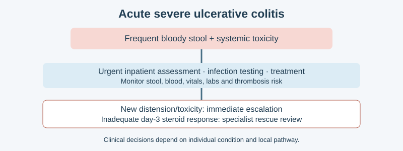

# Ulcerative colitis — concept guide

[MCQs](../MCQs/04-Ulcerative-Colitis-20-MCQs.md) · [Evidence](../Previous-Year-Questions/04-Ulcerative-Colitis-Evidence.md)

UC primarily colonic mucosal inflammation hai, usually rectum se continuous proximal extension. Tenesmus distal inflammation ka clue hai. Histology aur infectious stool testing diagnosis support karte hain. PSC, anemia aur colorectal neoplasia risk long-term monitoring mein relevant hain.

## Acute severe UC
Frequent bloody stools plus systemic toxicity urgent hospital assessment demand karte hain. Stool frequency, blood, vital signs aur ordered CRP trends document karo. Infection testing, limited endoscopy, prescribed IV steroid therapy aur individualized VTE prophylaxis verify karo. New distension with toxicity toxic megacolon concern raise karti hai. Antimotility drugs unreviewed administer mat karo. Day-three inadequate steroid response prompt specialist rescue/surgical review demand karta hai.

## Maintenance and monitoring
Distal disease mein rectal 5-ASA target treatment ho sakta hai. Steroids long-term maintenance ke liye generally suitable nahi. Biologic start se pehle latent TB/HBV screening, 5-ASA ke saath renal monitoring aur fecal inflammatory markers clinical context ke hisaab se review karo. Long-standing colitis mein risk-based surveillance relevant hai. Total proctocolectomy colonic disease remove karti hai lekin associated conditions aur surgery follow-up remain kar sakte hain.

- [NIDDK UC symptoms](https://www.niddk.nih.gov/health-information/digestive-diseases/ulcerative-colitis/symptoms-causes)
- [NIDDK UC diagnosis](https://www.niddk.nih.gov/health-information/digestive-diseases/ulcerative-colitis/diagnosis)
- [NIDDK UC treatment](https://www.niddk.nih.gov/health-information/digestive-diseases/ulcerative-colitis/treatment)
- [ACG UC update 2025](https://gi.org/journals-publications/ebgi/alkazzi_aug2025/)
- [BSG IBD guideline 2025](https://gut.bmj.com/content/74/Suppl_2/s1.full)
