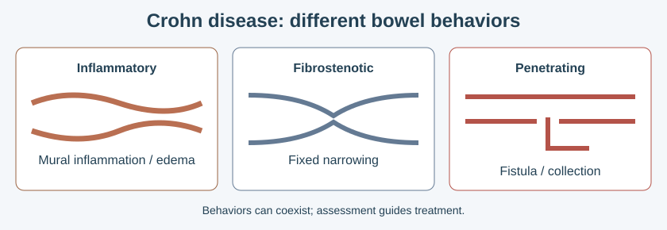

# Crohn disease — concept guide

[MCQs](../MCQs/05-Crohns-Disease-20-MCQs.md) · [Evidence](../Previous-Year-Questions/05-Crohns-Disease-Evidence.md)

Crohn disease transmural GI inflammation cause kar sakti hai. Deep ulcers cobblestone appearance create kar sakte hain. Ileocolonoscopy aur biopsies diagnostic workup ka part hain; small bowel and surrounding tissues MRE/CT enterography se evaluate ho sakte hain. Stricture concern mein capsule retention risk flag karo.

## Disease behavior
Inflammatory, fibrostenotic aur penetrating complications distinguish karo. Established fibrotic narrowing anti-inflammatory treatment se necessarily reverse nahi hoti. Fistula bowel se adjacent organ ya skin tak abnormal tract ho sakti hai. Fever plus focal pain mein abscess urgently evaluate karo. Source control, drainage, antimicrobials aur specialist plan follow karo. Loose seton drainage maintain kar sakta hai.

## Treatment and nutrition
Ileal-release budesonide suitable mild-to-moderate ileocecal disease mein induction ke liye option hai. ACG 2025 routine oral mesalamine ko mild-to-moderate active Crohn induction/maintenance ke liye support nahi karti. Ileal disease mein B12 deficiency aur limited ileal resection ke baad bile acid diarrhea evaluate karo. Children mein longitudinal growth monitor karo. Exclusive enteral nutrition selected pediatric cases mein specialist-directed induction option hai.

## Surgery and follow-up
Resection underlying recurrence tendency remove nahi karti. Prior resections aur penetrating disease risk assessment mein relevant hain. Scheduled ileocolonoscopy approximately 6–12 months postoperatively early recurrence detect kar sakti hai. Strictureplasty selected lesions mein bowel-preserving surgery hai. Patient-specific plans follow karo.

- [NIDDK Crohn symptoms and causes](https://www.niddk.nih.gov/health-information/digestive-diseases/crohns-disease/symptoms-causes)
- [NIDDK Crohn diagnosis](https://www.niddk.nih.gov/health-information/digestive-diseases/crohns-disease/diagnosis)
- [NIDDK Crohn treatment](https://www.niddk.nih.gov/health-information/digestive-diseases/crohns-disease/treatment)
- [ACG Crohn guideline 2025](https://doi.org/10.14309/ajg.0000000000003465)
- [ACG 2025 update commentary](https://gi.org/journals-publications/ebgi/zhai_dalal_sep2025/)
- [BSG IBD 2025](https://gut.bmj.com/content/74/Suppl_2/s1/)
- [ACG Crohn guideline summary 2025](https://www.guidelinecentral.com/guideline/4623548/)
