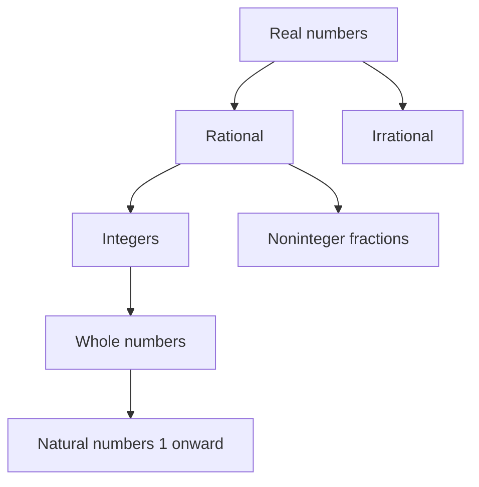

# Number systems, divisibility and remainders

**Priority High. Study-ready, unattempted.** [30 original questions](../MCQs/01-Number-Systems-and-Divisibility-30-MCQs.md) · [Reported exam evidence](../Previous-Year-Questions/01-Number-Systems-Reported-Evidence.md). This is quantitative aptitude for NORCET Prelims and staff nurse recruitment, not a nursing clinical topic.

## 1. Number types

Natural numbers ko yahan 1, 2, 3... define karte hain. Whole numbers mein zero bhi aata hai. Integers mein negative, zero aur positive whole numbers hote hain. Rational number p/q form mein express ho sakta hai, where p and q are integers and q is nonzero. Irrational number exact integer fraction mein express nahi ho sakta, jaise √2. All these form real numbers.

Zero neither positive nor negative hai. Prime number greater than one hota hai, with exactly two positive divisors. One neither prime nor composite hai. Two only even prime hai. A composite number greater than one can be broken into prime factors.

Terminating decimal: reduced fraction ke denominator mein sirf prime factors 2 and 5 hon. Example 7/20 = 0.35. Denominator mein 3 ya other prime remain kare toh nonterminating repeating decimal aati hai. Always simplify fraction first.

## 2. Prime factorization and powers

Example: 72 = 2³ × 3². Total positive divisors = (3+1)(2+1) = 12. Perfect square ke prime exponents even hote hain. Perfect cube ke exponents multiples of 3 hote hain. For example, 108 = 2² × 3³. Multiply by 3 to get 324 = 18². Divide by 4 to get 27 = 3³.

To check whether a positive integer greater than one is prime, test prime divisors up to its square root. Agar koi divisor nahi milta, number prime hai. Factorization HCF and LCM ka base hai, but those have a separate planned topic.

## 3. Divisibility rules

| Divisor | Rule |
|---|---|
| 2 | Last digit even |
| 3 | Digit sum divisible by 3 |
| 4 | Last two digits divisible by 4 |
| 5 | Last digit 0 or 5 |
| 6 | Both 2 and 3 |
| 8 | Last three digits divisible by 8 |
| 9 | Digit sum divisible by 9 |
| 10 | Last digit 0 |
| 11 | Difference of alternate digit sums is zero or a multiple of 11 |

Example: 53x4 divisible by 9. Digit sum 12+x hai. Next multiple 18 hai, so x=6. For 11, alternating positions alag sum karo, then difference check karo.

Count multiples of d in positive integer interval a to b inclusive: floor(b/d) − floor((a−1)/d). Example 30 through 90 divisible by 8: floor(90/8)=11 and floor(29/8)=3, so 8 multiples. Endpoint ko carefully check karo.

## 4. Remainders and unit digits

Division algorithm N = dq+r, where d is positive and 0 ≤ r < d. Remainder divisor ke equal ya bigger nahi ho sakta. Suppose N=9q+7. Then 2N+3 ka remainder (14+3) mod 9 = 8. Large power mein base ko smaller remainder se replace karke calculation easy ho sakti hai.

Unit digits repeat in cycles. Example 2 powers: 2,4,8,6. Exponent divided by 4 ka remainder 0 means fourth position, not zero digit. 2^19 ends in 8.

## 5. Factorials and integers

n factorial means 1 × 2 × ... × n. Trailing zero ek factor pair 2×5 se banta hai. Factor 5 usually limiting hota hai. Example 50! has floor(50/5)+floor(50/25)=10+2=12 zeros. Prime p ka factorial exponent floor(n/p)+floor(n/p²)+... hai until quotient zero.

Number line par negative number ke sign ko carefully compare karo. −0.8 is less than −0.5. Absolute distance never negative hoti hai. Consecutive odd numbers mein gap 2 hota hai. Agar three consecutive odd integers ka sum S hai, middle S/3 hai.

## Exam traps

One is not prime. Zero is not positive. Negative fractions may reverse intuitive magnitude comparison. Always distinguish total divisor count from sum of divisors. A repeated unit-digit cycle uses its final position when exponent remainder is zero. Avoid blindly applying a remembered shortcut to a different divisor.

## References and practice

- [OpenStax real numbers](https://openstax.org/books/algebra-and-trigonometry/pages/1-1-real-numbers-algebra-essentials)
- [OpenStax prime factorization and LCM](https://openstax.org/books/prealgebra-2e/pages/2-5-prime-factorization-and-the-least-common-multiple)
- [OpenStax integers](https://openstax.org/books/prealgebra/pages/3-key-concepts)
- Concept: [Class Everywhere — Divisibility Rules in Hindi](https://www.youtube.com/watch?v=j5DxpfGw0QY), 30 September 2025. Retrieved title, channel and description.
- Practice and solved questions: [Tyariexamki — Live Math Number System, Remainder, Competitive Exam Preparation Hindi](https://www.youtube.com/watch?v=3op2jp8ktO4), 9 August 2026. Retrieved channel and description explicitly cover divisibility, remainders, cyclicity, exam-oriented questions and solutions. General competitive aptitude, not a dedicated NORCET nursing session.
- Nursing-specific lead: [VS Nursing Academy channel posts](https://t.me/s/vsnursingacademy?after=5102) index Krishnan Sir Number System MCQ sessions for NORCET and RRB. Direct YouTube watch URL not independently verified, so no invented video ID. Full playback of the retrieved videos and individual answer verification remain pending.
