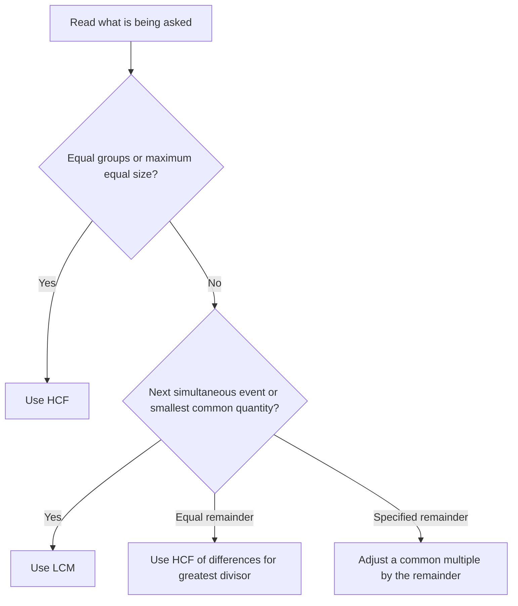

# Highest common factor (HCF) and least common multiple (LCM)

**Priority High. Study-ready, unattempted.** [30 original questions](../MCQs/02-HCF-and-LCM-30-MCQs.md) · [Reported exam evidence](../Previous-Year-Questions/02-HCF-and-LCM-Reported-Evidence.md)

## 1. HCF versus LCM

HCF greatest positive integer hai jo given integers ko exactly divide karta hai. LCM smallest positive integer hai jo given positive integers se exactly divisible hai. HCF ko GCD ya GCF bhi bolte hain. For 24 and 36, common factors 1, 2, 3, 4, 6, 12 hain, so HCF=12. Common positive multiples 72, 144, 216... hain, so LCM=72.

Imagine store mein 24 red labels and 36 blue labels hain. Maximum identical kits without leftovers ke liye HCF 12 use karte hain. Each kit gets 2 red and 3 blue. Do nonclinical timers 24 and 36 seconds mein repeat hote hain. Dono together start hon toh next coincidence LCM 72 seconds par hoti hai.

## 2. Prime factor method and Euclid

| Number | Prime factorization |
|---|---|
| 24 | 2³ × 3 |
| 36 | 2² × 3² |
| HCF | 2² × 3 = 12 |
| LCM | 2³ × 3² = 72 |

HCF mein common primes ke minimum exponents lo. LCM mein all involved primes ke maximum exponents lo. Euclid method mein larger number ko smaller se divide karo, then divisor ko remainder se divide karte raho. Last nonzero remainder HCF hai. Example 98=63+35, 63=35+28, 35=28+7, 28=4×7, so HCF=7.

For TWO positive integers only, HCF × LCM = product of the integers. Example HCF=10, LCM=140 and first integer=20. Other=10×140/20=70. Check actual HCF 10, LCM 140. Do not apply this simple product identity to three integers.

If a:b reduced ratio m:n is coprime and HCF=h, actual numbers hm and hn. LCM=hmn. HCF must divide LCM, so a proposed HCF 12 and LCM 70 cannot occur. If a divides b, HCF=a and LCM=b. For positive a, GCD(0,a)=a.

## 3. Word problem decision diagram

Equal remainder problem: if divisor d leaves same remainder on dividing a and b, it must divide a−b. For three numbers, greatest divisor is HCF of their positive differences. Example 41, 65, 89: differences 24 and 48, HCF=24, all give remainder 17.

Specified remainder problem: least number greater than all divisors leaving remainder 2 when divided by 5 and 7 is 35+2=37. If no lower-bound constraint is given, 2 itself is a valid small answer, so question wording carefully read karo.

## 4. Exam applications

- Maximum identical kits: HCF of item counts gives number of kits. Divide each item count by HCF to find per-kit contents.
- Greatest equal square tile: HCF of rectangle dimensions gives side length.
- Repeating schedules: LCM gives repeat period. For weekday questions reduce period modulo 7.
- Greatest k-digit common multiple: floor(maximum k-digit number / LCM) × LCM.
- Smallest k-digit common multiple: ceiling(minimum k-digit number / LCM) × LCM.
- Minimum add/subtract to a common multiple: find r = N mod LCM. If r=0, both adjustments zero. Otherwise add LCM−r or subtract r.
- Perfect square/cube constraints: start with LCM prime exponents and round up each exponent to an even number or multiple of three respectively.
- Ordered pair counts: let LCM/HCF = K. Each full prime-power block of K must go to exactly one of the two reduced coprime factors. If K has t distinct primes, there are 2^t ordered pairs. For K>1, unordered pairs are half this number.

## References and practice videos

- [OpenStax prime factors and LCM](https://openstax.org/books/prealgebra-2e/pages/2-5-prime-factorization-and-the-least-common-multiple)
- [OpenStax GCF](https://openstax.org/books/prealgebra-2e/pages/10-6-introduction-to-factoring-polynomials)
- Concept: [HCF and LCM live class for SSC and RRB](https://www.youtube.com/watch?v=_Oql350XT34). Indexed title and description confirm topic coverage. Channel metadata not independently retrieved.
- Dedicated MCQ practice: [LCM & HCF Aptitude Questions, Practice Test for Competitive Exams](https://www.youtube.com/watch?v=Tb3Eu0O1QhM). Indexed description identifies SSC, RRB and placement practice, and references Rise Academy. Exact channel attribution not independently confirmed. Both are general aptitude resources rather than NORCET-only sessions. Full playback and answer verification remain pending.
- [RRB Staff Nurse quantitative practice collection](https://testbook.com/questions/rrb-staff-nurse-quant-questions--65cf14e3f62e0b15f4cff5d7). Third-party question collection. Use independently checked solutions.
