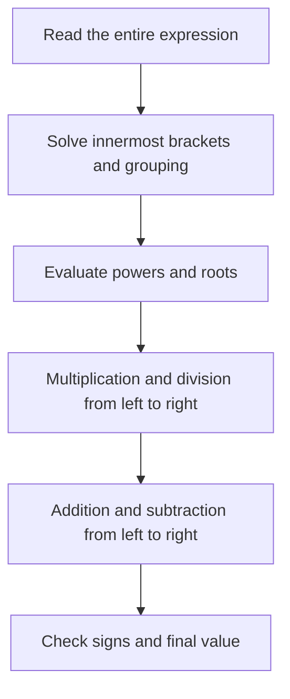

# Simplification and order of operations

**Study-ready, unattempted.** [30 original MCQs](../MCQs/03-Simplification-and-Order-of-Operations-30-MCQs.md) · [Reported recruitment questions](../Previous-Year-Questions/03-Simplification-Reported-Evidence.md).

## 1. BODMAS ka real meaning

Simplification ka matlab expression ko rules ke according evaluate karna hai. BODMAS mein B brackets, O orders (powers and roots), D division, M multiplication, A addition aur S subtraction ko represent karta hai. Lekin D always M se pehle aur A always S se pehle nahi hota. Division and multiplication equal priority hain. Isi tarah addition and subtraction equal priority hain. Same priority par left to right kaam karo.

Example: 36 ÷ 3 × 2 + 4. Left se 36÷3=12, 12×2=24 aur 24+4=28. Agar tum 3×2 pehle karogi toh original expression ka grouping change ho jayega. Answer 10 galat hoga. Lekin 36 ÷ (3×2) + 4 ka answer 10 hi hai, kyunki yahan brackets explicit hain.

Example: 20−8+5=12+5=17. Addition pehle karke 20−13=7 mat karo. Agar expression 20−(8+5) hota toh 7 sahi hota.

## 2. Nested brackets and negative signs

Bracket ke andar bhi same operation rules apply hote hain. 3 × [9 − {2 − (4−7)}] mein inner bracket −3 hai. Phir 2−(−3)=5, 9−5=4, aur 3×4=12. Minus sign before brackets har enclosed term ka sign change karta hai. For example 7−(a−b)=7−a+b.

| Operation | Rule |
|---|---|
| Positive × negative | Negative result |
| Negative × negative | Positive result |
| Negative ÷ negative | Positive result |
| Subtract negative | Add its positive opposite |
| Absolute value | Distance from zero, never negative |
| Division by zero | Undefined |

Absolute value bars grouping ki tarah work karte hain. For example abs(−6+2)=4. Lekin abs(−6)−abs(8)=−2 ho sakta hai, kyunki absolute values lene ke baad subtraction ho raha hai.

## 3. Powers and roots

−4² ka meaning −(4²)=−16 hai. (−4)² ka meaning (−4)×(−4)=16 hai. Brackets sign ko base mein include karte hain. √81 principal nonnegative square root hai, equal to 9. Equation x²=81 ke two solutions −9 and 9 ho sakte hain. Root symbol aur equation ko confuse mat karo.

For nonzero a, a⁰=1, a^m ÷ a^n = a^(m−n), and (a^m)^n=a^(mn). Example 5⁴÷5²=5²=25. Powers same base par hona zaroori hai. 2³+2²=8+4=12, not 2⁵.

## 4. Efficient mental calculation

Distributive rule: a(b+c)=ab+ac. 49×26+26=26×50=1300. Associative rule multiplication mein factors regroup karne deta hai. 25×12×4 = (25×4)×12=1200. Subtraction aur division ko arbitrary regroup nahi kar sakte.

Difference of squares: a²−b²=(a−b)(a+b). Example 62²−38²=24×100=2400. Algebraic substitution karte waqt negative variable value ko brackets mein likho. If x=−3, 2x²−x=18+3=21. Like terms combine hote hain, unlike terms nahi. 4x+3x=7x, but 4x+3 ka result 7x nahi hai.

## 5. Word problems and checking

Question mein exact answer poocha hai ya estimate, pehle identify karo. Estimate ke liye specified place value par round karo. Example 297×42 nearest tens estimate 300×40=12000. Exact product 12474 hai. Dono different objectives hain.

A store has 90 packets and sends 5 boxes of 8 packets each. It receives 12 more. Expression 90−5×8+12 gives 62 packets. Clinical calculations mein units and orders separately verify karna important hai. Ye arithmetic practice actual medicine administration authorization nahi hai.

## References and practice

- [OpenStax — order of operations](https://openstax.org/books/prealgebra-2e/pages/2-1-use-the-language-of-algebra)
- [OpenStax — evaluating expressions](https://openstax.org/books/prealgebra-2e/pages/2-2-evaluate-simplify-and-translate-expressions)
- [OpenStax — properties](https://openstax.org/books/prealgebra-2e/pages/7-2-commutative-and-associative-properties)
- Concept: [Maa Tara Educational — BODMAS Rule in Hindi, Aditya Sir](https://www.youtube.com/watch?v=HVDkvY542Mo), 15 July 2026. Indexed metadata confirms brackets and operation order, general foundation teaching.
- Dedicated NORCET MCQ practice: [Nursing Wallah by PW — NORCET 10 Mathematics Non Nursing Countdown MCQ Series, Sunny Ma'am](https://www.youtube.com/watch?v=pYWuxIO5n9o), 6 April 2026. Retrieved channel and chapter metadata. Simplification starts at 00:00, complex BODMAS 06:21, nested brackets 12:48, negative operations 15:03 and equations 19:48.
- Full playback not verified. Direct reopen of the NORCET video returned a cache miss, while indexed channel and chapter metadata were retrieved. Always follow equal-priority left-to-right rules rather than a misleading mnemonic.
