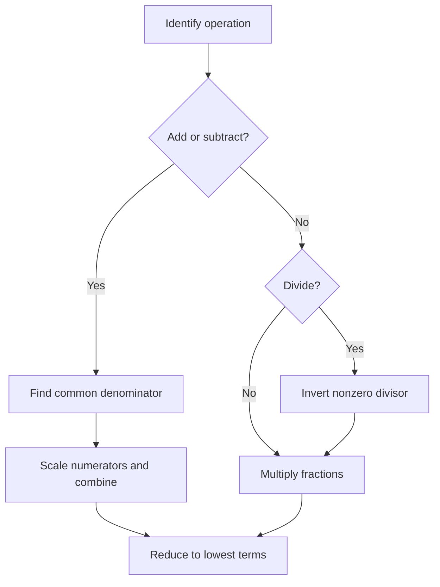

# Fractions — concepts and exam practice

**Study-ready, unattempted.** [30 original MCQs](../MCQs/04-Fractions-30-MCQs.md) · [Reported evidence](../Previous-Year-Questions/04-Fractions-Reported-Evidence.md).

## 1. Fraction ka meaning

Imagine ek cake ko 8 equal pieces mein divide kiya. Tum 3 pieces leti ho, toh tumne 3/8 cake liya. Numerator (3) selected parts batata hai aur denominator (8) total equal parts batata hai. Denominator zero nahi ho sakta.

```text
Whole: [■][■][■][□][□][□][□][□]
Selected part: 3 out of 8 = 3/8
```

Proper fraction positive numerator denominator se chhota hota hai, jaise 3/5. Improper fraction mein numerator denominator ke equal ya greater hota hai, jaise 7/4. Mixed number whole number aur proper fraction combine karta hai, jaise 1 3/4. Mixed number ko improper fraction mein badalne ke liye whole number ko denominator se multiply karo, numerator add karo aur denominator same rakho.

Example: 2 3/5 = (2×5+3)/5 = 13/5. Improper fraction se mixed number banane ke liye numerator divide karo. Quotient whole part aur remainder numerator banega.

## 2. Equivalent fractions and comparison

Numerator aur denominator ko same nonzero number se multiply ya divide karne se fraction ka value change nahi hota. 6/10 = 3/5. Lowest terms mein numerator aur denominator ka HCF 1 hota hai.

Positive denominators ke saath fractions compare karne ke liye cross multiplication use kar sakte ho. 4/7 and 5/9 compare karo. 4×9=36 aur 5×7=35. Isliye 4/7 greater hai. Negative fractions mein signs carefully handle karo. Same denominator ho toh larger numerator means larger fraction.

## 3. Four arithmetic operations

| Operation | Method | Example |
|---|---|---|
| Addition | Common denominator, then add scaled numerators | 1/3+1/4=7/12 |
| Subtraction | Common denominator, then subtract scaled numerators | 5/6−1/4=7/12 |
| Multiplication | Multiply numerators and denominators, cancel common factors | 3/5×10/9=2/3 |
| Division | Multiply by reciprocal of divisor (nonzero) | 3/5÷9/10=2/3 |

Adding fractions mein denominators direct add nahi karna. Agar denominators different hain, unka LCM lo aur equivalent fractions banao. Example 2/9+5/6. LCM 18 hai. 4/18+15/18=19/18.

Division mein first fraction same rakho. Second fraction ka reciprocal lo, phir multiply karo. Reciprocal of 3/7 is 7/3. Zero ka reciprocal undefined hai. Mixed numbers ko multiply ya divide karne se pehle improper fractions mein convert karo.



## 4. Applied problems and changing base

A stock of 120 items loses 1/4 of its original count. Remaining 90 hain. If 1/3 of the remaining is then used, second issue 30 hai. Final 60 hain. Important word remaining hai, kyunki second fraction original 120 par apply nahi hoti.

A quantity changes from 1/2 to 3/4. Absolute change 1/4 hai. Relative change original 1/2 se divide karke 1/2 milti hai. Isliye numerator result aur base carefully identify karo.

Fractional equation mein inverse operation use karo. If 2/5 of x = 18, both sides multiply by 5/2, so x=45. Denominator mein variable ho toh zero exclusion bhi check karo.

## 5. Exam traps

- Denominators ko direct add ya subtract mat karo.
- Division mein sirf divisor invert hota hai.
- Fraction of remaining aur fraction of original different bases hain.
- Relative change aur absolute change different hain.
- Answer ke saath unit preserve karo. Arithmetic practice actual clinical dosing instructions nahi hai.

## References and video practice

- [OpenStax fraction summary](https://openstax.org/books/prealgebra-2e/pages/4-key-concepts)
- [OpenStax multiplication/division](https://openstax.org/books/prealgebra-2e/pages/4-2-multiply-and-divide-fractions)
- [OpenStax addition/subtraction](https://openstax.org/books/prealgebra/pages/4-5-add-and-subtract-fractions-with-different-denominators)
- Teaching: [TicTacLearn Hindi — Proper, Improper and Mixed Fractions, part 1](https://www.youtube.com/watch?v=T6P4pPIRmjo), published 8 April 2020. Retrieved channel and description. Beginner NCERT-level concept lecture.
- NORCET MCQ practice: [Nursing Wallah by PW — NORCET 10 Mathematics Non Nursing Countdown MCQ Series](https://www.youtube.com/watch?v=pYWuxIO5n9o&t=1388s), 6 April 2026. Mixed fractions 23:08, addition of mixed fractions 29:16, fraction comparison 36:48, nested fraction equations 46:24. Same video as simplification but different identified segments, not counted as a second unique video.
- RRB PYQ practice lead: [RRB Nursing Superintendent Previous Year Question Papers, Reasoning + Aptitude, Non Nursing Part 2](https://www.youtube.com/watch?v=u5MEIwuQyss&t=821s). Indexed description confirms mixed fractions at 13:41 and HCF of fractions at 18:24. Channel attribution and question-level historical provenance not independently confirmed.

Full playback and video answers remain unverified. Study the methods and independently check every numerical result.
