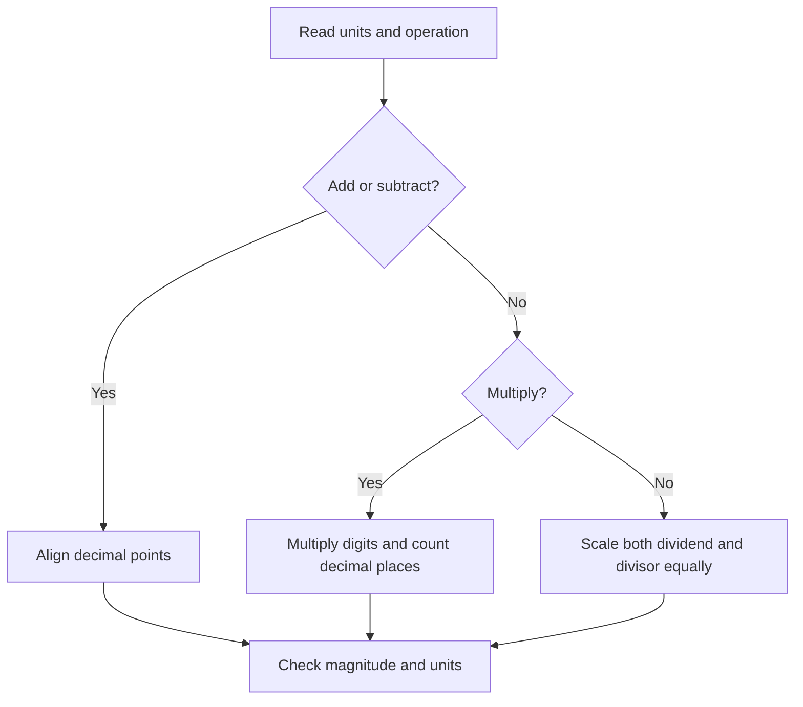

# Decimals — concepts and calculation strategies

**Study-ready, unattempted.** [30 originals](../MCQs/05-Decimals-30-MCQs.md) · [Reported exam practice](../Previous-Year-Questions/05-Decimals-Evidence-and-Sample-Practice.md).

## Place value and comparison

Decimal point ke left mein units, tens, hundreds aate hain. Right side mein tenths (1/10), hundredths (1/100), thousandths (1/1000) aate hain. Example 6.307 = 6 + 0.3 + 0.007. Zero hundredths ka placeholder hai. Decimal ke end par zero add karne se number ka numerical value change nahi hota, e.g. 0.4 = 0.400. Measurement precision ka meaning alag ho sakta hai.

| Digit in 6.307 | Place | Value |
|---|---|---|
| 6 | Ones | 6 |
| 3 | Tenths | 0.3 |
| 0 | Hundredths | 0 |
| 7 | Thousandths | 0.007 |

Compare karte waqt decimal places equal bana lo. 0.42 = 0.420, so 0.419 is smaller. Negative values mein direction ka dhyan rakho. −0.42 is smaller than −0.419.

## Rounding

Requested digit identify karo. Next digit 0–4 ho toh requested digit unchanged, next digit 5–9 ho toh round up (usual positive school rounding). Carry possible hai. 8.996 nearest hundredth = 9.00. Rounding aur truncation same nahi hain. A value recorded as 2.7 to nearest tenth under half-up rounding could represent any actual value from 2.65 inclusive to below 2.75. Clinical measurements aur dose rounding mein applicable facility policy follow karni chahiye, not a generic shortcut.

## Four operations

- Addition/subtraction: decimal points align karo, missing places zero se fill karo, normal carry/borrow use karo. 4.06−0.875 = 4.060−0.875 = 3.185.
- Multiplication: digits ko integers ki tarah multiply karo, then factors ke total decimal places count karo. 0.24×0.15 = 360/10000=0.036.
- Division: divisor ko whole number banane ke liye dividend aur divisor dono ko same power of 10 se multiply karo. 2.7÷0.06 = 270÷6=45.
- Estimation: expected magnitude pehle check karo. A number multiplied by positive number less than one becomes smaller if the first number is positive.

## Fraction conversion

Finite decimal ko place value denominator par likho, reduce karo. 0.0625 = 625/10000 = 1/16. Reduced denominator contains only factors 2 and 5 means terminating decimal. Otherwise a rational fraction has a repeating decimal. For x=0.454545..., 100x−x=45, hence x=45/99=5/11. For x=0.2333... where only 3 repeats, 100x−10x=21, hence x=21/90=7/30.

## Scientific notation and applications

Standard scientific notation a×10^n uses 1 ≤ a < 10 for positive numbers. 0.00052 = 5.2×10⁻⁴. Negative exponent small positive number indicate kar sakta hai, negative sign on the number nahi. In unit conversion check same unit first. For example 0.12 kg = 120 g. These are arithmetic exercises, not drug administration orders. Keep intermediate precision and round at the final step when requested.

## References and video mapping

[OpenStax decimals](https://openstax.org/books/prealgebra-2e/pages/5-1-decimals) · [Decimal operations](https://openstax.org/books/prealgebra-2e/pages/5-2-decimal-operations) · [Decimals and fractions](https://openstax.org/books/prealgebra/pages/5-3-decimals-and-fractions).

[25 Decimal Fraction Questions in 72 Minutes — SHiNE Academy (indexed attribution, not independently confirmed)](https://www.youtube.com/watch?v=szcmlZVGcWA&t=1110s) — general aptitude solved questions, multiplication Q8–Q10 at 18:30 as indexed. [Decimal Fraction (For All Exams)](https://www.youtube.com/watch?v=eNzC_hU2ToM) — indexed title only. Direct video retrieval failed, full playback, precise channel and dedicated nursing-specific decimal video remain pending.
