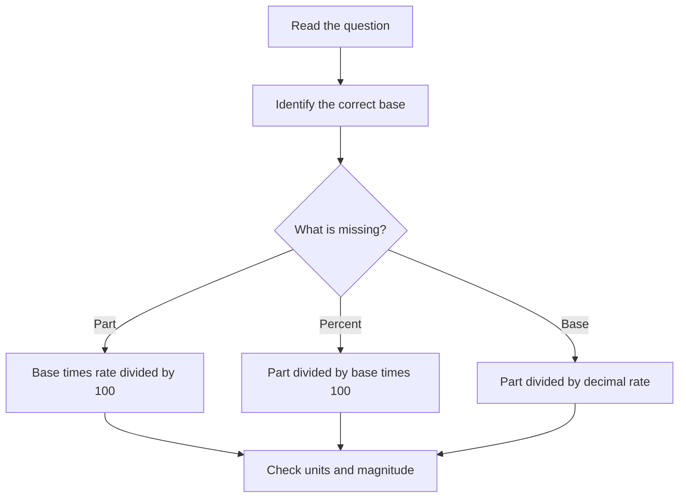

# Percentages — concepts, shortcuts and changing-base problems

**Study-ready, unattempted.** [30 original MCQs](../MCQs/06-Percentages-30-MCQs.md) · [Reported exam evidence](../Previous-Year-Questions/06-Percentages-Reported-Evidence.md). Earlier percentage starter remains separate.

## Meaning of percentage

Percent means per hundred. Imagine 100 equal counters mein 35 red hain. Red share 35/100 = 0.35 = 35%. Total count 200 ho toh same 35% means 70 counters. Percentage same ho sakti hai even if actual count different hai.

| Fraction | Decimal | Percent |
|---|---:|---:|
| 1/2 | 0.5 | 50% |
| 1/4 | 0.25 | 25% |
| 1/5 | 0.2 | 20% |
| 1/8 | 0.125 | 12.5% |
| 1/3 | 0.333... | 33 1/3% |
| 3/4 | 0.75 | 75% |

Part = rate/100 × whole. Rate = part/whole ×100%. Whole = part ÷ (rate/100), if rate nonzero. For example 18% of 350 =63. If 18% of x equals 63, divide 63 by 0.18, result 350.

## Percentage change and percentage points

Percent change = (new − original)/original ×100. Original must be nonzero. From 80 to 100, rise 20/80×100=25%. Return from 100 to 80 is fall 20/100×100=20%. Same absolute difference but different base.

A rate improves from 30% to 45%. Difference 15 percentage points hai, relative rise 15/30×100=50%. Exam wording mein relative increase aur percentage points carefully distinguish karo.

## Reverse percentages

If an original value rises by p%, new value = original × (1+p/100). Reverse calculation mein divide by that multiplier. If final after 20% rise is 180, original=180/1.2=150. Subtracting 20% of final gives 144, which is wrong base.

If A is p% greater than B, B is smaller than A by p/(100+p) ×100%. Example B=100 and A=150. Difference 50 on base 150 gives 33 1/3%, not 50%. Similarly if A is 20% below B, B is 25% above A.

## Successive changes

Always multiply factors rather than add percentage changes blindly. From 100, +10% gives 110, then −10% gives 99. Overall fall 1%. Two +10% steps give 121, net rise 21%. Nested shares multiply: 25% of 40% of whole =0.25×0.4=10% of whole. When a square side rises by 10%, area factor 1.1²=1.21, so area rises 21%.

## Weighted rates and overlap

Group A has 10 of 20 successful, group B has 72 of 80 successful. Combined rate = (10+72)/(20+80)×100=82%. Simple mean of 50% and 90% gives 70%, wrong because group sizes differ. For overlapping groups, share of at least one = share A + share B − share both. Keep a common denominator for all categories.

Practice-test thresholds in the MCQs are hypothetical arithmetic examples, not statements about official recruitment cut-offs. Use actual notified exam rules for eligibility.

## Sources and video study

[OpenStax — understand percent](https://openstax.org/books/prealgebra-2e/pages/6-1-understand-percent).

[Nursing Wallah — NORCET 10 Mathematics Non Nursing Countdown MCQ Series](https://www.youtube.com/watch?v=pYWuxIO5n9o&t=2946s) — indexed percentage increase/decrease section 49:06, relevant to changed-base and reverse calculations. [Second NORCET countdown session](https://www.youtube.com/watch?v=2ndNA4023-U&t=1755s) — indexed net population change section 29:15. [Krishnan Sir — Complete Percentage Class for EMRS, NORCET and RRB, VS Nursing Academy](https://www.youtube.com/watch?v=ZB-9LAT919M) — indexed description identifies instructor and academy. Direct page retrieval/playback and exact question mapping are not authenticated.

Source error warning: the reported OSSSC 19 March 2023 page prints an internally inconsistent answer for a reverse-base problem. See [question-level evidence](../Previous-Year-Questions/06-Percentages-Reported-Evidence.md) for the independent correction.
