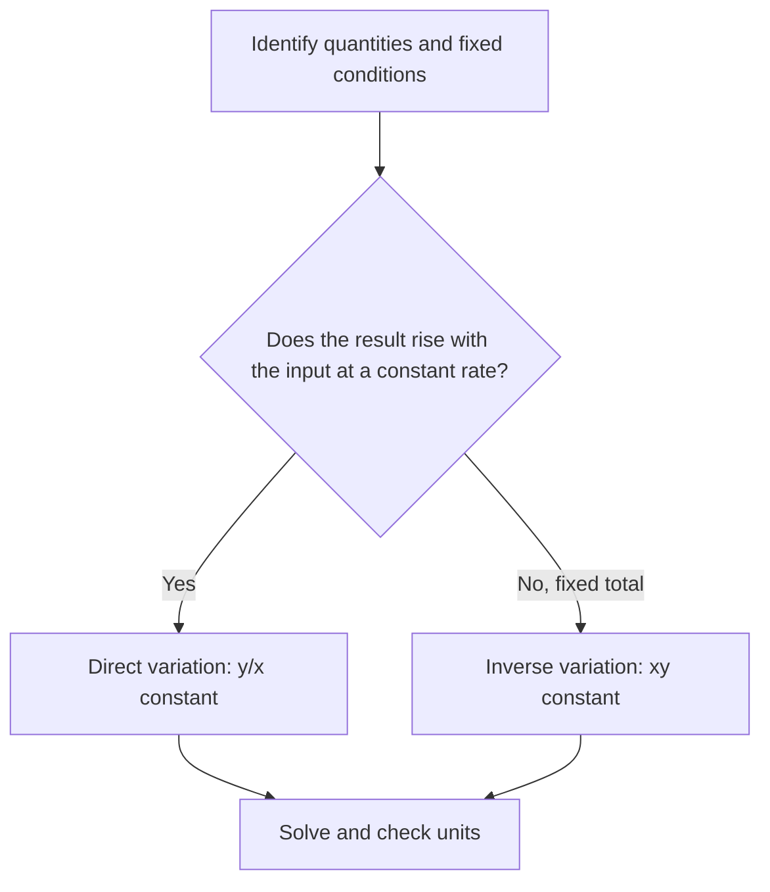

# Ratios and proportion — study guide

**Study-ready, unattempted.** Priority is editorial, not proof of repeated exam appearance. [Original bank](../MCQs/07-Ratios-and-Proportion-30-MCQs.md) · [Reported evidence](../Previous-Year-Questions/07-Ratios-and-Proportion-Reported-Evidence.md).

## Ratio basics

**Priority:** 🟠 HIGH YIELD | **Difficulty:** 🟡 Medium | **Evidence:** Core aptitude concept.

Imagine do boxes mein 12 red aur 18 blue counters hain. Red-to-blue ratio 12:18 ko HCF 6 se simplify karo, answer 2:3 hai. Ratio order matters. Red-to-total ratio alag hai, 12:30=2:5. Same-type quantities ko pehle same unit mein convert karo. 500 mL to 2 L = 500:2000=1:4.

Agar 540 tokens ko 2:3:4 mein divide karna hai, total nine parts hain. One part 60 hai. Shares 120, 180 and 240 hain. Sum check karo.

Practice: [Q1](../MCQs/07-Ratios-and-Proportion-30-MCQs.md#q1-simplify-the-ratio-126198), [Q2](../MCQs/07-Ratios-and-Proportion-30-MCQs.md#q2-express-the-ratio-750-ml-to-25-l-in-lowest-terms), [Q3](../MCQs/07-Ratios-and-Proportion-30-MCQs.md#q3-a-supply-of-660-labels-is-shared-between-two-departments-in-the-ratio-74-how-many-labels-does-the-smaller-department-receive). Historical evidence for the specific examples pending.

## Combined ratios and changing counts

**Priority:** 🟠 HIGH YIELD | **Difficulty:** 🔴 Difficult | **Evidence:** Same tested concept in reported RRB and DSSSB items.

A:B=2:5 and B:C=3:4. B ka common multiple 15 lo. First ratio ×3 gives 6:15, second ×5 gives 15:20. Combined A:B:C=6:15:20. Directly endpoints 2:4 lena wrong hai.

Changing count question mein initial quantities ko k ke multiples mein likho. Example boys:girls=3:2 and 10 girls join, after which ratio becomes 1:1. Initial 3k=2k+10, so k=10. Initial boys 30 and girls 20. For age ratios, add or subtract same years from both actual ages, not from ratio parts alone.

Practice: bank Q5–12, including [Q5](../MCQs/07-Ratios-and-Proportion-30-MCQs.md#q5-if-ab47-and-bc35-find-ac) and [Q11](../MCQs/07-Ratios-and-Proportion-30-MCQs.md#q11-the-ages-of-two-people-are-in-the-ratio-35-six-years-later-their-ages-will-be-in-the-ratio-23-find-the-present-age-of-the-younger-person). [RRB reported evidence, Q1](../Previous-Year-Questions/07-Ratios-and-Proportion-Reported-Evidence.md#q1-a-school-has-4500-students-girls-and-boys-are-in-the-ratio-4951-if-only-girls-are-added-how-many-must-join-for-the-two-groups-to-have-equal-counts).

## Proportions

**Priority:** 🟠 HIGH YIELD | **Difficulty:** 🟡 Medium | **Evidence:** Core aptitude concept.

Two ratios equal ho toh proportion banta hai. a/b=c/d with nonzero denominators implies ad=bc. For 8:12=x:27, x=27×8/12=18. Fourth proportional means a:b=c:x, so x=bc/a. Positive mean proportional between a and b is square root of ab.

```text
  a       c
 ---  =  ---
  b       d
 Cross products: a×d = b×c
```

Practice: [Q14](../MCQs/07-Ratios-and-Proportion-30-MCQs.md#q14-find-x-if-1435--x65), Q13–16. [OpenStax proportions](https://openstax.org/books/prealgebra-2e/pages/6-5-solve-proportions-and-their-applications).

## Direct and inverse variation

**Priority:** 🟠 HIGH YIELD | **Difficulty:** 🔴 Difficult | **Evidence:** Same concept as indexed DSSSB inverse capacity item, official evidence pending.

Direct variation: y=kx. If 4 identical notebooks cost ₹60, then 7 cost ₹105 at constant unit price. Inverse variation: xy=k. If fixed stock lasts 12 days for five identical devices at equal consumption, it lasts 10 days for six devices. Product device-days remains 60. For combined machine/time questions, calculate production per machine-hour first. Do not assume real clinical staffing, fluid administration or equipment needs vary in a simple proportion.



Practice: bank Q17–22, [Q18](../MCQs/07-Ratios-and-Proportion-30-MCQs.md#q18-a-tank-contains-enough-nonclinical-cleaning-material-for-12-identical-devices-to-use-for-15-days-at-the-same-daily-use-per-device-for-how-many-days-will-it-last-with-20-devices). DSSSB Q63 indexed evidence in reported file.

## Mixed applications

**Priority:** 🟡 IMPORTANT | **Difficulty:** 🔴 Difficult | **Evidence:** Original exam-style practice.

Two groups ke ratios combine karte waqt actual counts nikaalo, ratio terms simply add mat karo. Example first group 40, ratio 1:3 gives 10 and 30. Second group 20, ratio 1:1 gives 10 and 10. Combined ratio 20:40=1:2. Time-weighted share mein contribution × duration use karo only when specified. Uniform scaling means same multiplier in every linear dimension. Square variation mein y=kx², so x double hone par y four times hota hai.

Practice: bank Q23–28, [Q23](../MCQs/07-Ratios-and-Proportion-30-MCQs.md#q23-a-mixture-contains-two-harmless-craft-liquids-in-the-ratio-52-by-volume-there-are-42-l-in-total-how-much-of-the-second-liquid-must-be-added-to-make-the-ratio-11). Evidence of exact exam appearance pending.

## Part to whole

**Priority:** 🟠 HIGH YIELD | **Difficulty:** 🟡 Medium | **Evidence:** Core aptitude concept.

Ratio of completed to incomplete records can be 3:2, but completed fraction of total is 3/5, not 3/2. A proportion in descriptive statistics compares a part with its whole. Clinical rates and risk calculations need correctly defined numerator, denominator and time window. Patient-to-nurse arithmetic ratio is not an independent safe staffing recommendation.

Practice: Q29–30, [Q30](../MCQs/07-Ratios-and-Proportion-30-MCQs.md#q30-a-report-states-there-are-18-incomplete-records-for-every-72-complete-records-what-is-the-incomplete-to-total-ratio).

## References and video practice

[OpenStax ratios and rate](https://openstax.org/books/prealgebra-2e/pages/5-6-ratios-and-rate) · [OpenStax proportions](https://openstax.org/books/prealgebra-2e/pages/6-5-solve-proportions-and-their-applications) · [SATHEE IIT Kanpur aptitude guide](https://sathee.iitk.ac.in/sathee-ssc/student-corner/preparation-guide/quantitative-aptitude/ratio-and-proportion/).

[Nursing Wallah by PW — RRB Nursing Superintendent Non Nursing Part 7](https://www.youtube.com/watch?v=UMgEhDbslOs), published 14 February 2026. Indexed chapters: distribution 2:55, ratio identities 7:09, student ratios 14:18, comparison 16:09 and age ratios 19:20. Description and timestamps retrieved, playback and exam-question provenance not authenticated. [GDC NURSING — coin problems with ratio and proportion](https://www.youtube.com/watch?v=knKrITKBxpA), 24 June 2025, indexed description confirms coin problems and proportional reasoning. No exact question match asserted.
