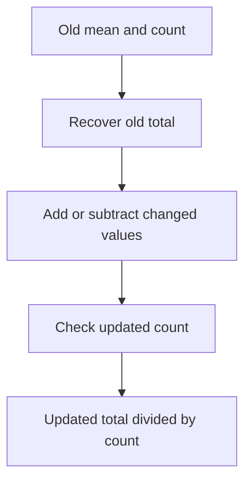

# Averages — study guide

**Study-ready, unattempted.** [30 original questions](../MCQs/08-Averages-30-MCQs.md) · [Reported exam evidence](../Previous-Year-Questions/08-Averages-Reported-Evidence.md). Priorities are editorial, not proof of exam recurrence.

## Mean and total

**Priority:** 🟠 HIGH YIELD | **Difficulty:** 🟡 Medium | **Evidence:** Core aptitude concept.

Average ya arithmetic mean values ko equal weight dene par unka representative central value hai. Agar four observations 10, 12, 15 and 19 hain, total 56 hai aur mean 56/4=14 hai. Mean ka actual dataset mein hona zaroori nahi.

Formula: mean = sum of observations / number of observations. Sum = mean × count. Missing value nikaalne ke liye expected total se known values ka sum subtract karo. Required test score nikaalne mein target count ko target mean se multiply karo, phir previous marks ka total minus karo. Check karo ki required score allowed maximum se exceed na kare.

For equally spaced numbers, mean first aur last value ka arithmetic mean hai. Example five consecutive even numbers 10, 12, 14, 16, 18 ka mean 14 hai. Six equally spaced numbers ka mean central two terms ke beech hota hai.

Practice: original Q1–6, [Q1](../MCQs/08-Averages-30-MCQs.md#q1-five-training-sessions-last-35-42-38-45-and-40-minutes-what-is-their-mean-duration), [Q3](../MCQs/08-Averages-30-MCQs.md#q3-the-mean-of-12-19-24-31-and-x-is-22-find-x).

## Changes and corrections

**Priority:** 🟠 HIGH YIELD | **Difficulty:** 🟡 Medium | **Evidence:** Same question types described in nursing recruitment practice video.

Joining, leaving aur correction ke questions mein pehle mean ko total mein convert karo. Example six members ka mean 20, total 120. New member 34 join kare, total 154 and count 7. New mean 22. Higher than old mean value join kare toh new mean increases.

Agar wrong reading 18 ke place par correct reading 30 hona tha, total mein 12 add karo, count unchanged. Agar n=12, corrected mean old mean se 1 higher hoga. Replacement mein new value minus removed value ka difference total ko adjust karta hai. Count change nahi hota.

Practice: Q7–10. [Q9](../MCQs/08-Averages-30-MCQs.md#q9-the-mean-of-24-recorded-values-is-32-a-value-of-18-was-entered-instead-of-42-what-is-the-corrected-mean).

## Combined and weighted means

**Priority:** 🟠 HIGH YIELD | **Difficulty:** 🔴 Difficult | **Evidence:** Same concept in recruitment practice video.

Do classes ka size unequal ho toh means ka simple average nahi le sakte. Group A mein 10 learners ka mean 40 aur group B mein 30 learners ka mean 60 hai. Combined total 400+1800=2200 aur count 40. Combined mean 55, not 50.

Combined mean = (n1×m1+n2×m2)/(n1+n2). Weighted mean = sum of weight×value divided by sum of weights. Agar weights 30% and 70% hain, scores 80 and 90 ke weighted marks 0.3×80+0.7×90=87 hain. Frequency table mein frequency weights hoti hain. Equal group sizes hone par simple mean of group means valid hai. Unknown group size ko equation bana kar solve karo.

Practice: Q11–17, [Q11](../MCQs/08-Averages-30-MCQs.md#q11-a-class-of-25-learners-averages-64-marks-while-another-class-of-35-averages-76-marks-find-the-combined-mean).

## Transformations and overlapping groups

**Priority:** 🟠 HIGH YIELD | **Difficulty:** 🔴 Difficult | **Evidence:** Directly inspected DSSSB 28 August 2019 shift III third-party reported average item.

Har value ko c se increase karne par mean bhi c se increase hota hai. Har value ko k se multiply karne par mean k times ho jata hai. Linear transformation ax+b ka mean a×old mean+b hota hai.

Overlapping groups mein same observation do baar count ho sakta hai. Example total of seven observations 70, first four total 42, last four total 40. Fourth observation 42+40−70=12. Three pairwise averages mein each person twice counted hai, so pair sums add karke 2 se divide karna overall total deta hai. Whole-number observations mein total bhi integer hona chahiye, so exact fractional mean aur count ka product integer check karna useful hai.

Practice: Q18–25, including [Q20](../MCQs/08-Averages-30-MCQs.md#q20-the-mean-of-ten-observations-is-24-the-mean-of-the-first-six-is-20-and-the-mean-of-the-last-five-is-30-find-the-sixth-observation). [Reported DSSSB example](../Previous-Year-Questions/08-Averages-Reported-Evidence.md#q1-three-workers-have-pairwise-average-monthly-earnings-as-follows-p-and-q-3200-q-and-r-3600-and-r-and-p-3500-what-is-their-combined-monthly-income).

## Average speed

**Priority:** 🟡 IMPORTANT | **Difficulty:** 🔴 Difficult | **Evidence:** Original cross-topic aptitude practice, specific video pending.

Average speed = total distance / total elapsed travel time. Equal distance legs par different speeds ka arithmetic mean incorrect hai. Example 60 km at 30 km/h takes 2 h, another 60 km at 60 km/h takes 1 h. Total 120 km in 3 h, so 40 km/h. Equal time legs mein arithmetic mean valid hai. Unequal time legs mein actual time weight use karo. Q26–27 allocated here and must not be counted twice in speed/time/distance topic.

Practice: bank Q26–27.

## Mixed applications

**Priority:** 🟠 HIGH YIELD | **Difficulty:** 🟡 Medium to 🔴 Difficult | **Evidence:** Original practice.

Average change = total change/count when count fixed. Unknown original count wale problems mein n old count rakho, old sum n×old mean, then added observations include karke equation banao. Always check final total and denominator. Real clinical data require attention to missing values, units, skew and measurement quality. Average does not establish clinical safety or individual patient status. Statistical median, mode, distribution and dispersion will be covered independently in research/statistics.

Practice: Q28–30.

## References and video mapping

[OpenStax Prealgebra 2e — Averages and Probability](https://openstax.org/books/prealgebra-2e/pages/5-5-averages-and-probability) · [OpenStax Introductory Statistics 2e — Measures of Center](https://openstax.org/books/introductory-statistics-2e/pages/2-5-measures-of-the-center-of-the-data).

[Nursing Wallah by PW — RRB Nursing Superintendent Non Nursing Part 8](https://www.youtube.com/watch?v=bJa1CQ16A24), published 16 February 2026. Indexed timestamps: required marks 4:10, mean formula 5:04, weighted average 7:50, missing observations 10:34, corrections 13:48, joining/leaving 16:35. Description inspected. Full playback and exact historical question provenance not authenticated.
