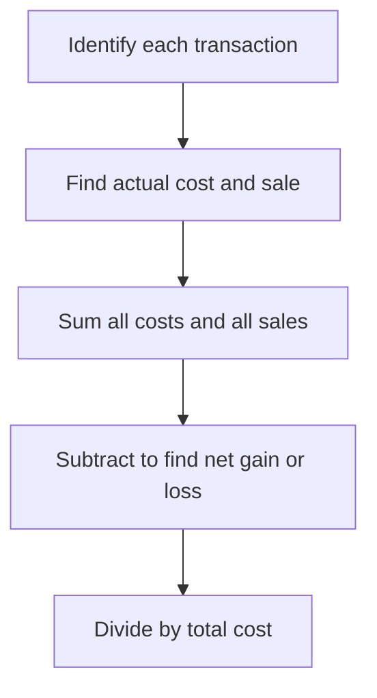

# Profit and loss — concepts and exam practice

**Study-ready, unattempted.** [30 original MCQs](../MCQs/09-Profit-and-Loss-30-MCQs.md) · [Reported evidence](../Previous-Year-Questions/09-Profit-and-Loss-Reported-Evidence.md). Editorial priority is not proof of frequency.

## Cost selling price and profit bases

**Priority:** 🟠 HIGH YIELD | **Difficulty:** 🟡 Medium | **Evidence:** Core aptitude and related reported exam concepts.

Cost price (CP) actual outlay hai. Selling price (SP) sale par received amount hai. Agar SP greater than CP hai toh gain, agar SP less than CP hai toh loss. Profit percentage usually CP par calculate hota hai. Example CP ₹200, SP ₹250. Gain ₹50, profit rate 50/200×100=25%. Agar question profit margin on sale poochta hai, denominator ₹250 hoga, so 20%. Dono rates different hain.

| Result | Formula |
|---|---|
| Gain | SP − CP |
| Loss | CP − SP |
| Profit percent | Gain/CP × 100 |
| Loss percent | Loss/CP × 100 |
| Selling-price margin | Gain/SP × 100 |

For profit p%, SP=CP(1+p/100). For loss l%, SP=CP(1−l/100). Reverse calculation mein corresponding factor se divide karo. CP positive hona chahiye.

Practice: [Q1](../MCQs/09-Profit-and-Loss-30-MCQs.md#q1-an-item-costs-640-and-sells-for-736-what-is-the-profit-percentage), Q1–7. Historical reverse-price reports in evidence Q1–2.

## Unit cost and expenses

**Priority:** 🟠 HIGH YIELD | **Difficulty:** 🟡 Medium | **Evidence:** Reported DSSSB unit-price question.

Agar 12 identical articles ₹360 mein kharide, cost per article ₹30. Selling price per article ₹36 ho toh gain ₹6 or 20%. Quantity units same rakho. Repair, packaging and transport ko total cost mein include karo when question defines them as part of outlay. Example purchase ₹300, repairs ₹40, transport ₹10 gives cost ₹350. Sale ₹420 gives gain ₹70 on ₹350 or 20%.

Practice: [Q9](../MCQs/09-Profit-and-Loss-30-MCQs.md#q9-a-seller-buys-25-identical-folders-for-1000-and-sells-all-at-48-each-find-the-total-gain-rate), Q8–11. Reported DSSSB evidence Q3.

## Combined transactions

**Priority:** 🟠 HIGH YIELD | **Difficulty:** 🔴 Difficult | **Evidence:** General competitive aptitude practice.

Always total cost and total receipts separately add karo. Example equal costs ₹100 each, one gain 20% and other loss 10%. Combined sales ₹120+₹90=₹210, overall gain 5%. Equal selling prices mein cost different hota hai. Example both sell ₹120, one at +20% and one at −20%. Costs ₹100 and ₹150, total cost ₹250 versus sales ₹240, loss 4%. Equal percentage gain and loss on equal selling prices yields loss p²/100 percent. Formula only under those conditions.

Practice: Q12–17, [Q13](../MCQs/09-Profit-and-Loss-30-MCQs.md#q13-two-items-sell-for-960-each-one-is-sold-at-20-gain-the-other-at-20-loss-what-is-the-overall-result). Exact historical matches pending.

## Reverse and changing cost

**Priority:** 🟠 HIGH YIELD | **Difficulty:** 🔴 Difficult | **Evidence:** Related RRB and ESIC reported items.

If price ₹360 gives 10% loss, CP=360/0.9=400. Target 15% profit ke liye SP=400×1.15=460. Present sale se increase ₹100 hoga. If two selling prices give equal absolute gain and loss, CP midpoint hota hai. When cost changes, recalculate denominator rather than subtract rates. Sequential resales mein each trader ka purchase cost previous trader ki sale price hai.

Practice: Q18–22, [Q18](../MCQs/09-Profit-and-Loss-30-MCQs.md#q18-a-seller-would-earn-150-more-if-the-profit-rate-rose-from-10-to-25-on-the-same-cost-find-the-cost).

## Inventory and net gain

**Priority:** 🟡 IMPORTANT | **Difficulty:** 🔴 Difficult | **Evidence:** Original arithmetic applications.

Spoiled goods bhi purchase cost ka part hain if no salvage value. If 20 items cost ₹400 total and only 16 sellable, break-even per sellable item ₹25 hai. To gain 10%, target total receipts ₹440 hai. For weighted portions use actual cost proportions. Net profit includes relevant fees and expenses only as defined by problem.

Practice: Q23–28.

## Fees and base comparison

**Priority:** 🟡 IMPORTANT | **Difficulty:** 🔴 Difficult | **Evidence:** Original arithmetic applications.

Commission on sales is a deduction from receipts. Net gain calculation mein first commission nikaalo, then cost subtract karo. Equal rupee profit different costs par equal percentage profit nahi hota. A ₹50 gain on ₹200 is 25%, but on ₹250 is 20%. These are nonclinical exam arithmetic examples.

Practice: Q29–30.

## Sources and video mapping

[OpenStax Prealgebra 2e — percent applications](https://openstax.org/books/prealgebra-2e/pages/6-3-solve-sales-tax-commission-and-discount-applications).

[CareerRide — Profit and Loss: Shortcuts & Tricks for Placement Tests, Job Interviews & Exams](https://www.youtube.com/watch?v=T2odvmxqi1I), 16 May 2017. Indexed description: formula 0:44, changed sale target 8:00, unit rates 11:23, equal selling prices 22:53, weighted transactions 26:46, resales 30:57, article counts 49:27. [RRB Nursing Superintendent Non Nursing Part 11](https://www.youtube.com/watch?v=4rLmUCAqhQo&t=1670s), indexed 27:50 article-count profit/loss problem. Nursing Wallah attribution from hashtags, direct retrieval failed. These are practice leads, not authenticated PYQ footage. Playback pending.
