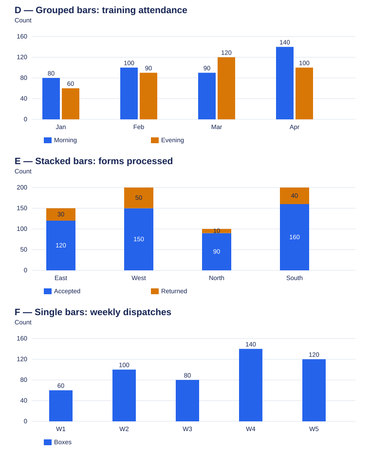

# 📚 Data interpretation — tables and bar charts

**Study-ready, not yet studied.** [Chapter](../README.md) · [30 MCQs](../MCQs/17-Data-Interpretation-Tables-and-Bar-Charts-30-MCQs.md) · [Previous Year Questions](../Previous-Year-Questions/17-DI-Tables-and-Bar-Charts-Reported-Evidence.md)

[Tables and denominators](#tables-and-denominators) · [Bar charts](#bar-charts) · [Common traps](#common-traps)

## Tables and denominators

**Priority:** 🔴 MOST IMPORTANT

Data interpretation ka matlab hai di hui information ko padhkar sahi meaning aur numerical answer nikaalna. Exam mein har number ko use karna zaroori nahi hota. Pehle question padho, phir heading, row, column aur unit dekho. Agar table mein count thousands mein hai, toh actual count ke liye 1000 se multiply karna padega. Agar ratio poocha hai aur dono values same unit mein hain, toh unit factor cancel ho jaata hai.

Socho do training centres ke fictional results hain:

| Centre | Registered | Appeared | Passed |
|---|---:|---:|---:|
| X | 200 | 160 | 96 |
| Y | 120 | 100 | 80 |

X ka attendance rate 160/200×100=80% hai. Pass rate among appeared 96/160×100=60% hai. Registered candidates mein pass percentage 96/200×100=48% hai. Teen answers alag hain kyunki denominator alag hai.

Overall pass rate ke liye total passes 176 aur appeared 260 hain. 176/260×100=67.69% approximately hai. Individual rates 60% aur 80% ka simple average 70% hai, jo overall rate nahi hai. Dono centres mein candidates equal nahi hain.

| Asked quantity | Calculation |
|---|---|
| Total | Relevant entries ka sum |
| Difference | Larger − smaller |
| Ratio | Same unit mein values simplify karo |
| Percentage share | Part / relevant total × 100 |
| Percentage change | (New − old) / old × 100 |
| Percentage-point difference | Do percentages ka direct difference |

Inventory table mein closing balance = opening + received − issued. Agar opening 80 aur received 40 hai toh available stock 120 hai. Issued 90 ho toh closing 30 hai. Target 50 ho toh shortage 20 hai. Surplus ko shortage ke saath net karna hai ya nahi, question decide karta hai.

Per-day productivity mein total output ko operating days se divide karo. Agar multiple sites alag days operate karti hain, toh pooled per-site-day rate = total visits / total site-days. Ye real-world staff productivity judgement nahi hai. Ye sirf arithmetic model hai.

**Practice:** Q1–15 in [original bank](../MCQs/17-Data-Interpretation-Tables-and-Bar-Charts-30-MCQs.md).
**Teaching:** [Career Definer — Kaushik Mohanty, basic concepts 01:55 and data table 21:00](https://www.youtube.com/watch?v=f_81iD62SWU&t=1260s). **▶️ [YouTube MCQ practice — Sanjay Sir, Advance Global Study](https://www.youtube.com/watch?v=LP5ZP87cBuI)**. Description names table questions, percentages and ratios. Exact item and playback pending.

## Bar charts

**Priority:** 🟠 HIGH YIELD

Bar chart mein categories ko alag bars se compare karte hain. Bar ki height ya length value batati hai. Vertical axis ka unit aur interval pehle check karo. Grouped bar mein ek category ke andar multiple separate bars hain. Stacked bar mein individual segments ek doosre ke upar hain. Total height sab segments ke sum ko represent karti hai, jab graph counts dikhata hai.

Ye charts original fictional practice datasets se banaye gaye hain. Exact values MCQ bank ke D–F tables mein bhi available hain. Grouped chart mein January ki morning 80 aur evening 60 hai. Total 140 hai. April ka total 140+100=240 hai. January se April increase 100/140×100=71.43% hai. 100 ko 240 se divide karna different denominator hoga.

Stacked chart mein West office ke 150 accepted aur 50 returned forms hain. Total 200 hai. Returned rate 50/200×100=25% hai. Segment ki height 50 aur upper boundary 200 ko confuse mat karo.

Single bar chart mein zero baseline se bar height actual count ke proportional hoti hai. Agar axis 50 se start ki jaaye toh 60 aur 140 counts ki displayed heights 10 aur 90 hongi. Actual values ka ratio 140:60=7:3 hai lekin displayed heights ka ratio 9:1 hai. Isliye axis truncate hone se difference visually exaggerated lag sakta hai.

**Practice:** Q16–30. **Teaching:** [Career Definer — bar graph chapter 34:40](https://www.youtube.com/watch?v=f_81iD62SWU&t=2080s). **▶️ [YouTube MCQ practice — Advance Global Study, bar graph DI](https://www.youtube.com/watch?v=LP5ZP87cBuI)**. Published description confirms bar questions, not exact items. Q30 truncated-axis practice video verification pending.

## Common traps

- Strictly above mean mein equal value count nahi hoti.
- Overall return rate = total returned / total processed.
- If maximum allowed count fractional ho, upper limit ko floor karo. 97.5 forms maximum ka matlab at most 97 whole forms.
- Percentage point aur relative percentage change alag hain. 40% se 50% change 10 points aur 25% relative increase hai.
- Total, average, rate, share aur growth mein se exactly kya poocha hai, woh identify karo.

## ▶️ Sources and verification

[OpenStax — line and bar graphs](https://openstax.org/books/statistics/pages/2-1-stem-and-leaf-graphs-stemplots-line-graphs-and-bar-graphs) and [OpenStax — chart selection](https://openstax.org/books/principles-data-science/pages/10-1-writing-an-informative-report) search extracts support graph types. [DSSSB official question bank listing](https://dsssb.delhi.gov.in/doit/tab-content/question-bank-online-exam-2019?page=3) indexed Nursing Officer papers but direct listing timed out. [DSSSB Nursing Officer syllabus summary](https://testbook.com/dsssb-nursing-officer/syllabus-exam-pattern) lists data interpretation. Exact current NORCET subtopic weights are not established.

Video descriptions and teaching chapter times checked on 27 November 2026. Full playback, transcripts and exact-item timestamps not verified. These general aptitude videos do not authenticate nursing exam provenance.

[Chapter](../README.md) · [MCQs](../MCQs/17-Data-Interpretation-Tables-and-Bar-Charts-30-MCQs.md) · [Previous Year Questions](../Previous-Year-Questions/17-DI-Tables-and-Bar-Charts-Reported-Evidence.md)
