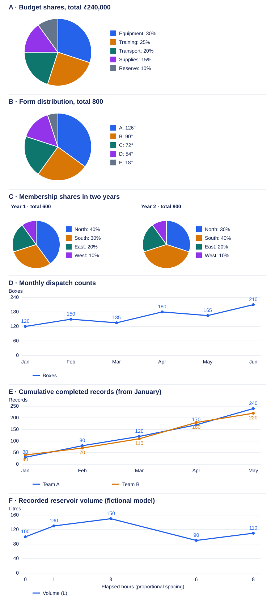

# 📚 Data interpretation — pie charts and line graphs

**Study-ready, not yet studied.** [Chapter](../README.md) · [30 original MCQs](../MCQs/18-Data-Interpretation-Pie-Charts-and-Line-Graphs-30-MCQs.md) · [Previous Year Questions](../Previous-Year-Questions/18-DI-Pie-Charts-and-Line-Graphs-Reported-Evidence.md)

[Pie charts](#pie-charts) · [Line graphs](#line-graphs) · [Common traps](#common-traps)

## Pie charts

**Priority:** 🔴 MOST IMPORTANT

Pie chart ek circle hai jismein poore total ko alag portions mein dikhaya jaata hai. Jaise pizza ko slices mein divide karte hain, waise har sector poore total ka ek hissa represent karta hai. Full circle 360° hota hai aur total share 100% hota hai. Agar ek sector 25% ka hai, toh uska angle 25/100×360=90° hoga.

Upar ke charts fictional practice data se banaye gaye hain. Exact numbers MCQ bank ke tables A–F mein bhi hain. Pehle total dekho, phir sector percentage ya angle identify karo.

| Required quantity | Formula |
|---|---|
| Count from percentage | Total × share/100 |
| Count from angle | Total × angle/360 |
| Angle from percentage | Share × 3.6 |
| Percentage from angle | Angle/360 × 100 |
| Total from known count and share | Count / decimal share |

Example: 800 archived forms mein A ka angle 126° hai. A ka share 126/360=0.35 hai, toh 800×0.35=280 forms hain. B ka angle 90° hai, toh 200 forms hain. A aur B ke beech difference 80 forms hai.

Agar 40 forms remove kiye jaate hain, toh new total 760 ho jaata hai. Original C count 160 unchanged hai. Lekin share ab 160/760×100=21.05% hai. Purana percentage directly use nahi kar sakte kyunki denominator badal gaya.

### Comparing two pie charts

Agar Year 1 mein 600 memberships hain aur North ka share 40% hai, toh count 240 hai. Year 2 mein total 900 aur North ka share 30% hai. Count 270 hai. Share 10 percentage points gira lekin actual count 30 badha. Isliye sirf pie slice ki size dekhkar actual count increase ya decrease decide nahi karna.

Agar dono years ka total combine karna hai, toh counts add karke combined total se divide karo. Unequal totals ke percentages ka unweighted average lena generally correct nahi hai.

### Reverse calculation from sector difference

Agar do sectors ka difference 12% of total hai aur unke amounts mein ₹36,000 difference hai, toh total = 36000/0.12 = ₹300,000 hai. Kisi third sector ka amount 20% ho toh 300000×0.20=₹60,000 hai. Ye approach [reported DSSSB pie-chart adaptation](../Previous-Year-Questions/18-DI-Pie-Charts-and-Line-Graphs-Reported-Evidence.md) mein bhi useful hai.

**Practice:** Q1–15. **Teaching:** [Career Definer — Kaushik Mohanty, pie chart chapter 58:25](https://www.youtube.com/watch?v=f_81iD62SWU&t=3505s). **▶️ [MCQ practice — Sanjay Sir, Advance Global Study](https://www.youtube.com/watch?v=LP5ZP87cBuI)**. Published description confirms pie-chart questions, percentage and ratio practice. Exact item and playback pending.

## Line graphs

**Priority:** 🔴 MOST IMPORTANT

Line graph mein ordered observations ko points ke through show karte hain aur points ko lines se connect karte hain. Horizontal axis usually time hoti hai aur vertical axis measured value hoti hai. Line ki direction se recorded increase ya decrease samajh aata hai. Lekin graph ki connecting line hamesha actual continuous measurement nahi hoti. Agar data sirf monthly hai, toh beech ke din ki exact value bina extra information ke pata nahi chalti.

Monthly dispatch data mein January 120 boxes aur June 210 boxes hain. Net increase 90 hai. Percentage increase 90/120×100=75% hai. Agar February se March decrease hai, toh is interval ka change negative hoga. Net change aur total absolute change alag quantities hain.

### Cumulative versus period-specific counts

Cumulative count beginning se particular date tak ka running total hota hai. Agar January-end 30 aur February-end 80 records hain, toh February alone mein 80−30=50 records complete hue. January aur February cumulative values add karna double counting hoga.

Multiple teams mein combined monthly output ke liye har team ka monthly difference nikaal kar add karo. Final cumulative totals ko add karne se final overall count milta hai, lekin intermediate cumulative totals ka sum total production nahi hota.

### Rate and time spacing

Agar time intervals unequal hain, toh sirf vertical change compare karna rate compare karne ke barabar nahi hai. Rate = change in value / elapsed time. Fictional reservoir dataset mein hour 1 par 130 L aur hour 3 par 150 L hai. Average rate 20/2=10 L/hour hai. Hour 3 se 6 tak average rate (90−150)/3=−20 L/hour hai.

Agar explicitly linear change assume kiya gaya hai, toh hour 4.5 midpoint par estimated volume 150−20×1.5=120 L hoga. Bina linear assumption ke exact 120 L establish nahi hota. Original chart mein irregular time spacing actual elapsed hours ke proportional hai.

**Practice:** Q16–30. **Teaching:** [Career Definer — line graph chapter 46:20](https://www.youtube.com/watch?v=f_81iD62SWU&t=2780s). **▶️ [MCQ practice — Advance Global Study, line graph DI](https://www.youtube.com/watch?v=LP5ZP87cBuI)**. Broad topic-level description confirms line graph questions. Dedicated interpolation and limits-of-inference practice video verification pending for Q28 and Q30.

## Common traps

- Pie shares add to 100% or angles add to 360° for a complete partition.
- Pie chart mein categories mutually exclusive honi chahiye. Overlapping categories ka pie misleading ho sakta hai.
- Share change ko count change mat samjho.
- Rate calculations mein correct time difference aur units use karo.
- Net change = end − start. Total absolute change = consecutive changes ke absolute magnitudes ka sum.
- Cumulative graph mein period-only output ke liye consecutive cumulative totals subtract karo.
- Interpolation aur extrapolation recorded fact nahi hain jab tak assumption aur model stated na ho.

## ▶️ Research and verification

[OpenStax — data and sampling, bar and pie charts](https://openstax.org/books/statistics/pages/1-2-data-sampling-and-variation-in-data-and-sampling) and [OpenStax — chart selection](https://openstax.org/books/principles-data-science/pages/10-1-writing-an-informative-report) indexed content supports visual selection. [OpenStax — line graphs](https://openstax.org/books/statistics/pages/2-1-stem-and-leaf-graphs-stemplots-line-graphs-and-bar-graphs) supports line graph basics. Historical DSSSB pie question report directly retrieved on 27 November 2026. Official key and original chart image not independently authenticated.

Video titles, descriptions, creator and published teaching chapter times checked. Full playback, transcripts and exact-question timestamps remain pending. General aptitude video is not proof of nursing exam appearance. This topic allocation is editorial, not an official NORCET weightage claim.

[Chapter](../README.md) · [MCQs](../MCQs/18-Data-Interpretation-Pie-Charts-and-Line-Graphs-30-MCQs.md) · [Previous Year Questions](../Previous-Year-Questions/18-DI-Pie-Charts-and-Line-Graphs-Reported-Evidence.md)
