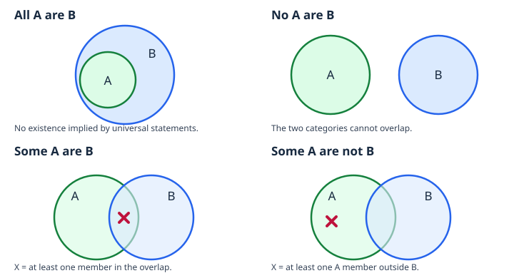

# 📚 Syllogism — statements, conclusions and possibility

**Study-ready, not yet studied.** [Chapter](../README.md) · [30 original MCQs](../MCQs/25-Syllogism-30-MCQs.md) · [Previous Year Questions](../Previous-Year-Questions/25-Syllogism-Reported-Evidence.md)

[Necessary conclusions](#necessary-conclusions) · [Possibility and impossibility](#possibility-and-impossibility) · [Only and only a few](#only-and-only-a-few) · [Mixed constraints](#mixed-constraints) · [Quick revision](#quick-revision)

## Necessary conclusions

**Priority:** 🔴 MOST IMPORTANT

Syllogism mein statements ko true maan kar conclusion check karte hain. Statement ek information hai jo question ne di hai. Conclusion woh nayi information hai jo us statement se logically nikal sakti hai. Real-life knowledge se answer mat choose karo. Agar question kahe ki all pens are bags, toh reasoning ke liye us relation ko true maanna hai, chahe real life mein aisa na ho.

Ek set ko objects ka group samjho. A ke andar jo objects hain woh A category ke members hain. Agar A ka har member B mein bhi hai, toh A ko B ke andar dikhate hain.



Diagram mein red X ek object ka hona confirm karta hai. Sirf circles draw karne se unmein object hona confirm nahi hota. Some ka matlab at least one hai. Universal statement All ya No apne aap category ke existence ko prove nahi karti. Is bank mein modern set-logic convention use hui hai. Kuch competitive exam solutions category existence assume karte hain. Jab question ye convention specify kare, uske according solve karo.

| Statement | Meaning | Reverse |
|---|---|---|
| All A are B | A ka har member B hai | All B are A zaroori nahi |
| No A are B | A aur B ka koi common member nahi | No B are A |
| Some A are B | Kam se kam ek common member hai | Some B are A |
| Some A are not B | Kam se kam ek A member B ke bahar hai | Some B are not A zaroori nahi |

Example: All A are B. All B are C. Toh all A are C. A ko B ke andar aur B ko C ke andar rakho. Ab A ke kisi member ka C ke bahar hona possible nahi. Lekin some C are A tab guaranteed hai jab A ke existence ka proof bhi ho.

Example: Some A are B. No B are C. Jo member A aur B dono mein hai, woh C mein nahi ho sakta. Isliye some A are not C follow karta hai. No A are C zaroori nahi, kyunki A ka additional member C mein ho sakta hai.

**Practice:** Q1–10. [NVS 2019 report and existence caveat](../Previous-Year-Questions/25-Syllogism-Reported-Evidence.md).

## Possibility and impossibility

**Priority:** 🔴 MOST IMPORTANT

Necessary conclusion har possible valid arrangement mein true hota hai. Possible conclusion ke liye bas ek arrangement chahiye jahan statements aur conclusion ek saath true ho sakein. Impossible conclusion kisi bhi valid arrangement mein true nahi ho sakta.

Socho No A are B aur No B are C diya hai. A aur C dono B ke bahar hain, lekin ek doosre se overlap kar sakte hain. Some A are C possible hai, necessary nahi. Ek arrangement mein A aur C same object ko contain karte hain. Doosre arrangement mein A aur C alag objects rakhte hain. Dono statements follow karte hain.

Counterexample ka matlab ek aisi valid arrangement jisme statements true hain lekin proposed conclusion false hai. Necessary conclusion ko reject karne ke liye sirf ek counterexample kaafi hai.

**Practice:** Q11–15. Q23–30 mein mixed examples bhi hain.

## Only and only a few

**Priority:** 🟠 HIGH YIELD

Only A are B ka direction dhyan se samjho. Iska meaning all B are A hai. Example: Only registered participants are badge holders. Har badge holder registered hai, lekin har registered participant ke paas badge hona zaroori nahi.

Only a few A are B ko is bank mein two conditions ki tarah define kiya gaya hai. Some A are B AND some A are not B. Iska matlab A mein ek member B ke andar aur kam se kam ek member B ke bahar hai. Isse some B are not A prove nahi hota.

```text
Only a few A are B:
A region outside B       A and B overlap
        X1                       X2
Both witnesses must exist.
```

Agar only a few A are B aur all B are C diya ho, toh overlap witness X2 C mein bhi hoga. X1 ka C se relation unknown hai. Isliye some A are C certain hai, some A are not C certain nahi.

**Practice:** Q16–22.

## Mixed constraints

**Priority:** 🟠 HIGH YIELD

Jab three ya four categories di hui hain, tab pehle universal constraints mark karo. Fir particular statements ke required witnesses mark karo. Some A are B aur Some B are C mein dono X same member ho sakte hain, lekin same hona zaroori nahi. Isliye some A are C automatically follow nahi karta.

All A are B aur All B are A ka matlab A aur B sets exactly equal hain. Isse A aur B non-empty hona prove nahi hota. Agar some A are C bhi diya ho, tab same witness B aur C mein bhi milega.

Either-or questions mein exam instruction carefully padho. All A are B aur Some A are not B exact logical complements hain. No A are B aur Some A are B bhi complements hain. Dono ek saath true nahi ho sakte aur dono ek saath false nahi ho sakte. Lekin do arbitrary conclusions ka individually unproven hona unko either-or pair nahi banata.

**Practice:** Q23–30. New bank ke har answer ko allowed set-membership arrangements se check kiya gaya hai. Wrong necessary conclusions ke liye valid counterexample diya gaya hai. Possible ya impossible conclusion ko consistency se check kiya gaya hai.

## ▶️ Teaching and practice video status

| Topic | Teaching resource | Question practice |
|---|---|---|
| Set relations and Venn method | [Categorical logic teaching text, UC Berkeley](https://www.stat.berkeley.edu/~stark/SticiGui/Text/categoricalLogic.htm). Specific teaching video pending. | [Parcham Classes — Syllogism, Either-Or, Only & Only a Few Cases](https://www.youtube.com/watch?v=Xg8MmpyL_yk), indexed description-level practice lead |
| Possibility and cannot follow | [Parmar SSC, Kamal Sir — possibility and can-never concept](https://www.youtube.com/watch?v=vTsQobo6LC8), indexed description | Same description lists detailed question practice. Exact item pending. |
| Only and only a few, mixed cases | Parcham Classes video above lists these cases in its title | Question practice listed in indexed description. Specific items not observed. |

Checked 27 November 2026. Direct YouTube reopen failed for Parcham video. Exact playback, language, duration and question timestamps are unverified. General aptitude videos are not evidence of nursing exam appearances.

## Quick revision

All mein direction reverse mat karo. Some mein at least one witness hota hai. No overlap symmetric hai. Necessary, possible aur impossible ko separate rakho. Category non-empty assumption ko silently add mat karo.

[Chapter](../README.md) · [MCQs](../MCQs/25-Syllogism-30-MCQs.md) · [Previous Year Questions](../Previous-Year-Questions/25-Syllogism-Reported-Evidence.md)
