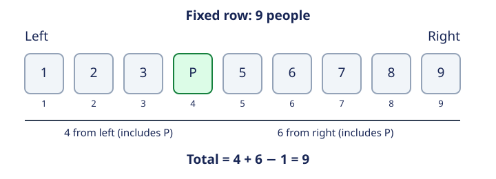

# 📚 Ordering and Ranking — position, order and changes

**Study-ready, not yet studied.** [Chapter](../README.md) · [30 original MCQs](../MCQs/26-Ordering-and-Ranking-30-MCQs.md) · [Previous Year Questions](../Previous-Year-Questions/26-Ordering-and-Ranking-Reported-Evidence.md)

[Rank and between count](#rank-and-between-count) · [Swaps and changing queues](#swaps-and-changing-queues) · [Relative order](#relative-order) · [Special cases and sufficiency](#special-cases-and-sufficiency) · [Quick revision](#quick-revision)

## Rank and between count

**Priority:** 🔴 MOST IMPORTANT

Rank ka matlab kisi fixed reference se position hai. Jaise examination marks ki list mein highest scorer ka rank 1 hai. Queue mein front se first person ka position 1 hai. Left aur right se rank count karte waqt jis person ke baare mein question hai usko bhi include karte hain. Ahead ya behind logon ki count mein us person ko include nahi karte.



P left se fourth hai aur right se sixth hai. Dono counts mein P included hai. Isliye total 4 + 6 − 1 = 9 hai.

| Given | Formula |
|---|---|
| Same person's left rank L and right rank R | Total N = L + R − 1 |
| Total N and left rank L | Right rank R = N − L + 1 |
| People ahead a and behind b | N = a + b + 1 |
| Two distinct left positions p and q | Strictly between = absolute difference of p and q − 1 |
| Odd total N | Unique middle rank = (N + 1)/2 |
| Even total N | Central ranks = N/2 and N/2 + 1 |

Example: 32 people ki row mein A left se 6th aur B right se 9th hai. B ka left rank 32 − 9 + 1 = 24 hai. A aur B ke strictly beech 24 − 6 − 1 = 17 people hain. Rank difference 18 hai, lekin strictly between ka answer 17 hai.

Agar total unknown ho aur dono alag logon ke ranks opposite ends se diye hon, unko seedha add mat karo. Pehle gap aur order establish karo. Maan lo A left se 10th aur B right se 8th hai. A aur B ke beech 3 people hain. B ka left rank 10 + 4 = 14 ya 10 − 4 = 6 ho sakta hai. Total respectively 21 ya 13 hai. Agar B A ke right mein diya hai toh sirf 21 valid hai.

**Practice:** Q1–10. [DSSSB 2019 reported rank question](../Previous-Year-Questions/26-Ordering-and-Ranking-Reported-Evidence.md).

## Swaps and changing queues

**Priority:** 🔴 MOST IMPORTANT

Swap mein do log apni positions exchange karte hain. Row ka total same rehta hai. A agar position 5 par tha aur B position 18 par tha, swap ke baad A 18 par aur B 5 par hoga. Jab opposite rank nikalna ho toh new position use karo.

Original schematic, fixed left-to-right reference:

```text
Before:  [A at 5] ----------- [B at 18]
After:   [B at 5] ----------- [A at 18]
Total unchanged. A moves 13 positions.
```

Queue mein additions aur departures total ko change kar sakte hain. Agar R front se 12th hai aur uske ahead 4 log chale jaate hain, R new 8th hoga. Agar 2 naye log uske behind join karte hain, front rank 8 hi rahega. Back rank nikalne ke liye updated total use karna hoga.

Person ko ek jagah se doosri jagah shift karna aur row se leave karna alag hai. Agar 3 ahead wale log back mein shift ho jaayein, total unchanged hai lekin target ka front rank 3 se improve hoga.

**Practice:** Q11–17. [NVS Staff Nurse 2018 reported interchange question](../Previous-Year-Questions/26-Ordering-and-Ranking-Reported-Evidence.md).

## Relative order

**Priority:** 🟠 HIGH YIELD

Har statement ko comparison arrow mein badlo. Highest se lowest order mein greater-than sign use kar sakte ho. Agar P Q se taller hai aur Q R se taller hai, P > Q > R. Is chain mein P R se bhi taller hoga.

Kabhi full chain nahi banti. Agar A > B aur C > D diya hai, A aur C ka relation unknown hai. A > B > C > D bhi possible hai aur C > D > A > B bhi. Koi ek diagram bana kar unknown comparison ko definite mat maan lo.

Worst possible rank nikalne ke liye target ke upar jitne log allowed hain unko place karo. Best possible rank nikalne ke liye target ke upar sirf compulsory log rakho. Example: six distinct ranks mein X ke upar A aur B fixed hain aur X ke neeche Y fixed hai. Remaining two log unknown hain. Best rank 3 hai aur worst rank 5 hai, jab tak koi aur restriction nahi hai.

**Practice:** Q18–25.

## Special cases and sufficiency

**Priority:** 🟠 HIGH YIELD

Rank hamesha integer hota hai. Agar two positions 3 aur 8 ke exactly midpoint par third person hona chahiye, midpoint 5.5 aata hai. Is condition ko integer-position row mein fulfil nahi kar sakte. Agar question simply beech mein poochta hai, positions 4, 5, 6 aur 7 allowed hain. Exactly midway ka meaning alag hai.

Ties ke liye question ka convention check karo. Standard competition ranking mein scores 90, 85, 85, 70 ke ranks 1, 2, 2, 4 hote hain. Dense ranking mein ranks 1, 2, 2, 3 hote hain. Jab tie convention specified nahi ho toh unique answer assume mat karo.

Data sufficiency ka matlab required answer ko determine karne ke liye information enough hai ya nahi. Sirf lower bound milne se total uniquely determine nahi hota. Example: A left se 8th hai aur B right se 6th hai. A B ke left hai, lekin gap unknown hai. Isse total ka minimum milta hai, exact total nahi. Agar adjacent bhi diya jaaye toh B left se 9th hai aur total 14 hai.

**Practice:** Q26–30.

## ▶️ Teaching and question practice

| Topic | Teaching | Dedicated practice |
|---|---|---|
| Basic rank and between counts | [Parcham Classes, Ankit Garg Sir — Order ranking reasoning](https://www.youtube.com/watch?v=40WJdU4Cvew), indexed description | [Parcham Classes — Order Ranking: Queue, Row, Interchange & Competition Based Questions](https://www.youtube.com/watch?v=vJIKOlIeBFY), Q1–10 broad coverage |
| Swaps and queue changes | [S Chand Academy — Ranking and Position Part 1](https://www.youtube.com/watch?v=vKJYawFjZk0), indexed position-interchange description | Parcham question-practice link above, Q11–17 |
| Relative order | [SATHEE analytical reasoning](https://sathee.iitk.ac.in/sathee-railway-exams/student-corner/topic-wise-practice/reasoning/analytical-reasoning/) | Parcham order ranking question-practice lead, Q18–26 |
| Special cases | Specific video not verified | Q27–30 specific practice pending |

Indexed descriptions checked 27 November 2026. Direct playback and exact question mapping are not verified. Teaching-only resources are not counted as question practice. General reasoning videos do not authenticate nursing examination appearances.

## Quick revision

Same person ke opposite ranks add karke 1 subtract karo. Between ke liye ranks same end se lo. Swap mein total unchanged hai. Queue change mein updated total aur target ki updated position separately check karo. Unknown comparison ko assume mat karo. Ties aur rank conventions padho.

[Chapter](../README.md) · [MCQs](../MCQs/26-Ordering-and-Ranking-30-MCQs.md) · [Previous Year Questions](../Previous-Year-Questions/26-Ordering-and-Ranking-Reported-Evidence.md)
