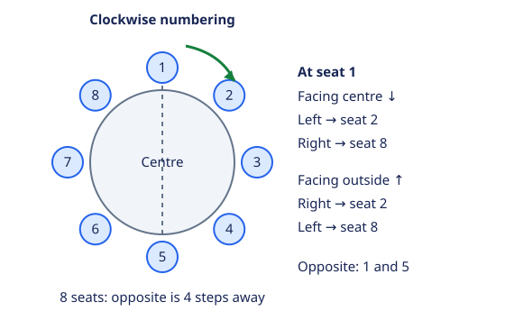

# 📚 Circular Seating Arrangement

**Study-ready, not yet studied.** [Chapter](../README.md) · [30 MCQs](../MCQs/28-Circular-Seating-Arrangement-30-MCQs.md) · [Previous Year Questions](../Previous-Year-Questions/28-Circular-Seating-Arrangement-Reported-Evidence.md)

[Clockwise numbering](#clockwise-numbering) · [Inward and outward facing](#inward-and-outward-facing) · [Opposite seats and arcs](#opposite-seats-and-arcs) · [Multiple arrangements](#multiple-arrangements)

## Clockwise numbering

**Priority:** 🔴 MOST IMPORTANT

Circular seating mein sab people ek round table ke around baithte hain. Straight line ki tarah fixed extreme left aur right ends nahi hote. Pehle ek person ko top par fix kar do. Baaki seats ko clockwise number karo. Agar eight seats hain toh 1 se 8 tak number honge. Seat 8 ke baad clockwise seat 1 aayegi. Seat 1 se anticlockwise ek step seat 8 par jaata hai.

Example: P seat 1 par hai, Q P se third clockwise hai. Q seat 4 par hoga. R Q se second anticlockwise hai, toh R seat 2 par hoga. Number 1 ko starting reference samjho. Starting seat ko ek movement step mat count karo.

## Inward and outward facing

**Priority:** 🔴 MOST IMPORTANT

Centre-facing person ka face table ke centre ki taraf hota hai. Agar woh top seat par hai toh neeche ki taraf face kar raha hai. Uska personal left page-right ki taraf hai. Top se page-right clockwise direction hoti hai. Isliye inward facing left clockwise aur right anticlockwise hai.

Outside-facing person centre se door face karta hai. Top seat par woh page ke upar face karega. Isliye personal right clockwise aur left anticlockwise hai. Mixed facing mein jis person ke respect mein relation poochha hai usi ki facing use karo.

| Reference person | Personal left | Personal right |
|---|---|---|
| Inward facing | Clockwise | Anticlockwise |
| Outward facing | Anticlockwise | Clockwise |

Example: Eight seats mein A seat 7 par centre face kar raha hai. B uske third left par hai. Seat 7 se clockwise steps 8, 1, 2 hain. B seat 2 par hai. Agar A outside face karta toh third left seat 4 hoti. Clue ka answer facing badalne se change hota hai.

**Practice:** Q1–9, Q19–21 and Q28–30.

## Opposite seats and arcs

**Priority:** 🟠 HIGH YIELD

Equally spaced circle mein even number of seats ho toh exact opposite seat hoti hai. Eight seats mein four steps ka gap hai. Six seats mein three steps. Seven seats mein exact diametrically opposite numbered seat nahi hoti. Agar odd-seat puzzle opposite word use kare toh geometry ya definition clarify honi chahiye.

Clockwise count aur shorter arc count alag ho sakte hain. Example: Eight-seat circle mein seat 2 se seat 7 clockwise jaane par five steps hain. Anticlockwise three steps hain. Clockwise strictly between four seats hain, jabki shorter arc strictly between two seats hain. Vacancy ho toh seats aur people ka count alag ho sakta hai.

**Practice:** Q9, Q13–18. [RRB Nursing Superintendent 29 April 2025 Shift III reported adaptation](../Previous-Year-Questions/28-Circular-Seating-Arrangement-Reported-Evidence.md).

## Multiple arrangements

**Priority:** 🟠 HIGH YIELD

Rotation ka matlab sab persons ko same direction mein same number of seats move karna hai. Agar table par absolute position specified nahi hai, rotated layouts relative seating ko change nahi karte. Isliye ek person ko seat 1 par fix karna useful hai. Reflection alag hai kyunki clockwise aur anticlockwise swap ho jaate hain. Reflection ko automatically same arrangement mat count karo.

Socho six seats mein P seat 1, Q seat 3 aur R seat 5 par fixed hain. S, T, U remaining three seats par kisi bhi order mein baith sakte hain. 3 × 2 × 1 = 6 layouts possible hain. Agar aur clue diya ho ki S aur T neighbours hain, toh koi arrangement valid nahi hoga, kyunki remaining seats 2, 4, 6 ek doosre se adjacent nahi hain. Aise contradictions detect karna important hai.

Possible statement ke liye ek valid layout sufficient hai. Necessary statement ke liye har valid layout mein same relation hona chahiye. New MCQ bank mein ten puzzle sets ke saare rotation-fixed permutations test kiye gaye hain. Jahan multiple layouts allowed hain, question unko correctly count karta hai ya requested relation ko har layout par verify karta hai.

**Practice:** Q10–12 and Q22–27.

## ▶️ Teaching and question practice

| Topic | Teaching | Dedicated question practice |
|---|---|---|
| Clockwise rules and inward/outward facing | [Parcham Classes, Circular and Square Based](https://www.youtube.com/watch?v=BX7HwL0SAEA), indexed description includes basics and facing rules | Same video description lists speed-solving practice, Q1–9, Q13–15, Q19–21, Q27–30 broad mapping |
| Mixed facing | [Circular seating in and out type](https://www.youtube.com/watch?v=AY94CIvyQwI), indexed description includes inward/outward rules | Same indexed description lists step-by-step practice. Creator and exact footage not independently checked. |
| Vacancies and multiple models | [SATHEE seating overview](https://sathee.iitk.ac.in/sathee-railway-exams/student-corner/quick-revision/reasoning/seating-arrangement/) | Specific video verification pending |

Checked 27 November 2026. Descriptions only. Exact question footage, timestamps and full playback not verified. These general aptitude videos are not proof of nursing exam provenance.

## Quick revision

Ek reference fix karo. Clockwise numbers mark karo. Inward left clockwise aur outward left anticlockwise hai. Even-circle opposite n/2 steps hai. Between count mein endpoints exclude karo. Different valid orders ko ignore mat karo.

[Chapter](../README.md) · [MCQs](../MCQs/28-Circular-Seating-Arrangement-30-MCQs.md) · [Previous Year Questions](../Previous-Year-Questions/28-Circular-Seating-Arrangement-Reported-Evidence.md)
