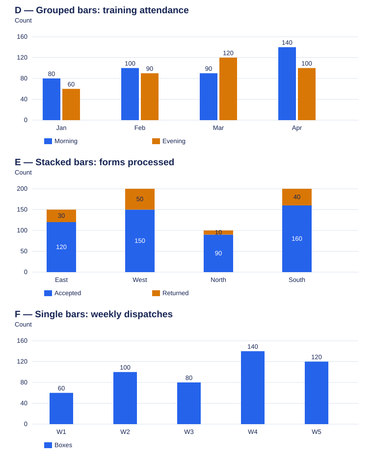

# 📝 Data interpretation — tables and bar charts: 30 original MCQs

**Study-ready, unattempted.** Six fictional datasets, not real patient or exam records. These are original questions, not official Previous Year Questions. Round only when requested. Rates use the denominator stated in the stem.

[Chapter](../README.md) · [Concepts](../Concepts/17-Data-Interpretation-Tables-and-Bar-Charts.md) · [Previous Year Questions](../Previous-Year-Questions/17-DI-Tables-and-Bar-Charts-Reported-Evidence.md)

## A — Recruitment training results

| Centre | Registered | Appeared | Passed |
|---|---|---|---|
| A | 240 | 200 | 120 |
| B | 300 | 250 | 175 |
| C | 180 | 150 | 105 |
| D | 280 | 200 | 100 |

### Q1. How many registered candidates across all four centres did not appear?

**Difficulty:** 🟡 Medium · **Priority:** 🟠 HIGH YIELD · Original practice

- **A.** 100
- **B.** 200
- **C.** 300
- **D.** 800

✅ Sahi answer aur explanation dekho

**Correct answer: B. 200**

**Kyun sahi hai:** Registered total 1000 hai aur appeared total 800 hai. Difference 200 hai.

**Baaki options kyun galat hain?**

- **A.** Yeh actual absent total ka aadha hai.
- **C.** Yeh appeared se passed subtract karke 300 failed candidates nikaalta hai, absent nahi.
- **D.** Yeh appeared total hai, absent nahi.

**Exam trick:** Registered, appeared aur passed ke denominators ko alag rakho.

[Concept](../Concepts/17-Data-Interpretation-Tables-and-Bar-Charts.md#tables-and-denominators) · [Reference](https://openstax.org/books/statistics/pages/2-1-stem-and-leaf-graphs-stemplots-line-graphs-and-bar-graphs)

**▶️ [YouTube MCQ practice — Sanjay Sir, Advance Global Study](https://www.youtube.com/watch?v=LP5ZP87cBuI)**. Published description identifies table DI questions and percentage/ratio practice. Topic-level mapping, exact item and playback pending.

### Q2. Which centre has the greatest gap in percentage points between its attendance rate and pass rate among those who appeared?

**Difficulty:** 🔴 Difficult · **Priority:** 🟠 HIGH YIELD · Original practice

- **A.** B
- **B.** C
- **C.** D
- **D.** A

✅ Sahi answer aur explanation dekho

**Correct answer: D. A**

**Kyun sahi hai:** A: 200/240×100−120/200×100=23.33 points. B: 83.33−70=13.33. C: 83.33−70=13.33. D: 71.43−50=21.43. A ka gap sabse bada hai.

**Baaki options kyun galat hain?**

- **A.** B ka gap 13.33 points hai.
- **B.** C ka gap 13.33 points hai.
- **C.** D ka gap 21.43 points hai, A ke 23.33 se kam.

**Exam trick:** Registered, appeared aur passed ke denominators ko alag rakho.

[Concept](../Concepts/17-Data-Interpretation-Tables-and-Bar-Charts.md#tables-and-denominators) · [Reference](https://openstax.org/books/statistics/pages/2-1-stem-and-leaf-graphs-stemplots-line-graphs-and-bar-graphs)

**▶️ [YouTube MCQ practice — Sanjay Sir, Advance Global Study](https://www.youtube.com/watch?v=LP5ZP87cBuI)**. Published description identifies table DI questions and percentage/ratio practice. Topic-level mapping, exact item and playback pending.

### Q3. What proportion of all successful candidates came from Centre B, expressed as a percentage?

**Difficulty:** 🟡 Medium · **Priority:** 🟠 HIGH YIELD · Original practice

- **A.** 35%
- **B.** 70%
- **C.** 25%
- **D.** 17.5%

✅ Sahi answer aur explanation dekho

**Correct answer: A. 35%**

**Kyun sahi hai:** Total passed 500 hai. B ka share 175/500×100=35% hai.

**Baaki options kyun galat hain?**

- **B.** 70% B ki pass rate hai, total successful candidates mein share nahi.
- **C.** 25% B ke appeared candidates ka correct share nahi hai.
- **D.** 17.5% B passes ko total registered 1000 se divide karta hai.

**Exam trick:** Registered, appeared aur passed ke denominators ko alag rakho.

[Concept](../Concepts/17-Data-Interpretation-Tables-and-Bar-Charts.md#tables-and-denominators) · [Reference](https://openstax.org/books/statistics/pages/2-1-stem-and-leaf-graphs-stemplots-line-graphs-and-bar-graphs)

**▶️ [YouTube MCQ practice — Sanjay Sir, Advance Global Study](https://www.youtube.com/watch?v=LP5ZP87cBuI)**. Published description identifies table DI questions and percentage/ratio practice. Topic-level mapping, exact item and playback pending.

### Q4. If Centre D must reach a pass rate of 65% among its existing appeared candidates, how many additional candidates must pass?

**Difficulty:** 🔴 Difficult · **Priority:** 🟠 HIGH YIELD · Original practice

- **A.** 65
- **B.** 130
- **C.** 30
- **D.** 20

✅ Sahi answer aur explanation dekho

**Correct answer: C. 30**

**Kyun sahi hai:** D ke 200 appeared mein 65% ka target 130 passes hai. Existing 100 se 30 extra chahiye.

**Baaki options kyun galat hain?**

- **A.** 65 target percentage hai, count nahi.
- **B.** 130 target total passes hai.
- **D.** 20 se sirf 120 passes yani 60% honge.

**Exam trick:** Registered, appeared aur passed ke denominators ko alag rakho.

[Concept](../Concepts/17-Data-Interpretation-Tables-and-Bar-Charts.md#tables-and-denominators) · [Reference](https://openstax.org/books/statistics/pages/2-1-stem-and-leaf-graphs-stemplots-line-graphs-and-bar-graphs)

**▶️ [YouTube MCQ practice — Sanjay Sir, Advance Global Study](https://www.youtube.com/watch?v=LP5ZP87cBuI)**. Published description identifies table DI questions and percentage/ratio practice. Topic-level mapping, exact item and playback pending.

### Q5. If 20 of Centre A's failed candidates are reclassified as successful after a review, what is the new overall pass rate among all appeared candidates?

**Difficulty:** 🔴 Difficult · **Priority:** 🟠 HIGH YIELD · Original practice

- **A.** 65
- **B.** 62.5
- **C.** 52
- **D.** 67.5

✅ Sahi answer aur explanation dekho

**Correct answer: A. 65**

**Kyun sahi hai:** Review se appeared total 800 same hai. Passes 500+20=520 hain. 520/800×100=65% hai.

**Baaki options kyun galat hain?**

- **B.** 62.5% review se pehle ka rate hai.
- **C.** 52% registered total par based hai.
- **D.** 67.5% ka matlab 540 passes hota, review mein 20 hi add hue.

**Exam trick:** Registered, appeared aur passed ke denominators ko alag rakho.

[Concept](../Concepts/17-Data-Interpretation-Tables-and-Bar-Charts.md#tables-and-denominators) · [Reference](https://openstax.org/books/statistics/pages/2-1-stem-and-leaf-graphs-stemplots-line-graphs-and-bar-graphs)

**▶️ [YouTube MCQ practice — Sanjay Sir, Advance Global Study](https://www.youtube.com/watch?v=LP5ZP87cBuI)**. Published description identifies table DI questions and percentage/ratio practice. Topic-level mapping, exact item and playback pending.

## B — Stationery stock ledger

| Item | Opening | Received | Issued |
|---|---|---|---|
| Pens | 150 | 90 | 180 |
| Folders | 120 | 80 | 140 |
| Pads | 100 | 60 | 125 |
| Labels | 240 | 120 | 270 |

### Q6. How many folders remain at the end of the ledger period?

**Difficulty:** 🟡 Medium · **Priority:** 🟠 HIGH YIELD · Original practice

- **A.** 80
- **B.** 140
- **C.** 200
- **D.** 60

✅ Sahi answer aur explanation dekho

**Correct answer: D. 60**

**Kyun sahi hai:** Opening plus received se 200 folders available the. Issued 140 subtract karke 60 bache.

**Baaki options kyun galat hain?**

- **A.** 80 receipts hain.
- **B.** 140 issued quantity hai.
- **C.** 200 issue se pehle available stock hai.

**Exam trick:** Opening plus received se available stock banta hai.

[Concept](../Concepts/17-Data-Interpretation-Tables-and-Bar-Charts.md#tables-and-denominators) · [Reference](https://openstax.org/books/statistics/pages/2-1-stem-and-leaf-graphs-stemplots-line-graphs-and-bar-graphs)

**▶️ [YouTube MCQ practice — Sanjay Sir, Advance Global Study](https://www.youtube.com/watch?v=LP5ZP87cBuI)**. Published description identifies table DI questions and percentage/ratio practice. Topic-level mapping, exact item and playback pending.

### Q7. For which item is closing stock the smallest?

**Difficulty:** 🟡 Medium · **Priority:** 🟠 HIGH YIELD · Original practice

- **A.** Pens
- **B.** Pads
- **C.** Folders
- **D.** Labels

✅ Sahi answer aur explanation dekho

**Correct answer: B. Pads**

**Kyun sahi hai:** Pens 60, folders 60, pads 35 aur labels 90 bache hain. Pads sabse kam hain.

**Baaki options kyun galat hain?**

- **A.** Pens 60 bache hain.
- **C.** Folders 60 bache hain.
- **D.** Labels 90 bache hain.

**Exam trick:** Opening plus received se available stock banta hai.

[Concept](../Concepts/17-Data-Interpretation-Tables-and-Bar-Charts.md#tables-and-denominators) · [Reference](https://openstax.org/books/statistics/pages/2-1-stem-and-leaf-graphs-stemplots-line-graphs-and-bar-graphs)

**▶️ [YouTube MCQ practice — Sanjay Sir, Advance Global Study](https://www.youtube.com/watch?v=LP5ZP87cBuI)**. Published description identifies table DI questions and percentage/ratio practice. Topic-level mapping, exact item and playback pending.

### Q8. What percentage of all available labels was issued?

**Difficulty:** 🔴 Difficult · **Priority:** 🟠 HIGH YIELD · Original practice

- **A.** 112.5%
- **B.** 25%
- **C.** 75%
- **D.** 225%

✅ Sahi answer aur explanation dekho

**Correct answer: C. 75%**

**Kyun sahi hai:** Labels ki available quantity 360 hai. 270/360×100=75% issue hue.

**Baaki options kyun galat hain?**

- **A.** 112.5% sirf opening 240 ko denominator banata hai.
- **B.** 25% closing stock ka share hai.
- **D.** 225% receipt 120 ko denominator banata hai.

**Exam trick:** Opening plus received se available stock banta hai.

[Concept](../Concepts/17-Data-Interpretation-Tables-and-Bar-Charts.md#tables-and-denominators) · [Reference](https://openstax.org/books/statistics/pages/2-1-stem-and-leaf-graphs-stemplots-line-graphs-and-bar-graphs)

**▶️ [YouTube MCQ practice — Sanjay Sir, Advance Global Study](https://www.youtube.com/watch?v=LP5ZP87cBuI)**. Published description identifies table DI questions and percentage/ratio practice. Topic-level mapping, exact item and playback pending.

### Q9. If every item must have at least 75 units in closing stock, what is the total shortfall across items?

**Difficulty:** 🔴 Difficult · **Priority:** 🟠 HIGH YIELD · Original practice

- **A.** 55
- **B.** 70
- **C.** 225
- **D.** 245

✅ Sahi answer aur explanation dekho

**Correct answer: B. 70**

**Kyun sahi hai:** Pens aur folders mein 15-15, pads mein 40 ki kami hai. Labels target se upar hain. Total shortfall 70 hai.

**Baaki options kyun galat hain?**

- **A.** 55 mein ek 15-unit shortage omit hai.
- **C.** 225 three items ka target stock hai.
- **D.** 245 total existing closing stock hai, shortfall nahi.

**Exam trick:** Opening plus received se available stock banta hai.

[Concept](../Concepts/17-Data-Interpretation-Tables-and-Bar-Charts.md#tables-and-denominators) · [Reference](https://openstax.org/books/statistics/pages/2-1-stem-and-leaf-graphs-stemplots-line-graphs-and-bar-graphs)

**▶️ [YouTube MCQ practice — Sanjay Sir, Advance Global Study](https://www.youtube.com/watch?v=LP5ZP87cBuI)**. Published description identifies table DI questions and percentage/ratio practice. Topic-level mapping, exact item and playback pending.

### Q10. What is the ratio of total received stock to total issued stock, in lowest terms?

**Difficulty:** 🟡 Medium · **Priority:** 🟠 HIGH YIELD · Original practice

- **A.** 14:29
- **B.** 7:14
- **C.** 1:2
- **D.** 70:143

✅ Sahi answer aur explanation dekho

**Correct answer: D. 70:143**

**Kyun sahi hai:** Received 90+80+60+120=350 hai. Issued 180+140+125+270=715 hai. 350:715 ko 5 se divide karne par 70:143 hai.

**Baaki options kyun galat hain?**

- **A.** Yeh 350:715 ka exact simplification nahi hai.
- **B.** Yeh denominator aur numerator ka sahi reduction nahi hai.
- **C.** 715 exactly 700 nahi hai.

**Exam trick:** Opening plus received se available stock banta hai.

[Concept](../Concepts/17-Data-Interpretation-Tables-and-Bar-Charts.md#tables-and-denominators) · [Reference](https://openstax.org/books/statistics/pages/2-1-stem-and-leaf-graphs-stemplots-line-graphs-and-bar-graphs)

**▶️ [YouTube MCQ practice — Sanjay Sir, Advance Global Study](https://www.youtube.com/watch?v=LP5ZP87cBuI)**. Published description identifies table DI questions and percentage/ratio practice. Topic-level mapping, exact item and playback pending.

## C — Outreach administration targets

| Site | Target visits | Recorded visits | Operating days |
|---|---|---|---|
| P | 500 | 450 | 15 |
| Q | 400 | 440 | 20 |
| R | 600 | 540 | 18 |
| S | 300 | 330 | 10 |

### Q11. Which sites exceeded their own visit targets?

**Difficulty:** 🟡 Medium · **Priority:** 🟠 HIGH YIELD · Original practice

- **A.** Q and S
- **B.** P and R
- **C.** Q only
- **D.** R and S

✅ Sahi answer aur explanation dekho

**Correct answer: A. Q and S**

**Kyun sahi hai:** Q mein 440>400 aur S mein 330>300 hai. P aur R target se neeche hain.

**Baaki options kyun galat hain?**

- **B.** Dono target se neeche hain.
- **C.** S bhi target se upar hai.
- **D.** R target se neeche hai.

**Exam trick:** Overall target aur per-day rate alag measures hain.

[Concept](../Concepts/17-Data-Interpretation-Tables-and-Bar-Charts.md#tables-and-denominators) · [Reference](https://openstax.org/books/statistics/pages/2-1-stem-and-leaf-graphs-stemplots-line-graphs-and-bar-graphs)

**▶️ [YouTube MCQ practice — Sanjay Sir, Advance Global Study](https://www.youtube.com/watch?v=LP5ZP87cBuI)**. Published description identifies table DI questions and percentage/ratio practice. Topic-level mapping, exact item and playback pending.

### Q12. Which site recorded the greatest number of visits per operating day?

**Difficulty:** 🔴 Difficult · **Priority:** 🟠 HIGH YIELD · Original practice

- **A.** P
- **B.** Q
- **C.** S
- **D.** R

✅ Sahi answer aur explanation dekho

**Correct answer: C. S**

**Kyun sahi hai:** P 450/15=30, Q 440/20=22, R 540/18=30 aur S 330/10=33 visits/day hai. S highest hai.

**Baaki options kyun galat hain?**

- **A.** P ka rate 30 hai.
- **B.** Q ka rate 22 hai.
- **D.** R ka rate 30 hai.

**Exam trick:** Overall target aur per-day rate alag measures hain.

[Concept](../Concepts/17-Data-Interpretation-Tables-and-Bar-Charts.md#tables-and-denominators) · [Reference](https://openstax.org/books/statistics/pages/2-1-stem-and-leaf-graphs-stemplots-line-graphs-and-bar-graphs)

**▶️ [YouTube MCQ practice — Sanjay Sir, Advance Global Study](https://www.youtube.com/watch?v=LP5ZP87cBuI)**. Published description identifies table DI questions and percentage/ratio practice. Topic-level mapping, exact item and playback pending.

### Q13. What is the combined shortfall against the overall target, allowing surplus visits at one site to offset another site's shortfall?

**Difficulty:** 🟡 Medium · **Priority:** 🟠 HIGH YIELD · Original practice

- **A.** 40
- **B.** 110
- **C.** 70
- **D.** 1800

✅ Sahi answer aur explanation dekho

**Correct answer: A. 40**

**Kyun sahi hai:** Targets total 1800 hain. Recorded visits 1760 hain. Net shortfall 40 hai.

**Baaki options kyun galat hain?**

- **B.** 110 sirf P aur R ki gross shortfall hai.
- **C.** 70 Q aur S ki surplus hai.
- **D.** 1800 target hai.

**Exam trick:** Overall target aur per-day rate alag measures hain.

[Concept](../Concepts/17-Data-Interpretation-Tables-and-Bar-Charts.md#tables-and-denominators) · [Reference](https://openstax.org/books/statistics/pages/2-1-stem-and-leaf-graphs-stemplots-line-graphs-and-bar-graphs)

**▶️ [YouTube MCQ practice — Sanjay Sir, Advance Global Study](https://www.youtube.com/watch?v=LP5ZP87cBuI)**. Published description identifies table DI questions and percentage/ratio practice. Topic-level mapping, exact item and playback pending.

### Q14. If Site P adds 3 operating days at its current visits-per-day rate, what percentage of its original target will it achieve?

**Difficulty:** 🔴 Difficult · **Priority:** 🟠 HIGH YIELD · Original practice

- **A.** 90%
- **B.** 102%
- **C.** 18%
- **D.** 108%

✅ Sahi answer aur explanation dekho

**Correct answer: D. 108%**

**Kyun sahi hai:** P ka rate 30/day hai. Extra 90 se total 540 hoga. 540/500×100=108% hai.

**Baaki options kyun galat hain?**

- **A.** 90% current achievement hai.
- **B.** 102% ka matlab 510 visits hai, extra 90 nahi.
- **C.** 18% extra visits ka target share hai, total achievement nahi.

**Exam trick:** Overall target aur per-day rate alag measures hain.

[Concept](../Concepts/17-Data-Interpretation-Tables-and-Bar-Charts.md#tables-and-denominators) · [Reference](https://openstax.org/books/statistics/pages/2-1-stem-and-leaf-graphs-stemplots-line-graphs-and-bar-graphs)

**▶️ [YouTube MCQ practice — Sanjay Sir, Advance Global Study](https://www.youtube.com/watch?v=LP5ZP87cBuI)**. Published description identifies table DI questions and percentage/ratio practice. Topic-level mapping, exact item and playback pending.

### Q15. What is the total recorded visits per operating day across all sites, rounded to two decimal places, treating each site-day separately?

**Difficulty:** 🔴 Difficult · **Priority:** 🟠 HIGH YIELD · Original practice

- **A.** 28.75
- **B.** 27.94
- **C.** 30
- **D.** 440

✅ Sahi answer aur explanation dekho

**Correct answer: B. 27.94**

**Kyun sahi hai:** Total visits 1760 aur site-days 15+20+18+10=63 hain. 1760/63=27.9365, yani 27.94 visits per site-day.

**Baaki options kyun galat hain?**

- **A.** 28.75 site rates ka simple mean hai, unequal days ignore karta hai.
- **C.** 30 kuch sites ka individual rate hai.
- **D.** 440 average total visits per site hai.

**Exam trick:** Overall target aur per-day rate alag measures hain.

[Concept](../Concepts/17-Data-Interpretation-Tables-and-Bar-Charts.md#tables-and-denominators) · [Reference](https://openstax.org/books/statistics/pages/2-1-stem-and-leaf-graphs-stemplots-line-graphs-and-bar-graphs)

**▶️ [YouTube MCQ practice — Sanjay Sir, Advance Global Study](https://www.youtube.com/watch?v=LP5ZP87cBuI)**. Published description identifies table DI questions and percentage/ratio practice. Topic-level mapping, exact item and playback pending.

## 📊 Bar chart panels D–F

The exact values are reproduced in the tables below for accessibility.

## D — Grouped bars: training attendance

| Month | Morning | Evening |
|---|---|---|
| Jan | 80 | 60 |
| Feb | 100 | 90 |
| Mar | 90 | 120 |
| Apr | 140 | 100 |

### Q16. In which month did evening attendance first exceed morning attendance?

**Difficulty:** 🟢 Easy · **Priority:** 🟠 HIGH YIELD · Original practice

- **A.** Jan
- **B.** Feb
- **C.** Mar
- **D.** Apr

✅ Sahi answer aur explanation dekho

**Correct answer: C. Mar**

**Kyun sahi hai:** Jan 60<80, Feb 90<100, Mar 120>90 hai. Pehli baar March mein hua.

**Baaki options kyun galat hain?**

- **A.** Jan evening kam hai.
- **B.** Feb evening kam hai.
- **D.** Apr evening 100 morning 140 se kam hai.

**Exam trick:** Grouped bars mein legend ke hisaab se series choose karo.

[Concept](../Concepts/17-Data-Interpretation-Tables-and-Bar-Charts.md#bar-charts) · [Reference](https://openstax.org/books/statistics/pages/2-1-stem-and-leaf-graphs-stemplots-line-graphs-and-bar-graphs)

**▶️ [YouTube MCQ practice — Sanjay Sir, Advance Global Study](https://www.youtube.com/watch?v=LP5ZP87cBuI)**. Published description identifies bar graph DI questions and percentage/ratio practice. Topic-level mapping, exact item and playback pending.

### Q17. What was the largest combined monthly attendance?

**Difficulty:** 🟡 Medium · **Priority:** 🟠 HIGH YIELD · Original practice

- **A.** 140
- **B.** 240
- **C.** 210
- **D.** 760

✅ Sahi answer aur explanation dekho

**Correct answer: B. 240**

**Kyun sahi hai:** Jan 140, Feb 190, Mar 210 aur Apr 240 hain. Maximum 240 hai.

**Baaki options kyun galat hain?**

- **A.** 140 Jan ka total aur Apr morning hai.
- **C.** 210 March ka total hai.
- **D.** 760 four months ka total nahi, monthly maximum bhi nahi.

**Exam trick:** Grouped bars mein legend ke hisaab se series choose karo.

[Concept](../Concepts/17-Data-Interpretation-Tables-and-Bar-Charts.md#bar-charts) · [Reference](https://openstax.org/books/statistics/pages/2-1-stem-and-leaf-graphs-stemplots-line-graphs-and-bar-graphs)

**▶️ [YouTube MCQ practice — Sanjay Sir, Advance Global Study](https://www.youtube.com/watch?v=LP5ZP87cBuI)**. Published description identifies bar graph DI questions and percentage/ratio practice. Topic-level mapping, exact item and playback pending.

### Q18. By what percentage did combined attendance rise from January to April, rounded to two decimal places?

**Difficulty:** 🔴 Difficult · **Priority:** 🟠 HIGH YIELD · Original practice

- **A.** 41.67%
- **B.** 100%
- **C.** 171.43%
- **D.** 71.43%

✅ Sahi answer aur explanation dekho

**Correct answer: D. 71.43%**

**Kyun sahi hai:** Jan total 140 aur April 240 hai. Increase 100/140×100=71.43% hai.

**Baaki options kyun galat hain?**

- **A.** 41.67% new total ko denominator banata hai.
- **B.** 100 count ka increase hai, percentage nahi.
- **C.** 171.43% new total as percent of old hai.

**Exam trick:** Grouped bars mein legend ke hisaab se series choose karo.

[Concept](../Concepts/17-Data-Interpretation-Tables-and-Bar-Charts.md#bar-charts) · [Reference](https://openstax.org/books/statistics/pages/2-1-stem-and-leaf-graphs-stemplots-line-graphs-and-bar-graphs)

**▶️ [YouTube MCQ practice — Sanjay Sir, Advance Global Study](https://www.youtube.com/watch?v=LP5ZP87cBuI)**. Published description identifies bar graph DI questions and percentage/ratio practice. Topic-level mapping, exact item and playback pending.

### Q19. What is the ratio of total morning to total evening attendance?

**Difficulty:** 🟡 Medium · **Priority:** 🟠 HIGH YIELD · Original practice

- **A.** 41:37
- **B.** 37:41
- **C.** 4:3
- **D.** 14:10

✅ Sahi answer aur explanation dekho

**Correct answer: A. 41:37**

**Kyun sahi hai:** Morning 410 aur evening 370 hain. 410:370 simplify karke 41:37 hai.

**Baaki options kyun galat hain?**

- **B.** Yeh ratio reverse karta hai.
- **C.** Yeh exact totals ka ratio nahi.
- **D.** Yeh April ki pair ratio hai.

**Exam trick:** Grouped bars mein legend ke hisaab se series choose karo.

[Concept](../Concepts/17-Data-Interpretation-Tables-and-Bar-Charts.md#bar-charts) · [Reference](https://openstax.org/books/statistics/pages/2-1-stem-and-leaf-graphs-stemplots-line-graphs-and-bar-graphs)

**▶️ [YouTube MCQ practice — Sanjay Sir, Advance Global Study](https://www.youtube.com/watch?v=LP5ZP87cBuI)**. Published description identifies bar graph DI questions and percentage/ratio practice. Topic-level mapping, exact item and playback pending.

### Q20. If April evening attendance was recorded 10 too high and March morning attendance 10 too low, what is the corrected difference between the four-month morning and evening totals?

**Difficulty:** 🔴 Difficult · **Priority:** 🟠 HIGH YIELD · Original practice

- **A.** 40
- **B.** 20
- **C.** 60
- **D.** 50

✅ Sahi answer aur explanation dekho

**Correct answer: C. 60**

**Kyun sahi hai:** Morning total 410+10=420. Evening total 370−10=360. Difference 60 hai.

**Baaki options kyun galat hain?**

- **A.** 40 original difference hai.
- **B.** 20 dono corrections ke direction ko galat apply karta hai.
- **D.** 50 sirf ek correction apply karta hai.

**Exam trick:** Grouped bars mein legend ke hisaab se series choose karo.

[Concept](../Concepts/17-Data-Interpretation-Tables-and-Bar-Charts.md#bar-charts) · [Reference](https://openstax.org/books/statistics/pages/2-1-stem-and-leaf-graphs-stemplots-line-graphs-and-bar-graphs)

**▶️ [YouTube MCQ practice — Sanjay Sir, Advance Global Study](https://www.youtube.com/watch?v=LP5ZP87cBuI)**. Published description identifies bar graph DI questions and percentage/ratio practice. Topic-level mapping, exact item and playback pending.

## E — Stacked bars: forms processed

| Office | Accepted | Returned |
|---|---|---|
| East | 120 | 30 |
| West | 150 | 50 |
| North | 90 | 10 |
| South | 160 | 40 |

### Q21. Which office has the lowest returned-form proportion among its processed forms?

**Difficulty:** 🟡 Medium · **Priority:** 🟠 HIGH YIELD · Original practice

- **A.** North
- **B.** East
- **C.** West
- **D.** South

✅ Sahi answer aur explanation dekho

**Correct answer: A. North**

**Kyun sahi hai:** East 30/150=20%, West 50/200=25%, North 10/100=10%, South 40/200=20%. North lowest hai.

**Baaki options kyun galat hain?**

- **B.** East 20% hai.
- **C.** West 25% hai.
- **D.** South 20% hai.

**Exam trick:** Stacked bar ki segment value aur total height alag hain.

[Concept](../Concepts/17-Data-Interpretation-Tables-and-Bar-Charts.md#bar-charts) · [Reference](https://openstax.org/books/statistics/pages/2-1-stem-and-leaf-graphs-stemplots-line-graphs-and-bar-graphs)

**▶️ [YouTube MCQ practice — Sanjay Sir, Advance Global Study](https://www.youtube.com/watch?v=LP5ZP87cBuI)**. Published description identifies bar graph DI questions and percentage/ratio practice. Topic-level mapping, exact item and playback pending.

### Q22. What is the total number of accepted forms across the four offices?

**Difficulty:** 🟡 Medium · **Priority:** 🟠 HIGH YIELD · Original practice

- **A.** 130
- **B.** 650
- **C.** 160
- **D.** 520

✅ Sahi answer aur explanation dekho

**Correct answer: D. 520**

**Kyun sahi hai:** Accepted blue segments add karo: 120+150+90+160=520.

**Baaki options kyun galat hain?**

- **A.** 130 returned total hai.
- **B.** 650 processed total hai.
- **C.** 160 South ka accepted count hai.

**Exam trick:** Stacked bar ki segment value aur total height alag hain.

[Concept](../Concepts/17-Data-Interpretation-Tables-and-Bar-Charts.md#bar-charts) · [Reference](https://openstax.org/books/statistics/pages/2-1-stem-and-leaf-graphs-stemplots-line-graphs-and-bar-graphs)

**▶️ [YouTube MCQ practice — Sanjay Sir, Advance Global Study](https://www.youtube.com/watch?v=LP5ZP87cBuI)**. Published description identifies bar graph DI questions and percentage/ratio practice. Topic-level mapping, exact item and playback pending.

### Q23. How many West returned forms must be corrected and accepted for West to match North's acceptance rate, assuming the processed total stays fixed?

**Difficulty:** 🔴 Difficult · **Priority:** 🟠 HIGH YIELD · Original practice

- **A.** 40
- **B.** 30
- **C.** 20
- **D.** 180

✅ Sahi answer aur explanation dekho

**Correct answer: B. 30**

**Kyun sahi hai:** North acceptance rate 90/100=90% hai. West processed 200 hai, target 180 accepted. Existing 150 se 30 reclassifications chahiye.

**Baaki options kyun galat hain?**

- **A.** 40 reclassifications se 95% hoga.
- **C.** 20 se 85% hoga.
- **D.** 180 target accepted total hai, extra nahi.

**Exam trick:** Stacked bar ki segment value aur total height alag hain.

[Concept](../Concepts/17-Data-Interpretation-Tables-and-Bar-Charts.md#bar-charts) · [Reference](https://openstax.org/books/statistics/pages/2-1-stem-and-leaf-graphs-stemplots-line-graphs-and-bar-graphs)

**▶️ [YouTube MCQ practice — Sanjay Sir, Advance Global Study](https://www.youtube.com/watch?v=LP5ZP87cBuI)**. Published description identifies bar graph DI questions and percentage/ratio practice. Topic-level mapping, exact item and playback pending.

### Q24. If East and South are merged for reporting, what percentage of their combined processed forms were returned?

**Difficulty:** 🔴 Difficult · **Priority:** 🟠 HIGH YIELD · Original practice

- **A.** 25%
- **B.** 14%
- **C.** 20%
- **D.** 70%

✅ Sahi answer aur explanation dekho

**Correct answer: C. 20%**

**Kyun sahi hai:** Returned 70 aur total 350 hai. 70/350×100=20%.

**Baaki options kyun galat hain?**

- **A.** 25% returned ko accepted 280 se divide karta hai.
- **B.** 14% denominator 500 le leta hai.
- **D.** 70 returned count hai, percentage nahi.

**Exam trick:** Stacked bar ki segment value aur total height alag hain.

[Concept](../Concepts/17-Data-Interpretation-Tables-and-Bar-Charts.md#bar-charts) · [Reference](https://openstax.org/books/statistics/pages/2-1-stem-and-leaf-graphs-stemplots-line-graphs-and-bar-graphs)

**▶️ [YouTube MCQ practice — Sanjay Sir, Advance Global Study](https://www.youtube.com/watch?v=LP5ZP87cBuI)**. Published description identifies bar graph DI questions and percentage/ratio practice. Topic-level mapping, exact item and playback pending.

### Q25. If the overall return rate must be no more than 15%, what is the minimum number of returned forms that must become accepted, without changing the processed total?

**Difficulty:** 🔴 Difficult · **Priority:** 🟠 HIGH YIELD · Original practice

- **A.** 32
- **B.** 33
- **C.** 97
- **D.** 98

✅ Sahi answer aur explanation dekho

**Correct answer: B. 33**

**Kyun sahi hai:** Total processed 650 hai. At most 97.5 returned allowed hain, count integer hai toh 97. Current 130 se 33 ko reclassify karna hoga.

**Baaki options kyun galat hain?**

- **A.** 32 se 98 returns rahenge, 15% se zyada.
- **C.** 97 maximum remaining returns hai.
- **D.** 98 allowed se ek zyada hai.

**Exam trick:** Stacked bar ki segment value aur total height alag hain.

[Concept](../Concepts/17-Data-Interpretation-Tables-and-Bar-Charts.md#bar-charts) · [Reference](https://openstax.org/books/statistics/pages/2-1-stem-and-leaf-graphs-stemplots-line-graphs-and-bar-graphs)

**▶️ [YouTube MCQ practice — Sanjay Sir, Advance Global Study](https://www.youtube.com/watch?v=LP5ZP87cBuI)**. Published description identifies bar graph DI questions and percentage/ratio practice. Topic-level mapping, exact item and playback pending.

## F — Single bars: weekly dispatches

| Week | Boxes |
|---|---|
| W1 | 60 |
| W2 | 100 |
| W3 | 80 |
| W4 | 140 |
| W5 | 120 |

### Q26. Which week had the smallest dispatch count?

**Difficulty:** 🟢 Easy · **Priority:** 🟠 HIGH YIELD · Original practice

- **A.** W2
- **B.** W3
- **C.** W5
- **D.** W1

✅ Sahi answer aur explanation dekho

**Correct answer: D. W1**

**Kyun sahi hai:** W1 mein 60 boxes hain, jo baaki sabse kam hai.

**Baaki options kyun galat hain?**

- **A.** W2 100 hai.
- **B.** W3 80 hai.
- **C.** W5 120 hai.

**Exam trick:** Axis baseline, total aur requested quantity check karo.

[Concept](../Concepts/17-Data-Interpretation-Tables-and-Bar-Charts.md#bar-charts) · [Reference](https://openstax.org/books/statistics/pages/2-1-stem-and-leaf-graphs-stemplots-line-graphs-and-bar-graphs)

**▶️ [YouTube MCQ practice — Sanjay Sir, Advance Global Study](https://www.youtube.com/watch?v=LP5ZP87cBuI)**. Published description identifies bar graph DI questions and percentage/ratio practice. Topic-level mapping, exact item and playback pending.

### Q27. What fraction of all five weeks' dispatches occurred during W4 and W5 together?

**Difficulty:** 🟡 Medium · **Priority:** 🟠 HIGH YIELD · Original practice

- **A.** 13/25
- **B.** 12/25
- **C.** 7/25
- **D.** 3/5

✅ Sahi answer aur explanation dekho

**Correct answer: A. 13/25**

**Kyun sahi hai:** W4+W5=260 hai. Total 500 hai. 260/500=13/25.

**Baaki options kyun galat hain?**

- **B.** 12/25 first three weeks ka share hai.
- **C.** 7/25 W4 alone ka share hai.
- **D.** 3/5 300/500 hota hai, 260 nahi.

**Exam trick:** Axis baseline, total aur requested quantity check karo.

[Concept](../Concepts/17-Data-Interpretation-Tables-and-Bar-Charts.md#bar-charts) · [Reference](https://openstax.org/books/statistics/pages/2-1-stem-and-leaf-graphs-stemplots-line-graphs-and-bar-graphs)

**▶️ [YouTube MCQ practice — Sanjay Sir, Advance Global Study](https://www.youtube.com/watch?v=LP5ZP87cBuI)**. Published description identifies bar graph DI questions and percentage/ratio practice. Topic-level mapping, exact item and playback pending.

### Q28. How many weeks had dispatches strictly above the five-week arithmetic mean?

**Difficulty:** 🟡 Medium · **Priority:** 🟠 HIGH YIELD · Original practice

- **A.** 3
- **B.** 1
- **C.** 2
- **D.** 4

✅ Sahi answer aur explanation dekho

**Correct answer: C. 2**

**Kyun sahi hai:** Mean 500/5=100 hai. Sirf W4 140 aur W5 120 strictly above hain.

**Baaki options kyun galat hain?**

- **A.** 3 mein W2 equal ko bhi above count kiya.
- **B.** 1 ek above-mean week omit karta hai.
- **D.** 4 below ya equal weeks include karta hai.

**Exam trick:** Axis baseline, total aur requested quantity check karo.

[Concept](../Concepts/17-Data-Interpretation-Tables-and-Bar-Charts.md#bar-charts) · [Reference](https://openstax.org/books/statistics/pages/2-1-stem-and-leaf-graphs-stemplots-line-graphs-and-bar-graphs)

**▶️ [YouTube MCQ practice — Sanjay Sir, Advance Global Study](https://www.youtube.com/watch?v=LP5ZP87cBuI)**. Published description identifies bar graph DI questions and percentage/ratio practice. Topic-level mapping, exact item and playback pending.

### Q29. If W6 must bring the six-week mean to at least 110 boxes, what minimum count is required in W6?

**Difficulty:** 🔴 Difficult · **Priority:** 🟠 HIGH YIELD · Original practice

- **A.** 160
- **B.** 110
- **C.** 150
- **D.** 60

✅ Sahi answer aur explanation dekho

**Correct answer: A. 160**

**Kyun sahi hai:** Six-week total kam se kam 660 chahiye. Existing 500 subtract karne par 160 boxes chahiye.

**Baaki options kyun galat hain?**

- **B.** 110 target mean hai, missing week nahi.
- **C.** 150 se total 650 aur mean 108.33 hoga.
- **D.** 60 W1 ka count hai.

**Exam trick:** Axis baseline, total aur requested quantity check karo.

[Concept](../Concepts/17-Data-Interpretation-Tables-and-Bar-Charts.md#bar-charts) · [Reference](https://openstax.org/books/statistics/pages/2-1-stem-and-leaf-graphs-stemplots-line-graphs-and-bar-graphs)

**▶️ [YouTube MCQ practice — Sanjay Sir, Advance Global Study](https://www.youtube.com/watch?v=LP5ZP87cBuI)**. Published description identifies bar graph DI questions and percentage/ratio practice. Topic-level mapping, exact item and playback pending.

### Q30. A report redraws W1 and W4 bars using a vertical axis starting at 50 instead of zero. What is the ratio of their displayed heights (W4:W1) under that scale?

**Difficulty:** 🔴 Difficult · **Priority:** 🟠 HIGH YIELD · Original practice

- **A.** 7:3
- **B.** 14:1
- **C.** 3:7
- **D.** 9:1

✅ Sahi answer aur explanation dekho

**Correct answer: D. 9:1**

**Kyun sahi hai:** Axis origin 50 hai. W4 displayed height 140−50=90 units aur W1 60−50=10 units. Ratio 9:1 hai, actual count ratio 7:3 hai.

**Baaki options kyun galat hain?**

- **A.** Yeh actual counts ka ratio hai, truncated heights ka nahi.
- **B.** Yeh 140 ko 10 se compare karta hai, dono displayed heights ko nahi.
- **C.** Yeh actual count ratio reverse karta hai.

**Exam trick:** Axis baseline, total aur requested quantity check karo.

[Concept](../Concepts/17-Data-Interpretation-Tables-and-Bar-Charts.md#bar-charts) · [Reference](https://openstax.org/books/statistics/pages/2-1-stem-and-leaf-graphs-stemplots-line-graphs-and-bar-graphs)

**YouTube MCQ practice: verification pending.** Truncated-axis comparison question footage not confirmed.

## ▶️ Practice coverage

29 topic-level links and one explicit gap (Q30). Exact question-video matches 0. Teaching-only counted as practice 0. No video playback or transcript inspected.

[Chapter](../README.md) · [Concepts](../Concepts/17-Data-Interpretation-Tables-and-Bar-Charts.md) · [Previous Year Questions](../Previous-Year-Questions/17-DI-Tables-and-Bar-Charts-Reported-Evidence.md)
