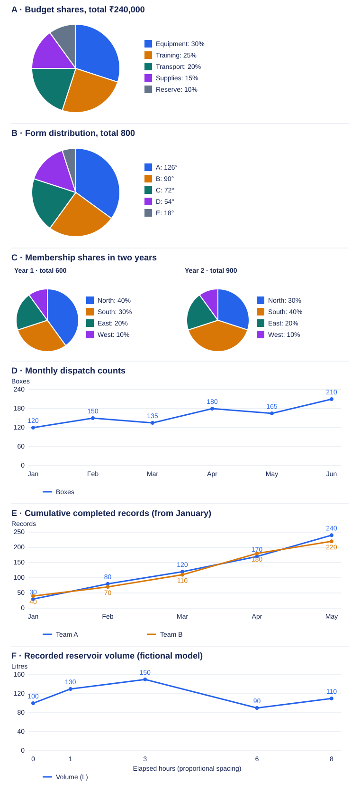

# 📝 Data interpretation — pie charts and line graphs: 30 original MCQs

**Study-ready, unattempted.** All six datasets are fictional. Charts are original, not copied from examination papers. Use recorded observations unless an interpolation assumption is stated. Round only where requested.

[Chapter](../README.md) · [Concepts](../Concepts/18-Data-Interpretation-Pie-Charts-and-Line-Graphs.md) · [Previous Year Questions](../Previous-Year-Questions/18-DI-Pie-Charts-and-Line-Graphs-Reported-Evidence.md)

Exact data are provided in tables for accessibility. Questions in each set use only that set's data.

## A — Budget allocation (total ₹240,000)

| Category | Share (%) |
|---|---|
| Equipment | 30 |
| Training | 25 |
| Transport | 20 |
| Supplies | 15 |
| Reserve | 10 |

### Q1. What angle represents the Training sector?

**Difficulty:** 🟢 Easy · **Priority:** 🟠 HIGH YIELD · Original practice

- **A.** 25°
- **B.** 60°
- **C.** 90°
- **D.** 120°

✅ Sahi answer aur explanation dekho

**Correct answer: C. 90°**

**Kyun sahi hai:** Training ka share 25% hai. Full pie 360° hota hai, toh 25/100×360=90° hai.

**Baaki options kyun galat hain?**

- **A.** 25 share percentage hai, angle nahi.
- **B.** 60° one-sixth share represent karta hai.
- **D.** 120° one-third share represent karta hai.

**Exam trick:** Pie chart share ko total amount se multiply karo.

[Concept](../Concepts/18-Data-Interpretation-Pie-Charts-and-Line-Graphs.md#pie-charts) · [Reference](https://openstax.org/books/principles-data-science/pages/10-1-writing-an-informative-report)

**▶️ [YouTube MCQ practice — Sanjay Sir, Advance Global Study](https://www.youtube.com/watch?v=LP5ZP87cBuI)**. Published description lists pie chart DI with percentage and ratio practice. Broad topic-level link only, exact subskill/item and playback pending.

### Q2. What is the combined allocation for Transport and Supplies?

**Difficulty:** 🟡 Medium · **Priority:** 🟠 HIGH YIELD · Original practice

- **A.** ₹84,000
- **B.** ₹48,000
- **C.** ₹36,000
- **D.** ₹1,08,000

✅ Sahi answer aur explanation dekho

**Correct answer: A. ₹84,000**

**Kyun sahi hai:** Transport 20% aur Supplies 15% hain. Combined 35% ka amount 240000×0.35=84000 hai.

**Baaki options kyun galat hain?**

- **B.** Yeh sirf Transport ka amount hai.
- **C.** Yeh sirf Supplies ka amount hai.
- **D.** Yeh 45% allocation hai, 35% nahi.

**Exam trick:** Pie chart share ko total amount se multiply karo.

[Concept](../Concepts/18-Data-Interpretation-Pie-Charts-and-Line-Graphs.md#pie-charts) · [Reference](https://openstax.org/books/principles-data-science/pages/10-1-writing-an-informative-report)

**▶️ [YouTube MCQ practice — Sanjay Sir, Advance Global Study](https://www.youtube.com/watch?v=LP5ZP87cBuI)**. Published description lists pie chart DI with percentage and ratio practice. Broad topic-level link only, exact subskill/item and playback pending.

### Q3. If ₹12,000 is transferred from Equipment to Reserve while the total stays fixed, what is the new Reserve share?

**Difficulty:** 🔴 Difficult · **Priority:** 🟠 HIGH YIELD · Original practice

- **A.** 10%
- **B.** 12%
- **C.** 25%
- **D.** 15%

✅ Sahi answer aur explanation dekho

**Correct answer: D. 15%**

**Kyun sahi hai:** Reserve pehle 240000×0.10=24000 tha. Transfer ke baad 36000 hai. 36000/240000×100=15% hai.

**Baaki options kyun galat hain?**

- **A.** 10% original share hai.
- **B.** 12 ko transfer amount se seedha percentage maan leta hai.
- **C.** 25% mein extra share galat add hua hai.

**Exam trick:** Pie chart share ko total amount se multiply karo.

[Concept](../Concepts/18-Data-Interpretation-Pie-Charts-and-Line-Graphs.md#pie-charts) · [Reference](https://openstax.org/books/principles-data-science/pages/10-1-writing-an-informative-report)

**▶️ [YouTube MCQ practice — Sanjay Sir, Advance Global Study](https://www.youtube.com/watch?v=LP5ZP87cBuI)**. Published description lists pie chart DI with percentage and ratio practice. Broad topic-level link only, exact subskill/item and playback pending.

### Q4. If the Training allocation is spent at 80% and all other non-reserve allocations are fully spent, what amount remains unspent, including the untouched Reserve?

**Difficulty:** 🔴 Difficult · **Priority:** 🟠 HIGH YIELD · Original practice

- **A.** ₹12,000
- **B.** ₹36,000
- **C.** ₹24,000
- **D.** ₹72,000

✅ Sahi answer aur explanation dekho

**Correct answer: B. ₹36,000**

**Kyun sahi hai:** Training allocation 60000 hai, 20% unspent yani 12000. Reserve 24000 untouched hai. Dono add karke 36000 bachte hain.

**Baaki options kyun galat hain?**

- **A.** Yeh training ka unspent part hai, reserve nahi.
- **C.** Yeh sirf Reserve hai.
- **D.** Yeh training ki spent amount 48000 ko reserve ke saath add karta hai.

**Exam trick:** Pie chart share ko total amount se multiply karo.

[Concept](../Concepts/18-Data-Interpretation-Pie-Charts-and-Line-Graphs.md#pie-charts) · [Reference](https://openstax.org/books/principles-data-science/pages/10-1-writing-an-informative-report)

**▶️ [YouTube MCQ practice — Sanjay Sir, Advance Global Study](https://www.youtube.com/watch?v=LP5ZP87cBuI)**. Published description lists pie chart DI with percentage and ratio practice. Broad topic-level link only, exact subskill/item and playback pending.

### Q5. If the total budget is reduced by 20% and all shares stay unchanged, how much less is allocated to Equipment?

**Difficulty:** 🔴 Difficult · **Priority:** 🟠 HIGH YIELD · Original practice

- **A.** ₹14,400
- **B.** ₹57,600
- **C.** ₹48,000
- **D.** ₹72,000

✅ Sahi answer aur explanation dekho

**Correct answer: A. ₹14,400**

**Kyun sahi hai:** Equipment ka old amount 72000 hai. Same share ke saath total budget 20% kam hua, toh equipment amount bhi 20% kam hoga. 72000×0.20=14400.

**Baaki options kyun galat hain?**

- **B.** 57600 new Equipment allocation hai, decrease nahi.
- **C.** 48000 poore budget ka decrease hai.
- **D.** 72000 original Equipment amount hai.

**Exam trick:** Pie chart share ko total amount se multiply karo.

[Concept](../Concepts/18-Data-Interpretation-Pie-Charts-and-Line-Graphs.md#pie-charts) · [Reference](https://openstax.org/books/principles-data-science/pages/10-1-writing-an-informative-report)

**▶️ [YouTube MCQ practice — Sanjay Sir, Advance Global Study](https://www.youtube.com/watch?v=LP5ZP87cBuI)**. Published description lists pie chart DI with percentage and ratio practice. Broad topic-level link only, exact subskill/item and playback pending.

## B — Distribution of 800 archived forms

| Category | Sector angle (degrees) |
|---|---|
| A | 126 |
| B | 90 |
| C | 72 |
| D | 54 |
| E | 18 |

### Q6. How many forms are in Category A?

**Difficulty:** 🟡 Medium · **Priority:** 🟠 HIGH YIELD · Original practice

- **A.** 126 forms
- **B.** 200 forms
- **C.** 280 forms
- **D.** 350 forms

✅ Sahi answer aur explanation dekho

**Correct answer: C. 280 forms**

**Kyun sahi hai:** Category A ka angle 126° hai. Forms =126/360×800=280 hain.

**Baaki options kyun galat hain?**

- **A.** 126 angle hai, forms nahi.
- **B.** 200 B category ka count hai.
- **D.** 350 ko 126° se correct conversion nahi milta.

**Exam trick:** Full pie 360° hai. Total change hone par denominator dobara check karo.

[Concept](../Concepts/18-Data-Interpretation-Pie-Charts-and-Line-Graphs.md#pie-charts) · [Reference](https://openstax.org/books/principles-data-science/pages/10-1-writing-an-informative-report)

**▶️ [YouTube MCQ practice — Sanjay Sir, Advance Global Study](https://www.youtube.com/watch?v=LP5ZP87cBuI)**. Published description lists pie chart DI with percentage and ratio practice. Broad topic-level link only, exact subskill/item and playback pending.

### Q7. What percentage of all forms belong to Categories D and E together?

**Difficulty:** 🟡 Medium · **Priority:** 🟠 HIGH YIELD · Original practice

- **A.** 72%
- **B.** 20%
- **C.** 15%
- **D.** 25%

✅ Sahi answer aur explanation dekho

**Correct answer: B. 20%**

**Kyun sahi hai:** D aur E angles 54+18=72° hain. 72/360×100=20% hai.

**Baaki options kyun galat hain?**

- **A.** 72 combined angle hai, percentage nahi.
- **C.** 15% D alone ka share hai.
- **D.** 25% B ka share hai.

**Exam trick:** Full pie 360° hai. Total change hone par denominator dobara check karo.

[Concept](../Concepts/18-Data-Interpretation-Pie-Charts-and-Line-Graphs.md#pie-charts) · [Reference](https://openstax.org/books/principles-data-science/pages/10-1-writing-an-informative-report)

**▶️ [YouTube MCQ practice — Sanjay Sir, Advance Global Study](https://www.youtube.com/watch?v=LP5ZP87cBuI)**. Published description lists pie chart DI with percentage and ratio practice. Broad topic-level link only, exact subskill/item and playback pending.

### Q8. How many more forms are in Category B than in Category E?

**Difficulty:** 🔴 Difficult · **Priority:** 🟠 HIGH YIELD · Original practice

- **A.** 72 forms
- **B.** 200 forms
- **C.** 40 forms
- **D.** 160 forms

✅ Sahi answer aur explanation dekho

**Correct answer: D. 160 forms**

**Kyun sahi hai:** Angle difference 72° hai. Count difference 72/360×800=160 forms hai.

**Baaki options kyun galat hain?**

- **A.** 72 degree difference hai.
- **B.** 200 B ka count hai.
- **C.** 40 E ka count hai.

**Exam trick:** Full pie 360° hai. Total change hone par denominator dobara check karo.

[Concept](../Concepts/18-Data-Interpretation-Pie-Charts-and-Line-Graphs.md#pie-charts) · [Reference](https://openstax.org/books/principles-data-science/pages/10-1-writing-an-informative-report)

**▶️ [YouTube MCQ practice — Sanjay Sir, Advance Global Study](https://www.youtube.com/watch?v=LP5ZP87cBuI)**. Published description lists pie chart DI with percentage and ratio practice. Broad topic-level link only, exact subskill/item and playback pending.

### Q9. After all Category E forms are removed, what percentage of the remaining forms belong to Category C, rounded to two decimal places?

**Difficulty:** 🔴 Difficult · **Priority:** 🟠 HIGH YIELD · Original practice

- **A.** 20%
- **B.** 19%
- **C.** 21.05%
- **D.** 25%

✅ Sahi answer aur explanation dekho

**Correct answer: C. 21.05%**

**Kyun sahi hai:** C mein 72/360×800=160 forms hain. E mein 40 hain. New total 760 hai. 160/760×100=21.05% hai.

**Baaki options kyun galat hain?**

- **A.** 20% old total se calculated share hai.
- **B.** 19% new denominator se correct result nahi hai.
- **D.** 25% old B share hai.

**Exam trick:** Full pie 360° hai. Total change hone par denominator dobara check karo.

[Concept](../Concepts/18-Data-Interpretation-Pie-Charts-and-Line-Graphs.md#pie-charts) · [Reference](https://openstax.org/books/principles-data-science/pages/10-1-writing-an-informative-report)

**▶️ [YouTube MCQ practice — Sanjay Sir, Advance Global Study](https://www.youtube.com/watch?v=LP5ZP87cBuI)**. Published description lists pie chart DI with percentage and ratio practice. Broad topic-level link only, exact subskill/item and playback pending.

### Q10. If half of Category D's forms are relabelled as Category B without changing the total, what angle will represent the enlarged Category B?

**Difficulty:** 🔴 Difficult · **Priority:** 🟠 HIGH YIELD · Original practice

- **A.** 117°
- **B.** 144°
- **C.** 90°
- **D.** 27°

✅ Sahi answer aur explanation dekho

**Correct answer: A. 117°**

**Kyun sahi hai:** D ka half angle 27° hai kyunki total unchanged hai. B ka new angle 90+27=117° hai.

**Baaki options kyun galat hain?**

- **B.** 144° poori D category transfer karta hai.
- **C.** 90° original B angle hai.
- **D.** 27° transferred part ka angle hai.

**Exam trick:** Full pie 360° hai. Total change hone par denominator dobara check karo.

[Concept](../Concepts/18-Data-Interpretation-Pie-Charts-and-Line-Graphs.md#pie-charts) · [Reference](https://openstax.org/books/principles-data-science/pages/10-1-writing-an-informative-report)

**▶️ [YouTube MCQ practice — Sanjay Sir, Advance Global Study](https://www.youtube.com/watch?v=LP5ZP87cBuI)**. Published description lists pie chart DI with percentage and ratio practice. Broad topic-level link only, exact subskill/item and playback pending.

## C — Two-year membership distribution (600 and 900 members)

| Group | Year 1 (%) | Year 2 (%) |
|---|---|---|
| North | 40 | 30 |
| South | 30 | 40 |
| East | 20 | 20 |
| West | 10 | 10 |

### Q11. Which group's membership count increased by the greatest number from Year 1 to Year 2?

**Difficulty:** 🟡 Medium · **Priority:** 🟠 HIGH YIELD · Original practice

- **A.** North
- **B.** East
- **C.** West
- **D.** South

✅ Sahi answer aur explanation dekho

**Correct answer: D. South**

**Kyun sahi hai:** North 240 se 270, South 180 se 360, East 120 se 180, West 60 se 90 hua. Increases 30,180,60,30 hain. South maximum hai.

**Baaki options kyun galat hain?**

- **A.** North ka increase 30 hai.
- **B.** East ka increase 60 hai.
- **C.** West ka increase 30 hai.

**Exam trick:** Different totals mein equal percentage ka matlab equal count nahi hota.

[Concept](../Concepts/18-Data-Interpretation-Pie-Charts-and-Line-Graphs.md#pie-charts) · [Reference](https://openstax.org/books/principles-data-science/pages/10-1-writing-an-informative-report)

**▶️ [YouTube MCQ practice — Sanjay Sir, Advance Global Study](https://www.youtube.com/watch?v=LP5ZP87cBuI)**. Published description lists pie chart DI with percentage and ratio practice. Broad topic-level link only, exact subskill/item and playback pending.

### Q12. Despite its percentage share falling, by how many members did North's actual count change?

**Difficulty:** 🔴 Difficult · **Priority:** 🟠 HIGH YIELD · Original practice

- **A.** -60 members
- **B.** 30 members
- **C.** -10 members
- **D.** 90 members

✅ Sahi answer aur explanation dekho

**Correct answer: B. 30 members**

**Kyun sahi hai:** North ka Year 1 count 600×40%=240 tha. Year 2 count 900×30%=270 hai. Actual count 30 badha, share 10 points gira.

**Baaki options kyun galat hain?**

- **A.** Yeh fixed Year 1 total par 10% reduction assume karta hai.
- **C.** −10 share ka percentage-point change hai, count nahi.
- **D.** 90 total membership increase ka 30% hai, North ka actual change nahi.

**Exam trick:** Different totals mein equal percentage ka matlab equal count nahi hota.

[Concept](../Concepts/18-Data-Interpretation-Pie-Charts-and-Line-Graphs.md#pie-charts) · [Reference](https://openstax.org/books/principles-data-science/pages/10-1-writing-an-informative-report)

**▶️ [YouTube MCQ practice — Sanjay Sir, Advance Global Study](https://www.youtube.com/watch?v=LP5ZP87cBuI)**. Published description lists pie chart DI with percentage and ratio practice. Broad topic-level link only, exact subskill/item and playback pending.

### Q13. What is the combined share of East across both years' membership totals, treating each year's memberships as separate observations?

**Difficulty:** 🔴 Difficult · **Priority:** 🟠 HIGH YIELD · Original practice

- **A.** 20%
- **B.** 40%
- **C.** 30%
- **D.** 16%

✅ Sahi answer aur explanation dekho

**Correct answer: A. 20%**

**Kyun sahi hai:** East counts 120 aur 180 hain. Combined 300 out of 1500 hai. 300/1500×100=20%.

**Baaki options kyun galat hain?**

- **B.** Yeh dono percentages seedha add karta hai.
- **C.** 30% North Year 2 ka share hai.
- **D.** 16% numerator ya denominator ka incorrect selection hai.

**Exam trick:** Different totals mein equal percentage ka matlab equal count nahi hota.

[Concept](../Concepts/18-Data-Interpretation-Pie-Charts-and-Line-Graphs.md#pie-charts) · [Reference](https://openstax.org/books/principles-data-science/pages/10-1-writing-an-informative-report)

**▶️ [YouTube MCQ practice — Sanjay Sir, Advance Global Study](https://www.youtube.com/watch?v=LP5ZP87cBuI)**. Published description lists pie chart DI with percentage and ratio practice. Broad topic-level link only, exact subskill/item and playback pending.

### Q14. By what percentage did South's actual membership grow between the two years?

**Difficulty:** 🔴 Difficult · **Priority:** 🟠 HIGH YIELD · Original practice

- **A.** 10%
- **B.** 33.33%
- **C.** 100%
- **D.** 50%

✅ Sahi answer aur explanation dekho

**Correct answer: C. 100%**

**Kyun sahi hai:** South 600×30%=180 se 900×40%=360 hua. Increase 180 hai. 180/180×100=100%.

**Baaki options kyun galat hain?**

- **A.** 10 percentage points share ka change hai.
- **B.** 33.33% share ka relative increase hai, count ka nahi.
- **D.** 50% new count ko denominator banata hai.

**Exam trick:** Different totals mein equal percentage ka matlab equal count nahi hota.

[Concept](../Concepts/18-Data-Interpretation-Pie-Charts-and-Line-Graphs.md#pie-charts) · [Reference](https://openstax.org/books/principles-data-science/pages/10-1-writing-an-informative-report)

**▶️ [YouTube MCQ practice — Sanjay Sir, Advance Global Study](https://www.youtube.com/watch?v=LP5ZP87cBuI)**. Published description lists pie chart DI with percentage and ratio practice. Broad topic-level link only, exact subskill/item and playback pending.

### Q15. If Year 2's total had been 750 instead of 900 with its shares unchanged, what would have been North's change in count from Year 1?

**Difficulty:** 🔴 Difficult · **Priority:** 🟠 HIGH YIELD · Original practice

- **A.** 15 members
- **B.** -15 members
- **C.** -90 members
- **D.** 30 members

✅ Sahi answer aur explanation dekho

**Correct answer: B. -15 members**

**Kyun sahi hai:** Hypothetical North count 750×30%=225 hai. Year 1 count 240 tha. 225−240=−15 yani 15 members kam.

**Baaki options kyun galat hain?**

- **A.** Yeh decrease ka sign reverse karta hai.
- **C.** Yeh 300 overall increase ka incorrect fraction subtract karta hai.
- **D.** 30 actual 900-member scenario ka increase hai.

**Exam trick:** Different totals mein equal percentage ka matlab equal count nahi hota.

[Concept](../Concepts/18-Data-Interpretation-Pie-Charts-and-Line-Graphs.md#pie-charts) · [Reference](https://openstax.org/books/principles-data-science/pages/10-1-writing-an-informative-report)

**▶️ [YouTube MCQ practice — Sanjay Sir, Advance Global Study](https://www.youtube.com/watch?v=LP5ZP87cBuI)**. Published description lists pie chart DI with percentage and ratio practice. Broad topic-level link only, exact subskill/item and playback pending.

## D — Monthly dispatch counts

| Month | Boxes |
|---|---|
| Jan | 120 |
| Feb | 150 |
| Mar | 135 |
| Apr | 180 |
| May | 165 |
| Jun | 210 |

### Q16. In which month did monthly dispatches reach their highest recorded value?

**Difficulty:** 🟢 Easy · **Priority:** 🟠 HIGH YIELD · Original practice

- **A.** Feb
- **B.** Apr
- **C.** May
- **D.** Jun

✅ Sahi answer aur explanation dekho

**Correct answer: D. Jun**

**Kyun sahi hai:** June mein 210 boxes hain, sabhi recorded months mein maximum.

**Baaki options kyun galat hain?**

- **A.** February 150 hai.
- **B.** April 180 hai.
- **C.** May 165 hai.

**Exam trick:** Line graph par time aur actual plotted values check karo.

[Concept](../Concepts/18-Data-Interpretation-Pie-Charts-and-Line-Graphs.md#line-graphs) · [Reference](https://openstax.org/books/principles-data-science/pages/10-1-writing-an-informative-report)

**▶️ [YouTube MCQ practice — Sanjay Sir, Advance Global Study](https://www.youtube.com/watch?v=LP5ZP87cBuI)**. Published description lists line graph DI with percentage and ratio practice. Broad topic-level link only, exact subskill/item and playback pending.

### Q17. Between which consecutive months did dispatches first decrease?

**Difficulty:** 🟡 Medium · **Priority:** 🟠 HIGH YIELD · Original practice

- **A.** Jan to Feb
- **B.** Mar to Apr
- **C.** Feb to Mar
- **D.** Apr to May

✅ Sahi answer aur explanation dekho

**Correct answer: C. Feb to Mar**

**Kyun sahi hai:** Jan se Feb 120→150 increase hai. Feb se Mar 150→135 decrease hai. Ye first decrease hai.

**Baaki options kyun galat hain?**

- **A.** Jan se Feb increase hai.
- **B.** Mar se Apr increase hai.
- **D.** Apr se May decrease hai, lekin first nahi.

**Exam trick:** Line graph par time aur actual plotted values check karo.

[Concept](../Concepts/18-Data-Interpretation-Pie-Charts-and-Line-Graphs.md#line-graphs) · [Reference](https://openstax.org/books/principles-data-science/pages/10-1-writing-an-informative-report)

**▶️ [YouTube MCQ practice — Sanjay Sir, Advance Global Study](https://www.youtube.com/watch?v=LP5ZP87cBuI)**. Published description lists line graph DI with percentage and ratio practice. Broad topic-level link only, exact subskill/item and playback pending.

### Q18. What was the net percentage increase from January to June?

**Difficulty:** 🟡 Medium · **Priority:** 🟠 HIGH YIELD · Original practice

- **A.** 75%
- **B.** 42.86%
- **C.** 90%
- **D.** 175%

✅ Sahi answer aur explanation dekho

**Correct answer: A. 75%**

**Kyun sahi hai:** January 120 se June 210 hua. Net increase 90 hai. Old 120 se divide karke 75% milta hai.

**Baaki options kyun galat hain?**

- **B.** 42.86% new value ko denominator leta hai.
- **C.** 90 boxes ka absolute increase hai.
- **D.** 175% new value as percent of old hai.

**Exam trick:** Line graph par time aur actual plotted values check karo.

[Concept](../Concepts/18-Data-Interpretation-Pie-Charts-and-Line-Graphs.md#line-graphs) · [Reference](https://openstax.org/books/principles-data-science/pages/10-1-writing-an-informative-report)

**▶️ [YouTube MCQ practice — Sanjay Sir, Advance Global Study](https://www.youtube.com/watch?v=LP5ZP87cBuI)**. Published description lists line graph DI with percentage and ratio practice. Broad topic-level link only, exact subskill/item and playback pending.

### Q19. If dispatches in April were mistakenly recorded 15 too high, what is the corrected six-month mean?

**Difficulty:** 🔴 Difficult · **Priority:** 🟠 HIGH YIELD · Original practice

- **A.** 160 boxes
- **B.** 145 boxes
- **C.** 165 boxes
- **D.** 157.5 boxes

✅ Sahi answer aur explanation dekho

**Correct answer: D. 157.5 boxes**

**Kyun sahi hai:** Original sum 960 hai. April correction se 945 banta hai. 945/6=157.5 boxes mean hai.

**Baaki options kyun galat hain?**

- **A.** 160 original mean hai.
- **B.** 145 incorrect total ya denominator use karta hai.
- **C.** 165 May ka count hai.

**Exam trick:** Line graph par time aur actual plotted values check karo.

[Concept](../Concepts/18-Data-Interpretation-Pie-Charts-and-Line-Graphs.md#line-graphs) · [Reference](https://openstax.org/books/principles-data-science/pages/10-1-writing-an-informative-report)

**▶️ [YouTube MCQ practice — Sanjay Sir, Advance Global Study](https://www.youtube.com/watch?v=LP5ZP87cBuI)**. Published description lists line graph DI with percentage and ratio practice. Broad topic-level link only, exact subskill/item and playback pending.

### Q20. Which consecutive-month intervals had identical absolute increases of 45 boxes?

**Difficulty:** 🔴 Difficult · **Priority:** 🟠 HIGH YIELD · Original practice

- **A.** Jan to Feb and Mar to Apr
- **B.** Mar to Apr and May to Jun
- **C.** Feb to Mar and Apr to May
- **D.** Jan to Feb and May to Jun

✅ Sahi answer aur explanation dekho

**Correct answer: B. Mar to Apr and May to Jun**

**Kyun sahi hai:** Mar→Apr 180−135=45 aur May→Jun 210−165=45 hain. Baaki increases Jan→Feb 30 aur decreases −15 hain.

**Baaki options kyun galat hain?**

- **A.** Jan→Feb sirf 30 hai.
- **C.** Dono intervals mein decrease 15 hai.
- **D.** Jan→Feb 30 hai, 45 nahi.

**Exam trick:** Line graph par time aur actual plotted values check karo.

[Concept](../Concepts/18-Data-Interpretation-Pie-Charts-and-Line-Graphs.md#line-graphs) · [Reference](https://openstax.org/books/principles-data-science/pages/10-1-writing-an-informative-report)

**▶️ [YouTube MCQ practice — Sanjay Sir, Advance Global Study](https://www.youtube.com/watch?v=LP5ZP87cBuI)**. Published description lists line graph DI with percentage and ratio practice. Broad topic-level link only, exact subskill/item and playback pending.

## E — Cumulative completed records (from January)

| Month end | Team A | Team B |
|---|---|---|
| Jan | 30 | 40 |
| Feb | 80 | 70 |
| Mar | 120 | 110 |
| Apr | 170 | 180 |
| May | 240 | 220 |

### Q21. How many records did Team A complete during February alone?

**Difficulty:** 🟡 Medium · **Priority:** 🟠 HIGH YIELD · Original practice

- **A.** 50 records
- **B.** 80 records
- **C.** 30 records
- **D.** 110 records

✅ Sahi answer aur explanation dekho

**Correct answer: A. 50 records**

**Kyun sahi hai:** Graph cumulative hai. February alone ka count February-end 80 minus January-end 30 =50 hai.

**Baaki options kyun galat hain?**

- **B.** 80 cumulative February-end total hai.
- **C.** 30 January-end total hai.
- **D.** 110 do cumulative totals add karta hai.

**Exam trick:** Cumulative values ka difference period-only count deta hai.

[Concept](../Concepts/18-Data-Interpretation-Pie-Charts-and-Line-Graphs.md#line-graphs) · [Reference](https://openstax.org/books/principles-data-science/pages/10-1-writing-an-informative-report)

**▶️ [YouTube MCQ practice — Sanjay Sir, Advance Global Study](https://www.youtube.com/watch?v=LP5ZP87cBuI)**. Published description lists line graph DI with percentage and ratio practice. Broad topic-level link only, exact subskill/item and playback pending.

### Q22. During which month did Team B complete the most new records?

**Difficulty:** 🔴 Difficult · **Priority:** 🟠 HIGH YIELD · Original practice

- **A.** Jan
- **B.** Mar
- **C.** Apr
- **D.** May

✅ Sahi answer aur explanation dekho

**Correct answer: C. Apr**

**Kyun sahi hai:** Team B ka monthly output Jan 40, Feb 30, Mar 40, Apr 70, May 40 hai. Maximum 70 April mein hai.

**Baaki options kyun galat hain?**

- **A.** January output 40 hai.
- **B.** March 110−70=40 hai.
- **D.** May 220−180=40 hai.

**Exam trick:** Cumulative values ka difference period-only count deta hai.

[Concept](../Concepts/18-Data-Interpretation-Pie-Charts-and-Line-Graphs.md#line-graphs) · [Reference](https://openstax.org/books/principles-data-science/pages/10-1-writing-an-informative-report)

**▶️ [YouTube MCQ practice — Sanjay Sir, Advance Global Study](https://www.youtube.com/watch?v=LP5ZP87cBuI)**. Published description lists line graph DI with percentage and ratio practice. Broad topic-level link only, exact subskill/item and playback pending.

### Q23. At the end of May, what fraction of all completed records were from Team B?

**Difficulty:** 🔴 Difficult · **Priority:** 🟠 HIGH YIELD · Original practice

- **A.** 12/23
- **B.** 11/23
- **C.** 11/12
- **D.** 1/2

✅ Sahi answer aur explanation dekho

**Correct answer: B. 11/23**

**Kyun sahi hai:** Cumulative May totals A=240 aur B=220 hain. Combined 460. B share 220/460=11/23 hai.

**Baaki options kyun galat hain?**

- **A.** 12/23 A ka share hai.
- **C.** 11/12 B:A ratio fraction hai.
- **D.** Dono teams equal nahi hain.

**Exam trick:** Cumulative values ka difference period-only count deta hai.

[Concept](../Concepts/18-Data-Interpretation-Pie-Charts-and-Line-Graphs.md#line-graphs) · [Reference](https://openstax.org/books/principles-data-science/pages/10-1-writing-an-informative-report)

**▶️ [YouTube MCQ practice — Sanjay Sir, Advance Global Study](https://www.youtube.com/watch?v=LP5ZP87cBuI)**. Published description lists line graph DI with percentage and ratio practice. Broad topic-level link only, exact subskill/item and playback pending.

### Q24. In which month was the combined monthly output of both teams greatest?

**Difficulty:** 🔴 Difficult · **Priority:** 🟠 HIGH YIELD · Original practice

- **A.** Jan
- **B.** Mar
- **C.** May
- **D.** Apr

✅ Sahi answer aur explanation dekho

**Correct answer: D. Apr**

**Kyun sahi hai:** Combined monthly outputs Jan 70, Feb 80, Mar 80, Apr 120, May 110 hain. April maximum hai.

**Baaki options kyun galat hain?**

- **A.** January combined 70 hai.
- **B.** March combined 80 hai.
- **C.** May 110 hai, April 120 se kam.

**Exam trick:** Cumulative values ka difference period-only count deta hai.

[Concept](../Concepts/18-Data-Interpretation-Pie-Charts-and-Line-Graphs.md#line-graphs) · [Reference](https://openstax.org/books/principles-data-science/pages/10-1-writing-an-informative-report)

**▶️ [YouTube MCQ practice — Sanjay Sir, Advance Global Study](https://www.youtube.com/watch?v=LP5ZP87cBuI)**. Published description lists line graph DI with percentage and ratio practice. Broad topic-level link only, exact subskill/item and playback pending.

### Q25. Suppose Team A's May-end cumulative count is revised downward by 30 while all earlier counts are unchanged. What is Team A's revised May-only output?

**Difficulty:** 🔴 Difficult · **Priority:** 🟠 HIGH YIELD · Original practice

- **A.** 210 records
- **B.** 70 records
- **C.** 40 records
- **D.** 10 records

✅ Sahi answer aur explanation dekho

**Correct answer: C. 40 records**

**Kyun sahi hai:** Revised May-end total 210 hai. April-end 170 unchanged hai. May-only 210−170=40 hai.

**Baaki options kyun galat hain?**

- **A.** 210 revised cumulative count hai.
- **B.** 70 original May-only count hai.
- **D.** 10 mein correction do baar subtract kiya gaya hai.

**Exam trick:** Cumulative values ka difference period-only count deta hai.

[Concept](../Concepts/18-Data-Interpretation-Pie-Charts-and-Line-Graphs.md#line-graphs) · [Reference](https://openstax.org/books/principles-data-science/pages/10-1-writing-an-informative-report)

**▶️ [YouTube MCQ practice — Sanjay Sir, Advance Global Study](https://www.youtube.com/watch?v=LP5ZP87cBuI)**. Published description lists line graph DI with percentage and ratio practice. Broad topic-level link only, exact subskill/item and playback pending.

## F — Recorded reservoir volume (fictional model)

| Time (hours) | Volume (L) |
|---|---|
| 0 | 100 |
| 1 | 130 |
| 3 | 150 |
| 6 | 90 |
| 8 | 110 |

### Q26. What is the average rate of volume change from hour 1 to hour 3?

**Difficulty:** 🟡 Medium · **Priority:** 🟠 HIGH YIELD · Original practice

- **A.** 10 L/hour
- **B.** 20 L/hour
- **C.** 25 L/hour
- **D.** 50 L/hour

✅ Sahi answer aur explanation dekho

**Correct answer: A. 10 L/hour**

**Kyun sahi hai:** Volume 130 se 150 hua. Time interval 2 hours hai. Net 20/2=10 L/hour hai.

**Baaki options kyun galat hain?**

- **B.** 20 litres ka absolute change hai.
- **C.** 25 incorrect interval use karta hai.
- **D.** 50 hour 3 ka volume divide by total time hai, change rate nahi.

**Exam trick:** Time interval, signed change aur observations ke beech assumptions ko alag rakho.

[Concept](../Concepts/18-Data-Interpretation-Pie-Charts-and-Line-Graphs.md#line-graphs) · [Reference](https://openstax.org/books/principles-data-science/pages/10-1-writing-an-informative-report)

**▶️ [YouTube MCQ practice — Sanjay Sir, Advance Global Study](https://www.youtube.com/watch?v=LP5ZP87cBuI)**. Published description lists line graph DI with percentage and ratio practice. Broad topic-level link only, exact subskill/item and playback pending.

### Q27. During which recorded interval was the average rate of volume decrease greatest?

**Difficulty:** 🔴 Difficult · **Priority:** 🟠 HIGH YIELD · Original practice

- **A.** Hours 0–1
- **B.** Hours 1–3
- **C.** Hours 6–8
- **D.** Hours 3–6

✅ Sahi answer aur explanation dekho

**Correct answer: D. Hours 3–6**

**Kyun sahi hai:** 0–1 mein +30 L/h, 1–3 mein +10, 3–6 mein −20 aur 6–8 mein +10 hai. Sirf 3–6 mein decrease hua, magnitude 20 L/h hai.

**Baaki options kyun galat hain?**

- **A.** 0–1 mein volume badha.
- **B.** 1–3 mein volume badha.
- **C.** 6–8 mein volume badha.

**Exam trick:** Time interval, signed change aur observations ke beech assumptions ko alag rakho.

[Concept](../Concepts/18-Data-Interpretation-Pie-Charts-and-Line-Graphs.md#line-graphs) · [Reference](https://openstax.org/books/principles-data-science/pages/10-1-writing-an-informative-report)

**▶️ [YouTube MCQ practice — Sanjay Sir, Advance Global Study](https://www.youtube.com/watch?v=LP5ZP87cBuI)**. Published description lists line graph DI with percentage and ratio practice. Broad topic-level link only, exact subskill/item and playback pending.

### Q28. Assuming volume changed linearly between hours 3 and 6, what was the estimated volume at hour 4.5?

**Difficulty:** 🔴 Difficult · **Priority:** 🟠 HIGH YIELD · Original practice

- **A.** 150 L
- **B.** 120 L
- **C.** 90 L
- **D.** 105 L

✅ Sahi answer aur explanation dekho

**Correct answer: B. 120 L**

**Kyun sahi hai:** Linear assumption mein rate −20 L/hour hai. Hour 3 se 1.5 hours baad volume 150−30=120 L hai.

**Baaki options kyun galat hain?**

- **A.** 150 hour 3 ki recorded value hai.
- **C.** 90 hour 6 ki value hai.
- **D.** 105 midpoint nahi hai, 1.5 hours ki correct decline 30 L hai.

**Exam trick:** Time interval, signed change aur observations ke beech assumptions ko alag rakho.

[Concept](../Concepts/18-Data-Interpretation-Pie-Charts-and-Line-Graphs.md#line-graphs) · [Reference](https://openstax.org/books/principles-data-science/pages/10-1-writing-an-informative-report)

**YouTube MCQ practice: verification pending.** This interpolation or limits-of-inference concept has no separately confirmed question video.

### Q29. What was the total absolute change in volume across all four consecutive recorded intervals?

**Difficulty:** 🔴 Difficult · **Priority:** 🟠 HIGH YIELD · Original practice

- **A.** 130 L
- **B.** 10 L
- **C.** 50 L
- **D.** 70 L

✅ Sahi answer aur explanation dekho

**Correct answer: A. 130 L**

**Kyun sahi hai:** Absolute changes 30,20,60,20 hain. Direction ignore karke total 130 L hai. Net change sirf 10 L hai.

**Baaki options kyun galat hain?**

- **B.** 10 beginning se end ka net change hai.
- **C.** 50 first two increases ka sum hai.
- **D.** 70 net increase aur decrease ka incorrect combination hai.

**Exam trick:** Time interval, signed change aur observations ke beech assumptions ko alag rakho.

[Concept](../Concepts/18-Data-Interpretation-Pie-Charts-and-Line-Graphs.md#line-graphs) · [Reference](https://openstax.org/books/principles-data-science/pages/10-1-writing-an-informative-report)

**▶️ [YouTube MCQ practice — Sanjay Sir, Advance Global Study](https://www.youtube.com/watch?v=LP5ZP87cBuI)**. Published description lists line graph DI with percentage and ratio practice. Broad topic-level link only, exact subskill/item and playback pending.

### Q30. Without assuming any behaviour between recorded points, which statement must be true?

**Difficulty:** 🔴 Difficult · **Priority:** 🟠 HIGH YIELD · Original practice

- **A.** Volume never exceeded 150 L during the eight hours.
- **B.** Volume was exactly 120 L at hour 4.5.
- **C.** At hour 6 the recorded volume was 90 L.
- **D.** Volume fell continuously from hour 3 to hour 6.

✅ Sahi answer aur explanation dekho

**Correct answer: C. At hour 6 the recorded volume was 90 L.**

**Kyun sahi hai:** Recorded table mein hour 6 value 90 L hai. Unobserved times ke exact values ya continuous movement ka proof nahi hai.

**Baaki options kyun galat hain?**

- **A.** Unrecorded times par higher value possible hai.
- **B.** 120 L interpolation assumption par depend karta hai.
- **D.** Endpoints decrease dikhate hain, continuous monotonic movement establish nahi karte.

**Exam trick:** Time interval, signed change aur observations ke beech assumptions ko alag rakho.

[Concept](../Concepts/18-Data-Interpretation-Pie-Charts-and-Line-Graphs.md#line-graphs) · [Reference](https://openstax.org/books/principles-data-science/pages/10-1-writing-an-informative-report)

**YouTube MCQ practice: verification pending.** This interpolation or limits-of-inference concept has no separately confirmed question video.

## ▶️ Practice coverage

28 topic-level practice mappings, two explicit gaps (Q28 and Q30). Exact question-video matches 0. Teaching-only counted as practice 0. Video description checked, playback and transcripts not verified.

[Chapter](../README.md) · [Concepts](../Concepts/18-Data-Interpretation-Pie-Charts-and-Line-Graphs.md) · [Previous Year Questions](../Previous-Year-Questions/18-DI-Pie-Charts-and-Line-Graphs-Reported-Evidence.md)
